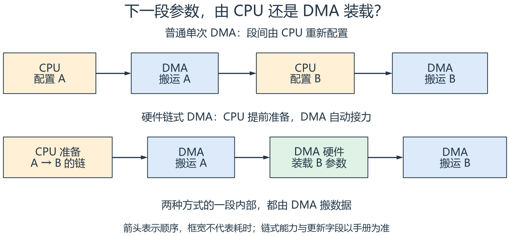
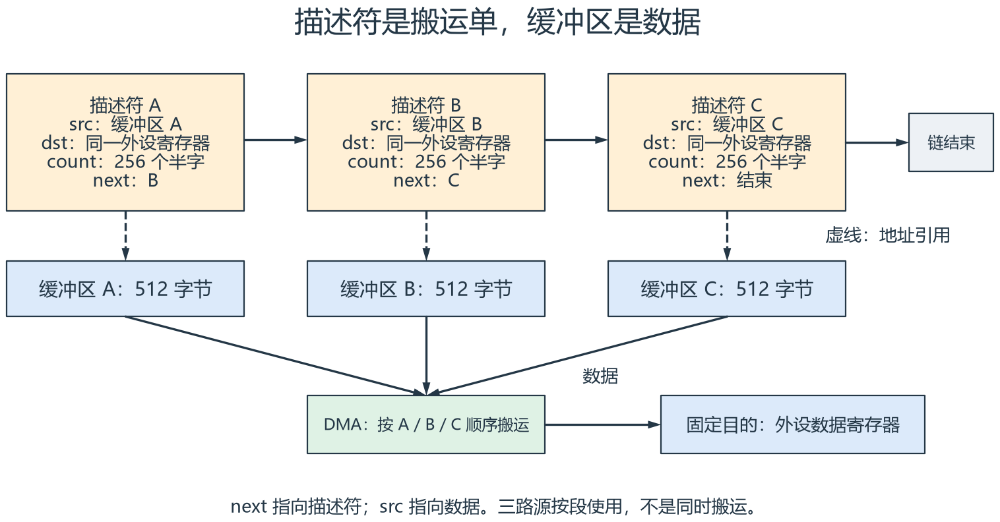
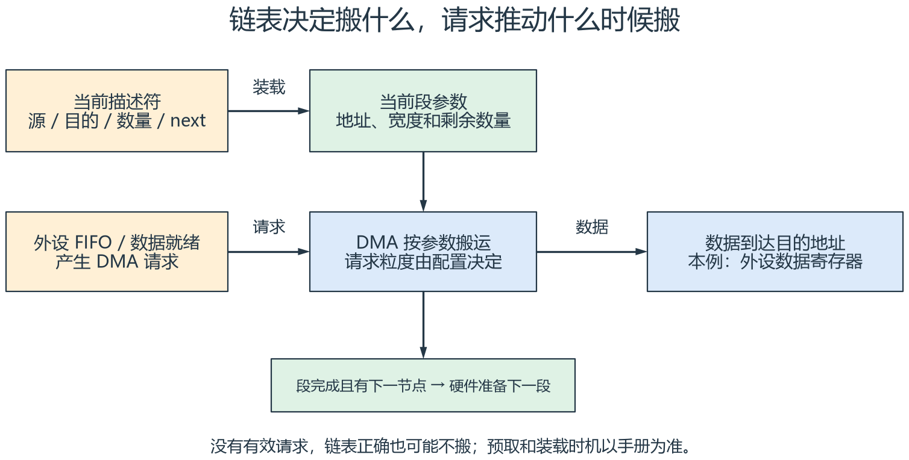
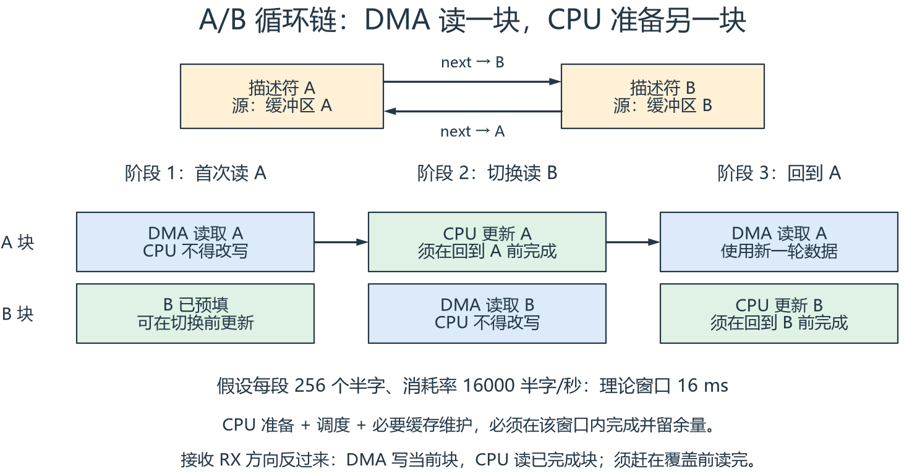

# DMA 链式传输图解：从一次搬运到自动接力

[返回 ADC/DMA 笔记](14_ADC_DMA.md) ·
[串口 DMA 应用](<../架构驱动应用/串口+DMA/串口_DMA.md>) ·
[STM32 ADC/DMA 基础](<../单片机基础/2-1-4-2_STM32基础 - AD转换与DMA_笔记.md>)

**DMA 链式传输，就是提前把多段搬运任务连起来，让支持该功能的 DMA
硬件在完成一段后，自动取得下一段的参数。**

把 CPU 想成写搬运单的人，把 DMA 想成搬运工：普通单次 DMA 做完一单后，
通常等 CPU 重新安排；硬件链式 DMA 可以沿着搬运单中的地址继续找下一单。

> 阅读边界：本文讲通用机制，不是某款 MCU 的寄存器配置教程。
> 实际是否支持链表、哪些字段能逐段更新、如何结束、何时中断，
> 必须核对具体 DMA 控制器手册。不能把所有 STM32 或 HC32 DMA 都视为相同。

建议按“谁装载下一段 → 描述符里有什么 → 请求怎样触发 → 缓冲区怎样交接”阅读。

## 一、普通 DMA 与链式 DMA，差别在哪里



[放大查看 SVG](dma-chain-assets/single-vs-chain.svg)

**读图：** 上排在 A 段结束后，需要 CPU 配置 B；下排由 CPU 提前准备链，
DMA 硬件装载 B。箭头表示执行顺序，框宽不代表耗时。

比较的前提是“需要改变搬运参数的多段任务”。普通单次 DMA 在一段搬运期间，
同样不需要 CPU 逐个数据搬运；链式传输进一步减少的是**段与段之间的配置工作**。

| 问题 | 普通单次 DMA | 硬件链式 DMA |
| --- | --- | --- |
| 一段内谁搬数据 | DMA | DMA |
| 下一段参数从哪里来 | 通常由 CPU 重新配置 | DMA 读取下一描述符 |
| 缓冲区必须连续吗 | 一次任务按当前地址规则访问 | 各段可以位于不同地址 |
| 每段都要中断吗 | 由中断配置决定 | 由硬件能力及节点配置决定 |
| 能保证连续输出吗 | 需核对配置间隔和外设状态 | 仍需核对带宽、装载开销和 FIFO |

链式传输经常用于散布在不同地址的数据块，也称为 scatter-gather，
即分散／聚集传输。实际可组合的方向和地址模式由控制器决定。

## 二、描述符是搬运单，数据缓冲区是货物



[放大查看 SVG](dma-chain-assets/descriptor-and-data.svg)

**读图：** 顶部横向箭头连接描述符；虚线表示源地址指向缓冲区；
底部实线表示实际数据经过 DMA 搬到固定的外设寄存器。
图中的三个源路径按 A、B、C 顺序使用，不表示三路同时搬运。

一张描述符通常描述以下内容，具体字段布局并不统一：

| 概念字段 | 含义 | 本例取值 |
| --- | --- | --- |
| `src` | 源地址 | 缓冲区 A、B 或 C |
| `dst` | 目的地址 | 同一个外设数据寄存器 |
| `count` | 本段传输数量 | 256 个半字 |
| `control` | 宽度、增量等控制参数 | 16 位、源递增、目的固定 |
| `next` | 下一描述符的地址或链信息 | B、C 或链结束标记 |

**`next` 指向下一张搬运单，不是下一段数据的首地址。**
描述符 B 内的 `src` 才说明 B 段数据放在哪里。

本例中，一个半字为 16 位，即 2 字节：

```text
每段大小 = 256 个半字 × 2 字节 = 512 字节
三段总量 = 3 × 512 字节 = 1536 字节
```

源地址按照半字宽度递增，外设寄存器地址保持固定。
实际计数寄存器可能以字节、传输单元、块或其他方式编码，不能直接照抄 256。

描述符也可能位于 DMA 可访问的其他存储区，不一定只能放在 RAM。
要分别确认描述符访问路径、数据访问路径、对齐和存储区权限。
“CPU 能读写这段地址”并不自动等于“DMA 能访问”。

## 三、一次完整传输怎样接力

以 A → B → C → 结束为例：

1. CPU 准备三段数据，填写描述符和链接关系。
2. 配置 DMA 通道、请求映射及必要的中断，按芯片要求装载第一段并启动。
3. DMA 按当前段规则响应请求，把 A 的数据搬到目的地址。
4. A 段达到规定数量，DMA 根据链信息取得并装载 B 的参数。
5. B、C 依次执行；最后按控制器规定的结束方式停止或完成本次链。
6. CPU 根据完成或错误事件回收缓冲区，向上层发布结果。

有的控制器从通道寄存器启动第一段，有的直接从描述符启动；
部分硬件会提前预取后续描述符。上面的步骤是逻辑顺序，不代表所有芯片的总线时序。
结束标记也不一定是空指针，可能还涉及链接使能位或其他控制字段。

## 四、链表准备好了，为什么 DMA 仍然不动



[放大查看 SVG](dma-chain-assets/request-and-transfer.svg)

**读图：** 上排决定搬运参数，下排的请求推动实际搬运。
当前段完成后，若还有合法节点，硬件准备下一段；后续执行仍遵循触发配置。
实际描述符预取或装载时机以手册为准。

这里有两个独立问题：

- **描述符：** 从哪里搬、搬到哪里、搬多少、下一段是谁？
- **请求：** 什么时候允许 DMA 执行一次或一批搬运？

例如向 I2S 的发送 FIFO 写数据，通常由外设的 FIFO 状态产生 DMA 请求。
链表负责段间接力，外设请求负责按消耗速度推动搬运。
如果请求源没有配置好，链表即使完全正确，也可能一段都不执行。

一次请求对应一个单元、一个 burst 还是一个 block，由 DMA 和请求配置决定。
所以“一次软件触发搬了一点数据”，只能证明那次触发确实产生了搬运，
不能证明外设请求会持续产生，也不能证明整条链已经跑通。

另外，DMA 循环并不会自动触发 ADC 转换。
定时器触发 ADC、ADC 产生结果、DMA 请求、缓冲区循环，是需要分别配置的环节。

## 五、链式、循环、双缓冲，不是同一个维度

| 机制 | 回答的问题 | 典型行为 |
| --- | --- | --- |
| 单次 DMA | 本次按什么参数搬一段 | 数量达到后完成 |
| 循环 DMA | 同一缓冲区怎样重复使用 | 到尾部后重新装载并回到起点 |
| 链式 DMA | 下一段参数从哪里来 | 硬件沿描述符切换任务 |
| 循环描述符链 | 链走到最后怎么办 | 最后一个节点重新指向前面 |
| A/B 双缓冲 | CPU 与 DMA 怎样轮流使用数据区 | 一个正在搬，另一个供 CPU 处理 |
| 软件队列接力 | 多段任务由谁衔接 | CPU 在回调或任务里重新配置 DMA |

硬件链表可以构成循环链；双缓冲可以通过循环半区、硬件双缓冲、
描述符链或软件切换实现。采用哪种办法，要看具体硬件能力和实时性要求。

**看到 A/B 缓冲区，不代表看到了硬件链表；看到回调里重启 DMA，也不能据此认定链式 DMA。**

## 六、A/B 循环链怎样配合 CPU



[放大查看 SVG](dma-chain-assets/double-buffer-ownership.svg)

**读图：** 这是发送 TX 示例。DMA 读取蓝色块时，CPU 不得改写同一数据块；
绿色块是交给 CPU 准备的缓冲区。三列是先后阶段，宽度不代表实测时间。

假设链关系固定为 A → B → A，CPU 在启动前已经把 A、B 都准备好：

以下交接以硬件不会提前读取待更新块的数据，或已经由驱动确认该块可访问为前提。

1. DMA 读 A 期间，B 可以保留已有数据，或由 CPU 在下一段开始前完成更新。
2. 确认 A 段数据已被 DMA 取走后，DMA 转去读 B，CPU 才可以更新 A。
3. CPU 必须在 DMA 下一次回到 A 之前完成填写并发布数据。
4. B 段结束后，双方交换角色，持续轮转。

这不是天然带锁的共享内存。完成事件只是交接依据之一，仍需确认
DMA 是否还有数据预读、事件对应哪一段，以及 CPU 何时真正拿到处理时间。

### 用一个明确假设估算准备窗口

假设 DMA 实际以每秒 16000 个半字消耗数据，每段 256 个半字，
忽略切换开销且速率恒定：

```text
每段时间 = 256 / 16000 秒 = 16 ms
```

DMA 读 B 的这 16 ms，是 CPU 更新 A 的理论窗口。
要计入中断响应、任务调度、数据生成以及必要的缓存维护，并留出余量。
若 CPU 需要 20 ms，两个缓冲区就不够，链表本身不能解决生产速度不足。
本例不是对实际 I2S 采样率、声道数或时隙宽度的推断。

### 接收方向要反过来看

对于 ADC／UART 接收，是 DMA **写入**缓冲区，CPU **读取**已完成块。
CPU 必须在 DMA 再次覆盖该块之前读完或复制走。
队列只传一个指针，不会自动复制数据，也不会阻止 DMA 覆盖它。

如果来不及，应按业务要求选择暂停、背压、丢弃旧块或报告溢出；
不是所有外设都支持暂停或背压，处理策略必须明确。

## 七、回到现有笔记，怎样判断用了哪种机制

### 1. ADC/DMA 笔记

原笔记中的 DMA 配置、转换完成回调、队列通知，说明了数据搬运和软件交接。
是否循环、是否每段重新启动，要结合 DMA 初始化和启动代码判断；
仅有完成回调不足以证明使用了硬件链表。

阅读 ADC 链路时，沿着下面的方向检查：

```text
转换触发 → ADC 完成采样 → DMA 请求 → 写入当前数据块
→ 块完成事件 → 采集任务处理 → 发布带时间戳和有效性的结果
```

### 2. 串口 DMA 笔记

你现有的 `HAL_UARTEx_RxEventCallback()` 示例中，回调再次调用了
`HAL_UARTEx_ReceiveToIdle_DMA()`。这里能够直接看到的是**软件重新提交接收**，
并没有展示 DMA 硬件读取下一描述符。

还要结合具体 HAL 版本、DMA 模式和事件类型，确认是否需要重启、
`Size` 代表什么位置，以及重启间隔是否可能漏收。本文不修改原示例代码。

UART 的 IDLE、DMA 半传输／全传输和协议帧边界也不是同一件事。
一次交付可能是半帧、多帧或混合片段，协议解析仍由上层负责。

## 八、按 cfg / ctx / data / ops 看模块边界

| 类别 | 在链式 DMA 中的对应内容 | 所有权 |
| --- | --- | --- |
| `cfg` | 通道、请求源、宽度、方向、对齐和数量上限 | 由驱动配置或受控接口管理 |
| `ctx` | 当前节点、忙闲状态、错误、待回收块及内部描述符 | DMA 驱动维护 |
| `data` | 待发送块、已接收块及长度、时间戳、有效性 | 按明确的交接规则访问 |
| `ops` | 提交、启动、停止、查询结果、回收和恢复 | 上层通过接口请求 |

描述符是传输控制信息；固定参数属于配置，动态任务和链接管理属于运行上下文。
它不是业务数据快照。上层应提交数据块和意图，避免绕过驱动直接修改运行中的节点。

## 九、实际使用前需要检查什么

| 检查点 | 为什么要检查 |
| --- | --- |
| 地址、长度、宽度和对齐 | 避免越界、错位或不支持的访问 |
| 描述符与数据的生命周期 | 函数返回后的局部对象可能已经失效 |
| 请求映射和启动顺序 | 配置正确的链也可能没有有效触发 |
| 节点更新与预取规则 | 硬件可能已取得你准备修改的下一节点 |
| 缓存与内存顺序 | 有数据缓存或缓冲写入时，CPU 与 DMA 可能看到不同内容 |
| 错误、停止和恢复路径 | 出错后不能继续把未完成数据当有效结果 |
| 缓冲区交接和处理时限 | 运行正常也可能发生覆盖、旧数据重发或发送欠载 |

有数据缓存的系统，应按平台规则执行必要的 clean／invalidate、屏障和所有权交接。
具体操作顺序要匹配方向和内存属性，不能用 `volatile` 代替缓存一致性措施。
没有数据缓存的 MCU 也仍需考虑生命周期、并发访问及硬件要求的内存顺序。

发现传输错误时，应记录错误位置和已完成范围，按手册停止请求／通道并确认静止，
再回收或重建任务；接收结果标记无效，发送失败向上层报告。
不能让软件认为缓冲区已经归还，而 DMA 实际上仍在访问。

## 十、三个容易误判的“完成”

1. **DMA 段完成：** 本段数据已经完成规定的 DMA 搬运。
2. **链完成：** 所有节点按结束条件执行完毕，且没有需要处理的错误。
3. **外设输出完成：** 数据已经从 FIFO、移位寄存器或接口输出。

例如 UART 发送时，最后一个字节写进发送寄存器，
不等于最后一个停止位已经从引脚发出。原始 DMA 完成事件与 HAL 上层回调
也可能具有不同语义，必须追踪驱动实现。
I2S 数据搬完，也不能据此证明 DAC、功放和扬声器已经正常输出声音。

## 十一、自测：先想一想，再展开

<details>
<summary>描述符 A 的 next 指向缓冲区 B，对吗？</summary>

通常不对。`next` 指向描述符 B；描述符 B 的源或目的地址再指向缓冲区 B。
具体字段编码以控制器手册为准。

</details>

<details>
<summary>A → B → A 已经连成环，为什么还可能没有数据？</summary>

还需要检查通道使能、请求源、外设请求使能、有效地址、计数和错误状态。
链表只解决任务衔接，不自动保证请求产生。

</details>

<details>
<summary>DMA 读 B 时，CPU 更新 A，为什么仍可能播放旧数据？</summary>

CPU 可能没有在下一次读 A 前完成更新，或存在交接、缓存、可见性问题。
硬件链表按链接继续执行，并不天然知道这段业务数据是否已经准备好。

</details>

## 图源、阅读入口与验证边界

- [四页可编辑 draw.io 图源](dma-chain-assets/dma-chain-explained.drawio)。
- [配图生成脚本](dma-chain-assets/generate_diagrams.py)。
- 同目录保留各图 JSON、SVG 和 PNG；JSON 可供 diagramry 重绘。

图和正文采用同一套标注。没有 draw.io Desktop 时，可用图源在 draw.io 中编辑，
预览图由 diagramry 根据相同布局生成，不依赖截图。
修改 draw.io 后，应同步重导出图片；修改生成脚本后，应重新生成并检查图文。

本文验收范围是 Markdown 链接、图片显示、图源结构和概念一致性。
未编译 DMA 驱动，未下载固件，也未进行吞吐、FIFO、总线或引脚实测。
应用到具体 MCU 前，应对照参考手册的 DMA 章节、请求映射表和勘误，
再用完成／错误记录及实际外设数据验证。
