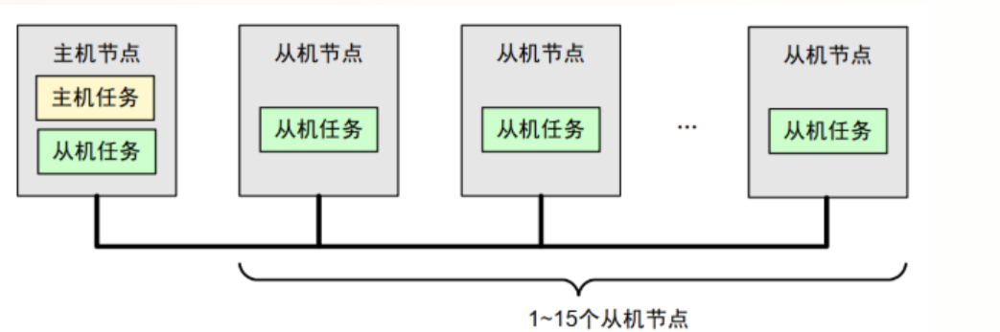
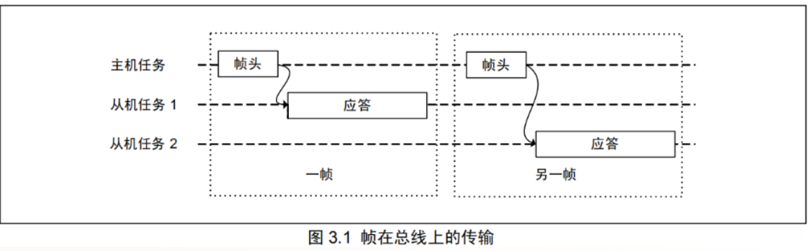
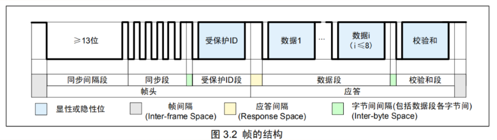
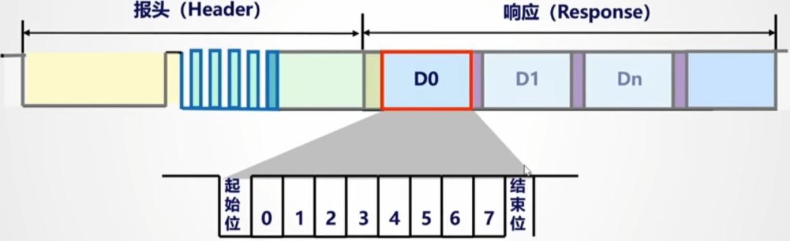
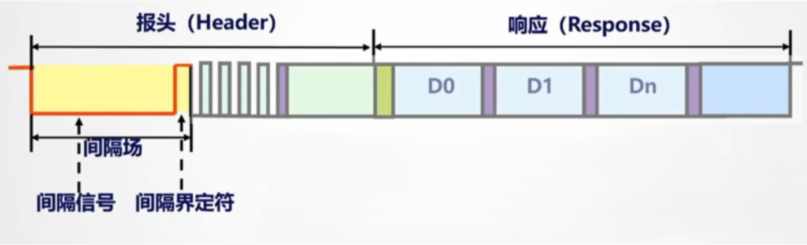
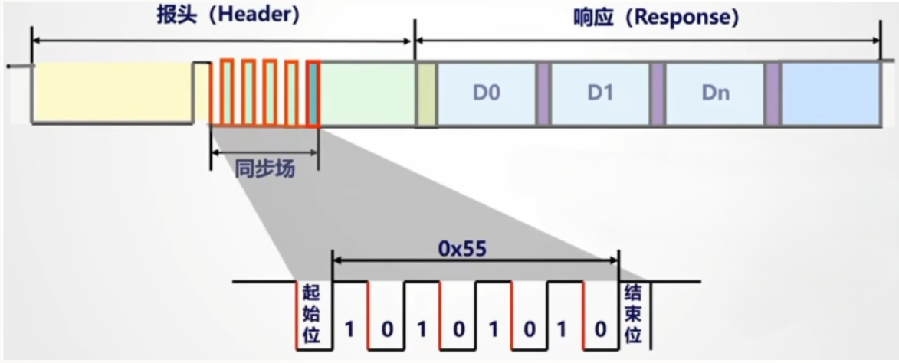

## LIN 总线
LIN 是 Local Interconnect Network 的缩写，是基于 UART/SCI(Universal Asynchronous Receiver-Transmitter / Serial Communication Interface，通用异步收发器/串行通信接口)的低成本串行通信协议。可用于汽车、家电、办公设备等多种领域

### 定义
Lin是针对汽车电子系统而定义的一种低成本串行通信协议。是为了作为子网络使用的，一般可以认为是Can线的补充，实际应用上可以针对ECU的不同特性来选择使用Can或者LIN

### 特点

1. 主从架构：LIN协议是主从架构的，主从设备之间通过LIN协议进行通信，主设备作为总线控制器，从设备作为数据传输设备
2. 延迟时间短：LIN协议延迟时间短，通常为1ms左右，适合于实时性要求高的应用场景，传播时间可以提前计算出
3. 最高速率：LIN协议最高速率为1Mbps，可以支持高带宽的数据传输，但是为了EMC(Electromagnetic Compatibility)电磁兼容性，为了限制EMI(Electromagnetic Interference)，LIN协议一般使用 Manchester 编码，因此传输速度会下降,规定的最大位s率是20Kbps
4. 支持诊断

### Lin 协议结构

Lin是单总线的拓扑结构，总线的电平为12V，最高传输速率是20kbps，一个Lin网络节点最多连接16个从设备，从设备最多连接1个主设备

类似于IIC总线一样，主机任务可以发送帧头和数据，但是**从机不能够主动发送数据**，只能通过主机的请求来获取数据：(1). 发送应答帧(2). 发送数据帧 (3)忽略应答

Lin采用Usart 打传输方式，一共10位，一位起始位，一位停止位，8位数据位，按照LSB First 顺序传输

- 帧头：同步间隔段，同步端，受保护的ID段，应答部分包含数据段，校验和段，其中0是显性电平，1是隐性电平，支持线于特性，当总线上有一个设备发送1的时候，总线呈显性电平；所有的节点都发送隐形电平或不发送信息时，总线才呈隐形电平，即显性电平起主导作用

#### 字节段

基于SCI的通信格式，发送一个字节需要10个位的时间，先发一个显性位（低电平），八个位发完后再跟一个高电平的隐性位表示字节发送结束

#### 同步间隔段

间隔段由主节点发出，表示一帧报文的起始，由至少13个显性位组成，间隔界定符至少由1个隐性位组成

#### 同步段

同步场的作用是确保所有从节点使用与主节点以相同的波特率进行发送和接收数据，使用下降沿来进行数据同步，从数据表示来看表示的字节数据是0x55