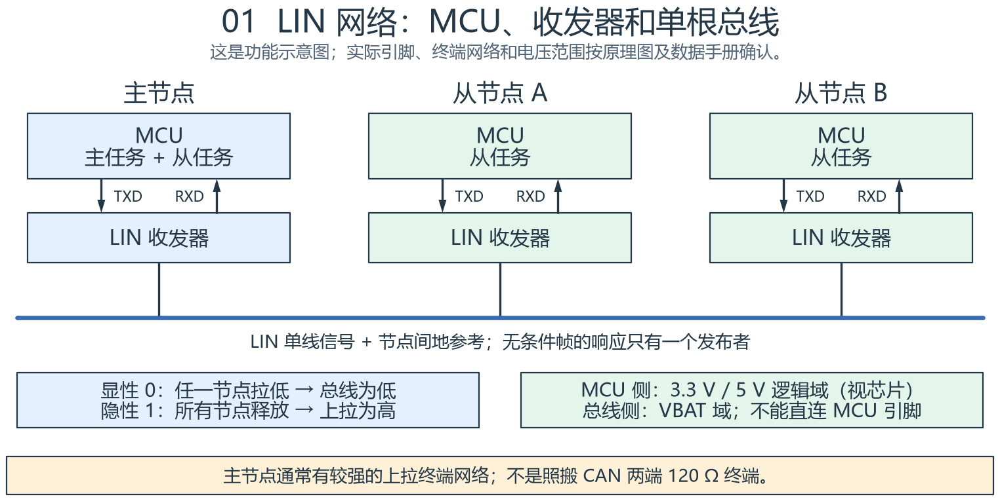
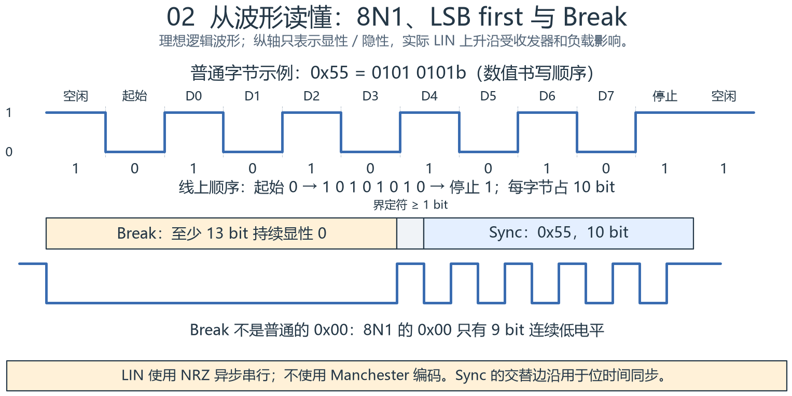
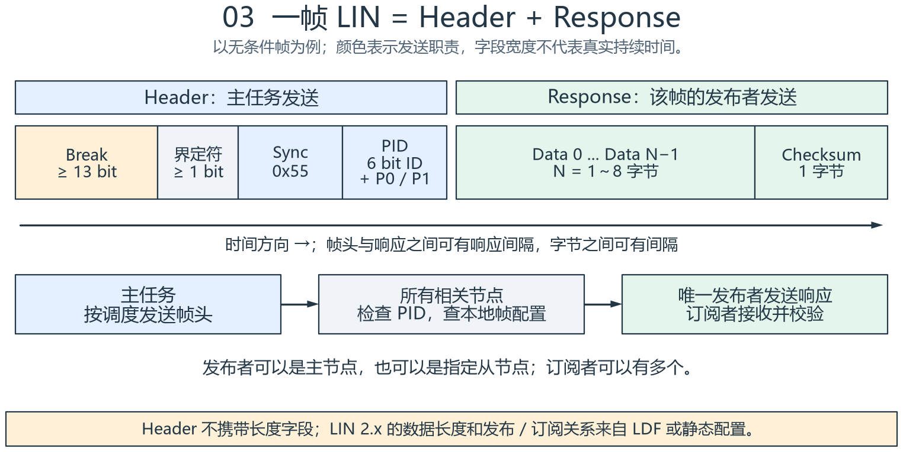
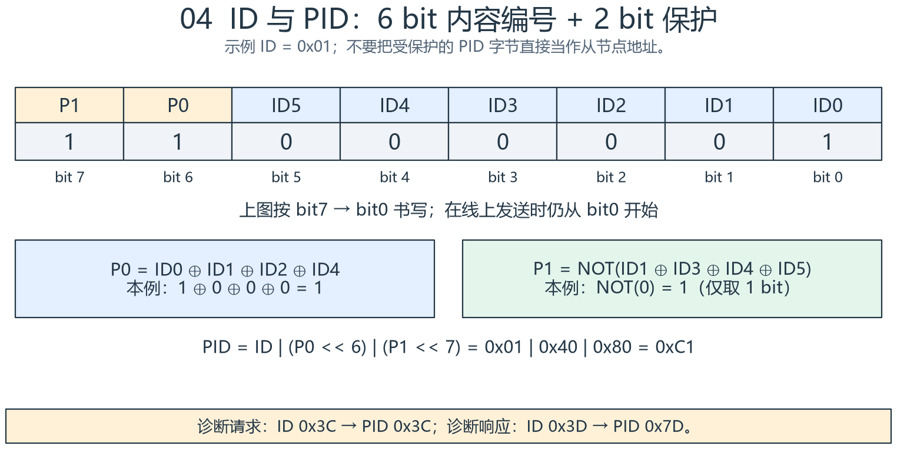
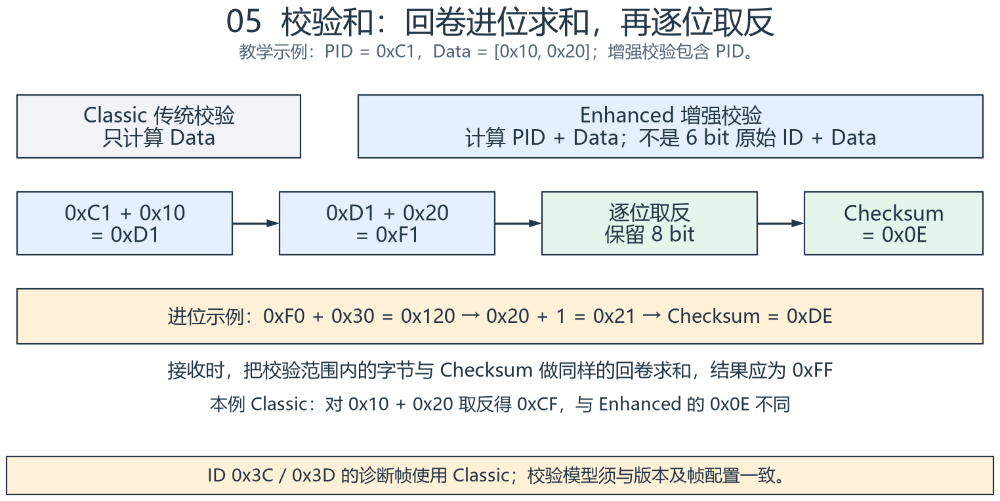
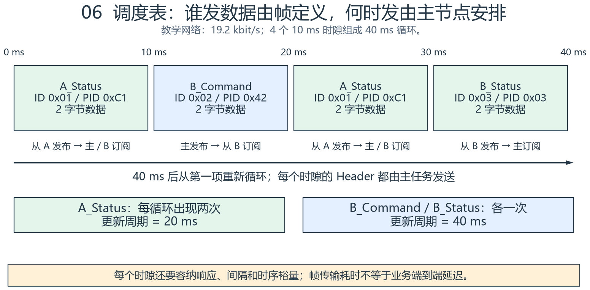
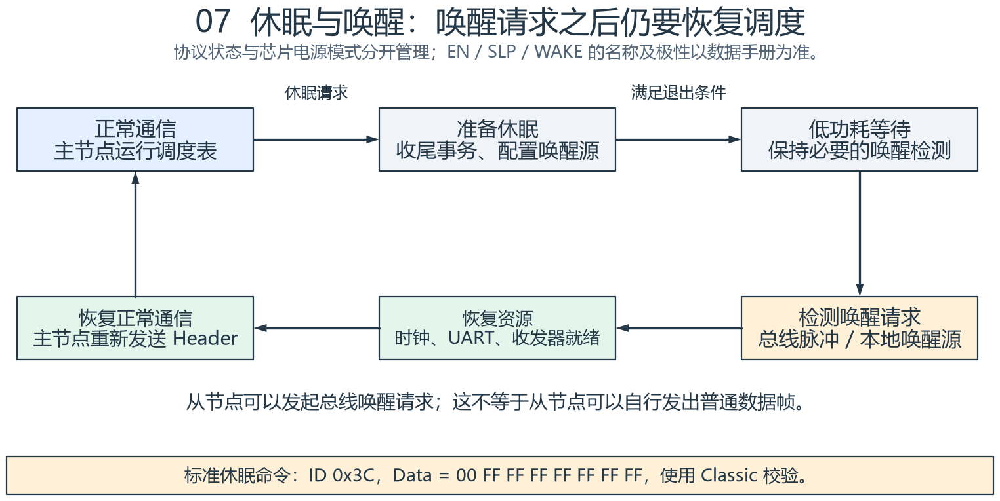
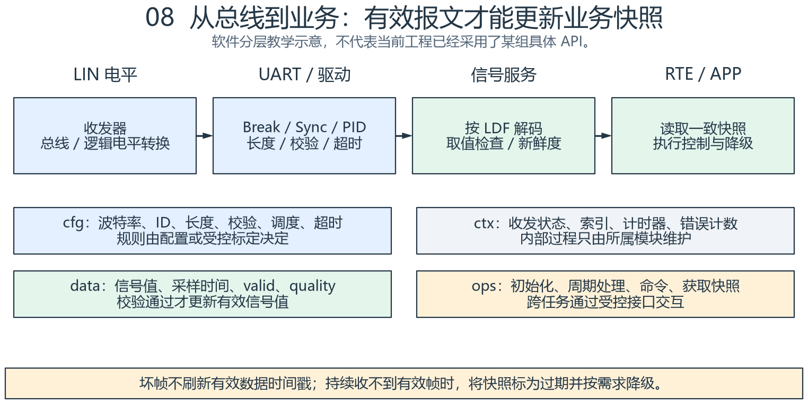

# LIN 总线协议：从接线、波形到调度与软件

LIN（Local Interconnect Network，本地互连网络）是一种低成本的
单主多从串行通信网络。**主节点按调度表发送帧头，指定发布者发送数据，
订阅者校验后使用数据**，这是理解 LIN 的主线。

它常用于车窗、后视镜、座椅、空调执行器、开关和传感器等局部网络，
也常由网关连接到 CAN。LIN 可以独立组成网络，不要求必须搭配 CAN。

> 本文以 LIN 2.x / LIN 2.2A 为主要依据；所有节点名、ID、信号、周期
> 和抓包数据均为教学示例，不代表具体车型协议或硬件接线。

阅读顺序：

1. 先看接线与电平，区分 UART 逻辑侧和 LIN 总线侧。
2. 再看字节与完整帧，弄清 Header 和 Response 分别由谁发送。
3. 手算 PID 和 Checksum，再读调度表与 LDF。
4. 最后结合休眠、软件分层和抓包步骤定位问题。

全部 8 张图提供 [可编辑 draw.io 源文件](lin-assets/lin-bus-explained.drawio)，
每张图也有同名 SVG 和 JSON，见 [配图说明](lin-assets/README.md)。

## 1. 先记住这些基本参数

| 项目 | 正确理解 |
| --- | --- |
| 网络角色 | 一个主节点，多个从节点；普通通信由主任务发起 |
| 节点数量 | LIN 2.2A §6.5.5 建议一个网络总节点数不超过 16，即通常 1 主 + 最多 15 从；还受物理负载约束 |
| 信号线 | 一根 LIN 信号线，还需要节点间地参考及各自供电 |
| 典型物理电平 | 车载 VBAT 域；常见 12 V 系统，但不是固定精确的 12 V 逻辑输出 |
| 标准最高位速率 | 20 kbit/s；19.2 kbit/s 是常见配置之一 |
| 字节编码 | NRZ 异步串行，8 个数据位、无 UART 奇偶校验、1 个停止位，即 8N1 |
| 位顺序 | 每个字节先发最低位，LSB first |
| 数据段长度 | LIN 2.x 每帧 1～8 字节；诊断帧固定 8 字节 |
| 检错 | PID 的两个保护位 + 传统 / 增强 Checksum；不使用 CAN 的 CRC 机制 |
| 通信时机 | 由调度表决定，延迟取决于周期、帧长、位速率与应用处理 |
| 诊断 | 支持诊断与节点配置；诊断帧的 ID 不等于节点诊断地址 NAD |

LIN 的优势是成本低、布线简单、可预先安排通信时间。
它的带宽有限，适合低速局部控制；不能仅凭“支持调度”就认定满足任意实时性要求。

**几处容易记错的地方：**最高速率不是 1 Mbps；编码不是 Manchester；
不存在固定“约 1 ms 延迟”；显性是逻辑 0，而不是逻辑 1。

## 2. 硬件连接：UART 不等于 LIN 总线



**如何读图：**每个 MCU 先通过 TXD / RXD 连接本节点的 LIN 收发器，
所有收发器的 LIN 端再接到同一根总线上。图中的箭头分别表示 MCU 发送
和接收的方向，不代表额外的两根车外通信线。

- MCU 的 TX 输出串行逻辑，经收发器 TXD 转成总线显性 / 隐性电平。
- 收发器监听 LIN，将接收结果从 RXD 送给 MCU 的 RX 输入。
- MCU 逻辑侧电压按芯片确定，可能是 3.3 V 或 5 V；LIN 侧属于 VBAT 域。
- 主节点通常具有电阻、二极管组成的较强上拉终端网络；从节点通常有较弱上拉。
  具体取值、是否集成、滤波与保护元件均以收发器手册和原理图为准。

因此，普通 USB-UART 的 TX / RX 不能直接连接车辆 LIN 线。
抓 LIN 应使用适配的 LIN 接口，或在收发器的逻辑侧用合适仪器观察。
LIN 也不采用 CAN 那种两端各一个 120 Ω 电阻的终端方式。

### 2.1 显性、隐性与“线与”

| 总线状态 | 逻辑值 | 直观含义 |
| --- | --- | --- |
| Dominant，显性 | 0 | 有节点将总线拉低 |
| Recessive，隐性 | 1 | 所有节点释放，总线由上拉回到高电平 |

只要有一个节点拉低，总线就是显性；所有节点都释放，总线才是隐性。
这就是“显性优先”，从逻辑角度可理解为线与。

空闲时通常为隐性高电平。实际接收阈值、波形斜率和允许电压范围应查
收发器数据手册，不能把理想图当成精确电压或边沿要求。

## 3. 字节、Break 与 Sync：从波形入门



**如何读图：**上半部分是普通字节 `0x55`；下半部分先是一段明显更长
的低电平 Break，再出现界定符和 `0x55`。上下两行分别用于观察字节格式
和帧起始，横向比例只用于教学。

### 3.1 普通字节：1 + 8 + 1 = 10 bit

除了 Break，每个字节都按以下格式发送：

```text
空闲 1 → 起始位 0 → D0 D1 D2 D3 D4 D5 D6 D7 → 停止位 1
                    8 个数据位，低位先发
```

`8N1` 中的 `N` 表示 UART 没有额外的奇偶校验位。
PID 内部的 P0 / P1 是它的 8 个数据位的一部分，不能把 UART 配成带校验
来代替 PID 的保护位。

以 `0x55 = 0101 0101b` 为例，数值通常按高位在左书写，但线上 D0 先发，
因此数据位的时间顺序是 `1 0 1 0 1 0 1 0`。

### 3.2 Break：告诉所有节点“新帧开始了”

Break 由主任务发送：

- 显性低电平持续至少 **13 个标称位时间**。
- 随后是隐性高电平的 Break delimiter，至少 **1 个标称位时间**。
- 它是特殊段，不遵循普通的 8N1 字节格式。

普通 `0x00` 只有起始位和 8 个数据位连续为低，共 9 bit，
随后停止位回到高电平，不能直接等同于合格的 LIN Break。
MCU 是否能自动生成或检测 LIN Break，要看具体 UART / LIN 外设能力。

### 3.3 Sync：固定为 0x55

Sync 的交替边沿为从节点测量主节点位时间、进行同步提供依据。
是否自动调整、怎样测量和允许多大误差，取决于外设及协议栈实现。
有同步机制也不代表可以忽略时钟精度和容差要求。

在 `19.2 kbit/s` 下：

```text
1 bit 时间        = 1 / 19200 ≈ 52.083 μs
普通 8N1 字节     = 10 bit    ≈ 520.833 μs
最短 Break 低电平 = 13 bit    ≈ 677.083 μs
最短界定符        = 1 bit     ≈ 52.083 μs
```

## 4. 完整帧：谁发帧头，谁发数据



**如何读图：**沿时间方向从左往右看。左侧 Header 始终由主任务发送；
右侧 Response 由该帧配置的发布者发送，发布者可以位于主节点或某个从节点。
响应间隔属于响应时序的一部分，图中用 Header 与数据之间的空隙示意。

| 部分 | 字段 | 内容 / 作用 | 发送者 |
| --- | --- | --- | --- |
| Header | Break + delimiter | 标志新帧开始 | 主任务 |
| Header | Sync | 固定 0x55，用于同步 | 主任务 |
| Header | PID | 6 bit 帧 ID + P0 / P1 | 主任务 |
| Response | Data | 普通帧 1～8 字节 | 该帧唯一发布者 |
| Response | Checksum | 检查数据，增强模式还覆盖 PID | 同一个发布者 |

主节点包含“主任务”和“从任务”；从节点只有“从任务”。
这里的任务是协议角色，**不要求一定映射成两个 FreeRTOS 任务**。
主任务负责调度和帧头；从任务负责根据帧配置发布或订阅响应。

因此可以出现三种常见关系：

1. 主节点发 Header，从 A 发 Response，主节点订阅。
2. 主节点既发 Header 又发 Response，从 A / B 订阅。
3. 主节点发 Header，从 A 发 Response，从 B 订阅。

从节点不能自行发起普通帧头，但可以在主节点安排的时机向其他节点发布数据。
从节点发起休眠网络唤醒属于另一种机制，见第 9 节。

### 4.1 ID 是帧标识，不是简单的设备地址

例如 `A_Status` 的 ID 是 `0x01`，表示“这一类状态数据”。
谁发布、谁订阅、长几个字节，由网络配置约定。一个从节点可以发布多种 ID，
一种帧也可以有多个订阅者。

LIN 2.x 的 Header 不发送数据长度字段，接收方必须事先知道该 ID 的长度。
不能只看到 PID，就用统一公式从 ID 推出 LIN 2.x 帧长。
一些旧版资料按 ID 区间说明 2 / 4 / 8 字节的规则，不应套用到 LIN 2.x 配置。

### 4.2 没有独立的 ACK 字段

Response 是这帧的数据和校验和，不是额外的 ACK。
如果业务要求确认“命令已执行”，应定义执行状态反馈和超时机制。
发送 API 返回成功，只能证明相应软件层完成了它定义的操作，
不能直接证明从节点收到、执行成功或物理执行器已经动作。

## 5. PID：把 6 bit 的 ID 保护起来



**如何读图：**上面按数值习惯排列 bit7 到 bit0，左侧两位是保护位，
右侧六位是帧 ID；实际串行发送仍从 bit0 开始。

```text
P0  = ID0 ⊕ ID1 ⊕ ID2 ⊕ ID4
P1  = NOT(ID1 ⊕ ID3 ⊕ ID4 ⊕ ID5)，结果仅保留 1 bit
PID = ID | (P0 << 6) | (P1 << 7)
```

`⊕` 是异或；`|` 是按位或。接收方先检查保护位，再从 `PID & 0x3F`
得到 6 bit 的 ID。仅掩码取 ID 而不检查 P0 / P1，会丢失这层检错能力。

| ID | P0 | P1 | 线上 PID | 示例用途 |
| --- | --- | --- | --- | --- |
| 0x01 | 1 | 1 | 0xC1 | A_Status |
| 0x02 | 1 | 0 | 0x42 | B_Command |
| 0x03 | 0 | 0 | 0x03 | B_Status |
| 0x3C | 0 | 0 | 0x3C | 主节点诊断请求 |
| 0x3D | 1 | 0 | 0x7D | 从节点诊断响应 |

帧 ID 的用途分区：

- `0x00～0x3B`：信号携带帧。
- `0x3C / 0x3D`：诊断及配置。
- `0x3E / 0x3F`：保留。

分析仪有的显示原始 ID，有的显示完整 PID。
因此日志中的 `0x3D` 和 `0x7D` 可能对应同一种诊断响应帧，先看工具字段定义。

## 6. Checksum：传统与增强校验如何计算



**如何读图：**中间一行是增强校验的逐步计算；黄色框专门说明发生进位
时怎样处理。核心是“**回卷进位求和，然后对最终的 8 bit 取反**”。

| 校验模型 | 参与求和的字节 | 典型适用情况 |
| --- | --- | --- |
| Classic，传统 / 标准校验 | 所有 Data | LIN 1.x 兼容通信，以及 ID 0x3C / 0x3D 的诊断帧 |
| Enhanced，增强校验 | 完整 PID + 所有 Data | 按配置使用增强校验的 LIN 2.x 信号帧 |

模型按帧配置，不能只看到“LIN 2.x”就对诊断帧也使用增强校验。
增强校验加入的是包含保护位的 **PID**，不是只有 6 bit 的 ID，
也不包含 Break 或 Sync。

### 6.1 回卷进位不等于直接丢掉高位

每次相加，如果和大于 `0xFF`，就减去 `0xFF`，等价于把溢出的进位加回低位。

```text
0xF0 + 0x30 = 0x120
回卷进位：    0x20 + 1 = 0x21
最终取反：    ~0x21 & 0xFF = 0xDE
```

如果直接做 `sum & 0xFF`，会得到 `0x20`，进而算出错误的 `0xDF`。

### 6.2 同一组数据，两种校验结果不同

假设 `ID = 0x01`，因此 `PID = 0xC1`，数据是 `10 20`：

```text
Classic：
  0x10 + 0x20 = 0x30
  Checksum = ~0x30 & 0xFF = 0xCF

Enhanced：
  0xC1 + 0x10 + 0x20 = 0xF1
  Checksum = ~0xF1 & 0xFF = 0x0E
```

接收时，可以重新计算后比较，也可以把接收到的 Checksum 加入同样的
回卷求和，正确结果应为 `0xFF`。例如 `0xF1 + 0x0E = 0xFF`。
校验和只能帮助检错，不代表数据来源经过认证，也不证明业务值一定合理。

## 7. 调度表：为什么 LIN 的时序可以提前规划



**如何读图：**每个格子是一个 10 ms 时隙，四个时隙构成 40 ms 循环。
每个时隙开始都由主任务发送相应 Header，绿色表示从节点发布的数据，
蓝色表示主节点发布的数据。

| 循环内时刻 | 帧名 | ID / PID | 数据长度 | Response 发布者 | 订阅者 |
| --- | --- | --- | --- | --- | --- |
| 0 ms | A_Status | 0x01 / 0xC1 | 2 字节 | 从 A | 主节点、从 B |
| 10 ms | B_Command | 0x02 / 0x42 | 2 字节 | 主节点 | 从 B |
| 20 ms | A_Status | 0x01 / 0xC1 | 2 字节 | 从 A | 主节点、从 B |
| 30 ms | B_Status | 0x03 / 0x03 | 2 字节 | 从 B | 主节点 |

因此 `A_Status` 的周期是 20 ms，另外两帧的周期是 40 ms。
“主任务每 10 ms 启动一个时隙”不等于“所有帧都是 10 ms 周期”。

### 7.1 先计算一帧占多久

按最短 Break、最短界定符、无额外间隔计算，设数据长度为 `N`，波特率为 `B`：

```text
Header 位数       = 13 + 1 + 10 + 10 = 34 bit
Response 位数     = 10 × (N + 1)     = 数据 + 1 字节校验和
T_frame_nominal   = [34 + 10 × (N + 1)] / B
```

| 数据长度 | 标称总位数 | 19.2 kbit/s 标称帧时间 | 1.4 倍标称时间 |
| --- | --- | --- | --- |
| 1 字节 | 54 bit | 2.813 ms | 3.938 ms |
| 2 字节 | 64 bit | 3.333 ms | 4.667 ms |
| 8 字节 | 124 bit | 6.458 ms | 9.042 ms |

LIN 2.2A §2.3.2 分别给 Header 和 Response 定义了标称时间的 1.4 倍上限，
用于容纳允许的时序开销。时隙还需要满足主任务的抖动、时间基准等要求；
不能把标称帧时间直接当作可用时隙长度。
本例选择 10 ms 时隙只是教学配置，不是所有网络都必须如此。

这个上限也不是让接收节点在 `1.4 × T_nominal` 时就一律截断帧；
规范对分析工具和接收节点的行为有区别，接收处理还要能与后续 Break
重新同步，不能拿手算的最短时间代替协议栈时序设计。

### 7.2 帧时间、更新周期、业务延迟是三件事

以本例 `A_Status` 为例，数据刚好在轮询结束后变化，可能接近 20 ms 后
才迎来下一次发送机会，随后还要经过响应传输和业务处理。
所以端到端延迟应包含：

```text
输入采样等待 → 等待调度机会 → 总线传输 → 解析 / 快照 → 应用处理
```

不能写成固定 1 ms。若还要转发到 CAN 或 UART，应继续计入转发队列、
发送周期和接收端处理时间。

### 7.3 常见帧类型

| 类型 | 主任务做什么 | 谁提供响应 | 需要注意 |
| --- | --- | --- | --- |
| Unconditional，无条件帧 | 到时隙就发送该帧 Header | 配置的唯一发布者 | 最常见；发布者应提供响应 |
| Event-triggered，事件触发帧 | 在安排的时隙发送事件帧 Header | 有更新的关联从节点 | 可无人响应；多节点响应可能冲突，主节点切换到冲突解决调度表 |
| Sporadic，偶发帧 | 有更新时，按配置优先级选择关联帧发送；无更新可保持时隙静默 | 主节点 | 选择发生在主节点内部，不是总线上的 CAN 式位仲裁 |
| Diagnostic，诊断帧 | 安排 0x3C 请求、0x3D 响应机会 | 请求由主节点发布，响应由被寻址从节点发布 | 固定 8 字节、Classic 校验；未就绪时可能没有诊断响应 |

事件触发帧仍需要主节点先发 Header，不代表从节点可以随时抢发。
“LIN 不需要 CAN 式仲裁”也不等于“任何配置下绝不会出现碰撞”。

## 8. LDF：节点、帧、信号和调度的共同约定

LDF（LIN Description File）描述整个网络的通信关系，
可供配置生成器、协议栈和分析仪使用。它类似通信的“共同说明书”。

| 查找内容 | 需要回答的问题 |
| --- | --- |
| 协议 / 语言版本、位速率 | 用哪个版本、以多快的速度通信？ |
| Nodes | 谁是主节点，有哪些从节点？ |
| Signals | 信号多宽、初值是什么、谁发布、谁订阅？ |
| Frames | 帧 ID、长度、发布者是什么，信号放在哪些 bit？ |
| Schedule_tables | 哪些帧按什么次序、以什么时隙发送？ |
| 诊断与节点属性 | NAD、产品标识、诊断能力及相应时序是什么？ |

下面仅摘录与 `A_Status` 有关的教学片段，省略了 Nodes、其他帧等定义，
**不是可独立导入的完整 LDF**：

```text
LIN_speed = 19.2 kbps;

Signals {
    A_Keys:  8, 0, NodeA, Master, NodeB;
    A_Level: 8, 0, NodeA, Master, NodeB;
}

Frames {
    A_Status: 0x01, NodeA, 2 {
        A_Keys,  0;
        A_Level, 8;
    }
}

Schedule_tables {
    Normal {
        A_Status  delay 10 ms;
        B_Command delay 10 ms;
        A_Status  delay 10 ms;
        B_Status  delay 10 ms;
    }
}
```

逐项理解：

- `A_Keys: 8, 0, ...`：信号长 8 bit，初值是 0；由 NodeA 发布，Master / NodeB 订阅。
- `A_Status: 0x01, NodeA, 2`：帧 ID 是 0x01，发布者是 NodeA，数据长度为 2 字节。
- `A_Keys, 0`：最低有效位放在帧数据区 bit offset 0。
- `A_Level, 8`：最低有效位放在 bit offset 8，即第二个字节。
- 每项 `delay 10 ms` 表示对应调度项的时隙长度，包含发送和空闲余量；
  不是“完整发完帧以后再额外等 10 ms”。

LIN 2.x 标量信号低位先映射，多字节标量按小端传输。
例如一个从 offset 0 开始的 16 bit 标量，数据 `34 12` 对应原始值 `0x1234`。
字节数组、诊断载荷的具体语义仍应按相应定义解读，不要对所有载荷统一反转。
物理量换算、枚举值与无效值也必须查适用协议和信号定义。

**拿到一个 LIN 工程，先对照 LDF 查 ID、长度、发布者和调度，
再看驱动代码；不要从变量名或收到的几个字节反推业务语义。**

## 9. 休眠与唤醒：总线休眠和 MCU 低功耗分开看



**如何读图：**上半部分从正常通信进入低功耗等待，下半部分从唤醒检测
恢复资源，再回到调度。它表示工程处理顺序，不是某一款芯片 EN / SLP 引脚的时序图。

### 9.1 进入休眠

标准 go-to-sleep 命令是主节点请求帧：

```text
ID       = 0x3C，PID = 0x3C
Data     = 00 FF FF FF FF FF FF FF
Checksum = Classic，结果为 0x00
```

规范要求接收方按第一个数据字节解释该休眠请求，忽略其余七字节的值；
发送方应按上面的标准格式发送。
LIN 2.2A 还规定了总线不活动 4～10 s 后的从节点总线休眠转换，
判定条件按协议栈和规范执行，不能直接拿普通业务报文超时代替。

**收到总线休眠请求不等于 MCU 必须立刻进入 STOP。**
节点应用可能还有收尾工作。工程上还要处理未完成事务、输出安全状态、
收发器模式和唤醒源，满足整机需求后才进入相应低功耗状态。

### 9.2 唤醒网络

休眠网络里的任意节点都可以发起唤醒请求。LIN 2.2A §2.6.2 的关键时序为：

| 项目 | 规范中的含义 |
| --- | --- |
| 发送唤醒脉冲 | 显性持续 250 μs～5 ms，并回到隐性 |
| 从节点检测与就绪 | 检测持续超过 150 μs 的显性脉冲及其上升沿；从结束边沿算起，100 ms 内准备好通信 |
| 主节点恢复时间 | 由网络设计者 / 应用决定；不能直接把从节点的 100 ms 规定套给主节点 |
| 请求无后续进展 | 按规范条件在 150～250 ms 后重发；连续三次失败后，第四次至少等待 1.5 s |

唤醒之后仍需要主节点重新发送 Header 才能恢复普通通信。
如果主节点直接用 Header 的 Break 唤醒网络，该第一帧可能在从节点尚未
就绪时被错过，不能默认它已经作为业务帧成功处理。

芯片的总线唤醒滤波、Standby / Sleep / Normal 模式、RXD 行为与控制引脚
极性必须查对应数据手册；不凭 `EN`、`SLP_N` 之类名字猜测实际硬件。

## 10. 软件如何组织：从原始字节到有效业务数据



**如何读图：**先沿上排看数据如何从总线走到 APP，再看下排四个框如何
划分规则、内部过程、业务事实和外部行为。图中名称是职责示意，未规定具体 API。

建议按以下逻辑追踪接收链：

```text
LIN 线电平
  → 收发器 RXD
  → UART / LIN 外设及驱动
  → Break / Sync / PID 检查与帧配置匹配
  → 接收规定数量的数据和校验和
  → 校验成功、业务取值检查
  → 更新信号快照、时间戳与有效性
  → RTE / APP 读取快照，执行控制或降级
```

发送链反向体现业务意图：APP 请求控制 → 服务更新待发布信号 → 主任务
调度到相应帧 → 发布者从任务发送响应 → 收发器驱动 LIN。
不能让 APP 随意绕过调度直接往 UART 塞数据。

### 10.1 cfg / ctx / data / ops 对应什么

| 类别 | LIN 中的典型内容 | 所有权与边界 |
| --- | --- | --- |
| cfg | 位速率、ID、长度、校验模型、发布订阅关系、调度表、超时策略 | 静态配置或受控标定，业务不能随意改 |
| ctx | 当前收发状态、缓存索引、当前时隙、内部计时器、错误计数 | 所属模块私有维护 |
| data | 按键信号、执行器状态、时间戳、valid、quality | 所属服务发布，上层读取一致快照 |
| ops | 初始化、周期处理、命令请求、收帧处理、获取快照、休眠与恢复 | 外部通过有边界的行为接口交互 |

### 10.2 异常时怎么处理

- **PID 保护错误、长度不匹配、校验失败：**丢弃本次更新，记录错误；
  不把坏帧写入业务快照，也不刷新“最近一次有效数据”的时间戳。
- **未知 ID：**按本节点帧配置忽略；不能因为不知道长度就任意猜一个长度解析。
- **无响应或响应不完整：**区分帧类型并记录状态，按协议栈设计结束或重同步；
  事件触发帧和未就绪诊断响应允许无数据，不能统一报成断线。
- **持续没有有效数据：**按项目超时要求标为过期，执行明确的保持、撤销或安全默认策略。
  “保留最后数值”必须同时保留无效标记，不能伪装成新数据。
- **收到新的 Break / Sync 序列：**协议帧处理应能放弃未完成旧帧并重新同步。
- **并发访问：**任务 / 中断之间通过队列、临界区或快照机制交互，保证信号值、
  时间戳和有效性属于同一次更新。

注意 UART 空闲中断、DMA 搬运完成或“收到了几个字节”，都不等价于
“接收到一帧校验正确且业务有效的 LIN 数据”。

## 11. 完整走一遍抓包示例

使用前面的教学网络：主节点轮询 `A_Status`，NodeA 发布，长度 2 字节，
采用 Enhanced；假设 `A_Keys = 0x10`，`A_Level = 0x20`。

```text
主节点发送： Break | delimiter | 55 | C1
NodeA 发送：                               10 | 20 | 0E
```

逐步解读：

1. 长低电平和界定符表示新帧；测低电平宽度，确认 Break 符合要求。
2. `55` 是同步字节，从位时间确认是否接近配置的 19.2 kbit/s。
3. `C1` 是 PID，检查保护位后得到 `C1 & 3F = 01`。
4. 查 LDF：ID 01 对应 A_Status，发布者 NodeA，长度 2 字节。
5. 因此 `10 20` 是数据，后面的 `0E` 是 Checksum，不能把它当第三个数据字节。
6. 增强校验：`C1 + 10 + 20 + 0E = FF`，本例校验正确。
7. offset 0 的 A_Keys 为 `0x10`，offset 8 的 A_Level 为 `0x20`。
8. 服务完成取值检查，发布一致快照，主节点和 NodeB 的应用才使用它。

这里仅演示原始值：`0x10` 的 bit4 为 1，`0x20` 的无符号原始值为 32。
哪个按键对应 bit4、32 对应多少物理量，都需要真实协议说明，本文不作车辆映射。

## 12. 抓不到、收不全、校验错时怎么排查

先固定：适用协议 / LDF 版本、主从角色、位速率、ID 与 PID 显示方式、
长度、校验模型、发布者、周期。然后沿“电源 → 线 → 收发器 → UART → 协议 → 业务”检查。

| 观察到的现象 | 优先检查 | 可以据此证明什么 |
| --- | --- | --- |
| LIN 长期为高，无任何帧头 | 主任务是否运行、调度是否启用、TXD 与收发器模式 | 仅凭静态高电平不能区分正常空闲、休眠、断线或主节点未发 |
| LIN 长期为低 | 短地、TXD 长低、收发器状态、相关节点供电 | 示波器低电平是电气现象，需继续定位拉低来源 |
| 有 Break，后续看不到 0x55 | 位速率 / 时钟、UART 格式、波形阈值与 Break 检测配置 | 不能仅凭一个低脉冲认定 Header 完整 |
| Header 正常，无 Response | 是否轮询正确帧、发布者是否上电就绪、PID / 配置是否一致 | 主节点发出了 Header，不等于指定从节点已正常工作 |
| 只有部分数据 | 预期长度、DMA / 缓存边界、驱动状态、响应时序、下一个 Break | DMA 完成数不一定等于协议帧长 |
| PID 保护错误 | 位速率、噪声、停止位、ID 与 PID 混用 | 单纯 `PID & 0x3F` 无法证明 PID 正确 |
| Checksum 错 | Classic / Enhanced、是否加入完整 PID、回卷进位、长度和字节对齐 | 不应第一反应就认为从节点发错 |
| 主节点自己发帧却又收到数据 | 本机 RXD 回读 / 驱动回显处理 | 本机回读不代表从节点返回了 ACK |
| 抓包正确，应用值不更新 | 信号 offset、取值检查、有效性、超时、快照读取与并发 | 总线正确和业务链正确是两个验证层次 |
| 休眠后无法恢复 | 唤醒脉冲、唤醒源、时钟 / UART 恢复、收发器模式、主节点恢复调度 | 看到唤醒边沿不等于通信已恢复 |

建议同时观察 MCU TX、MCU RX 与 LIN 线，分清故障在哪一侧。
量测 LIN 侧应使用满足电压范围和接地条件的仪器；普通低压逻辑分析仪不能
直接按 MCU 电平范围接到 VBAT 域。

### 12.1 调试记录至少写这些

| 记录项 | 示例 / 作用 |
| --- | --- |
| 时间戳 | 相邻有效帧间隔，判断真实周期和抖动 |
| 帧 ID 和 PID | 同时记录，避免工具显示口径混淆 |
| 数据长度、原始字节 | 按 LDF 解释前保留原始证据 |
| 校验模型与结果 | Classic / Enhanced，以及是否通过 |
| 发布者和方向 | 区分主节点 Header、主节点响应、从节点响应 |
| 错误状态 | PID、帧格式、无响应、不完整、校验错误分别统计 |
| 最近有效接收时间 | 判断业务新鲜度，区别于“最近收到任意字节” |
| 台架条件 | 供电、唤醒条件、连接节点、LDF 和固件版本 |

驱动初始化成功、UART 有中断、主任务有心跳，都不能替代总线波形、
有效帧抓包以及业务动作的证明。

## 13. 自查：是否真正理解了 LIN

| 问题 | 应能说出的结论 |
| --- | --- |
| 主节点发完 Header 就一定接收吗？ | 不一定；如果它是发布者，还要发 Response |
| 从节点之间能交换数据吗？ | 可以，但通信时机仍由主节点 Header 安排 |
| ID 0x01 在线上一定看到 01 吗？ | 不一定，完整 PID 是 0xC1 |
| Header 里能看到长度吗？ | LIN 2.x 没有长度字段，查 LDF / 帧配置 |
| 诊断 ID 0x3D 的 PID 是什么？ | 0x7D，仍使用 Classic 校验 |
| 调度时隙 10 ms，所有信号都是 10 ms 更新吗？ | 不是，要看每个帧在调度表中的出现频次 |
| 收到 UART 数据就能刷新有效时间戳吗？ | 不能，要通过帧校验和业务检查 |
| 从节点可发唤醒请求，是否可随时发普通数据？ | 不可以，普通数据仍需要主任务的帧头 |

## 14. 资料与核对范围

1. [LIN Specification Package Revision 2.2A](https://www.cs-group.de/wp-content/uploads/2016/11/LIN_Specification_Package_2.2A.pdf)
   —— LIN 联盟规范原文，由 C&S 托管。重点章节：§2.3 帧传输、§2.4 调度、
   §2.6 休眠唤醒、§2.8.3 校验示例、§6.5.5 节点负载、§9 LDF。
2. [TI SLLA383A：LIN Protocol and Physical Layer Requirements](https://www.ti.com/lit/an/slla383a/slla383a.pdf)
   —— 辅助理解收发器、逻辑侧与总线侧、负载和唤醒。
   对节点数量等表述，本文采用上方原始 LIN 2.2A 规范的口径。

本次核对了规范关键条款、PID / 校验和数值、时间计算、配图和文档链接。
本文属于协议学习资料，未对具体工程进行固件编译、烧录、台架抓包或实车验证。
