# 2-1-3-1_STM32基础 - 单片机与STM32：图文笔记

[直接阅读深入学习](#deep-study) · [跨外设工程专题](<01_跨外设工程专题与阅读索引.md>)

单片机把处理、存储、计时和接口集成在同一芯片上。先分清 CPU、存储器、外设，再理解程序如何启动和控制外部设备。

[返回学习导航](<00_单片机基础图文笔记导航.md>) · [打开原课件](<2-1-3-1_STM32基础 - 单片机与STM32.pdf>)

## 阅读范围

原课件共 17 页；阅读定位：P1–8 单片机与架构；P9–13 STM32 家族、命名和资源；P14–16 引脚、启动与最小系统。
图中卡片用于拆分概念，编号是阅读顺序；卡片之间不自动表示时间或因果。
重绘时序与数值例子会在图旁写出前提，不代表开发板实测。

## 一、从现实输入到执行动作

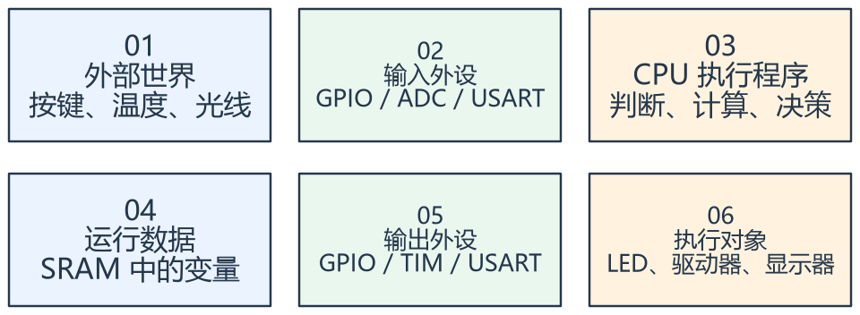

看图方法：先读每张卡片的关键词，再用下文核对它们之间的关系。

图中的箭头描述一个完整业务过程。传感器把现实变化变成电信号，输入外设将信号交给软件，CPU 执行存放在 Flash 中的指令，再通过输出外设控制对象。

CPU 并不等于整个单片机。Cortex-M3 是内核，STM32F103 是 ST 围绕内核集成存储器、总线和外设形成的芯片。ARM
提供的架构、内核与 ST 的芯片型号是不同层次。

以按键控制灯为例：引脚电平变化 → GPIO 输入寄存器 → 程序判断按下状态 → GPIO 输出控制 → LED
电流变化。程序变量不是引脚电压本身，中间有采样和执行时刻。

外设可以自主工作。定时器开始后可持续计数，DMA 可搬运数据；CPU 不必用每一条指令模拟这些硬件动作。

## 二、Flash、SRAM 和外设寄存器各管什么

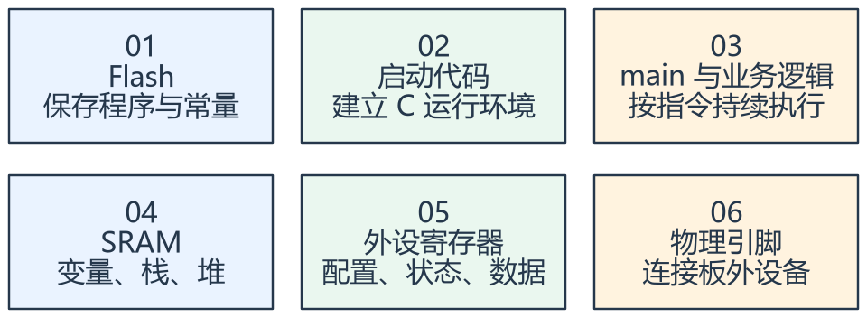

看图方法：先读每张卡片的关键词，再用下文核对它们之间的关系。

Flash 保存程序，掉电后仍可保留；SRAM 保存运行中的变量、栈和堆，普通 SRAM 掉电后不保证内容。外设寄存器则让软件配置硬件、读取状态和交换数据。

以 STM32F103C8T6 为例，课件列出 Cortex-M3、最高 72 MHz、标称 64 KB Flash 和 20 KB
SRAM。不能根据部分板卡能访问更大空间，就把非标称资源当作保证。

常见地址区间用于建立位置感：用户 Flash 从 0x08000000 开始，SRAM 从 0x20000000 开始，片上外设主要在
0x40000000 区域。具体边界按型号手册确认。

程序中的指针地址只是访问入口。访问 Flash、SRAM 或外设寄存器，背后动作不同；对 Flash 的普通指针写入不能代替正确的擦除与编程流程。

## 三、复位后为什么能找到 main

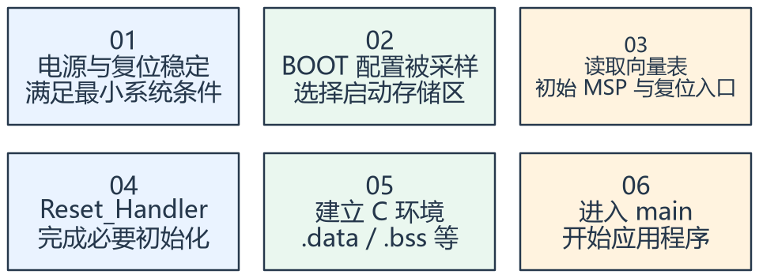

看图方法：先读每张卡片的关键词，再用下文核对它们之间的关系。

BOOT 配置先决定从哪一种存储区启动。选择用户 Flash 后，CPU 通过启动映射读取向量表，装载初始
MSP，并取得复位处理入口。向量表里的地址不是给处理函数传入的普通参数。

随后由启动文件和运行库建立执行环境，例如复制已初始化数据、清零未初始化数据。SystemInit
的调用位置受所用启动文件和工具链影响，应看实际工程，不能把一份固定顺序套给所有平台。

本芯片最小系统应关注主电源、去耦、复位、BOOT、电源地和调试接口；外部高速晶振并不是所有程序运行的绝对前提，芯片也有内部时钟源。是否需要外部晶振取决于
时钟精度和应用。

STM32F103C8T6 中，C 对应引脚规模、8 对应 Flash 容量编码、T 对应封装系列、6
对应温度等级编码。解码用于初步识别，最终电气和资源以完整型号数据手册为准。

## 专项图解

### 同一个地址空间中，三类位置做不同的事

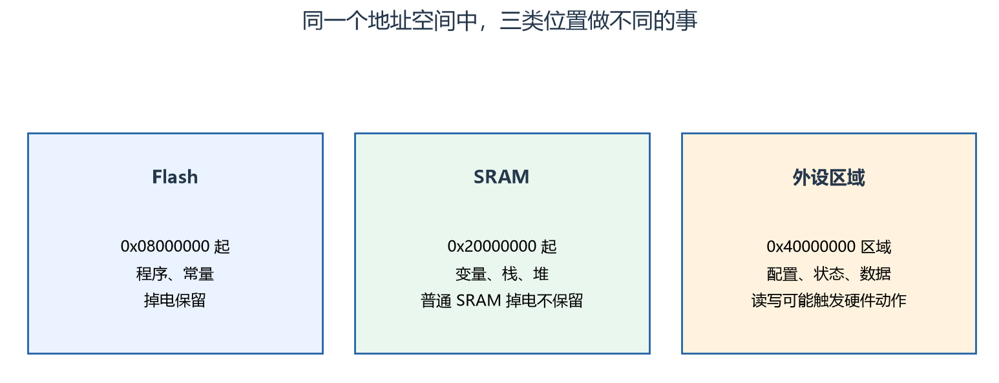

三块并排表示地址空间中的不同区域，不是执行先后。先定位地址属于哪一区，再判断读写的含义；具体容量和边界按完整型号确认。

### F103 启动选择：先选来源，再执行启动代码

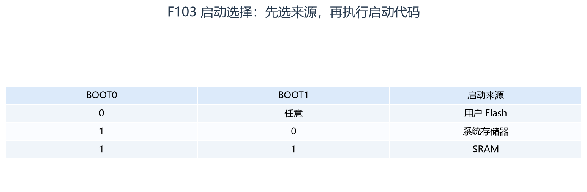

先读 BOOT0，再在需要时读 BOOT1。选择启动源并不等于已经完成时钟和 C 运行环境初始化。此表针对课件 F1。

### 输入、程序与输出在 MCU 内怎样协作

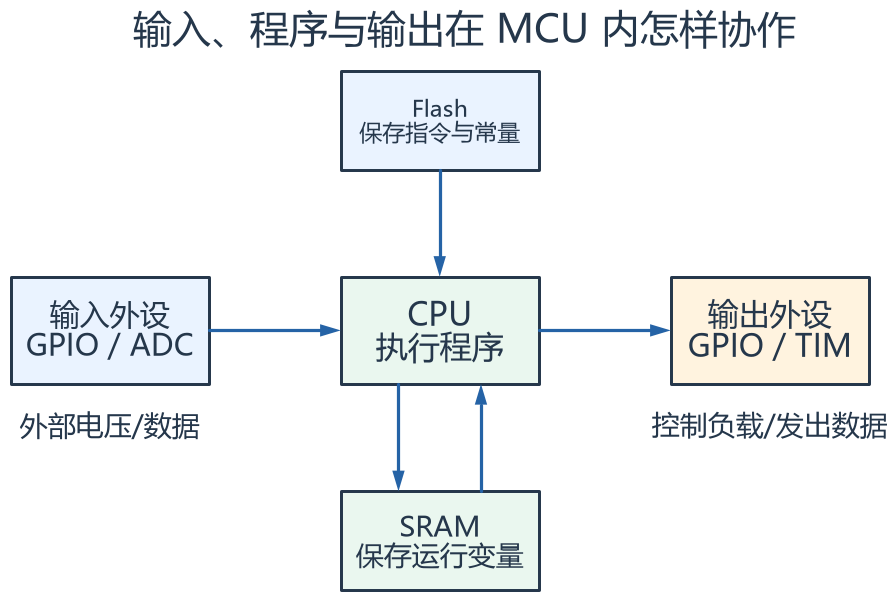

先横向看输入到输出，再看 Flash 提供程序、SRAM 保存现场。箭头表示概念上的数据/指令关系，省略了真实总线矩阵和仲裁。

## 对照课件原图

下面图片截取自同目录原 PDF；页码为 PDF 阅读器中的物理页序号。
先读重绘解释，再用原图核对硬件框图或课件细节。

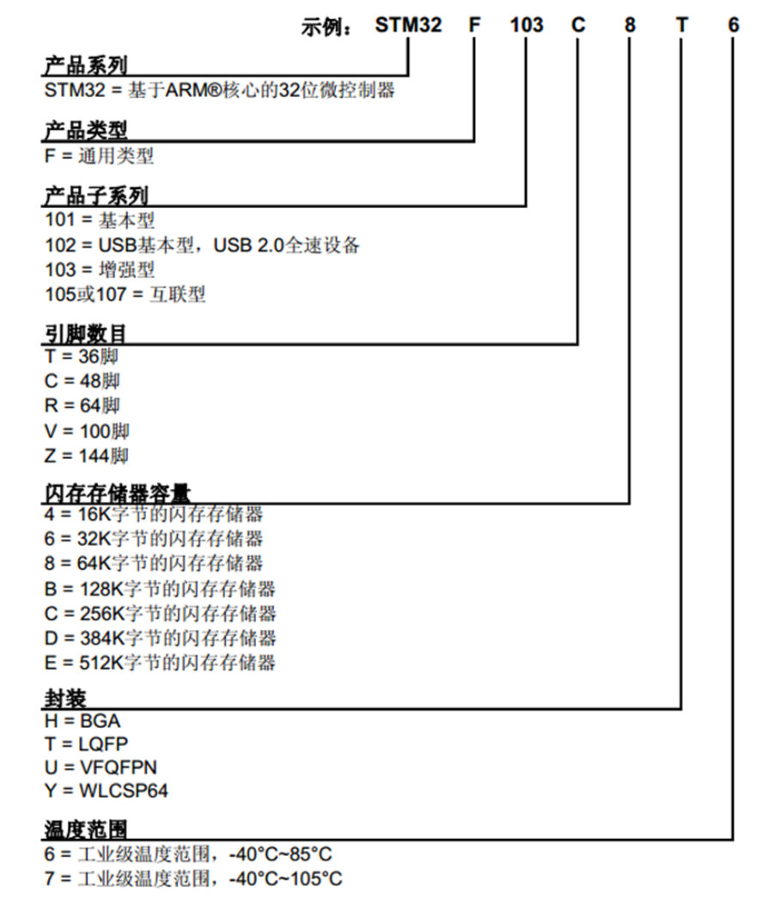

课件 P11（原图局部）：按字段读型号，重点找容量、封装和温度等级。

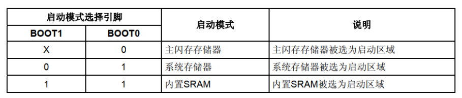

课件 P15（原图局部）：先分清 BOOT0、BOOT1 的组合，再看选择哪一种启动区。

## 关键概念速查

| 名称 | 应该记住什么 |
|---|---|
| CPU / MCU | 内核负责执行，MCU 还包含存储器和外设 |
| Flash / SRAM | 程序持久保存与运行现场分工 |
| BOOT / 启动代码 | 前者选启动来源，后者建立程序执行环境 |

## 具体例子

假设 Flash 中保存一段点灯程序：上电后并不是“灯直接知道要亮”，而是复位入口执行初始化，main 配置 GPIO，再由输出电路改变 LED 电流。

## 实验时如何验证

- 在芯片丝印、工程器件选择和课件型号之间核对一致性。
- 只读查看向量表、Flash 与 SRAM 地址，分清地址和值。
- 跟踪复位到 main，记录实际启动文件调用顺序。

## 常见误区

- “STM32 都是 Cortex-M3”不成立，不同系列内核和资源不同。
- GPIO 电平、封装引脚和调试接口必须看当前型号，不能只根据 PA/PB 名称猜接线。
- 地址、地址中存的值和程序入口是三个不同概念。

## 自测：先想答案，再展开

为什么 SRAM 不能代替 Flash 保存掉电参数？

普通 SRAM 依赖供电，掉电内容不保证。

向量表第一个字是函数地址吗？

不是，它是初始 MSP 值；复位入口在下一项。

## 深入学习：把芯片资源连接成完整的执行模型

本节目录：

- [1. 架构、内核、芯片、开发板是四个层次](#deep-1)
- [2. 内存映射为什么能让 C 指针访问外设](#deep-2)
- [3. Flash 中的初值怎样变成 SRAM 中的变量](#deep-3)
- [4. 复位、启动映射与向量表重定位](#deep-4)
- [5. 时钟树是一张资源依赖图](#deep-5)
- [6. 从资源估算走到工程设计](#deep-6)
- [7. 用问题检验是否真正理解](#deep-7)

### 1. 架构、内核、芯片、开发板是四个层次

Armv7-M 描述一类架构，Cortex-M3 是实现这一架构的内核，STM32F103 在内核周围加入总线、Flash、SRAM 和外设，开发板再增加电源、晶振、接口和外部器件。
同样使用 Cortex-M3 的芯片，外设地址、引脚复用和时钟配置仍可完全不同；同一 MCU 的两块板，LED 的有效电平也可能不同。

软件相应分成启动/CMSIS、芯片驱动、板级支持、设备服务和应用逻辑。
LED 接在哪个脚是板级事实，“发生报警时让灯闪烁”是业务意图。分清层次后，换板卡通常只需调整较低层，而不是把业务条件复制进 GPIO 驱动。

F103C8 的 C 表示该系列的引脚规模编码，8 是容量编码，T 是封装，6 是温度等级；具体代码含义仍看该系列订货表。
“Cortex-M3 都有同样外设”“STM32 都能运行 72 MHz”都不是由内核名称可推导出的结论。

### 2. 内存映射为什么能让 C 指针访问外设

CPU 发出一次地址访问，总线与地址译码决定接收者是 SRAM、Flash 还是外设寄存器。
例如 F103 的 GPIOA 基址为 0x40010800，IDR 偏移 0x08，ODR 偏移 0x0C，BSRR 偏移 0x10。
所以 0x4001080C 是 ODR 的位置，当前位置读出的数才是端口输出控制值。

地址本身、该地址中的数据、该数据描述的硬件状态必须区分。
写入 SRAM 是保存普通值；读某些外设寄存器可能清标志；对写一清零的标志写 0 也不等于清除。
这就是为什么不能把所有寄存器都当作普通变量进行 `|=` 或 `&=`。

`volatile` 用来让编译器按要求保留对这类对象的访问，但不会自动完成临界区、跨字段一致性或外设时序等待。
指针非空也不保证它指向正确的器件、合法地址和允许的访问宽度。

<!-- extended:address-decode -->

#### 机制补图：一次写 GPIOA_ODR 的地址怎样形成

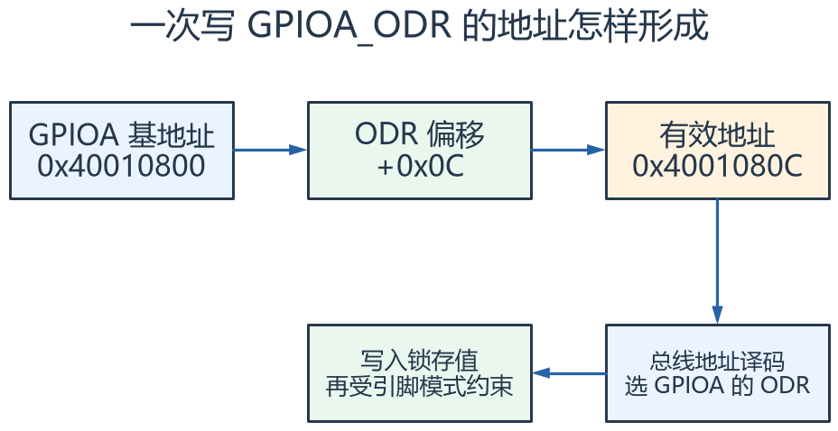

**读图方法与条件：** 沿箭头把基地址与偏移相加。地址选中的是寄存器，写 ODR 改变输出锁存值；引脚电压还受模式、外部负载等条件约束。

[放大查看 SVG](course-note-assets/extended/01/address-decode.svg) · [可编辑结构图](course-note-assets/extended/01/extended.drawio)

<!-- /extended -->

### 3. Flash 中的初值怎样变成 SRAM 中的变量

全局已初始化变量的初值通常保存在可装载镜像中，启动时复制到 SRAM 的运行地址；未显式初始化的静态存储对象通常在 .bss 中清零。
只读常量通常留在 Flash；栈保存调用现场与自动变量；堆支持按运行需求分配。
编译器优化、链接脚本和特殊段可改变放置方式，所以最终布局看 map 文件。

例：一个 1024 字节的已初始化可写数组，可能同时占用约 1024 字节的 Flash 初值和 1024 字节 SRAM 运行空间；
同样大的零初始化静态数组主要占 SRAM，镜像不必携带 1024 个零。具体镜像填充方式仍受工具链影响。
这解释了为什么代码量不大也可能 SRAM 先耗尽。

F103C8 标称 SRAM 20 KiB，范围为 0x20000000～0x20004FFF。
若把栈顶设为 0x20005000，它位于区域上边界后一字节，适配向低地址增长的满递减栈；不能据此说它已经越界写入。
实际是否溢出还需结合历史最深栈、数组边界和内存保护机制。

<!-- extended:c-startup -->

#### 机制补图：进入 main 之前，初值和零值从哪里来

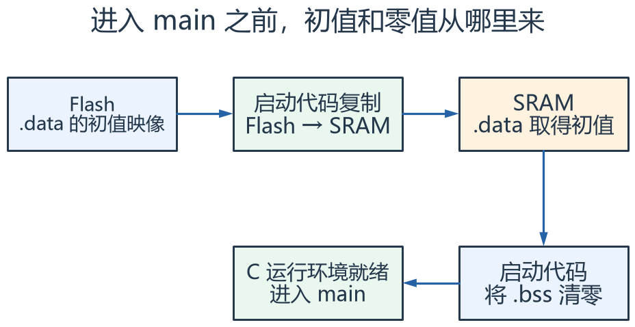

**读图方法与条件：** 带非零初值的普通全局变量既占 Flash 初值空间，又占 SRAM 运行空间；.bss 通常只在镜像中记录范围，启动时在 RAM 清零。实际初始化可能由编译器运行库完成。

[放大查看 SVG](course-note-assets/extended/01/c-startup.svg) · [可编辑结构图](course-note-assets/extended/01/extended.drawio)

<!-- /extended -->

### 4. 复位、启动映射与向量表重定位

复位时从启动映射取得初始 MSP 与复位入口，随后启动代码建立运行环境并进入应用。
F103 常见用户 Flash 物理地址从 0x08000000 开始，但启动映射会使选中的存储区出现在复位取向量的位置。
“物理 Flash 基址”和“复位访问的映射入口”不是矛盾的两个答案。

VTOR 指定异常向量表的位置。改变 VTOR 只改变后续异常查表位置，不自动切换栈、初始化变量或跳到新 main。
从 bootloader 跳到应用需要处理栈、向量、外设/中断状态和入口条件，是一项完整的执行环境交接。
本课仅建立概念，不据此给未知工程直接编写跳转代码。

<!-- extended:reset-vector -->

#### 机制补图：复位入口读取的是两个表项，不是两条普通指令

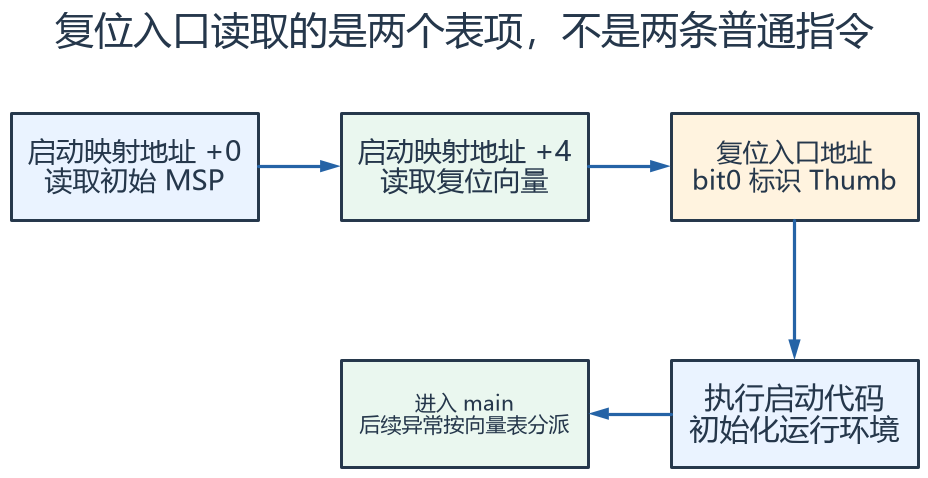

**读图方法与条件：** 复位先建立栈，再从复位向量进入程序。图省略芯片启动映射细节。以后改 VTOR 只是改变异常向量表位置，不会自动重新装载 MSP。

[放大查看 SVG](course-note-assets/extended/01/reset-vector.svg) · [可编辑结构图](course-note-assets/extended/01/extended.drawio)

<!-- /extended -->

### 5. 时钟树是一张资源依赖图

时钟源经 PLL 与总线分频形成 SYSCLK、HCLK、PCLK1、PCLK2，再驱动不同外设。
打开某个外设的 RCC 门控只让它具备时钟条件，并不等于通道已启动或引脚已连接。
复位外设与关闭外设时钟也不同：前者重置内部状态，后者停止时钟推进。

提高主频前要检查电压范围、Flash 等待周期和各总线限制；只把 PLL 配成较大倍数不构成合法提频。
定时器、串口、ADC 都依赖自己的时钟关系，改主频后只更新一个软件变量不能自动改好所有外设。

### 6. 从资源估算走到工程设计

假设采样缓存 4 KiB、通信缓存 2 KiB、四个任务各预留 1 KiB 栈，已使用约 10 KiB，尚未计算全局数据、主栈、控制块与堆碎片。
应在链接 map 和运行监测中分别确认静态占用与动态峰值，而不是用源文件大小估算 RAM。

实时性也要预算：1 kHz 任务每次最多可用多少时间，是否会被更高优先级任务和中断推迟？
平均 CPU 利用率低，不代表每次截止时间都满足；突发通信和长临界区可能形成局部拥塞。
后续 ADC、DMA、定时器和 FreeRTOS 各篇会把这些依赖逐项展开。

<!-- extended:ram-budget -->

#### 机制补图：20 KiB SRAM 预算：先扣固定成本，再留余量

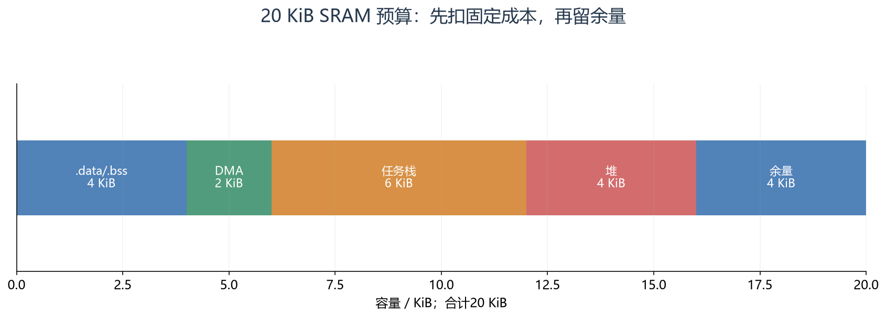

**读图方法与条件：** 示例总计20 KiB。这里“堆”不再包含已单列的任务栈；若 FreeRTOS 动态创建任务，栈可能来自内核堆，不能重复相加。真实占用需结合 map、分配方式和运行峰值。

[放大查看 SVG](course-note-assets/extended/01/ram-budget.svg)

<!-- /extended -->

### 7. 用问题检验是否真正理解

| 问题 | 推理要点 |
|---|---|
| 头文件声明的寄存器为何能控制引脚？ | 指针地址 → 总线译码 → 外设逻辑 → 引脚通路 |
| 下载成功为何仍无法运行？ | 镜像写入不证明启动源、栈、时钟和入口条件正确 |
| 更换同内核 MCU 能否原样复用寄存器代码？ | 内核通用部分与厂商外设必须分开 |
| 变量地址在 SRAM 范围内就绝对安全吗？ | 还要确认对象边界、生命周期和并发访问 |

自己画一次“Flash 指令 → CPU → GPIO 寄存器 → 驱动级 → LED”的路径，并在旁边画 SRAM 保存变量的支路。
能解释每个箭头为什么存在，才比记住一串缩写更接近理解单片机。

## 资料与验证边界

入门部分依据同目录课件；深入部分补充官方资料与明确条件下的推导。课件中的产品宣传、历史软件版本、
简化图和典型性能不直接作为当前板卡、固件或全部同系列产品的保证。
本次只整理资料与图文，没有编译固件、下载或进行硬件实测。
实际接线、电平、寄存器差异和模块命令须核对所用器件资料。

## 图源与后续修改

[可编辑概念图](course-note-assets/01/concepts.drawio)；
[本课图源目录](course-note-assets/01)。
概念图同时提供 JSON、SVG 与 PNG，专项图提供 SVG 与 PNG。
SVG 可放大查看；JSON 可用 diagramry 重绘。课件原图保持原貌，
不把截图中的文字改写成未经证实的新协议。

[专项图重绘脚本](course-note-assets/_source/redraw.py) ·
[图源使用说明](course-note-assets/_source/图源说明.md)

## 继续学习与资料对照

[跨外设工程专题](<01_跨外设工程专题与阅读索引.md>) · [资料来源与适用范围](<02_图文笔记资料来源与适用范围.md>)

深入部分包含官方机制对照和教学推导；模块命令、电气接线与固件差异按资料页的边界处理。
