# 2-1-3-2_STM32基础 - 部署开发环境：图文笔记

[直接阅读深入学习](#deep-study) · [跨外设工程专题](<01_跨外设工程专题与阅读索引.md>)

开发环境是一条“源码 → 编译 → 链接 → 下载 → 调试”的工具链。先弄清每个文件的职责，才能定位编译错误和板卡无反应的问题。

[返回学习导航](<00_单片机基础图文笔记导航.md>) · [打开原课件](<2-1-3-2_STM32基础 - 部署开发环境.pdf>)

## 阅读范围

原课件共 29 页；阅读定位：P1–9 工具与支持包；P10–12 固件库文件关系；P13–26 建工程与添加文件；P27–29 调试下载。
图中卡片用于拆分概念，编号是阅读顺序；卡片之间不自动表示时间或因果。
重绘时序与数值例子会在图旁写出前提，不代表开发板实测。

## 一、一次 Build 到底做了什么

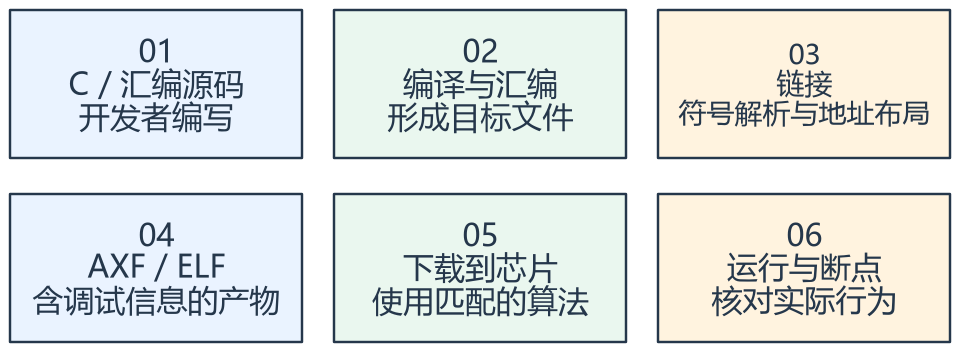

看图方法：先读每张卡片的关键词，再用下文核对它们之间的关系。

编译负责检查和翻译单个源文件，链接负责把目标文件和库放在一起，解析跨文件引用并安排地址。下载则将可装载的内容写入芯片，调试器通过符号信息对应回源码。

头文件一般提供声明、宏和类型；把 .h 加到工程树不等于相应 .c 已参与编译。Include Path
解决“到哪里找头文件”，工程源文件列表解决“哪些实现参与构建”。

“找不到头文件”通常先查路径；“未定义符号”先查实现文件和链接配置；“重复定义”则查重复源文件、重复中断入口或把定义写进头文件。

生成 HEX/BIN 与生成带调试信息的 AXF 是不同输出需求。能下载不等于符号和源码匹配，调试时应使用同一次构建的产物。

## 二、一个 STM32 工程需要哪些角色

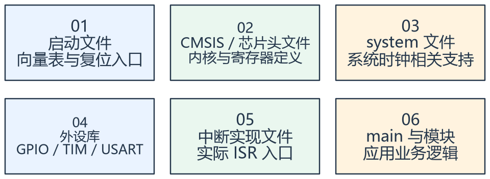

看图方法：先读每张卡片的关键词，再用下文核对它们之间的关系。

课件使用 STM32F1 标准外设库。startup 文件提供向量表和启动入口，stm32f10x.h
提供芯片相关定义，system_stm32f10x.c 处理系统相关支持，外设库封装寄存器操作。

选择目标器件后，还要确保启动文件与容量分组匹配。对课件 STM32F103C8T6，不能随意选另一个系列的启动文件或链接布局。

标准外设库与 HAL 是不同的库体系。阅读课件时先用它自己的结构理解，不要把 stm32f10x_* 与 stm32f1xx_hal_*
文件混装来“补齐函数”。

Pack、编译器、设备选择和库版本共同构成环境。记录版本有助于重现工程；课件中的“最新版本”与截图属于历史状态，不能当作当前软件发布信息。

## 三、下载与调试应该分层检查

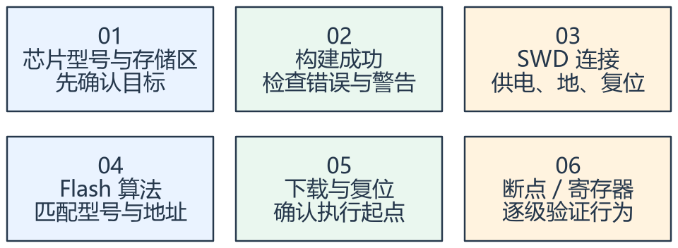

看图方法：先读每张卡片的关键词，再用下文核对它们之间的关系。

工程 Build 成功只是第一层。之后需要连接目标、使用合适的 Flash 算法写入，并确认复位后程序进入预期入口。

如果连接不上，先核对供电、公共地、SWDIO、SWCLK、复位和工具连接配置；如果能连接但不能写，检查 Flash 算法、存储区域和保护状态。

如果下载成功但不运行，先在 main 或复位入口设置断点，检查启动来源、时钟初始化与异常。不要直接把所有问题归为下载器损坏。

课件包含授权激活截图；学习环境使用有效许可或官方提供的适用版本即可。本笔记关注工具链职责，不把历史安装与授权方式当作固定配置要求。

## 专项图解

### 根据报错发生阶段，缩小排查范围

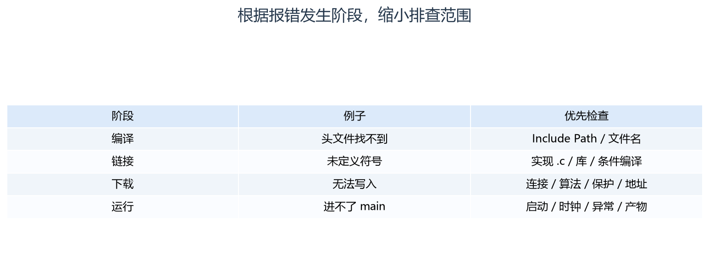

从左往右看阶段、现象、检查项。先找到失败所在阶段，再检查该阶段的输入条件。

### 文件名不同，是因为承担的工具链职责不同

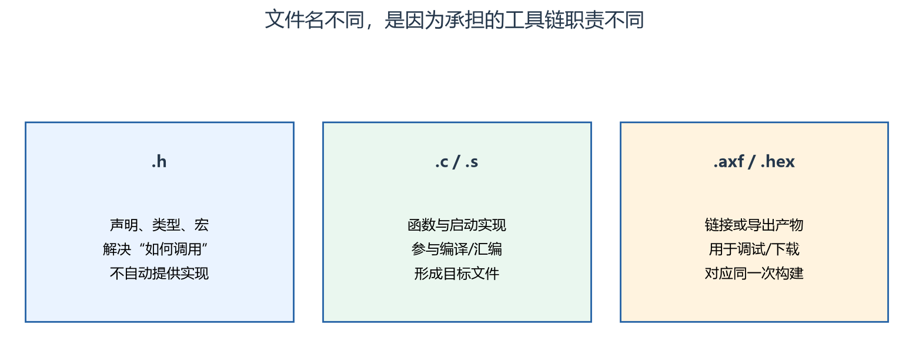

头文件与实现文件各有责任。修改了源码后，旧 HEX 不会自动随之改变；应重新构建并核对下载产物。

## 对照课件原图

下面图片截取自同目录原 PDF；页码为 PDF 阅读器中的物理页序号。
先读重绘解释，再用原图核对硬件框图或课件细节。

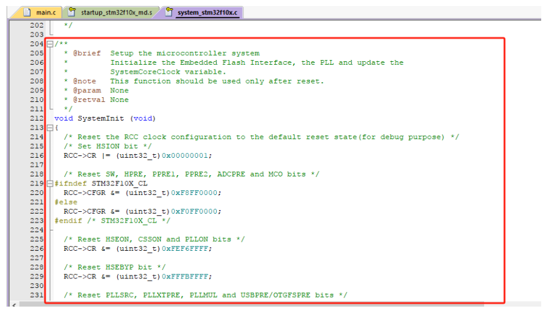

课件 P12（原图局部）：观察 system 文件承担的系统相关职责，具体执行位置看启动代码。

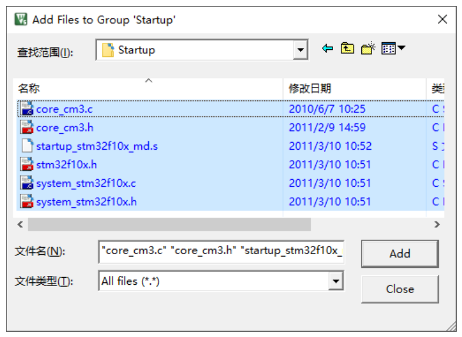

课件 P19（原图局部）：工程树展示源文件的组织，仍需核对目标构建所包含的文件。

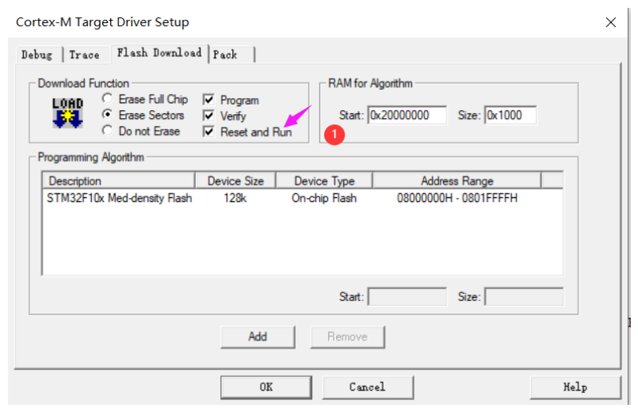

课件 P27（原图局部）：调试工具与 Flash 算法分别负责连接和写入，二者都需匹配。

## 关键概念速查

| 名称 | 应该记住什么 |
|---|---|
| 编译错误 | 语法、类型、头文件和单文件问题 |
| 链接错误 | 缺失实现、重复符号、存储区溢出 |
| 运行问题 | 启动、时钟、异常、外设与接线 |

## 具体例子

main 调用 GPIO_Init，但对应库 .c 未参与构建：头文件可正常找到，编译也可能通过，最终仍会在链接阶段报缺失实现。

## 实验时如何验证

- 记录器件、编译器、库与调试工具版本。
- 构建后检查错误与警告，核对下载文件的时间和路径。
- 在 main 设置断点，确认复位后确实执行当前产物。

## 常见误区

- Include Path 不会自动把目录内所有 .c 加入构建。
- 不要仅因为下载进度结束就认定功能验证完成。
- 课件中的 IDE 版本和当前实际安装版本需要分开记录。

## 自测：先想答案，再展开

为什么有头文件仍会报未定义符号？

声明存在，但实现未被编译或链接。

第一处断点放哪里有帮助？

根据问题选择复位入口、main 或首次外设初始化位置。

## 深入学习：从源码到芯片，建立可追溯的构建与调试链

本节目录：

- [1. 预处理、编译、汇编、链接各自看见什么](#deep-1)
- [2. 启动文件与链接布局必须配套](#deep-2)
- [3. 目标器件、编译器 ABI 与库不能随意混合](#deep-3)
- [4. AXF/ELF、HEX、BIN 为什么不能互相混称](#deep-4)
- [5. 调试器只是观察窗口，也会改变现场](#deep-5)
- [6. 从 HardFault 回到真正出错的位置](#deep-6)
- [7. 一个“头文件没问题、最后仍失败”的案例](#deep-7)
- [8. 验证强度分层](#deep-8)

### 1. 预处理、编译、汇编、链接各自看见什么

预处理展开宏与条件编译、包含头文件；编译把一个翻译单元转为目标代码；汇编处理启动等汇编源；链接解析符号并按布局放入存储区。
一个 C 文件及其包含展开后的内容构成翻译单元。修改一个头文件可能使很多 .c 重新构建，而不是只改变这个头文件所在的工程分组。

声明告诉编译器名字和类型，定义提供对象或函数实现。`extern` 声明全局对象不负责分配另一份存储；头文件里放普通全局变量定义，则可能被多个翻译单元重复定义。
Include Path 影响预处理查找，链接库与源文件列表影响实现是否存在，不能用增加头文件路径修复所有链接错误。

条件编译还可能让“文件明明在工程里”却不包含所需实现。定位时看实际宏、预处理结果和 map 中的符号，不要只看文件树有没有这个文件。

<!-- extended:translation-units -->

#### 机制补图：头文件被展开，目标文件才交给链接器

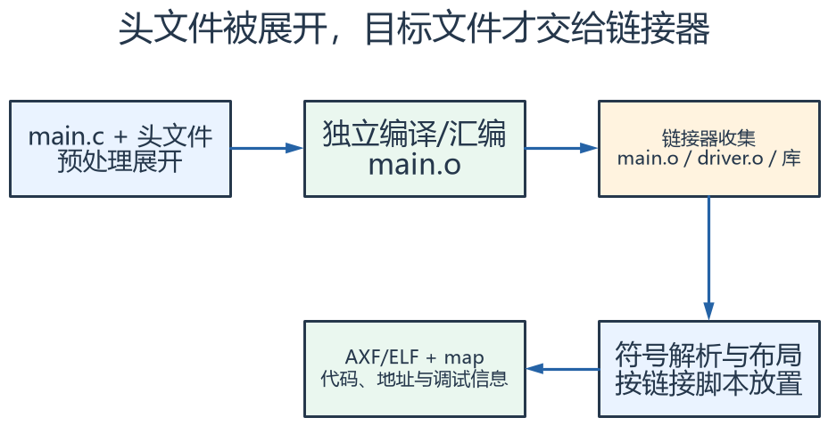

**读图方法与条件：** 这是 main.c 的一条分支；driver.c 等各自编译成目标文件，再汇入链接器。头文件中的函数声明不会自动生成对应实现。

[放大查看 SVG](course-note-assets/extended/02/translation-units.svg) · [可编辑结构图](course-note-assets/extended/02/extended.drawio)

<!-- /extended -->

### 2. 启动文件与链接布局必须配套

启动文件提供向量表、复位入口和相关栈/堆约定，链接布局决定 Flash/SRAM 的起点、大小、段的放置与保留区域。
STM32F103C8 的标称容量不能因为选择了更大容量启动文件就自动变大；错误布局可能编译成功，直到下载或运行时才暴露。

向量表中的中断符号要与实际 ISR 名称一致。某个源文件里存在“看起来是中断函数”的函数，如果名字不匹配且未绑定到向量，CPU 仍可能跳到默认处理。
弱定义允许用户实现覆盖默认入口，但重复强定义会导致链接冲突。

map 文件应重点查：入口和向量段、Flash 区域占用、读写/清零数据、栈与堆保留、关键函数归属。
它能回答“最终链接进了哪个实现”，比仅搜索源代码更接近实际镜像。

<!-- extended:lma-vma -->

#### 机制补图：同一份 .data 同时有装载地址与运行地址

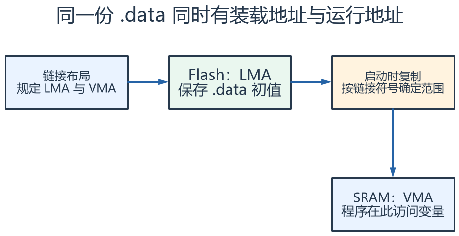

**读图方法与条件：** LMA 是镜像存放初值的位置，VMA 是程序访问变量的地址。链接器与启动代码必须对这段复制范围保持一致。

[放大查看 SVG](course-note-assets/extended/02/lma-vma.svg) · [可编辑结构图](course-note-assets/extended/02/extended.drawio)

<!-- /extended -->

### 3. 目标器件、编译器 ABI 与库不能随意混合

目标内核决定指令与异常支持，编译器版本和选项影响 ABI、运行库和调试信息。
Cortex-M3 没有硬件 FPU，不能机械使用某个 M4F 工程的浮点 ABI 设置。
优化等级会改变变量可见性、内联和执行时序；调试时某变量显示 unavailable 不一定是变量被内存破坏。

标准外设库、HAL 和寄存器操作是不同抽象入口。混用并非任何时候都绝对禁止，但必须保证同一外设的初始化与运行状态有唯一清晰的拥有者。
例如 HAL 认为外设正在传输，而另一段寄存器代码重置了它，软件状态与硬件状态就会分离。

### 4. AXF/ELF、HEX、BIN 为什么不能互相混称

ELF/AXF 通常包含段、符号与调试信息；HEX 包含地址化的数据记录；BIN 通常只是原始字节，下载时需要额外指定起始地址。
同一 BIN 放在不同地址，程序不一定能正常运行。生成格式不同也不自动修正向量表或链接地址。

一次可追溯交付至少记录源码版本、构建配置、工具链版本、产物哈希和下载目标。
“今天生成的文件”不如“哪一次构建、什么哈希、下载到哪里”可靠；时钟、宏和链接配置也是版本的一部分。

### 5. 调试器只是观察窗口，也会改变现场

断点会让 CPU 暂停，但外设是否冻结取决于调试冻结配置。定时器可能继续运行，串口对端也可能继续发数据，因此单步调试可能人为制造溢出和超时。
硬件断点数量有限；Flash 中断点、软件断点、观察点的能力也不同。不要把断点放不进去等同于工具完全失效。

观察寄存器还需注意读副作用。某些状态通过“读状态再读数据”等顺序清除，调试器自动刷新可能改变你准备分析的状态。
对时间敏感问题，更适合时间戳、跟踪、短 GPIO 标记与逻辑分析仪，再配合必要断点。

<!-- extended:debug-halt -->

#### 机制补图：断点停住 CPU 后，外设是否继续必须单独确认

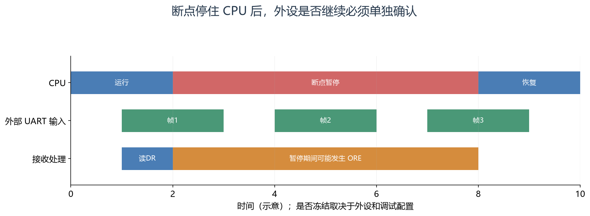

**读图方法与条件：** 沿同一横坐标看：CPU 没执行接收代码时，外部发送器仍可能发帧。DMA、定时器和看门狗的冻结行为需分别核对，断点现场可能改变故障。

[放大查看 SVG](course-note-assets/extended/02/debug-halt.svg)

<!-- /extended -->

### 6. 从 HardFault 回到真正出错的位置

发生 HardFault 时，先保留异常状态、当时使用的栈、堆栈帧中的 PC/LR/xPSR，以及 CFSR/HFSR 等信息。
BFAR/MMFAR 只有相应有效位成立时才有意义，不能看到一个数就认定它一定是故障地址。

异常处理函数中临时打印一大段文本可能继续消耗栈或再次访问坏地址。更可靠的诊断流程先保存最小现场，再在稳定路径输出。
根据堆栈 PC 回到 map/反汇编，可判断非法访问、错误函数指针、栈破坏或未使能外设等方向，但具体原因还需源代码证据。

<!-- extended:fault-pc -->

#### 机制补图：从 HardFault 现场定位到出错访存

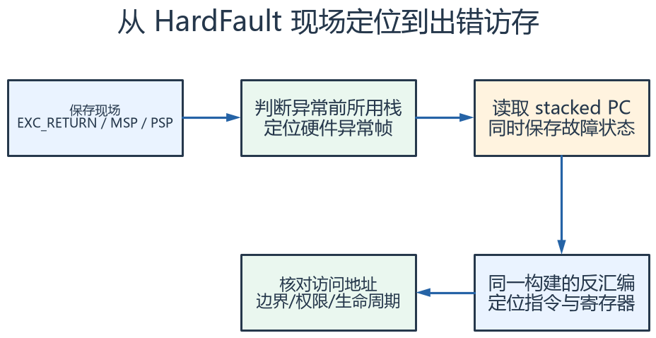

**读图方法与条件：** 先保存现场，再解析。若故障发生在异常入栈阶段，栈帧可能不完整；某些不精确总线错误的 stacked PC 也未必指向肇事指令。不能只看到 HardFault_Handler 就断言栈溢出。

[放大查看 SVG](course-note-assets/extended/02/fault-pc.svg) · [可编辑结构图](course-note-assets/extended/02/extended.drawio)

<!-- /extended -->

### 7. 一个“头文件没问题、最后仍失败”的案例

假设 main 调用某设备初始化接口。编译正常，链接报未定义符号，排查顺序为：

1. 找到函数定义，确认名字、大小写与参数声明一致。
2. 确认 .c 参与当前目标，而非仅存在于目录或另一个 build target。
3. 检查条件编译是否排除了该函数，必要时看预处理结果。
4. 若来自库，确认库格式、架构和链接配置匹配。
5. 若 C/C++ 混合，检查符号链接约定等边界。

此时修改串口接线、下载器或 CPU 时钟都不会解决缺失实现的问题，因为程序还未形成完整可执行镜像。

### 8. 验证强度分层

| 验证 | 能证明什么 | 还不能证明什么 |
|---|---|---|
| 编译/链接成功 | 形成当前配置的镜像 | 真实引脚与时序正确 |
| 下载并进入 main | 启动链能够执行 | 所有异常和长时间运行正确 |
| 外设寄存器检查 | 配置与部分状态符合预期 | 电气幅值和板级干扰符合要求 |
| 仪器与场景验证 | 所测条件下功能和时序成立 | 未覆盖条件下自动成立 |

学习工程也应保留“能构建、能启动、能完成一个可测动作”的最小基线，再逐项增加功能。
一次同时改工具链、库、引脚与业务逻辑，会让失败时缺少可比较的参照。

## 资料与验证边界

入门部分依据同目录课件；深入部分补充官方资料与明确条件下的推导。课件中的产品宣传、历史软件版本、
简化图和典型性能不直接作为当前板卡、固件或全部同系列产品的保证。
本次只整理资料与图文，没有编译固件、下载或进行硬件实测。
实际接线、电平、寄存器差异和模块命令须核对所用器件资料。

## 图源与后续修改

[可编辑概念图](course-note-assets/02/concepts.drawio)；
[本课图源目录](course-note-assets/02)。
概念图同时提供 JSON、SVG 与 PNG，专项图提供 SVG 与 PNG。
SVG 可放大查看；JSON 可用 diagramry 重绘。课件原图保持原貌，
不把截图中的文字改写成未经证实的新协议。

[专项图重绘脚本](course-note-assets/_source/redraw.py) ·
[图源使用说明](course-note-assets/_source/图源说明.md)

## 继续学习与资料对照

[跨外设工程专题](<01_跨外设工程专题与阅读索引.md>) · [资料来源与适用范围](<02_图文笔记资料来源与适用范围.md>)

深入部分包含官方机制对照和教学推导；模块命令、电气接线与固件差异按资料页的边界处理。
