# 2-1-3-3_STM32基础 - GPIO输入与输出：图文笔记

[直接阅读深入学习](#deep-study) · [跨外设工程专题](<01_跨外设工程专题与阅读索引.md>)


GPIO 一端连接物理引脚，另一端连接寄存器。理解输入路径、输出驱动和上下拉，比只记初始化函数更重要。

[返回学习导航](<00_单片机基础图文笔记导航.md>) · [打开原课件](<2-1-3-3_STM32基础 - GPIO输入与输出.pdf>)

## 阅读范围

原课件共 24 页；阅读定位：P1–6 GPIO 结构与八种模式；P7–12 LED/蜂鸣器与输出；P13–23 按键、传感器和输入实验。
图中卡片用于拆分概念，编号是阅读顺序；卡片之间不自动表示时间或因果。
重绘时序与数值例子会在图旁写出前提，不代表开发板实测。

## 一、读取电平与写出电平走不同路径

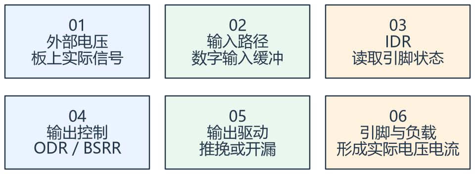

看图方法：先读每张卡片的关键词，再用下文核对它们之间的关系。

读取输入时，是外部引脚电压通过输入路径形成 IDR 中的状态；写输出时，是软件改变输出控制，经驱动级影响引脚。ODR
的值不总等于物理引脚当前电压，特别是在开漏释放或外部冲突时。

STM32F1 的 CRL、CRH 配置引脚模式，IDR 读输入，ODR 保存输出控制，BSRR
可按位设置或复位，避免普通读改写影响其他位。不同系列寄存器组织不同，不要照搬名字。

引脚命名与电气能力是两件事。课件开头对“最大承受 5V”的表述不能覆盖所有引脚和模式；是否 5V 容忍必须看完整型号数据手册的 FT 标记、供电和工作条件。

GPIO 的输出速度配置描述驱动能力/边沿相关能力，不代表配置为 50 MHz 后引脚就自动产生 50 MHz 方波。

## 二、推挽、开漏、上拉怎样理解

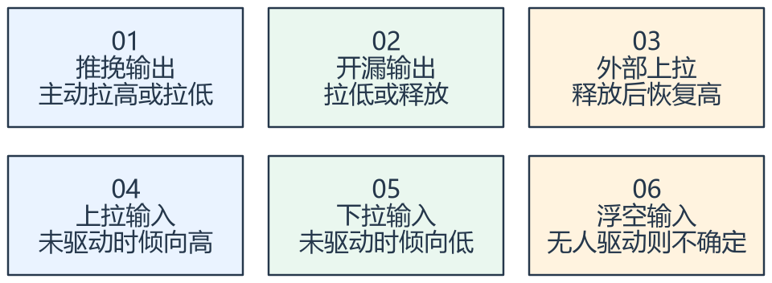

看图方法：先读每张卡片的关键词，再用下文核对它们之间的关系。

推挽像两个方向都能驱动：需要高时向上驱动，需要低时向下驱动。开漏只主动拉低，写“高”是释放，需要上拉或外部电路提供高电平。

输入上拉/下拉是给没有强驱动的引脚建立默认电平，不是把所有外部电压强制固定。用按键接地加上拉时，松开读 1，按下读 0；换成按键接电源加下拉时，语义相反。

八种模式可按四类输入（浮空、上拉、下拉、模拟）与四类输出（通用推挽、通用开漏、复用推挽、复用开漏）记忆。复用输出把输出控制交给外设。

模拟输入关闭或绕开数字输入相关路径以适配模拟采样；使用 ADC 前，应确认该物理引脚确实对应所需通道。

## 三、按键与 LED 必须从电路推导有效电平

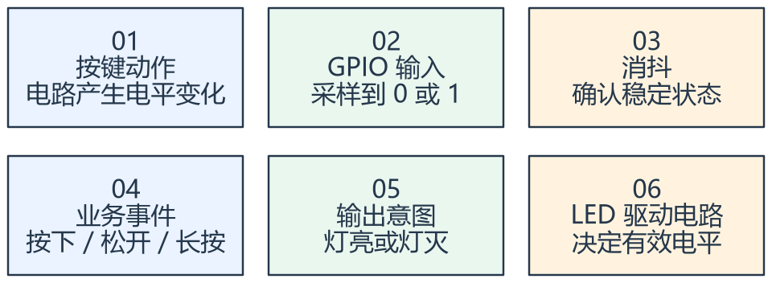

看图方法：先读每张卡片的关键词，再用下文核对它们之间的关系。

课件的低电平点亮 LED 与上拉按键都是具体电路结果。不要用“0 代表关、1 代表开”替代分析：如果 LED 阳极经电阻接电源，GPIO
拉低才可能形成点亮电流。

机械按键边沿会抖动，一次按下可能产生多次 0/1 变化。消抖先确认稳定电平，再产生一次业务事件。循环里不断读到低电平不等于每次都是一个新按下事件。

光敏/温敏模块常包含分压和比较器。模拟输出反映连续电压，数字输出只表示是否越过阈值；模块的阈值和有效电平需看具体电路。

蜂鸣器还要分有源和无源。有源通常加合适电源即可发声，无源需要变化的驱动信号。继电器、电机等负载需匹配驱动与保护，不能当作普通 GPIO 小电流负载。

## 专项图解

### 电平变化 → 消抖确认 → 一次按下事件

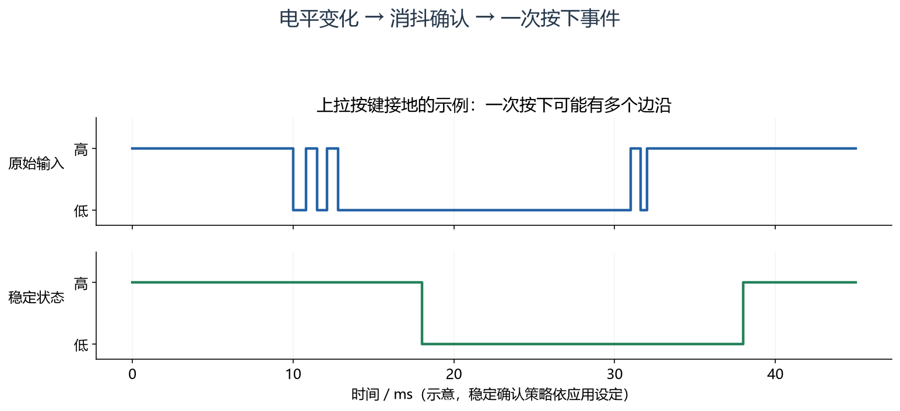

先看上面的快速跳变，再看下面稳定后的状态。确认从松开变为按下时发布一次事件；不要每读到一次低电平就加一次按下计数。图中延时只是示意。

### 同样写 0/1，推挽与开漏的物理动作不同

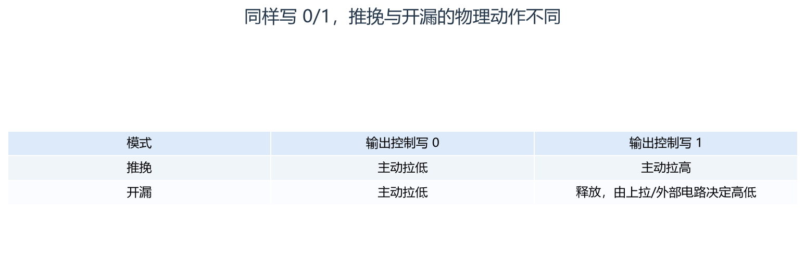

按“模式 → 写入值 → 物理动作”阅读。开漏释放时若没有合适上拉，不能保证读到高。输入电压容限仍需查器件数据手册。

### 开漏的“高”是释放：电压由外部电路建立

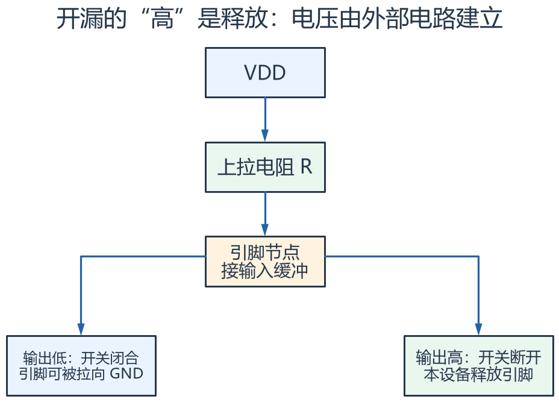

上方上拉提供变高的路径，下方两张框表示同一输出级的两种状态。释放后若别的设备仍拉低，节点仍为低；这是一幅开关等效图，不代表实际板卡接线。

## 对照课件原图

下面图片截取自同目录原 PDF；页码为 PDF 阅读器中的物理页序号。
先读重绘解释，再用原图核对硬件框图或课件细节。

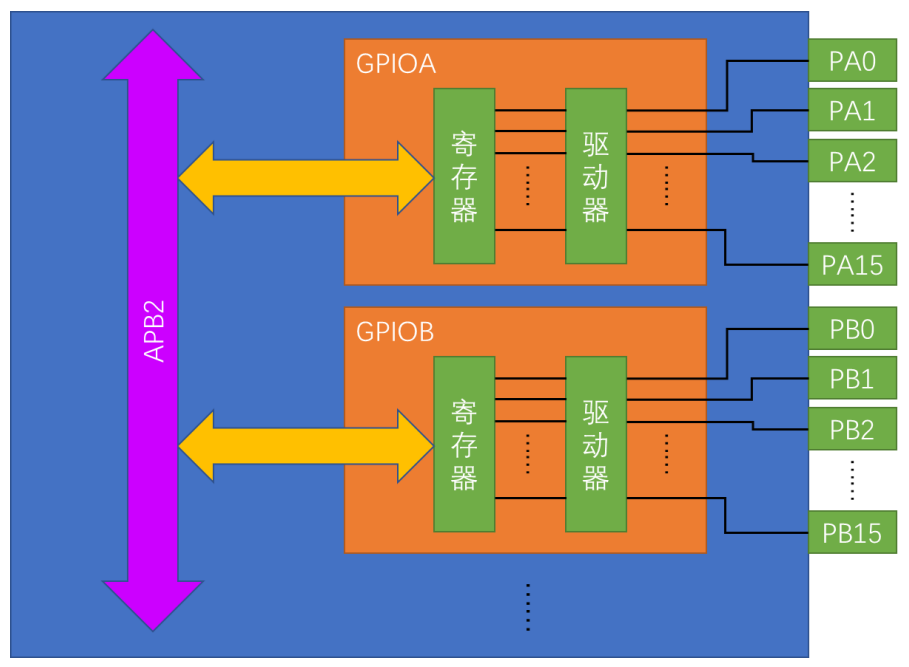

课件 P2（原图局部）：从总线、寄存器、驱动级一直跟到物理引脚。

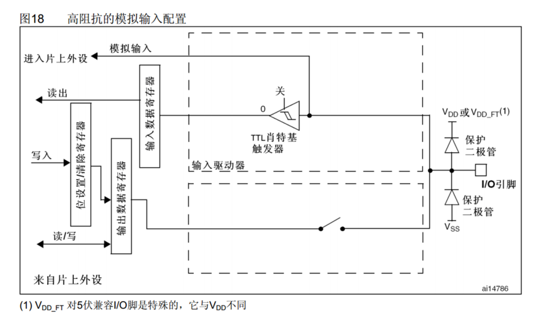

课件 P5（原图局部）：模拟输入图说明模拟通路与数字输入通路的区别。

## 关键概念速查

| 名称 | 应该记住什么 |
|---|---|
| IDR | 读引脚经过输入路径得到的状态 |
| ODR / BSRR | 输出控制；BSRR 提供按位动作 |
| CRL / CRH | F1 配置模式和输出速度的入口 |

## 具体例子

上拉按键松开时读 1，按下接地后读 0。程序确认低电平稳定后发布“按下”事件，再按 LED 的电路有效电平输出点灯命令。

## 实验时如何验证

- 先查 LED、按键电路与 GPIO 电压范围，再确定有效电平。
- 分别观察原始电平、消抖状态和事件计数。
- 用示波器观察边沿；不要用软件读取频率代替物理波形测量。

## 常见误区

- 不是所有 GPIO 都允许直接接 5 V。
- 开漏写 1 是释放，不等于主动输出强高电平。
- 端口位、芯片封装脚号与板上排针号不能混为一谈。

## 自测：先想答案，再展开

<details>
<summary>开漏释放后为什么仍可能读 0？</summary>

无上拉、外部拉低或线路异常都可能导致。

</details>

<details>
<summary>一直读到按下状态为什么不能一直计次？</summary>

电平是持续状态，按下事件通常只在确认转换时产生一次。

</details>

<a id="deep-study"></a>

## 深入学习：从 GPIO 寄存器到真实电压、电流与可靠输入


本节目录：

- [1. F1 每个引脚的四个配置位怎样分工](#deep-1)
- [2. ODR 读改写为什么会丢别的位](#deep-2)
- [3. 输入阈值、耐压和驱动能力要分开看](#deep-3)
- [4. LED 电阻不能只凭习惯写一个值](#deep-4)
- [5. 开漏上拉是一个速度与功耗的折中](#deep-5)
- [6. 消抖不仅是“等 20 ms 再读一次”](#deep-6)
- [7. 启动毛刺与引脚拥有权](#deep-7)
- [8. 诊断必须同时看软件值和引脚](#deep-8)

<a id="deep-1"></a>

### 1. F1 每个引脚的四个配置位怎样分工

CRL 配置引脚 0～7，CRH 配置 8～15，每脚占四位，由 MODE 和 CNF 组合解释。
MODE=00 时按输入模式解释 CNF；MODE 非零时按输出模式解释 CNF，并选择输出速度等级。
同一个 CNF 数值在输入与输出场景下可能含义不同，不能脱离 MODE 独立记忆。

以 PA5 为例，其配置字段位于 GPIOA_CRL 的第 20～23 位。修改时只改变该四位，保留其他脚的配置。
例如通用推挽、2 MHz 档对应 CNF=00、MODE=10，字段值是二进制 0010。
这个例子解释编码，不代表当前板卡的 PA5 应按此配置。

F1 上拉/下拉输入使用对应输入配置，再由 ODR 位选择上拉还是下拉。它与后续系列的独立 PUPDR 组织不同。
复用映射还可能受 AFIO 和调试端口占用影响；开通 GPIO 时钟不等于外设已经连接到目标脚。

<!-- extended:pa5-bits -->

#### 机制补图：GPIOA_CRL：PA5 独占 bits23:20 的四位

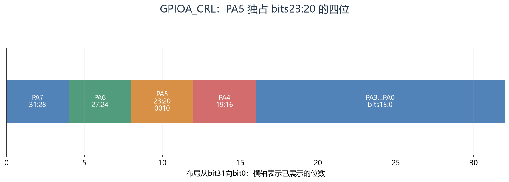

**读图方法与条件：** 按图从高位往低位看。PA5 的 0010 拆成 CNF=00、MODE=10，对应 F1 通用推挽输出、最大输出速度2 MHz；这不是 PWM 频率。只更改 PA5 时应掩码保护其余引脚。

[放大查看 SVG](course-note-assets/extended/03/pa5-bits.svg)

<!-- /extended -->

<a id="deep-2"></a>

### 2. ODR 读改写为什么会丢别的位

假设主循环读 ODR 得到 0，准备把 bit0 置一。它还没写回时，中断把 bit1 置一，ODR 变成 2。
主循环随后用旧值计算并写回 1，bit1 就被清掉。这是“读、修改、写回”三个步骤之间被插入访问造成的竞争。

BSRR 的低 16 位写一置位、高 16 位写一复位，写零不动作，允许用单次写入表达本次要改变的位。
例如置 bit0、复位 bit1，可在一次写中表达两个动作。它减少普通 ODR 读改写对其他位的干扰。
但多个模块同时争用同一引脚仍会互相覆盖业务意图，寄存器原子操作不能替代资源拥有规则。

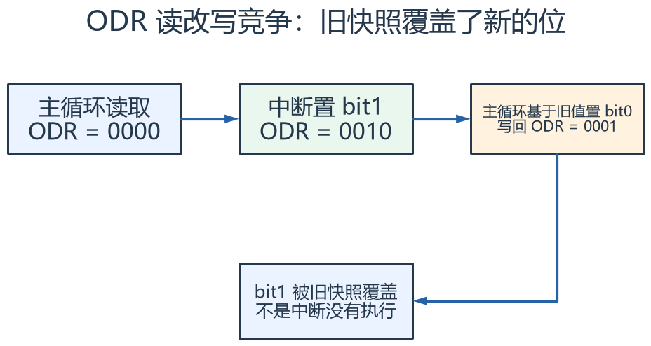

怎么看：沿时间向右看：ISR 已置位 PA1，主循环随后写回旧快照，又把 PA1 清零。BSRR 的单次位写入可以避免这种覆盖。

<a id="deep-3"></a>

### 3. 输入阈值、耐压和驱动能力要分开看

数字 1/0 来自输入阈值判断，不是电压只能等于 3.3 V 或 0 V。
VIL/VIH 给出保证识别低/高的条件，中间区域不应作为稳定数字状态使用；噪声、慢边沿与悬空都可能使读数跳动。

5 V 容忍描述特定引脚在规定条件下的输入能力，不表示所有引脚、模拟模式、掉电状态都可随意接 5 V。
输出驱动能力又是另一组指标，应同时检查单脚、端口/电源引脚总电流及输出压降。
绝对最大额定值是损伤边界，不是推荐长期工作点。

<!-- extended:threshold-regions -->

#### 机制补图：输入阈值存在不保证区，不能把中点当阈值

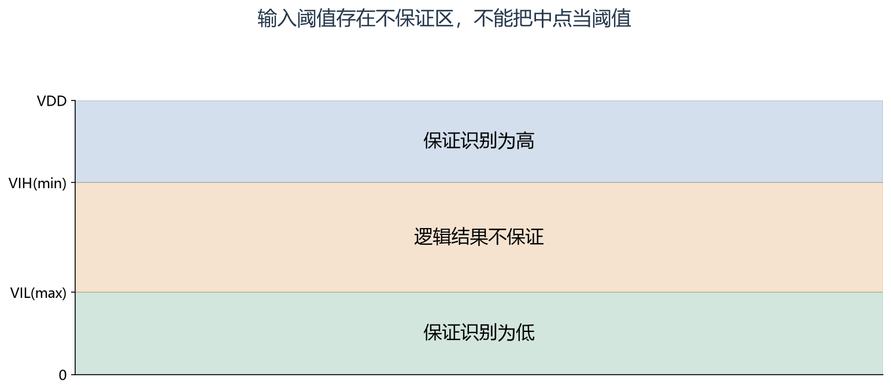

**读图方法与条件：** 纵轴仅作阈值区域示意，0.3/0.7 的图上位置不是器件规格值。实际 VIL、VIH、耐压和注入电流限制应分别查对应引脚与供电条件。

[放大查看 SVG](course-note-assets/extended/03/threshold-regions.svg)

<!-- /extended -->

<a id="deep-4"></a>

### 4. LED 电阻不能只凭习惯写一个值

假设电源 3.3 V，LED 正向压降按 2.0 V 示例，目标电流 3 mA，GPIO 低电平压降按 0.2 V 估计：

```text
R ≈ (3.3 − 2.0 − 0.2) / 0.003 ≈ 367 Ω
```

选相邻标准阻值后要重新计算电流，并考虑 LED 与 GPIO 压降随温度和电流变化。
若电路为电源→电阻→LED→GPIO，GPIO 拉低才形成吸电流路径；若换接法，点亮语义随之改变。
电机、继电器或大电流灯必须采用合适驱动级及保护，不能照搬小 LED 的直接驱动方式。

<a id="deep-5"></a>

### 5. 开漏上拉是一个速度与功耗的折中

开漏释放后通过 R 给线路电容 C 充电，电压近似按指数上升。
常见 30%～70% 上升时间可估为 tr≈0.8473RC；这是 RC 模型，不包含全部器件非理想行为。

例：R=4.7 kΩ、C=100 pF，tr≈398 ns。减小 R 可以加快上升，却增加拉低时的灌电流；增大 R 可减少静态电流，却可能使上升过慢。
还要按允许 VOL 与灌电流检查下限。内部弱上拉方便建立默认电平，不能保证任意总线电容与速率要求。

<!-- extended:pullup-rise -->

#### 机制补图：开漏释放后，上升速度取决于 R×C

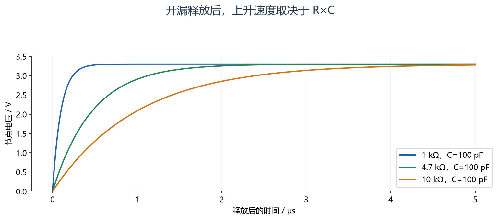

**读图方法与条件：** 按 V=3.3×(1−exp(−t/RC)) 画理想集中电容模型。电阻减小会加快上升，但拉低时的电流约为3.3/R，仍要满足设备灌电流和低电平电压约束。

[放大查看 SVG](course-note-assets/extended/03/pullup-rise.svg)

<!-- /extended -->

<a id="deep-6"></a>

### 6. 消抖不仅是“等 20 ms 再读一次”

可靠输入处理至少区分原始电平、稳定状态和事件。采用周期采样时，可记录候选状态和连续稳定时间，达到阈值后才更新稳定状态。
从稳定松开变为稳定按下产生一次按下事件；持续按住可进一步生成长按、连发等独立业务状态。

如果每 1 ms 采样，要求连续 10 个低样本才确认按下，响应将增加约一个稳定窗口，并受采样相位影响。
窗口越大不总是越好：可能漏掉用户允许的短按。阈值应来自开关抖动特征、最短有效动作和响应需求。

中断检测也不会天然完成消抖。一种方法是在边沿后启动受控确认，再读取稳定输入；ISR 中长时间忙等会阻塞其他硬件事件。
过短脉冲若必须捕获，则应使用合适硬件，而不是随意扩大消抖窗口后仍宣称“不漏脉冲”。

<a id="deep-7"></a>

### 7. 启动毛刺与引脚拥有权

若负载对上电瞬间敏感，要检查复位默认模式、外部上下拉、输出控制值和模式切换顺序。
例如先准备期望 ODR，再切换为输出，常有助于避免短暂错误电平；但实际结果仍依赖电路和复用硬件行为。

外设复用输出时，GPIO 输出数据通常不再直接决定该外设驱动的波形。
一个脚同时被灯控模块和定时器模块配置，会形成“初始化正常、过一会失效”的隐蔽问题。应由板级资源表和明确接口控制切换。

<!-- extended:startup-glitch -->

#### 机制补图：先设输出锁存值，再切输出模式可避免部分启动毛刺

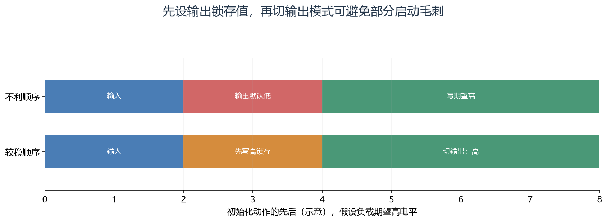

**读图方法与条件：** 红段说明切到输出后、软件尚未写期望值的间隙。预写 ODR/BSRR 只能控制软件接管后的过程；复位期间的安全电平仍依赖上拉、下拉及外部驱动使能设计。

[放大查看 SVG](course-note-assets/extended/03/startup-glitch.svg)

<!-- /extended -->

<a id="deep-8"></a>

### 8. 诊断必须同时看软件值和引脚

| 现象 | 检查链 |
|---|---|
| ODR 是 1，外部仍是低 | 模式→开漏释放→上拉→外部拉低/短路 |
| IDR 乱跳 | 接地/供电→默认上下拉→电平阈值→噪声与抖动 |
| 复用引脚没输出 | 外设时钟→外设启动→映射→GPIO 复用→负载 |
| 不同任务点灯互相干扰 | 是否同脚多拥有者→是否存在 ODR 读改写 |

把观察记录成“谁在什么时刻写了什么、当时寄存器是什么、引脚测到什么”。
只有寄存器截图时，只能证明软件/硬件配置状态，不能证明电流、边沿和外部接线符合预期。

## 资料与验证边界

入门部分依据同目录课件；深入部分补充官方资料与明确条件下的推导。课件中的产品宣传、历史软件版本、
简化图和典型性能不直接作为当前板卡、固件或全部同系列产品的保证。
本次只整理资料与图文，没有编译固件、下载或进行硬件实测。
实际接线、电平、寄存器差异和模块命令须核对所用器件资料。

## 图源与后续修改

[可编辑概念图](course-note-assets/03/concepts.drawio)；
[本课图源目录](course-note-assets/03)。
概念图同时提供 JSON、SVG 与 PNG，专项图提供 SVG 与 PNG。
SVG 可放大查看；JSON 可用 diagramry 重绘。课件原图保持原貌，
不把截图中的文字改写成未经证实的新协议。

[专项图重绘脚本](course-note-assets/_source/redraw.py) ·
[图源使用说明](course-note-assets/_source/图源说明.md)


## 继续学习与资料对照

[跨外设工程专题](<01_跨外设工程专题与阅读索引.md>) · [资料来源与适用范围](<02_图文笔记资料来源与适用范围.md>)

深入部分包含官方机制对照和教学推导；模块命令、电气接线与固件差异按资料页的边界处理。

[深入配图源目录](course-note-assets/deep/03) · [深入图重绘脚本](course-note-assets/_source/deeper_diagrams.py)
