# 2-1-4-1_STM32基础 - 中断：图文笔记

[直接阅读深入学习](#deep-study) · [跨外设工程专题](<01_跨外设工程专题与阅读索引.md>)

中断把“事件已经发生”与“CPU 何时处理”连接起来。外设、请求屏蔽、NVIC、向量表和 ISR 每一环都要分清。

[返回学习导航](<00_单片机基础图文笔记导航.md>) · [打开原课件](<2-1-4-1_STM32基础 - 中断.pdf>)

## 阅读范围

原课件共 23 页；阅读定位：P1–4 中断、NVIC 和优先级；P5–7 AFIO/EXTI；P8–15 传感器与 OLED；P16–23 外部中断实验。
图中卡片用于拆分概念，编号是阅读顺序；卡片之间不自动表示时间或因果。
重绘时序与数值例子会在图旁写出前提，不代表开发板实测。

## 一、外部边沿如何让 CPU 进入中断

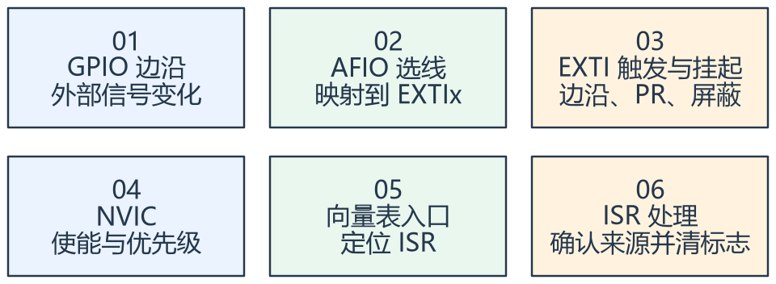

看图方法：先读每张卡片的关键词，再用下文核对它们之间的关系。

以 F103 外部中断为例，AFIO 选择某个端口的同号引脚接到 EXTI 线；EXTI 检测选定边沿，设置挂起状态，再通过中断通路送给 NVIC。

PA0 和 PB0 都是候选的 EXTI0 来源，但同一时刻 EXTI0 不能同时直接映射两者。EXTI 线、GPIO 引脚和 NVIC IRQ
也不是一对一等价：有些 EXTI 线共用一个 IRQ 入口。

ISR 要判断哪个来源确实挂起，并按硬件要求清除对应标志。清 NVIC pending 不等于清外设源，源仍有效时可能再次请求。

CPU 响应存在延迟，受到屏蔽、当前执行、优先级和嵌套影响。因此中断计次能说明软件收到了请求，不自动证明每个物理毛刺都被唯一记录。

## 二、优先级决定能否抢占与先处理谁

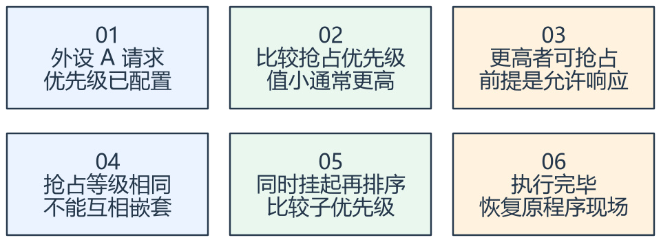

看图方法：先读每张卡片的关键词，再用下文核对它们之间的关系。

课件采用 Cortex-M3 的 NVIC 优先级分组。先理解抢占优先级控制是否能打断当前 ISR，子优先级主要用于同抢占等级的挂起请求排序。

数字更小通常表示更高的硬件中断优先级，但只有芯片实现的优先级位才有效。分组决定这些位如何分配，不是增加新的硬件优先级位。

异常进入时硬件会保存规定的一组寄存器，处理程序返回时恢复。软件或编译器可能另行保存其他寄存器；这与“中断把整个程序复制一份”不同。

发生中断时，CPU 在向量表中读取处理入口并转移执行；向量项里的处理地址不是以普通参数方式传给 ISR。

## 三、把采集与慢业务分开

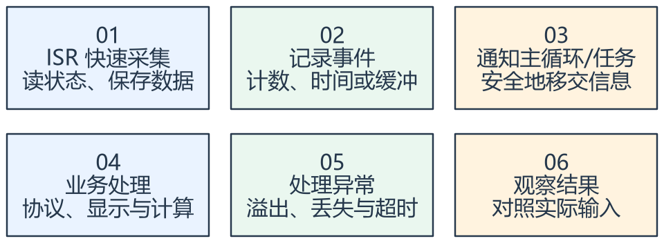

看图方法：先读每张卡片的关键词，再用下文核对它们之间的关系。

在 ISR 内尽量完成必要的采集、清标志和通知，把耗时显示、长延时、复杂业务放在主循环或任务中。ISR 时间过长会增加其他请求的响应延迟。

共享数据需要考虑一致性。volatile 使访问不被不适当地优化，但不自动保证多个字段同时更新或复合读改写原子化。

按键中断仍需要消抖，遮挡计次也需要确认有效边沿。一个业务动作可以产生多个电气边沿，必须按传感器输出含义选择触发方式。

使用 RTOS 时，还需遵守 FromISR 接口与中断优先级限制；不能在 ISR 内调用会等待阻塞的普通任务接口。

## 专项图解

### 抢占：高 ISR 完成后，先恢复被打断的低 ISR

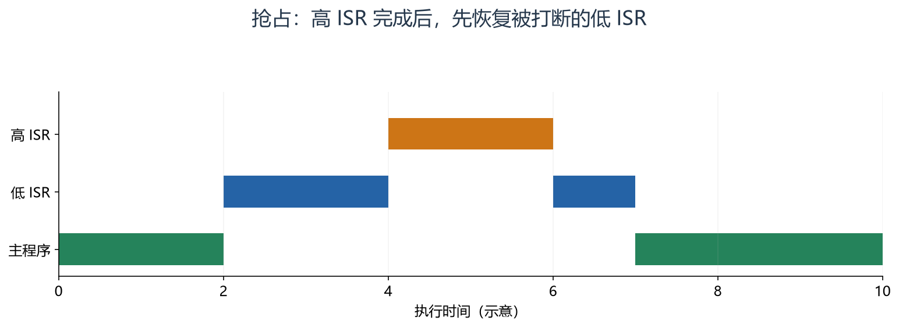

沿横轴看：主程序 → 低 ISR → 高 ISR → 低 ISR 剩余部分 → 主程序。只有抢占优先级满足条件才这样嵌套；子优先级不能单独实现这一效果。

### 向量表：存入口地址的位置，与入口地址本身不同

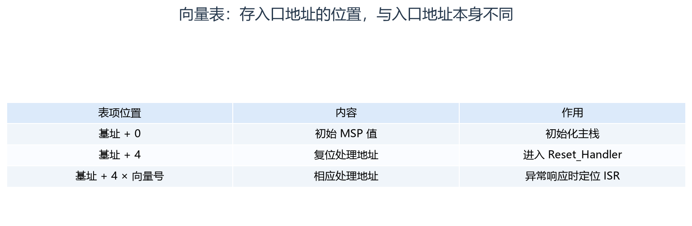

第一列是表项地址，第二列是该地址中存的值，第三列是用途。外部 IRQ 的向量号一般为 IRQn + 16；VTOR 移动表的位置不会自动重装 MSP。

### 同号引脚经过选择，映射到一条 EXTI 线

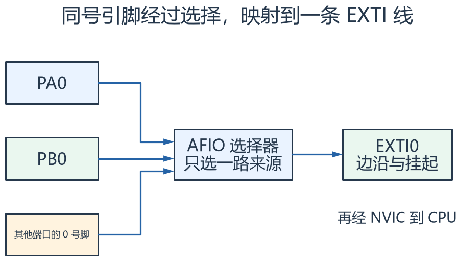

三路箭头表示候选输入，不是同时启用的三路信号。同一条 EXTI0 由 AFIO 选择一个端口来源，再做触发和挂起判断。

## 对照课件原图

下面图片截取自同目录原 PDF；页码为 PDF 阅读器中的物理页序号。
先读重绘解释，再用原图核对硬件框图或课件细节。

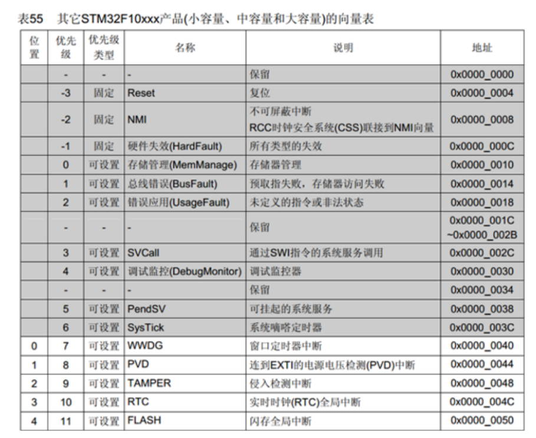

课件 P3（原图局部）：表中包括系统异常与外部中断，注意向量号和外设 IRQ 编号的区别。

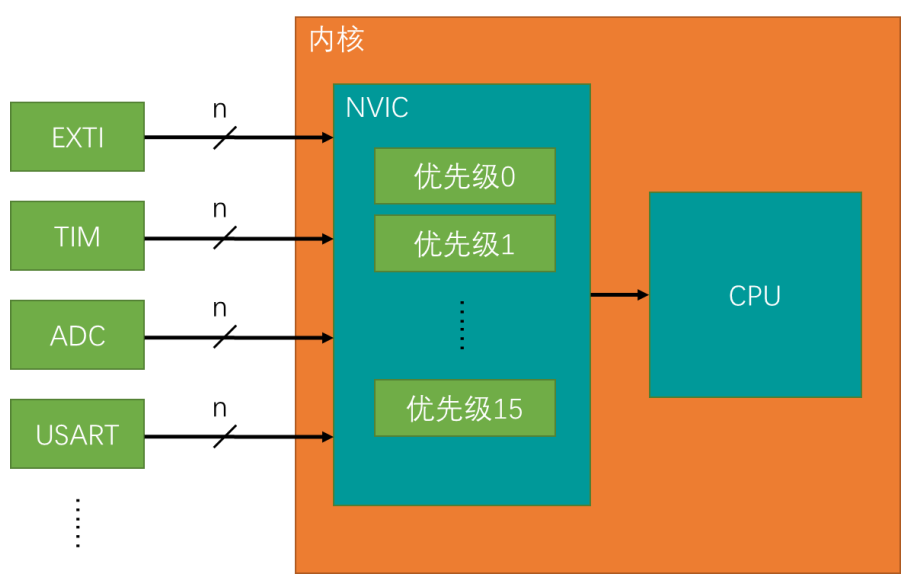

课件 P4（原图局部）：沿外设请求 → NVIC → CPU 看优先级的位置。

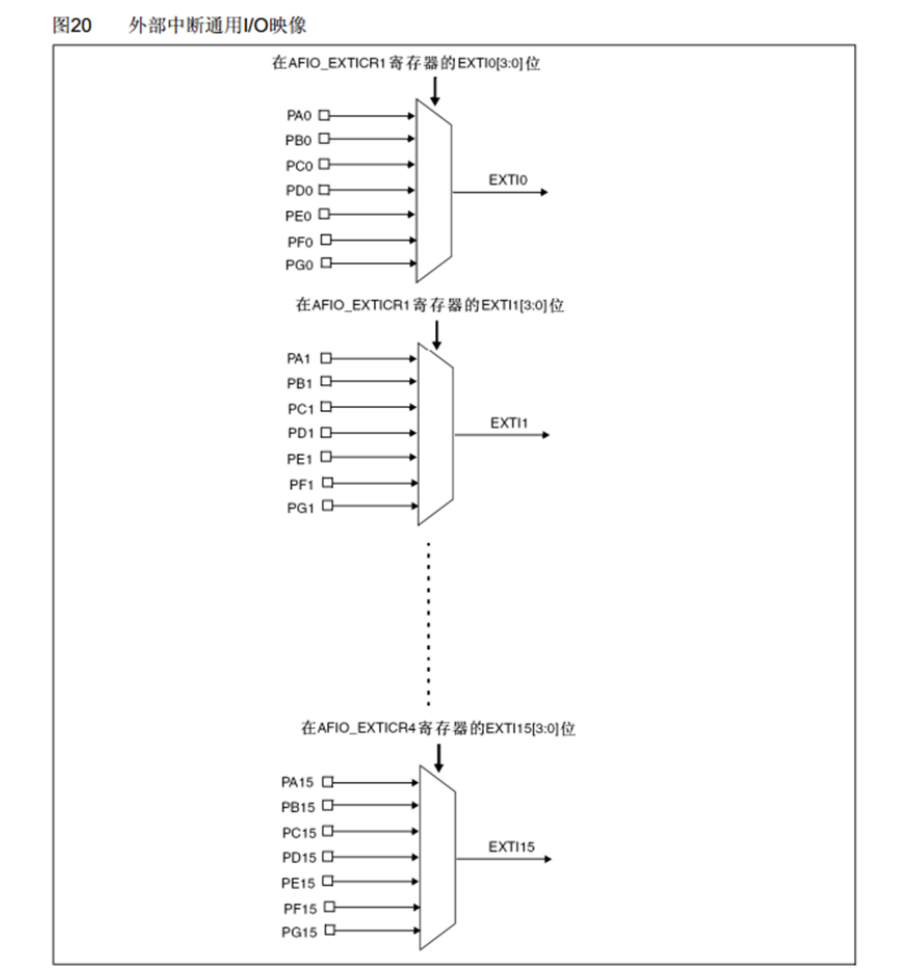

课件 P7（原图局部）：同号引脚通过选择器接到一条 EXTI 线，理解资源互斥。

## 关键概念速查

| 名称 | 应该记住什么 |
|---|---|
| AFIO | 选择 F1 外部中断线连接到哪一个 GPIO 端口 |
| EXTI | 边沿检测、事件/中断屏蔽和挂起状态 |
| NVIC | CPU 侧请求使能、优先级与分发 |

## 具体例子

遮挡传感器产生下降沿，映射到 EXTI0 后挂起；NVIC 允许响应时进入 ISR，软件确认并清 PR、增加事件计数，再由主循环更新 OLED。

## 实验时如何验证

- 确认 AFIO 映射、边沿、EXTI 屏蔽和 NVIC 配置。
- 记录输入边沿、ISR 进入和退出，检查抖动与响应时间。
- 验证共享 IRQ 的来源判断，以及清标志后不再无故重入。

## 常见误区

- 子优先级更高不代表能打断同抢占等级的 ISR。
- 同号 EXTI 只能选一个端口来源。
- 只清 CPU 侧挂起状态可能没有清掉真正的外设请求。

## 自测：先想答案，再展开

两个中断抢占优先级相同能互相嵌套吗？

不能靠子优先级实现互相抢占。

为何中断函数不断重入？

先检查真实来源是否仍挂起、清除方式和信号抖动。

## 深入学习：中断从请求、仲裁到现场恢复

本节目录：

- [1. 一个边沿如何经过三层开关](#deep-1)
- [2. PR 写一清零，为什么普通 |= 可能清掉别的事件](#deep-2)
- [3. NVIC 四个实现位如何分组](#deep-3)
- [4. 硬件入栈保存了什么](#deep-4)
- [5. 响应延迟与服务耗时必须分开测](#deep-5)
- [6. PRIMASK、BASEPRI 与临界区](#deep-6)
- [7. ISR 与任务交接为何不能只加 volatile](#deep-7)
- [8. 用诊断问题代替盲目改优先级](#deep-8)

### 1. 一个边沿如何经过三层开关

以 F103 PA0 下降沿为例，先由 AFIO_EXTICR1 选择 EXTI0 的端口来源，EXTI_FTSR 选择下降沿，EXTI_IMR 决定是否向中断路径放行。
边沿可形成 PR 挂起记录，之后还有 NVIC 的 IRQ 使能、优先级与内核屏蔽条件，最终 CPU 才响应。

事件路径的 EMR 与中断路径的 IMR 不是一回事。用于事件或唤醒的条件与“进入 ISR”必须分别配置。
某些线共用中断入口，所以进入 EXTI9_5_IRQHandler 后还要区分是哪条线，不是名字里出现 5 就只有 EXTI5。

关 IMR 主要控制请求传播，不应假定自动清 PR；关 NVIC 也不清掉外设产生事件的事实。
重新使能前若旧挂起仍存在，可能立刻响应。应明确丢弃旧事件还是保留处理，不能每次机械清除而丢失有效输入。

### 2. PR 写一清零，为什么普通 |= 可能清掉别的事件

EXTI_PR 属于写一清零：目标位写 1 才清，写 0 保持。
假设 bit0 和 bit1 同时挂起，读 PR 得到 0b11，再执行“读值 OR bit0 后写回”，结果会把两个 1 都写回，两个挂起都被清掉。

只清目标位应采用该寄存器要求的直接写掩码，而不是套普通变量的读改写模式。
不过“同样是状态寄存器”不代表清除规则相同：TIM 的部分标志按写零清除，USART 还有规定的读序列。
先查每一位的访问语义，再决定操作方式。

<!-- extended:w1c -->

#### 机制补图：PR 读改写会把读到的其他 1 一起写回清除

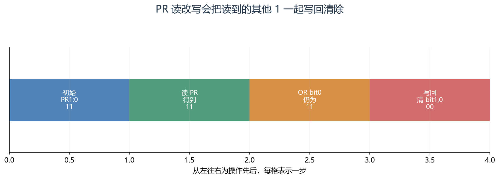

**读图方法与条件：** 这里两位同时挂起。PR |= (1<<0) 会写回11，两个事件都被清掉。只清 bit0 应直接写01，硬件执行 W1C 后保留 bit1，结果为10。这是寄存器语义，不能套用普通 RAM 的读改写直觉。

[放大查看 SVG](course-note-assets/extended/04/w1c.svg)

<!-- /extended -->

### 3. NVIC 四个实现位如何分组

F103 实现四个中断优先级位，可在抢占与子优先级之间划分。
例如两位抢占、两位子优先级意味着四个抢占等级、每级四个子等级，并非同时拥有 16 级抢占和 16 级子优先级。

抢占级更高者可打断较低者；同抢占级不能互相抢占，同时挂起时才进一步比较子优先级等规则。
CMSIS 接口常接收未左移的逻辑优先级，底层再移到实际实现位；直接写寄存器与调库接口不能混用同一种编码假设。

系统异常也参与优先级关系。NMI、HardFault 等与普通外部 IRQ 的优先级能力不同，不能把所有异常都理解为 NVIC_EnableIRQ 可管理的一类设备请求。

<!-- extended:preemption -->

#### 机制补图：抢占优先级决定能否打断，子优先级用于待处理仲裁

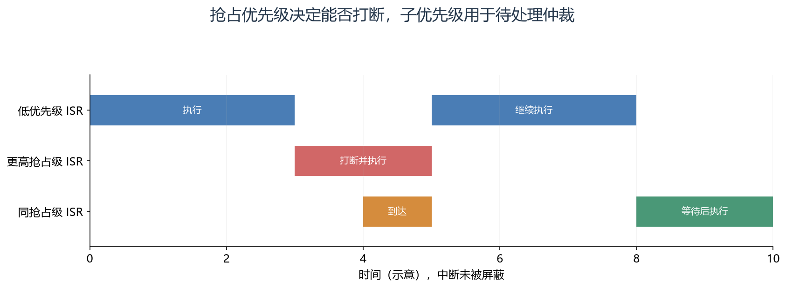

**读图方法与条件：** 第三行在 t=4 到达，但即便子优先级更高，也不能打断同抢占级的在执行异常。只有出现多个可服务的待处理中断时，才体现同级仲裁。

[放大查看 SVG](course-note-assets/extended/04/preemption.svg)

<!-- /extended -->

### 4. 硬件入栈保存了什么

典型 Cortex-M3 异常进入时，硬件保存 R0～R3、R12、LR、PC、xPSR，形成基本八字堆栈帧；满足对齐需求时还可能有额外对齐空间。
其他需要保留的寄存器由编译器/软件按调用约定处理，不能把八个字等同于整个 ISR 的全部栈消耗。

线程模式进入异常前可能使用 MSP 或 PSP；处理模式（Handler mode）下使用 MSP。LR 中的 EXC_RETURN 编码说明返回条件，不一定是普通调用的返回地址。
嵌套中断会进一步消耗异常栈；RTOS 中任务栈和主中断栈需要分别预算。

尾链允许连续处理挂起异常时减少不必要的出栈/再入栈，late arrival 可改变异常进入期间优先响应的对象。
这些优化降低某些开销，但不消除总线等待、长 ISR 和屏蔽对最坏响应时间的影响。

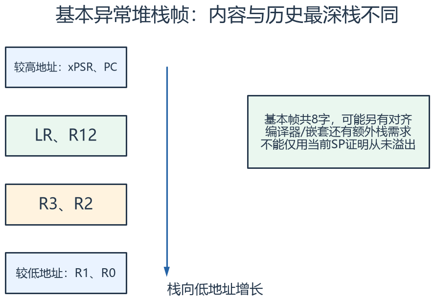

怎么看：按地址方向读八个字的位置。图示基本帧，不包含可能的对齐填充，也不包含 RTOS 软件另外保存的寄存器。

### 5. 响应延迟与服务耗时必须分开测

外部边沿到 ISR 第一条可观察动作是响应延迟；进入 ISR 到退出是服务时间。
二者都会影响业务完成时间，但原因不同。提高 IRQ 优先级可减少部分抢占等待，却无法缩短 ISR 内部的忙等和慢打印。

例如 10 kHz 输入每 100 μs 一次，ISR 平均执行 80 μs 已占约 80% CPU；若偶发执行 150 μs，平均数字看起来尚可，仍可能丢事件。
标志位合并、多次边沿覆盖与硬件捕获过载要分别评估，不能只观察软件计数“还在增加”。

<!-- extended:irq-latency -->

#### 机制补图：响应延迟、ISR 耗时与业务完成时间是三段

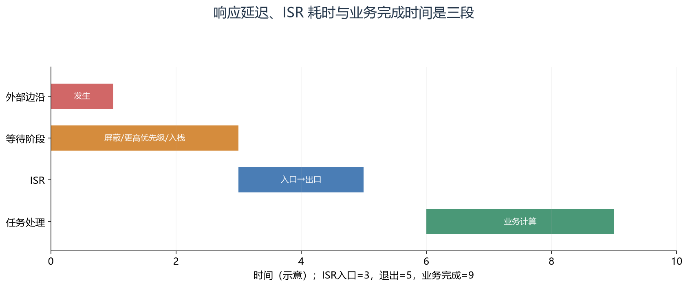

**读图方法与条件：** 边沿到 ISR 入口为3单位，ISR服务为2单位，端到端业务延迟为9单位。只在 ISR 入口和出口翻转 GPIO，测得的脉宽不能代表完整响应延迟。

[放大查看 SVG](course-note-assets/extended/04/irq-latency.svg)

<!-- /extended -->

### 6. PRIMASK、BASEPRI 与临界区

PRIMASK 可屏蔽普通可配置优先级异常，BASEPRI 则按优先级阈值屏蔽一部分异常。
屏蔽不会使外部世界停止，外设仍可能累计到有限的挂起状态或填满缓冲。
退出临界区后只是恢复响应资格，已经溢出丢失的数据不会自动补回来。

RTOS 的临界区常利用特定屏蔽机制，因此某些更高紧急程度中断仍可运行，但不能调用受内核约束的 API。
具体阈值必须从该工程的 FreeRTOSConfig.h、port 和优先级分组推导，不能复制一个通用数值。

### 7. ISR 与任务交接为何不能只加 volatile

若 ISR 更新 `{value, timestamp, valid}`，任务读完 value 后 ISR 又更新剩余字段，任务就可能拿到不同采样轮次的组合。
即便单个对齐字访问可原子完成，多字段快照与 `counter++` 这种复合动作仍不自动原子。

可按数据规模使用短临界区复制、双缓冲、版本检查或队列。每种方案还要处理写者速度、旧数据、版本回绕和对象生命周期。
ISR 宜保留必要状态、快速清源并通知消费者；显示、复杂协议和长存储操作由适当任务执行。

<!-- extended:snapshot-tear -->

#### 机制补图：volatile 无法保证两个字段来自同一轮更新

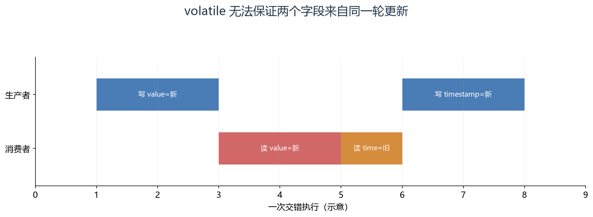

**读图方法与条件：** 消费者取得“新数值+旧时间”。volatile 约束编译访问，不提供多字段快照。应按并发关系选择短临界区、双缓冲或带内存顺序保证的版本化快照。

[放大查看 SVG](course-note-assets/extended/04/snapshot-tear.svg)

<!-- /extended -->

### 8. 用诊断问题代替盲目改优先级

| 现象 | 需要回答的问题 |
|---|---|
| 从不进入 ISR | 输入是否到脚？映射/触发/IMR/NVIC/向量是否全部成立？ |
| 不断重进 ISR | 真正请求源是否仍挂起？清除方式是否正确？输入是否抖动？ |
| 两路事件只处理一路 | 共用入口是否逐源判断？W1C 读改写是否误清其他位？ |
| 偶发 HardFault | 栈余量、非法共享对象、ISR API 与异常现场如何？ |
| 任务被饿死 | ISR 总负载、嵌套、关中断时长与高优先级忙等如何？ |

仪器上同时采集输入与短 ISR 标记，可以分离物理事件、响应延迟和处理耗时。
GPIO 标记本身有开销，应说明测量方法；过长串口打印会大幅改变待测系统。

## 资料与验证边界

入门部分依据同目录课件；深入部分补充官方资料与明确条件下的推导。课件中的产品宣传、历史软件版本、
简化图和典型性能不直接作为当前板卡、固件或全部同系列产品的保证。
本次只整理资料与图文，没有编译固件、下载或进行硬件实测。
实际接线、电平、寄存器差异和模块命令须核对所用器件资料。

## 图源与后续修改

[可编辑概念图](course-note-assets/04/concepts.drawio)；
[本课图源目录](course-note-assets/04)。
概念图同时提供 JSON、SVG 与 PNG，专项图提供 SVG 与 PNG。
SVG 可放大查看；JSON 可用 diagramry 重绘。课件原图保持原貌，
不把截图中的文字改写成未经证实的新协议。

[专项图重绘脚本](course-note-assets/_source/redraw.py) ·
[图源使用说明](course-note-assets/_source/图源说明.md)

## 继续学习与资料对照

[跨外设工程专题](<01_跨外设工程专题与阅读索引.md>) · [资料来源与适用范围](<02_图文笔记资料来源与适用范围.md>)

深入部分包含官方机制对照和教学推导；模块命令、电气接线与固件差异按资料页的边界处理。

[深入配图源目录](course-note-assets/deep/04) · [深入图重绘脚本](course-note-assets/_source/deeper_diagrams.py)
