# 2-1-4-2_STM32基础 - AD转换与DMA：图文笔记

[直接阅读深入学习](#deep-study) · [跨外设工程专题](<01_跨外设工程专题与阅读索引.md>)

ADC 负责把电压转换为数字，DMA 负责把结果及时搬进内存。扫描决定转换顺序，连续决定是否重复，二者是两个维度。

[返回学习导航](<00_单片机基础图文笔记导航.md>) · [打开原课件](<2-1-4-2_STM32基础 - AD转换与DMA.pdf>)

## 阅读范围

原课件共 29 页；阅读定位：P1–8 ADC 原理、模式和转换时间；P9–14 采样实验；P15–23 DMA；P24–29 DMA 与 ADC 实验。
图中卡片用于拆分概念，编号是阅读顺序；卡片之间不自动表示时间或因果。
重绘时序与数值例子会在图旁写出前提，不代表开发板实测。

## 一、电压怎样变成一个数字

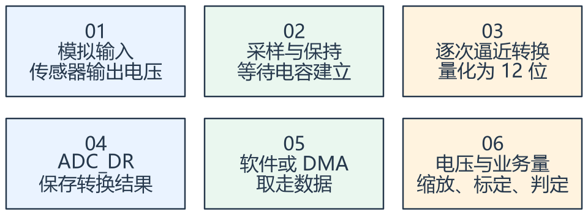

看图方法：先读每张卡片的关键词，再用下文核对它们之间的关系。

ADC 输入不是无限范围。课件以 3.3 V 为参考示例，实际允许范围与转换比例要结合 VDDA、VREF 和具体型号。12 位可表示
0～4095，但这不等于有 12 位准确度。

可以用 3.3 V / 4096 估计一个量化刻度约 0.806 mV。用端点线性换算 Vin ≈ code × Vref / 4095
便于显示；严格转换特性还要考虑量化、偏移、增益和饱和。

采样时间给输入源给内部采样电容充电的机会。高源阻抗、分压阻值过大或快速切换通道时，过短采样会造成误差。总转换时间还包括转换阶段。

课件中“1 μs 转换”是满足时钟与采样设置时的条件示例，不是每一种通道、采样时间和精度要求下都保证 1 μs。

## 二、扫描与连续是两项独立选择

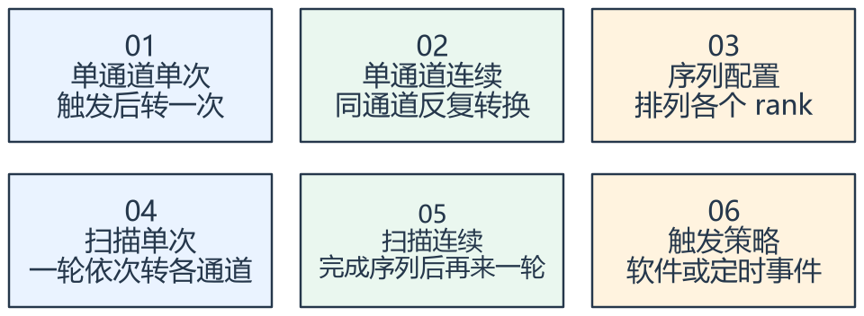

看图方法：先读每张卡片的关键词，再用下文核对它们之间的关系。

扫描回答“一次序列要转哪些通道”，连续回答“完成后是否自动继续”。不能把扫描简单理解为多任务，也不能把连续等同于多通道。

例如序列按 PA0、PA1、PA2 对应通道排列，转出的数值必须按 rank 次序解释；物理通道号不一定恰好等于缓冲数组下标。

多通道通常依次采样，不是同时采样。测快速变化信号时，需考虑通道之间的采样时间差。GPIO 也应配置到适合模拟采样的模式。

ADC 时钟受型号限制。不能因为 CPU 是 72 MHz，就直接给 ADC 72 MHz；课件 F1 的 ADC 时钟上限及转换条件需按手册核对。

## 三、ADC 与 DMA 怎样把一轮数据排进数组

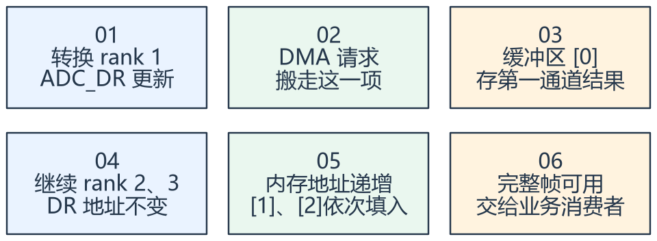

看图方法：先读每张卡片的关键词，再用下文核对它们之间的关系。

ADC_DR 是固定外设地址，而内存缓冲地址通常递增。12 位结果通常放入 16 位元素，DMA 两端的数据宽度、对齐、元素数量要一致。

循环 DMA 到尾部后重新装载计数，可以不断采集；但业务读取时可能正碰上下一轮覆盖。DMA 运行不等于自动得到一致快照。

可通过半传输/全传输事件划分可消费块，或采用双缓冲、版本和复制快照。还应确认数据更新时间与消费者速度，避免把旧值当新值。

DMA 只搬运，不理解“这是温度还是电压”。通道顺序、有效性、单位和时间戳应由上层采集服务明确发布。

### 延伸：循环 DMA 与链式 DMA 有什么不同

循环 DMA 关注同一配置怎样重复使用缓冲区；链式 DMA 关注硬件怎样取得
下一段搬运参数。双缓冲则关注 CPU 与 DMA 的数据交接，可以有不同实现。
具体控制器是否支持描述符链，要查对应型号手册，不能由“支持 DMA”直接推出。

[阅读 DMA 链式传输图解](<../ADC_DMA/15_DMA链式传输图解.md>)：
四张图理解描述符、请求和双缓冲。

## 专项图解

### ADC 把连续电压分成离散码值

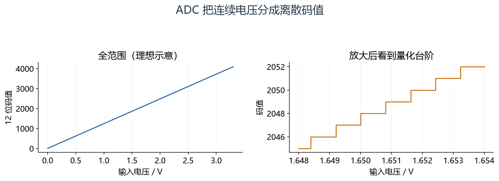

左图看全范围，右图看局部台阶。以 3.3 V、12 位为例，一步约 0.806 mV；图未包含噪声、偏移和增益误差，不能当作实测精度。

### 固定外设地址 + 递增内存地址，形成一轮数据

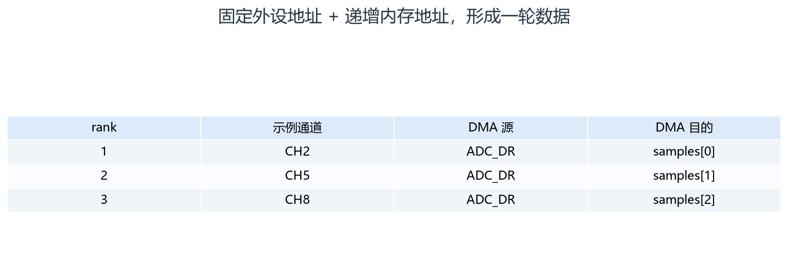

按行看采样顺序：rank 是序列位置，CH 是物理通道号，数组下标按搬运顺序。三者不是天然相等；DMA 完整帧完成后才能按一致性策略交给消费者。

### 循环 DMA 与 CPU 读取必须划分一致的数据块

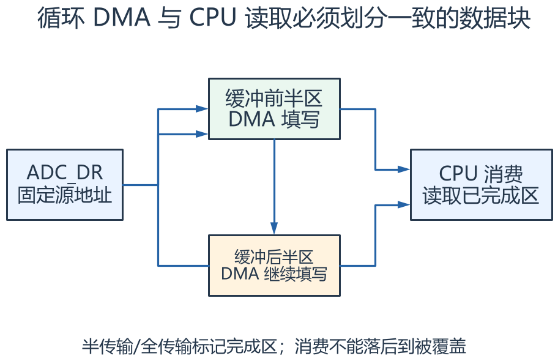

沿左侧看固定地址的数据不断搬进内存，沿上下看两块轮换。CPU 读取已完成块时，DMA 应在另一块写；半/全完成机制并不自动防止消费者过慢。

## 对照课件原图

下面图片截取自同目录原 PDF；页码为 PDF 阅读器中的物理页序号。
先读重绘解释，再用原图核对硬件框图或课件细节。

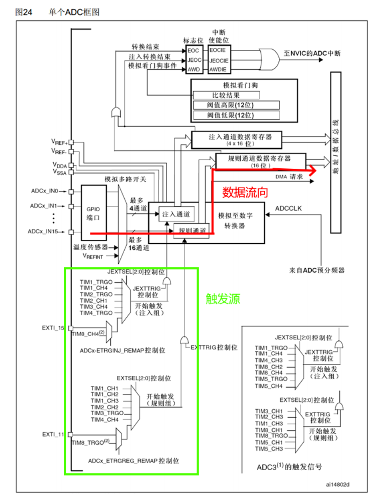

课件 P3（原图局部）：先找通道选择、采样转换、结果寄存器及触发路径。

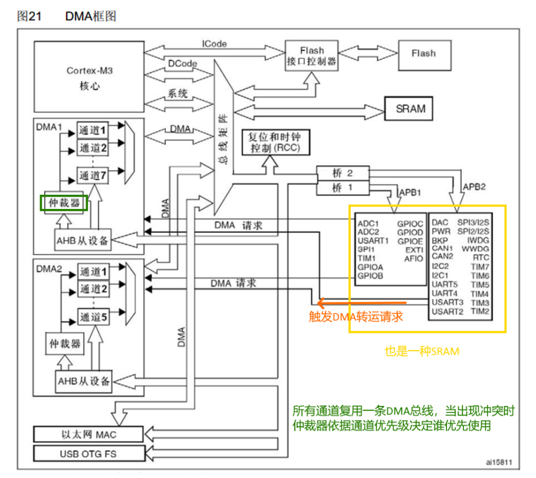

课件 P18（原图局部）：DMA 是总线使用者，数据搬运仍需要正确的请求和配置。

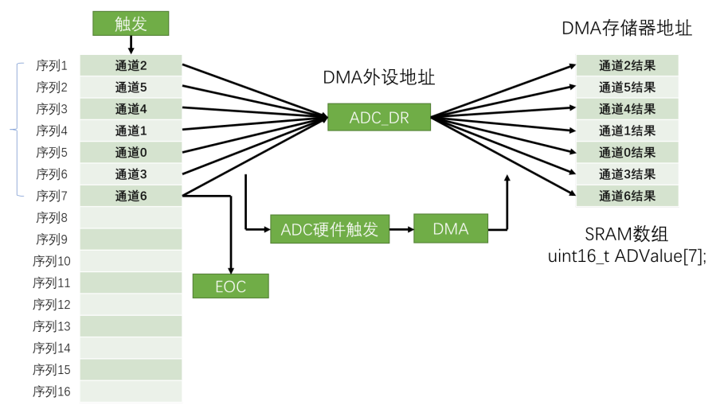

课件 P23（原图局部）：沿通道序列 → ADC_DR → 递增内存槽观察数据排列。

## 关键概念速查

| 名称 | 应该记住什么 |
|---|---|
| ADC | 采样、转换、通道序列与触发 |
| DMA | 源/目的地址、宽度、增量、数量与循环 |
| 业务快照 | 通道含义、缩放、更新时间和有效性 |

## 具体例子

序列为 CH0、CH1、CH2，DMA 将三次结果依次放到 samples[0..2]。若读到 2048，参考电压按 3.3 V 示例，输入约为
1.65 V；再按传感器比例换算实际量。

## 实验时如何验证

- 核对模拟范围、参考电压、通道序列和 DMA 元素宽度。
- 输入已知电压，对照原始码值和换算值，确认数组次序。
- 提高采样速率观察消费者是否读到跨轮数据，并检查过期判定。

## 常见误区

- DMA 的数量一般以传输单元计，不一定以字节计。
- 多通道扫描不保证各通道同一瞬间采样。
- ADC 转换完成与 DMA 缓冲整帧完成是不同的观察点。

## 自测：先想答案，再展开

为什么 DMA 外设地址不递增？

每次结果都从同一个 ADC_DR 读取。

为什么循环 DMA 数组仍可能读乱？

CPU 可能读到正在被下一轮覆盖的部分数据。

## 深入学习：采样精度、时间分辨率与 DMA 数据所有权

本节目录：

- [1. 采样保持为什么对输入阻抗敏感](#deep-1)
- [2. 分辨率、准确度、噪声与 ENOB](#deep-2)
- [3. 转换速率由采样周期和转换周期共同决定](#deep-3)
- [4. 采样率与混叠：数字滤波救不了所有失真](#deep-4)
- [5. 扫描、连续、触发、规则/注入组是不同维度](#deep-5)
- [6. DMA 传的是单元，不是业务消息](#deep-6)
- [7. 循环缓冲区怎样判定“这块数据归我读”](#deep-7)
- [8. 采集服务对上层应发布什么](#deep-8)
- [9. 练习：设计一个三路周期采集](#deep-9)

### 1. 采样保持为什么对输入阻抗敏感

ADC 在采样窗口内通过内部开关给采样电容充电，进入转换阶段后再量化。
若输入源阻抗较大，RC 建立不足，采样电容电压尚未接近真实输入，转换再快也只是在准确量化一个尚未建立的电压。

理想一阶模型中，残余误差约为初始电压差乘 e^(−t/RC)。若希望满量程跳变后的误差小于半个 12 位 LSB，需要 t 大于约 ln(8192)RC≈9.01RC。
这里 R 包含源阻抗与等效开关影响，C 也不是任意假设的外接电容值；工程取值应按数据手册允许输入阻抗、采样时间及实测建立情况选择。

通道从高电压切到低电压时，前一个采样状态可能影响下一个通道。因此“每路单独测都准，放进扫描后偏差大”应先考虑建立时间与序列影响，而不是只在换算公式里改一个常数。

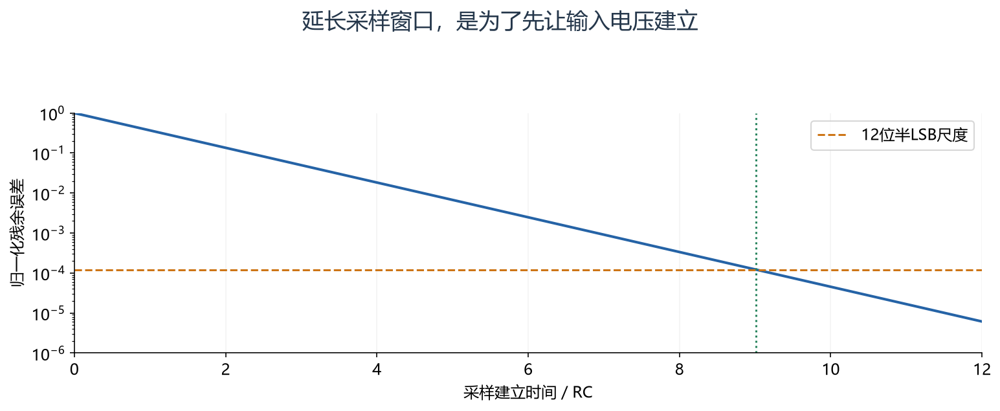

怎么看：横轴以 RC 为单位，纵轴为相对残余误差。曲线降到半个 12 位 LSB 的尺度需要约 9.01RC；这里仅采用一阶满量程阶跃模型。

### 2. 分辨率、准确度、噪声与 ENOB

12 位有 4096 个离散码，但偏移、增益、非线性、参考电压误差和噪声都会影响真实测量。
以 3.3 V 为例，一步约 0.806 mV；这不意味着结果绝对误差必然小于 0.806 mV。

参考电压若偏高 1%，用错误 Vref 换算就可能产生约 1% 比例误差。读取内部参考或执行标定是否能改善，取决于器件提供的校准信息和实际测量方案。
F1 的 ADC 校准需要在规定条件下完成，但校准并不能修复传感器误差、前端分压公差和不良接地。

对独立、近似零均值随机噪声，平均 N 次可使标准差约降为原来的 1/√N；系统性偏差不会这样消失。
平均还引入延迟。长度 16 的滑动平均对时序的影响，不能只用“更平滑”概括。

<!-- extended:accuracy-noise -->

#### 机制补图：读数稳定与接近真实值，是两个不同维度

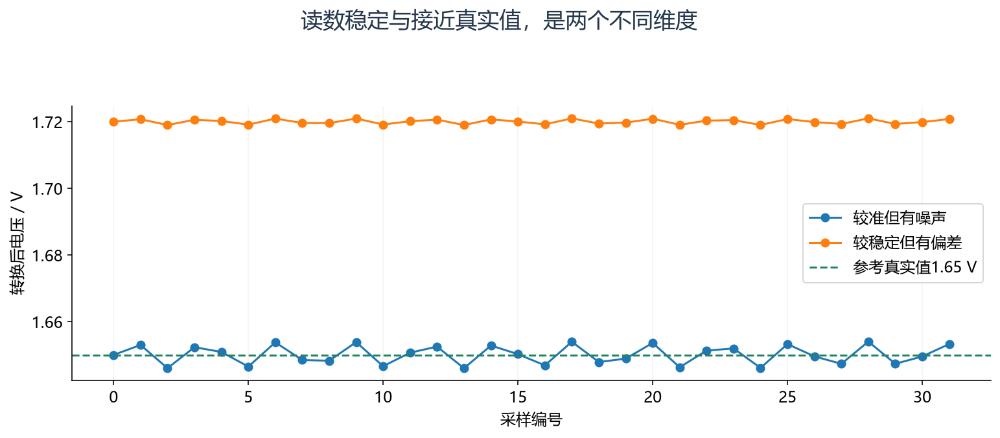

**读图方法与条件：** 两组数据是人为构造的对照。多次平均可减小部分随机噪声，不会自动消除参考电压误差、增益误差或直流偏差。

[放大查看 SVG](course-note-assets/extended/05/accuracy-noise.svg)

<!-- /extended -->

### 3. 转换速率由采样周期和转换周期共同决定

F103 常规 12 位转换：Tconv=(采样周期数+12.5)/fADC。
例如 fADC=12 MHz、采样 55.5 周期，则一次约 (55.5+12.5)/12 MHz=5.667 μs。
如果扫描三路且配置相同，一轮转换至少约 17 μs，尚需考虑触发与系统实际条件。

F103 的 ADC 时钟上限不能由 CPU 主频推断；72 MHz PCLK2 常选择分频得到不超过允许上限的 ADC 时钟。
设定外部触发周期时，必须保证一整轮能完成。触发频率高于 ADC 实际处理能力，不能得到预期数量的独立样本。

三路一轮 17 μs，不代表三路在同一时刻采样。对于相位比较、瞬态电流和快速控制，要区分同序列采样和真正同步采样能力。

<!-- extended:scan-timing -->

#### 机制补图：三通道扫描的同一轮数据，也不是同一瞬间采样

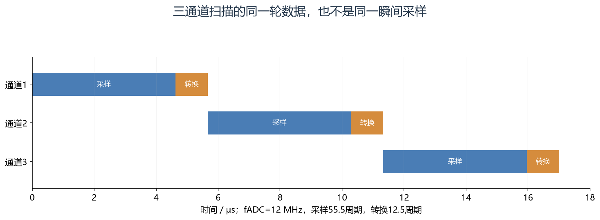

**读图方法与条件：** 一通道约5.667 μs，三通道约17 μs。扫描是依次进行；三相电流等强同步需求还要评估通道间的采样偏移。

[放大查看 SVG](course-note-assets/extended/05/scan-timing.svg)

<!-- /extended -->

### 4. 采样率与混叠：数字滤波救不了所有失真

均匀采样的 Nyquist 条件要求带限信号的采样率大于最高频率的两倍，但工程中还需滤波过渡带和足够相位/幅值裕量。
若用 1 kHz 采样观察 700 Hz 正弦，离散样本会呈现与 300 Hz 分量相混淆的结果。
采样后再做低通，不能知道这个 300 Hz 原来来自哪一个连续频率。

因此抗混叠滤波在采样前就要考虑。数字平均适合抑制部分噪声，不等于前端没有带宽约束。
传感器输出速率、模拟前端带宽和 DMA 更新频率也不是同一个“采样率”。

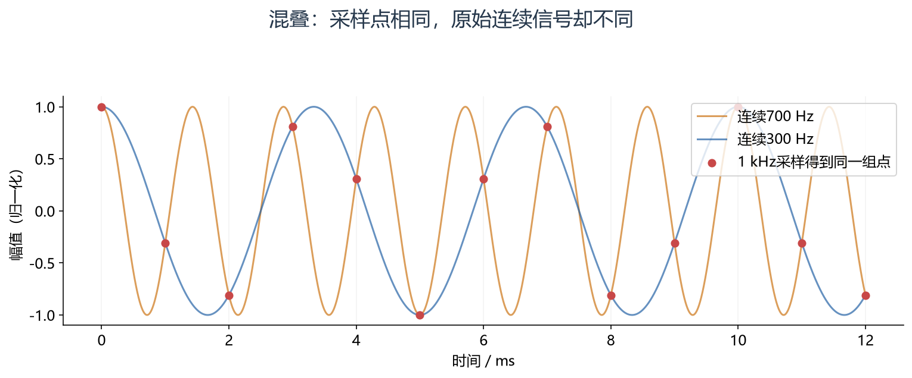

怎么看：对照连续曲线与采样点：在图示相位条件下，700 Hz 与 300 Hz 的不同连续波形可给出相同样本。采样后无法凭这些点恢复区别。

### 5. 扫描、连续、触发、规则/注入组是不同维度

扫描指定序列内多个 rank；连续决定一轮后是否自动继续；外部触发决定开始时刻；规则组与注入组提供不同使用路径。
不能把这些配置混成“打开连续扫描后，一切按定时器周期采集”。连续模式可能让后续序列自由运行，与逐次定时触发的目标不同。

典型受控采样链路是定时器事件→一次规则序列→DMA搬运完整轮次。应逐项确认该 ADC 实例支持的外部触发源和 DMA 路径。
寄存器位置可按 SMPR 配采样时间、SQR 配规则序列、CR1/CR2 配运行模式、DR 提供结果来理解。

### 6. DMA 传的是单元，不是业务消息

DMA 需要源地址、目的地址、两端宽度、是否递增、方向、数量、循环和请求映射。
例如 ADC 结果用 16 位元素，长度 96 表示 96 个传输单元，通常对应 192 字节，不是 96 字节。
数组 rank 顺序由 ADC 决定，DMA 只依次复制，不能根据数值自行识别 CH0 或温度。

数据量可以估算：三通道、每通道 10 ksample/s、16 位结果，原始负载约 60 kB/s。
总线实际开销还包括外设读取与内存写入、仲裁以及 CPU 竞争。DMA 减少 CPU 搬运工作，不表示不占带宽。

### 7. 循环缓冲区怎样判定“这块数据归我读”

半传输完成后，前半区可交给 CPU，DMA 继续写后半区；全传输完成后角色交换。
消费者必须在 DMA 回来覆盖该半区前完成处理，或复制到独立快照。如果消费者连续落后，多大的缓冲最终也会填满。

缓冲设计应明确：一块包含多少完整扫描轮、时间戳代表块起点还是结束点、处理是否允许丢块、过载后如何报告。
不要把半传输边界放在一轮通道序列中间而仍按完整帧解读。

F103 Cortex-M3 的本课范围没有数据缓存一致性问题，但换到带 D-cache 的 MCU 后，DMA 与 CPU 共享内存还可能需要缓存维护和可访问区域规划。
这属于平台迁移边界，不能反过来给本课随意加入无效的 cache 操作。

<!-- extended:dma-ownership -->

#### 机制补图：半缓冲交接给 CPU 的，是一个有限时间的读取窗口

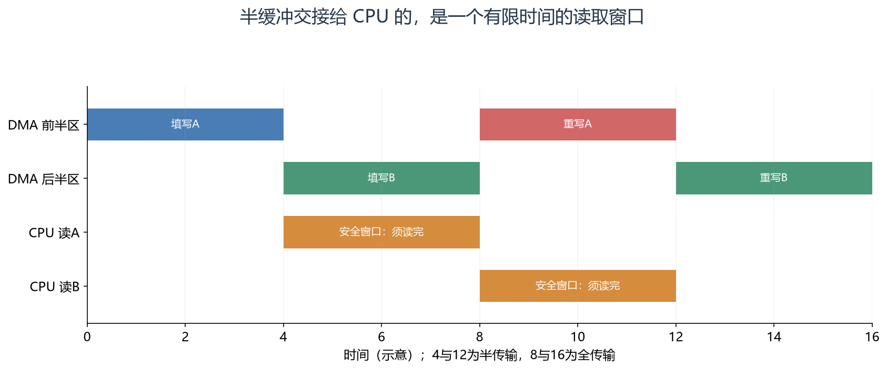

**读图方法与条件：** t=4 时前半区完成，但 t=8 起又被 DMA 使用。若 CPU 读A延续到t=8 之后，就可能混入下一轮。标志位不会自动锁住内存。

[放大查看 SVG](course-note-assets/extended/05/dma-ownership.svg)

<!-- /extended -->

### 8. 采集服务对上层应发布什么

建议数据至少包含原始值或物理量、单位、采样时间/年龄、有效性与错误原因。
`cfg` 保存量程、序列、采样周期与标定；`ctx` 保存缓冲索引和采集阶段；`data` 提供完整快照；`ops` 提供启动、停止、获取快照等接口。
业务层请求“读取有效温度”，不必知道 DMA 的当前 CNDTR 值。

输入断线、超范围、等待超时和 DMA 错误要区分。全零既可能是真实零输入，也可能是未更新缓冲，不能用一个数值替代全部有效性判断。

### 9. 练习：设计一个三路周期采集

要求每路 1 ksample/s，三路依次转换，fADC=12 MHz，每次采样 55.5 周期。
一轮约 17 μs，小于 1 ms 周期；定时器按支持的触发源每毫秒启动一轮。
若 DMA 一半区存 32 轮，则每半区 96 个 16 位元素、192 字节，约每 32 ms 产生一个可消费块。

控制若要求 2 ms 内得到新数据，32 ms 整块交付就不合适，即使总吞吐足够。
缓冲增大可以增加处理余量，但会增加分块交付延迟；应从业务截止时间反推块长度。

<!-- extended:batch-latency -->

#### 机制补图：缓冲区越大，回调越少，但批量交付等待越长

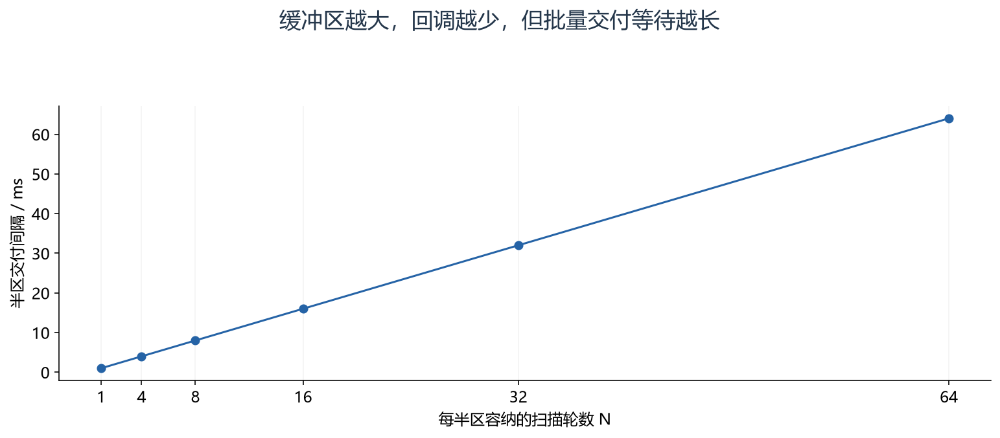

**读图方法与条件：** 假设每1 ms完成一轮三通道扫描。每半区N轮，则每N ms交付一次。N=32 时半区96个半字、整缓冲384 B；首轮等到第32轮才交付，约额外等待31 ms，还需计入转换和调度时间。

[放大查看 SVG](course-note-assets/extended/05/batch-latency.svg)

<!-- /extended -->

## 资料与验证边界

入门部分依据同目录课件；深入部分补充官方资料与明确条件下的推导。课件中的产品宣传、历史软件版本、
简化图和典型性能不直接作为当前板卡、固件或全部同系列产品的保证。
本次只整理资料与图文，没有编译固件、下载或进行硬件实测。
实际接线、电平、寄存器差异和模块命令须核对所用器件资料。

## 图源与后续修改

[可编辑概念图](course-note-assets/05/concepts.drawio)；
[本课图源目录](course-note-assets/05)。
概念图同时提供 JSON、SVG 与 PNG，专项图提供 SVG 与 PNG。
SVG 可放大查看；JSON 可用 diagramry 重绘。课件原图保持原貌，
不把截图中的文字改写成未经证实的新协议。

[专项图重绘脚本](course-note-assets/_source/redraw.py) ·
[图源使用说明](course-note-assets/_source/图源说明.md)

## 继续学习与资料对照

[跨外设工程专题](<01_跨外设工程专题与阅读索引.md>) · [资料来源与适用范围](<02_图文笔记资料来源与适用范围.md>)

深入部分包含官方机制对照和教学推导；模块命令、电气接线与固件差异按资料页的边界处理。

[深入配图源目录](course-note-assets/deep/05) · [深入图重绘脚本](course-note-assets/_source/deeper_diagrams.py)
