# STM32 定时器中断与输出比较笔记

[直接阅读深入学习](#deep-study) · [跨外设工程专题](<01_跨外设工程专题与阅读索引.md>)


定时器的核心是：时钟驱动 CNT 计数，配置决定计数速度、周期和输出行为。
本笔记配合本目录的定时器课件阅读，按时钟、计数、更新中断、PWM 输出的顺序学习。

本文 PWM 原理示例采用 STM32F103C8T6 的 TIM2：内部时钟、连续向上计数、
PWM 模式1、有效高电平。假设定时器输入时钟为 72 MHz；
实际输入时钟必须根据当前芯片的 RCC 时钟树确认，不能直接等同于 CPU 主频。


[返回图文笔记导航](<00_单片机基础图文笔记导航.md>)

## 阅读范围与学习顺序

本篇整理定时器时基、更新中断、输出比较和 PWM，重点讲清输出的因果关系。
输入捕获对应下一份课件，本篇不展开。

建议依次回答下面几个问题：

1. 定时器的时钟从哪里来？
2. CNT 多久加 1，什么时候回到 0？
3. 更新事件如何变成 CPU 中断？
4. CCR 如何决定 PWM 的高低电平？
5. 如何选择参数，并让新参数在合适的时机生效？

## 一、定时器有哪些类型？

按课件所用的 STM32F103C8T6：

| 类型 | 本芯片的定时器 | 本次学习的主要能力 |
| --- | --- | --- |
| 高级定时器 | TIM1 | 时基、PWM；另有互补输出、死区、刹车等控制 |
| 通用定时器 | TIM2、TIM3、TIM4 | 时基、更新中断、输出比较、PWM 等 |
| 基本定时器 | 本芯片无 TIM6、TIM7 | 其他型号可用其完成时基、触发等功能 |

不要把整个 STM32F1 系列的资源表当作 C8T6 的实际资源表。
本篇使用 TIM2，可以聚焦基本计数和 PWM，不必先处理高级定时器的额外输出控制。

## 二、时钟先经过哪里？

使用内部时钟时，关系可以写成：

```text
RCC 时钟树 → 定时器输入时钟 fTIM → PSC → 计数时钟 fCNT → CNT
```

STM32F103 的 TIM2 位于 APB1。对应的定时器时钟规则为：

| APB1 预分频 | TIM2 内部时钟来源的频率 |
| --- | --- |
| 系数为 1 | fTIM = PCLK1 |
| 系数大于 1 | fTIM = 2 × PCLK1 |

例如典型的 HCLK = 72 MHz、APB1 二分频配置：

```text
HCLK = 72 MHz
PCLK1 = 36 MHz
APB1 分频系数为 2，所以 TIM2 输入时钟 = 2 × 36 MHz = 72 MHz
```

这个倍频关系来自该系列的 RCC 设计，不能不看芯片型号就套给其他 STM32。
RCC 的外设时钟使能与 CR1.CEN 也有区别：
前者提供外设运行所需的时钟，后者控制计数器开始或停止计数。

## 三、先理解 CNT 的运行方式

| 模式 | 典型计数序列 | 本篇是否使用 |
| --- | --- | --- |
| 向上计数 | 0、1、…、ARR、0、1、… | 使用 |
| 向下计数 | ARR、…、1、0、ARR、… | 只作概念对照 |
| 中心对齐 | CNT 在上下两个方向往返 | 入门部分不套用；深入部分另作推导 |

CNT 保存当前值，ARR 保存边界，PSC 决定两个计数变化之间隔多久。
读到 CNT = 5 只知道当前处于第几个刻度；
要换算为时间，还需要知道 fCNT、起点和是否经过溢出。

## 四、定时器的关键寄存器

先记住：**PSC 决定数多快，CNT 表示数到哪，ARR 决定一轮多长，
CCR 决定 PWM 高电平持续多久。**

| 寄存器 | 作用 | 在 PWM 示例中的意义 |
| --- | --- | --- |
| PSC | 预分频配置 | 输入时钟除以 PSC + 1，决定 CNT 的步长时间 |
| CNT | 当前计数值 | 硬件不断改变的数值，从 0 数到 ARR 后循环 |
| ARR | 自动重装载值 | 向上计数的上限，一轮包含 ARR + 1 个刻度 |
| CCR1～CCR4 | 捕获/比较值 | 输出时作为比较阈值，本节以 CCR1 为例 |
| CR1 | 运行控制 | 控制启动、方向、计数模式和 ARR 预装载等 |
| CCMR1/2 | 通道模式配置 | 选择输出模式，例如 PWM 模式1 |
| CCER | 通道输出控制 | 配置输出使能及极性 |
| DIER | 中断/DMA 请求使能 | 硬件持续输出 PWM 本身不要求开启中断 |
| SR | 状态标志 | 记录更新、比较匹配等状态 |
| EGR | 软件产生事件 | UG 可请求更新，常用于装载时基配置 |

PSC 寄存器保存分频配置，不是不断递增的业务计数值；当前数到哪里看 CNT。
通道 1～4 共用同一套 PSC、CNT、ARR，分别使用各自的 CCR 设置比较阈值。

### PSC：72 MHz 分频 72，为什么还不是 1 秒？

72 MHz 表示每秒 7200 万个时钟周期。分频 72 后：

```text
PSC = 71，也就是 72 分频
计数频率 = 72 MHz / 72 = 1 MHz
CNT 每增加 1，经过的时间 = 1 / 1 MHz = 1 μs
```

注意：**PSC 写 71 才是 72 分频；PSC 写 72 则是 73 分频。**
分频只决定每一步多久，定时周期还取决于一轮数多少步，也就是 ARR。

如果希望每 1 秒产生一次周期性更新，可以这样配置：

```text
定时器输入时钟 fTIM = 72 MHz
PSC = 7199 → 7200 分频 → 10 kHz → 每步 0.1 ms
ARR = 9999 → 从 0 数到 9999 → 一轮共 10000 步
周期 = 10000 × 0.1 ms = 1000 ms = 1 s
```

此例的 PSC 和 ARR 均在 STM32F103 TIM2 的 16 位取值范围内。
不要把其他 STM32 型号的定时器位宽直接套用过来。

### ARR 和 CNT：数到上限后，还要保持一个刻度

以 ARR = 9、向上计数为例：

```text
CNT：0 → 1 → 2 → 3 → 4 → 5 → 6 → 7 → 8 → 9 → 0 → …
```

CNT 刚变成 9 时，一轮尚未结束；再过一个计数时钟，才从 9 回到 0。
因此一轮共 10 个刻度。ARR 是计数上限，向上计数溢出后 CNT 回到 0。

在本节允许正常更新的配置下，溢出会产生更新事件 UEV。
产生事件与 CPU 执行中断函数是两个环节：还需中断请求使能、NVIC 配置、
CPU 允许响应等条件。不开启中断，CNT 仍然可以继续计数并输出 PWM。

## 五、定时更新和 CPU 中断是什么关系？

### 1. 一次周期性更新怎样传到 CPU？

本节假设普通连续向上计数、更新未被禁止，且未使用其他触发源改变时基：

```text
fTIM → PSC 分频 → CNT 从 0 数到 ARR
    → 下一拍 CNT 回到 0，发生溢出更新
    → SR.UIF 更新标志置 1
    → DIER.UIE = 1，允许发出更新中断请求
    → NVIC 对应通道使能，CPU 允许响应
    → 执行定时器中断函数，检查并处理标志
```

更新事件还可以装载预装载参数或触发其他硬件动作。
所以 UEV 是外设事件，不等于每次都必须执行中断函数。

SR.UIF 是标志位，不是累加计数器；多个更新可能合并成一个待处理标志。
软件处理慢时，不能通过“进入中断几次”就断定外设只更新过几次。
实际中断入口时间还受到优先级、屏蔽和其他中断执行的影响。

### 2. 用 1 秒更新理解 PSC 和 ARR

| 输入时钟 | PSC | fCNT | ARR | 周期 |
| --- | --- | --- | --- | --- |
| 72 MHz | 7199 | 10 kHz | 9999 | 1 s |
| 72 MHz | 7199 | 10 kHz | 999 | 100 ms |
| 72 MHz | 7199 | 10 kHz | 9 | 1 ms |
| 72 MHz | 71 | 1 MHz | 999 | 1 ms |

同一个周期可以用不同的 PSC、ARR 组合实现。
后两行虽然都是 1 ms，但每步分别是 0.1 ms 和 1 μs，时间分辨率不同。

### 3. 初始化为什么可能刚启动就进一次中断？

初始化代码可能通过 EGR.UG 请求更新，以便立即装载 PSC 等配置。
在默认允许软件更新产生相应标志的设置下，这可能留下 SR.UIF。
之后开启更新中断，就可能立即响应这个已经存在的标志。

初始化时通常按所用库和芯片要求处理已有标志，再允许中断并启动。
不能只根据“我还没等完一个周期”就断定 CNT 计数错误。
URS 控制更新请求来源，UDIS 控制更新事件；使用 UG 时需结合二者分析。

### 4. LED 翻转间隔与闪烁频率

如果每 100 ms 在中断中翻转一次 LED：

```text
0 ms：亮 → 100 ms：灭 → 200 ms：亮 → 300 ms：灭 → …
```

完整亮灭周期是 200 ms，闪烁频率为 5 Hz。
如果每 200 ms 才翻转一次，则完整周期为 400 ms，闪烁频率为 2.5 Hz。
中断周期和亮灭完整周期之间还隔着“翻转两次才回到原状态”这一层。

## 六、看图理解 PWM 输出

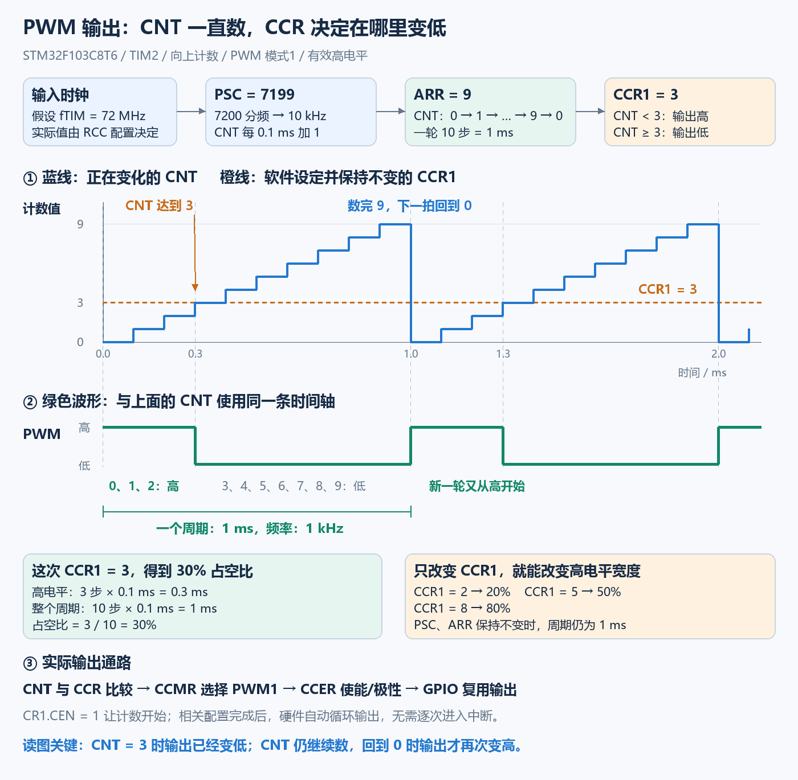

[打开可编辑的 drawio 原图](timer-output-assets/pwm-output-explained.drawio)

图中三条曲线使用同一条时间轴，上下对齐看电平变化：

- **蓝色阶梯是 CNT**：每隔固定时间加 1，数完 ARR 后回到 0。
- **橙色虚线是 CCR1**：软件设定的比较阈值，此例一直保持为 3。
- **绿色波形是 PWM 输出**：硬件根据 CNT 与 CCR1 的关系改变输出电平。

### 1. 先确定每个台阶多久、每轮多少步

| 配置 | 数值 | 效果 |
| --- | --- | --- |
| 定时器输入时钟 | 72 MHz | 示例假设，实际值由 RCC 配置决定 |
| PSC | 7199 | 7200 分频，CNT 每 0.1 ms 加 1 |
| ARR | 9 | 一轮 10 步，周期 1 ms |
| CCR1 | 3 | 前 3 步输出高电平 |

计算关系为：

```text
计数频率 fCNT = fTIM / (PSC + 1)
每步时间 Δt = (PSC + 1) / fTIM
PWM 周期 T = (ARR + 1) × Δt
PWM 频率 fPWM = fTIM / [(PSC + 1) × (ARR + 1)]
```

这些周期公式对应本节连续、向上、边沿对齐计数的条件；
中心对齐等其他模式需要按对应的计数过程重新计算。

### 2. CCR1 决定何时由高变低

在 PWM 模式1、向上计数、有效高电平的条件下：

```text
CNT < CCR1  → 输出高电平
CNT ≥ CCR1  → 输出低电平
```

沿着图中第一轮曲线看：

1. CNT 为 0、1、2 时，小于 CCR1 = 3，输出保持高电平。
2. CNT 变成 3 时，不再小于 CCR1，输出变低；CNT 继续计数。
3. CNT 为 3～9 时，输出一直保持低电平。
4. 数完 9，下一拍 CNT 回到 0，再次小于 CCR1，输出重新变高。

**CNT 达到 CCR 不会因此停止或清零。CCR 决定比较点，ARR 决定周期边界。**

高电平覆盖 0、1、2，共 3 个刻度：

```text
高电平时间 Ton = CCR1 × Δt = 3 × 0.1 ms = 0.3 ms
低电平时间 Toff = 7 × 0.1 ms = 0.7 ms
整个周期 T = 1 ms，PWM 频率 = 1 kHz
占空比 D = Ton / T = CCR1 / (ARR + 1) = 3 / 10 = 30%
```

CCR 不加 1，是因为从 CNT = 3 开始已经输出低电平；
高电平覆盖的计数值只有 0、1、2。

### 3. 只改 CCR，改变的是高电平宽度

保持 PSC = 7199、ARR = 9 不变：

| CCR1 | 输出高电平时的 CNT | 高电平时间 | 占空比 |
| --- | --- | --- | --- |
| 0 | 无 | 0 ms | 0% |
| 2 | 0、1 | 0.2 ms | 20% |
| 3 | 0、1、2 | 0.3 ms | 30% |
| 5 | 0～4 | 0.5 ms | 50% |
| 7 | 0～6 | 0.7 ms | 70% |
| 8 | 0～7 | 0.8 ms | 80% |
| 10 | 0～9，整轮均小于 CCR1 | 1 ms | 100% |

将 CCR1 从 3 改成 7，相当于把图中的橙色比较线上移。
CNT 要数到 7，输出才变低，高电平因此变宽。
这些设置的周期都为 1 ms，因为 PSC 和 ARR 没有改变。
这里 ARR = 9，所以 CCR1 = 10 可以正常表示；
其他配置下还需要检查 ARR + 1 是否超出 CCR 寄存器范围。

### 4. CR1 和输出通路有什么用？

PSC、ARR、CCR 配好后，CR1 负责控制时基如何运行。

| CR1 控制位 | 作用 | 对本例的影响 |
| --- | --- | --- |
| CEN | 使能计数器 | 普通内部时钟模式下，置 1 开始计数，清 0 停止 |
| DIR | 计数方向 | 本例采用向上计数 |
| ARPE | ARR 预装载使能 | 开启后，新 ARR 等更新事件再装载生效 |
| OPM | 单脉冲模式 | 本例连续输出，不启用单次运行 |

停止计数不等于清零，也不能单凭 CEN = 0 推断引脚一定输出低电平。
CR1 中的 CKD 主要影响数字滤波、死区等使用的时钟；
本节 CNT 的计数频率由输入时钟和 PSC 决定。

配置后的输出逻辑链为：

```text
RCC 提供定时器时钟
    → PSC 分频
    → CNT 按 ARR 循环计数
    → 通道比较 CNT 与 CCR1
    → CCMR 选择 PWM 模式1
    → CCER 配置输出使能和极性
    → GPIO 复用输出 PWM
```

相关配置完成后，通过 CEN 启动计数，硬件便能持续输出。
CPU 不需要每个周期进入中断、逐次翻转 GPIO。
高级定时器 TIM1 等还需关注 BDTR.MOE 等额外输出控制，不能直接照搬 TIM2。

### 5. 为什么写入参数后，有时要等下一轮才生效？

运行中更新参数时，要区分软件写入值与硬件当前使用的内部值：

- PSC 有缓冲，写入后需要更新事件才能装载到内部生效值。
- ARR 是否使用预装载，由 CR1.ARPE 控制。
- 输出比较 CCR 是否使用预装载，由 CCMR 中的 OCxPE 控制。

启用预装载后，新参数可以等更新事件再生效，便于在周期边界切换。
EGR.UG 可主动请求更新，常用于初始化装载配置；
其对更新标志和请求的影响还取决于 URS、UDIS 等设置。

例如当前 CCR1 = 3，启用输出比较预装载后写入 7：
当前这一轮仍按原比较值运行，正常的下一次更新事件后，
下一轮再按新比较值输出，减少中途修改造成异常脉宽的可能。

> 本节是基于课件整理的原理与数值示例，没有进行示波器或开发板实测。
> 参考资料：本文所依据的[定时器课件][timer-lesson]。

[timer-lesson]: <2-1-4-3_STM32基础 - 定时器中断与输出比较.pdf>

## 七、输出比较与 PWM 是什么关系？

输出比较的核心是把 CNT 与 CCR 比较，根据配置改变通道内部参考信号。
PWM 是输出比较的一种常用工作模式。

| 模式 | 核心行为 | 与本篇 PWM1 的区别 |
| --- | --- | --- |
| 冻结 | 比较匹配不改变参考输出 | 不用于自动生成本篇 PWM 波形 |
| 匹配时置有效 | CNT = CCR 时置有效 | 单个比较点改变状态 |
| 匹配时置无效 | CNT = CCR 时置无效 | 单个比较点改变状态 |
| 匹配时翻转 | CNT = CCR 时翻转状态 | 翻转一次不等于完成一个方波周期 |
| PWM 模式1 | 向上计数时，CNT < CCR 为有效 | 本篇示例采用此模式 |
| PWM 模式2 | 向上计数时，与 PWM1 有效性相反 | 相同参数下有效区间互补 |

“有效”先描述内部参考信号。到引脚是高还是低，还要看 CCER 的极性配置。
本篇明确采用有效高电平，才可以直接写成“CNT < CCR 输出高”。

比如翻转模式下，每一轮只有一次匹配而翻转一次电平：
完整方波需经过两次翻转，其频率不能直接当成更新频率。
也不能把本篇 PWM 的占空比公式套给所有输出比较模式。

## 八、反过来设计一组 PWM 参数

### 1. 先确定频率，再考虑占空比分辨率

假设 fTIM 已确认是 72 MHz，希望输出 1 kHz、30% 的 PWM。
选择 1 MHz 的计数时钟，则每步是 1 μs：

```text
PSC + 1 = 72 MHz / 1 MHz = 72 → PSC = 71
ARR + 1 = 1 MHz / 1 kHz = 1000 → ARR = 999
CCR1 = 30% × 1000 = 300
```

结果为周期 1000 μs、高电平 300 μs、低电平 700 μs。
与图中的 10 个刻度相比，这里一轮有 1000 个刻度：

| 一轮刻度数 | 占空比每调整 1 个计数值的变化量 |
| --- | --- |
| 10 | 10% |
| 1000 | 0.1% |

更大的 ARR 通常能提供更细的占空比步进，但还受输入时钟和寄存器范围约束。
目标周期不一定能够整除为整数刻度，实际参数需取整并反算误差。

### 2. 几组可复算的配置

以下均假设 fTIM = 72 MHz、PWM1、连续向上计数、有效高：

| 目标 | PSC | ARR | CCR1 | 结果 |
| --- | --- | --- | --- | --- |
| 1 kHz，30% | 7199 | 9 | 3 | 1 ms 周期，0.3 ms 高电平 |
| 1 kHz，30% | 71 | 999 | 300 | 同频率与占空比，步进更细 |
| 50 Hz，1.5 ms 高电平 | 71 | 19999 | 1500 | 20 ms 周期，7.5% 占空比 |
| 1 Hz，50% | 7199 | 9999 | 5000 | 1 s 周期，0.5 s 高电平 |

50 Hz、1.5 ms 的例子仅说明脉宽配置方法，
外接舵机等设备的允许周期、脉宽和供电仍应按具体器件资料确认。
占空比相同也不代表脉宽相同：1 ms 周期的 50% 是 0.5 ms，
20 ms 周期的 50% 则是 10 ms。

### 3. 改 PSC、ARR、CCR 分别改变什么？

| 调整项 | 其他项保持不变时的主要影响 |
| --- | --- |
| PSC 增大 | 每步变慢，周期变长，频率降低；占空比比例不变 |
| ARR 增大 | 一轮刻度增加，周期变长；固定 CCR 下占空比下降 |
| CCR 增大 | 周期不变，高电平变宽，直到达到整轮有效 |

多个通道共用时基，所以改变 PSC 或 ARR 会同时影响这些通道的周期。
若想两个通道各用不同的频率，应先检查是否需要不同的定时器资源。

## 九、从参数到真正的引脚输出

理解公式后，还需要完成硬件通路配置：

1. 确认芯片、定时器、通道、引脚映射和是否需要重映射。
2. 确认 RCC 时钟树，并使能定时器与相关 GPIO 的外设时钟。
3. 配置内部时钟、连续向上计数、PSC 和 ARR。
4. 将通道配置为输出，选择 PWM1 并设置 CCR。
5. 按需要启用 ARR、CCR 的预装载，并处理初始化参数装载。
6. 配置通道输出使能、有效极性以及 GPIO 的复用功能。
7. 如果使用高级定时器，检查主输出使能、刹车及其他相关限制。
8. 清理初始化遗留状态，通过计数使能启动，检查实际输出。

这是职责清单，具体寄存器写入顺序和库函数调用应服从当前工程及参考手册。
此处不指定实际板卡接线，也不将其他系列的 GPIO 复用方式直接套给 F103。

课件使用标准外设库时，可以这样对应概念：

| 配置项或 API | 对应含义 |
| --- | --- |
| TIM_Prescaler | PSC 的分频配置 |
| TIM_Period | ARR 的周期边界值 |
| TIM_CounterMode | 计数方向或模式 |
| TIM_Pulse | 输出比较 CCR 的配置值 |
| TIM_OCMode_PWM1 | 选择 PWM 模式1 |
| TIM_OutputState | 通道输出使能 |
| TIM_OCPolarity | 输出有效极性 |
| TIM_Cmd | 控制计数器使能 |

标准库、HAL 和寄存器直写是不同的配置入口，
阅读示例时先确认库类型，避免把一种库的函数当成另一种库的接口。

## 十、常见问题速查

| 现象或疑问 | 先检查什么 |
| --- | --- |
| 为什么 PSC = 71 才是 72 分频？ | 分频系数是 PSC + 1 |
| 为什么 ARR = 9 是 10 步？ | 0～9 都各占一个刻度 |
| 为什么 CCR = 3 不是 4 步高电平？ | 只有 0、1、2 满足 CNT < 3 |
| CNT 到 CCR 会停止吗？ | 本篇 PWM 模式不会；CNT 仍按 ARR 循环 |
| CNT 在走但引脚不输出？ | 通道模式、CCER、GPIO 映射及高级定时器输出控制 |
| 频率刚好差一倍？ | 核对 APB 定时器时钟、计数模式及测量的是何种信号 |
| 改 CCR 后周期也变化了？ | 核对是否同时改了 ARR/PSC，以及测量方式 |
| 参数写进去却没立即生效？ | 检查 PSC 缓冲、ARPE、OCxPE 和更新事件 |
| 刚启动就进中断？ | 检查初始化 UG 是否留下 UIF，以及其他请求源 |
| 停止 CNT 后引脚为什么没变低？ | CEN 不是独立的输出拉低命令 |
| 没开中断能产生 PWM 吗？ | 可以，配置完成后由硬件持续运行 |

如果输出存在，仍应测量实际周期、高电平宽度和电平极性，
不能仅根据寄存器“看起来正确”判断板卡输出已经符合要求。

## 十一、用四元组整理软件侧职责

这里把四元组用于软件驱动的职责分析，不把寄存器强行视为四个结构体。

| 类别 | 软件侧的对应内容 |
| --- | --- |
| cfg | 选择的定时器/通道、时钟、PSC、ARR、允许的脉宽范围等 |
| ctx | 初始化状态、运行状态、待生效的参数等模块内部信息 |
| data | 当前生效频率、占空比、有效性，以及必要的状态快照 |
| ops | 初始化、启动、停止、申请修改占空比、读取一致快照等接口 |

业务层表达目标频率、脉宽或占空比，驱动层负责合法性校验和寄存器配置。
运行中的 CNT 属于底层过程状态，通常不需要业务模块随意改写。
如果软件维护了“当前输出参数”，应区分已申请值与真正生效值。

## 十二、学完后用这些问题自测

1. 72 MHz、PSC = 71，CNT 每步多久？
2. 72 MHz、PSC = 7199、ARR = 9999，一轮多久？
3. ARR = 9、CCR1 = 3，为什么占空比是 30%？
4. 保持图中的 PSC、ARR 不变，把 CCR1 改成 7，频率会变化吗？
5. 如果开启 CCR 预装载，写入新值后通常何时生效？
6. CCR1 = 0 与 CCR1 = ARR + 1 分别对应什么边界？

答案：1 μs；1 s；高电平覆盖 3/10 刻度；
频率不变、占空比变成 70%；正常更新事件装载后；
本篇条件下分别为 0% 与 100%，后者还需确认 CCR 能表示 ARR + 1。

<a id="deep-study"></a>

## 深入学习：从一组 PWM 参数，到可预测的时序系统

本节在前面图解之上增加硬件机制与工程设计。除明确写 TIM1 的地方，仍以
STM32F103 的 TIM2、16 位计数器为例。输入捕获另见下一篇。


本节目录：

- [1. 时钟域与 CKD：不是所有“分频”都在改变 CNT](#deep-1)
- [2. 参数反推是一个有边界的整数优化问题](#deep-2)
- [3. 中心对齐为什么不能继续套 ARR+1 的公式](#deep-3)
- [4. UEV、UIF、UIE、URS、UDIS 分别控制哪一层](#deep-4)
- [5. 预装载解决边界切换，却不自动使多个写操作原子化](#deep-5)
- [6. 一条可检查的初始化与启动顺序](#deep-6)
- [7. 多个定时器和 ADC 如何联动](#deep-7)
- [8. TIM1 的互补输出、死区与刹车](#deep-8)
- [9. 四个工程问题，按证据逐层定位](#deep-9)
- [10. 带推导的练习](#deep-10)

<a id="deep-1"></a>

### 1. 时钟域与 CKD：不是所有“分频”都在改变 CNT

首先分开三个频率：RCC 给定时器的输入频率、PSC 后的计数频率、数字滤波与死区使用的时基。
CR1.CKD 决定 tDTS 与内部时钟的关系，服务于相关滤波和死区时序；它不能替代 PSC，不能靠改 CKD 把 CNT 的频率再除二。

当 APB1 分频不为 1，F103 的 TIM2 输入可能是 PCLK1 的两倍。这不表示 TIM2 的每一次寄存器读取也按两倍 APB 速度完成。
总线访问时钟与定时器内部功能时钟是两个概念。改系统时钟后，应重新检查所有依赖该时钟域的定时参数。

PSC 保存 N−1，内部预分频器完成 N 个输入时钟才产生一个计数节拍。
它还有独立的运行相位；只把 CNT 写成 0，不等于同时复位预分频器的内部计数。
需要建立确定的首周期时，要按 UG 的硬件语义初始化时基。

<!-- extended:clock-branches -->

#### 机制补图：PSC 与 CKD 位于不同的时序分支

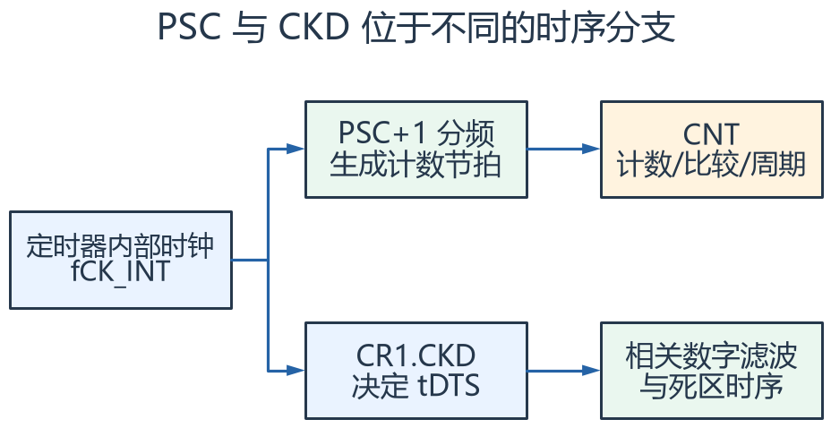

**读图方法与条件：** 先沿上分支看计数速度，再看下分支的滤波/死区。CKD并不是CNT后面又加一个分频器。72 MHz只除72得到1 MHz、每步1 μs；要定时1 s还需继续累计。16位定时器可用PSC=7199、ARR=9999：72 MHz÷7200÷10000=1 Hz，不能直接把一百万写进16位ARR。

[放大查看 SVG](course-note-assets/extended/06/clock-branches.svg) · [可编辑结构图](course-note-assets/extended/06/extended.drawio)

<!-- /extended -->

<a id="deep-2"></a>

### 2. 参数反推是一个有边界的整数优化问题

边沿对齐、连续向上计数时：

```text
fCNT = fTIM / (PSC + 1)
Ttick = (PSC + 1) / fTIM
fPWM = fTIM / [(PSC + 1) × (ARR + 1)]
Dhigh = CCR / (ARR + 1)    仅限 PWM1、有效高等条件
ΔD = 1 / (ARR + 1)
```

设计时先确定频率允许误差，再尽量保留大的 ARR，以获得更细占空比分辨率。
同样是 1 kHz，100 格只有 1% 步进，1000 格有 0.1% 步进。PSC 太大虽然容易算，却会损失可用的计数分辨率。

例：fTIM = 72 MHz，目标 20 kHz。令 PSC = 0，ARR = 3599，恰好得到 3600 格。
25% 对应 CCR = 900；每格约 13.889 ns，约有 log2(3600) = 11.81 位的占空比刻度能力。
这个“位数”描述数字刻度，不能当作实际输出边沿精度：晶振、驱动传播、抖动和测量仪器还会引入误差。

若目标频率不能被整数分解精确实现，就枚举合法 PSC、将理想 ARR 四舍五入，再计算实际频率误差。
普通 16 位 PSC/ARR 的合法范围不能因公式需要而扩大；CCR 的可表示范围也限制 100% 输出的直接写法。

<!-- extended:psc-resolution -->

#### 机制补图：同为20 kHz，过大的 PSC 会损失占空比刻度

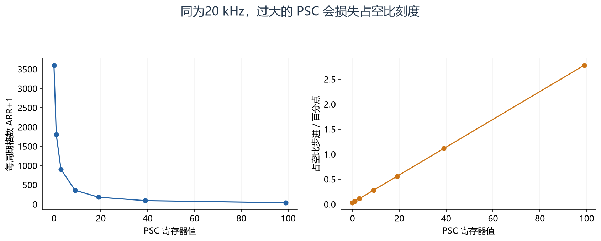

**读图方法与条件：** fTIM=72 MHz，边沿向上计数，(PSC+1)(ARR+1)=3600。PSC=0 有3600格，步进约0.0278个百分点；PSC=99只有36格，步进约2.778个百分点。两者频率相同，分辨率差100倍。

[放大查看 SVG](course-note-assets/extended/06/psc-resolution.svg)

<!-- /extended -->

<a id="deep-3"></a>

### 3. 中心对齐为什么不能继续套 ARR+1 的公式

中心对齐时 CNT 在 0 与 ARR 之间往返。以 ARR = 4 为例，相邻的完整周期可看成：

```text
节拍位置：0 1 2 3 4 5 6 7 8
CNT 值 ：0 1 2 3 4 3 2 1 0
```

从一个底点到下一个底点是 8 个节拍，因此完整载波周期为 2×ARR 个节拍。
对正常的 ARR>0 配置，fPWM = fCNT / (2×ARR)，而不是 fCNT / [2×(ARR+1)]。
CMS 的具体选择还影响比较标志在哪个计数方向产生；不要把“一个完整 PWM 周期”直接当作“只发生一次更新或比较请求”。

仍用 72 MHz、20 kHz，中心对齐可以取 PSC = 0、ARR = 1800。
对于常见 PWM1 内部有效区间，可按 CCR/ARR 理解平均有效比例，但最终引脚高电平还取决于极性与通道配置。
边沿对齐与中心对齐比较的是脉冲相对载波的位置，也会影响多相驱动和 ADC 采样位置。

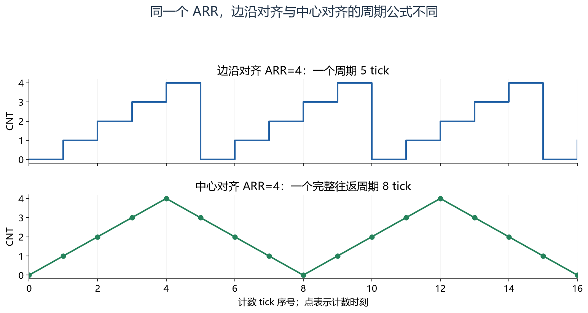

怎么看：数横轴相邻点之间的时间间隔：ARR=4 时边沿周期为 5 tick，中心对齐一个完整往返为 8 tick。端点值不能重复多算一个时间格。

<a id="deep-4"></a>

### 4. UEV、UIF、UIE、URS、UDIS 分别控制哪一层

| 名称 | 控制或记录的东西 | 容易误解的地方 |
|---|---|---|
| UEV | 更新动作，涉及影子值装载等 | 不是 ISR 函数调用 |
| UIF | 更新相关状态标志 | 一个比特不能累计无限次事件 |
| UIE | 是否允许更新中断请求 | 关掉它不等于停止硬件 PWM |
| URS | 更新请求来源筛选 | 不等于禁止所有内部更新动作 |
| UDIS | 禁止更新事件 | 与仅禁止 CPU 中断的作用不同 |
| UG | 软件产生更新相关动作 | 可能重置计数相位，不能随时乱触发 |

以手册规定的普通配置为例，URS=1 时，用 UG 仍可完成装载/重新初始化，但不会因此设置 UIF 去请求更新中断。
UDIS=1 则会抑制 UEV 及对应影子值装载；UG 对计数器、预分频器的重新初始化又有单独规定。
所以不能写出“开了某一位，所有更新都不存在”这样的笼统结论。

如果中断被屏蔽 3 ms，而更新周期只有 1 ms，UIF 可能一直保持 1。
恢复后进一次 ISR 并不意味着只发生过一次更新。需要累计时间时，应选择可观测的计数差、扩展计数或可靠事件机制。

<!-- extended:update-gates -->

#### 机制补图：内部更新动作与 CPU 中断请求是两条判断链

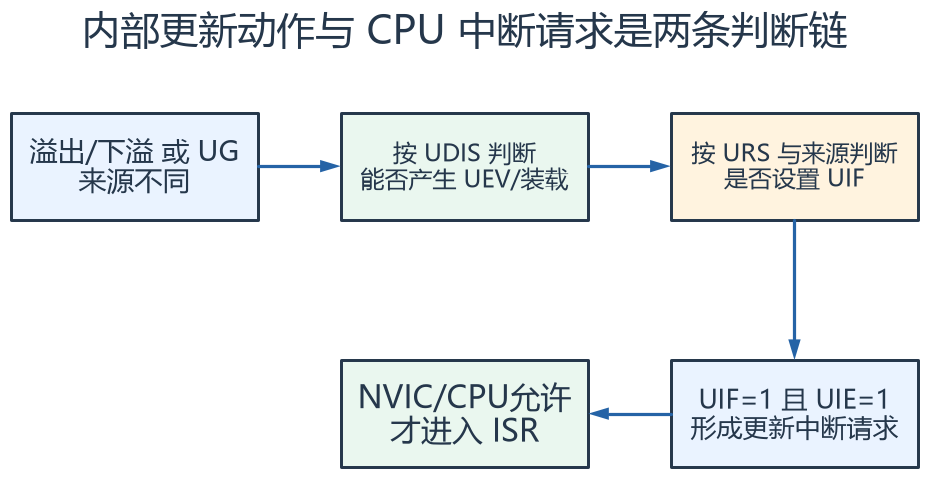

**读图方法与条件：** 图表示分层检查，不是所有来源都会完整走到最后。普通配置下URS=1 的 UG 仍能初始化/装载，却不因此置 UIF；UDIS=1 阻止 UEV 装载，UG 的计数器/预分频器初始化仍有单独语义。关UIE只关请求，PWM硬件仍可运行。

[放大查看 SVG](course-note-assets/extended/06/update-gates.svg) · [可编辑结构图](course-note-assets/extended/06/extended.drawio)

<!-- /extended -->

<a id="deep-5"></a>

### 5. 预装载解决边界切换，却不自动使多个写操作原子化

PSC 自带缓冲；ARR 的预装载由 ARPE 控制；输出比较 CCR 的预装载由 OCxPE 控制。
“写入寄存器值”和“当前用于比较的有效值”因此可能不同。

比如旧 ARR=999、CCR=300，新目标 ARR=1999、CCR=600，两个周期都要求 30%。
即使都开预装载，若自然更新恰好落在两次软件写之间，仍可能装载新 ARR 和旧 CCR，短暂输出 15%。
预装载解决单项参数的切换时机，多项参数的一致性还需要统一提交策略。

可选方法包括：启动前一次配置完整；在已知安全窗口完成写入；有计划地抑制更新后统一提交；
或使用定时器 DMA burst 按规定布局传输多项参数。选哪一种要明确是否允许相位跳变、是否允许丢一轮更新。
不要为了“立即生效”每次都写 UG，强制更新可能截断当前周期。

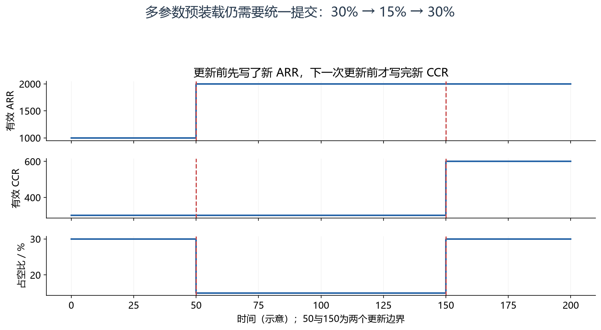

怎么看：沿同一时刻竖着对照 ARR、CCR 和占空比：两个目标状态都为 30%，但中间混合状态变成 15%。图示参数状态，不是实测毛刺波形。

<a id="deep-6"></a>

### 6. 一条可检查的初始化与启动顺序

以下是配置责任顺序，不是可直接复制的板级 C 程序：

1. 确认 TIM、GPIO、AFIO 的资源占用与时钟来源，核对复用引脚。
2. 在输出未使能时配置 PSC、ARR、计数方向、对齐模式。
3. 配置通道为输出、PWM 模式、CCR、极性和预装载。
4. 产生所需初始化更新，检查并清理初始化带来的状态标志。
5. 按需求配置中断/DMA；只做 PWM 时不必为了输出而开 ISR。
6. 配置 GPIO 复用与通道输出；TIM1 还需考虑 MOE、刹车、空闲态。
7. 最后启动计数，并实测首周期、稳态周期和启停电平。

如果停止 CEN，计数只是冻结在当前位置，输出可能保持当时高或低。
“关闭 PWM”要定义成业务期望：引脚拉低、高阻、保持还是受控关断，再选择对应通道/驱动接口。

<a id="deep-7"></a>

### 7. 多个定时器和 ADC 如何联动

一个定时器可通过 TRGO 发布内部触发，另一个通过 TRGI/从模式执行复位、门控或触发启动。
内部触发线 ITR 的连接表与具体 TIM 实例有关，不能把任意 TIM 都直接互联。

典型链路是：PWM 定时器的指定事件 → ADC 外部触发 → ADC 扫描 → DMA 缓冲 → 控制任务。
这样采样由硬件时序约束，不必在更新 ISR 中再调用一次 ADC 启动函数，从而减少软件响应延迟带来的变化。
但触发位置不能简单假定为所有波形的“中心”；需要避开功率开关边沿和模拟建立过程。

通过 DMA 更新一串 CCR 值可以产生变化占空比波形。每个元素至少要定义：应用于哪一周期、从哪个请求触发搬运、何时真正装载有效。
DMA 过晚或数据未准备好，会导致旧脉宽重复、周期错位等问题。DMA 不会替你判断波形是否连续。

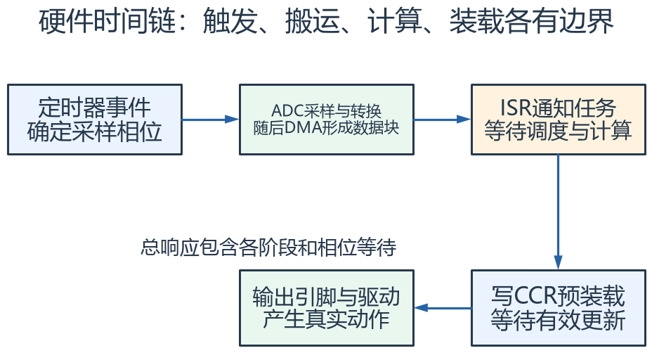

怎么看：沿箭头逐项预算采样、搬运、软件等待和输出装载边界。F103 可选触发源必须查实例映射，图不代表任意 TIM 与 ADC 可直接连接。

<a id="deep-8"></a>

### 8. TIM1 的互补输出、死区与刹车

互补通道不等于把两个引脚简单输出成逻辑反相。功率管关断有延迟，上下桥臂若短暂同时导通会造成直通。
死区发生器在切换时留出两者都关断的间隔，参数需要结合驱动器、功率器件、温度和传播时间确定。

DTG 是分段编码，并非从 0 到 255 都按同样步长变化。低段使用 tDTS 的线性刻度，高段通过不同倍率扩大范围。
例如在适用的低段、tDTS=1/72 MHz 条件下，DTG=72 对应约 1 μs；跨到更高编码区时必须按手册重新换算。

刹车输入可通过硬件影响输出，MOE、OSSI/OSSR、极性和 LOCK 等共同决定故障与空闲行为。
这类配置属于功率级保护的一部分。没有实际驱动电路和器件资料，就不能根据一张 PWM 图指定“安全死区”和有效电平。

<!-- extended:deadtime -->

#### 机制补图：死区将待导通一路的边沿推迟，形成双方关断区

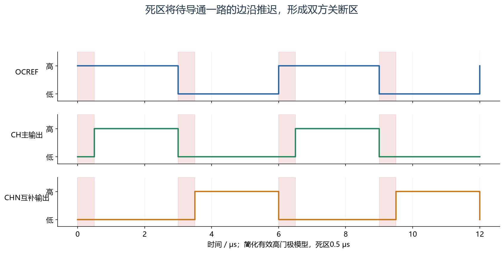

**读图方法与条件：** 三行在同一时刻垂直对照，红色带内两路都为低。这只是TIM1互补输出的有效高简化模型，忽略极性、空闲态、刹车与驱动传播延迟；实际功率级还需测量门极及上下管交叠。

[放大查看 SVG](course-note-assets/extended/06/deadtime.svg)

<!-- /extended -->

<a id="deep-9"></a>

### 9. 四个工程问题，按证据逐层定位

| 现象 | 先观察什么 | 推理方向 |
|---|---|---|
| 计算 1 kHz，测得 500 Hz | RCC、PSC、ARR、CMS | 输入时钟或中心对齐条件不同 |
| CNT 在走却没有引脚波形 | CCR、CCER、GPIO、MOE/刹车 | 计数通路通，输出通路未满足 |
| 改频率时偶发窄脉冲 | 写入时刻、预装载、UG | 中途立即生效或多参数跨更新 |
| ISR 次数偏少但 PWM 正常 | UIF 保持、屏蔽时间、ISR耗时 | 事件被标志位合并或软件来不及 |

参数日志只能证明软件写过什么，寄存器回读能证明配置与状态，示波器才能证明引脚上的实际周期、占空比和毛刺。
需要追溯首周期问题时，应同时记录启动触发和首个输出边沿，不能只测稳定运行后的平均频率。

<!-- extended:cen-freeze -->

#### 机制补图：清 CEN 可能把 PWM 冻结在高电平

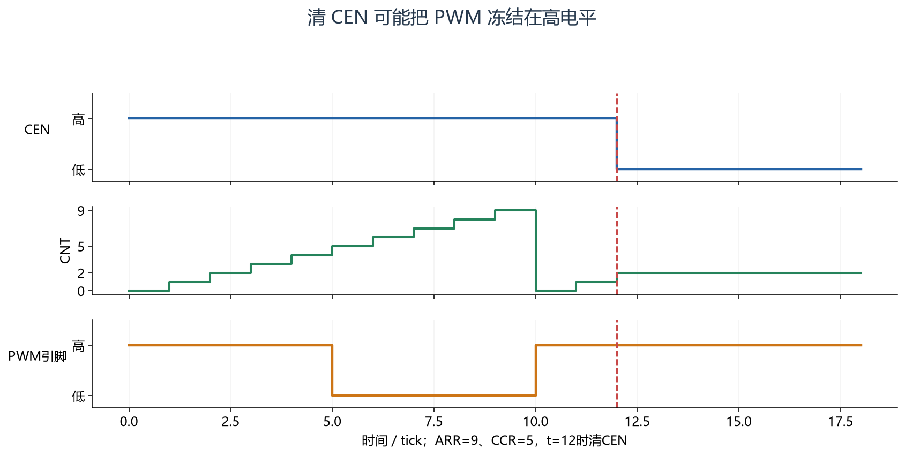

**读图方法与条件：** PWM1、有效高、输出仍使能且未触发刹车等条件下，CNT停在2，CNT<CCR继续成立。停止计数与要求负载进入安全态应分开设计；不能把清CEN当成通用拉低命令。

[放大查看 SVG](course-note-assets/extended/06/cen-freeze.svg)

<!-- /extended -->

<a id="deep-10"></a>

### 10. 带推导的练习

题一：72 MHz 输入生成 50 Hz、1.5 ms 高电平，为什么常选 1 μs 的计数节拍？

解：PSC=71 得到 1 MHz，ARR=19999 得到 20 ms 周期，CCR=1500 得到 1.5 ms。
占空比为 7.5%，控制量通常是高电平时长。改变帧周期而保持 CCR 时，脉宽不变但占空比会变；具体执行器接受范围仍查器件规格。

题二：同一 TIM 的两个通道，能否一个输出 1 kHz、另一个按同一种 PWM 方式输出 2 kHz？

解：普通 PWM 通道共用 PSC/CNT/ARR，因此共用载波周期，CCR 分别调脉宽。
特殊输出比较翻转、软件重排比较点等可形成别的波形，但那已不是两个独立时基的普通 PWM 配置。

题三：计数节拍 1 μs，目标 1 s，为什么不能直接给 F103 TIM2 写 ARR=999999？

解：此处 TIM2 是 16 位计数器，写入超范围不能得到期望的一秒。
可改 PSC=7199、ARR=9999 得到 0.1 ms×10000=1 s，或采用经过正确扩展的多周期计时方案。

<!-- extended:ccr-threshold -->

#### 机制补图：CCR 是比较阈值：CNT=0、1、2 时输出高

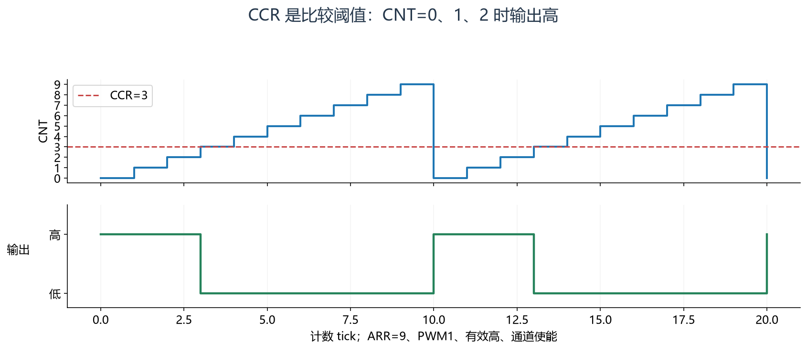

**读图方法与条件：** 垂直对照上下图：到CCR=3时翻为低，CNT不会停下；到10个tick完成一轮。因此D=3/(9+1)=30%。CR1的CEN控制是否计数，DIR/CMS控制走法，ARPE控制ARR预装载；输出还需CCMR与CCER配置。

[放大查看 SVG](course-note-assets/extended/06/ccr-threshold.svg)

<!-- /extended -->

## 十三、资料和验证边界

- 本篇依据同目录[定时器中断与输出比较课件][timer-lesson]及本次讨论整理；深入部分另参考 ST 官方资料。
- 配图是原理时序示意，不是示波器采集结果。
- 数值计算、引用链接和图文一致性已检查；未进行固件编译或开发板实测。
- 需要上板验证时，应确认 fTIM、输出周期、高低电平宽度、极性和更新边界。

## 十四、更多分解图：一张图只理解一个动作

建议先按以下小图拆开理解，再回到第六节的综合图。

### 补图一：PSC 把密集时钟变成较慢计数节拍

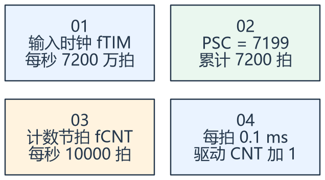

看图方法：先读每张卡片的关键词，再用下文核对它们之间的关系。

从左向右只看时间单位转换。72 MHz 除以 7200 得到 10 kHz，所以 CNT 每一步是 0.1 ms。PSC 里面的 7199
是配置，不能把它当成当前 CNT。

要得到 1 秒，还必须再数 10000 步，也就是 ARR = 9999。分频只决定一步多久，ARR 决定一轮多少步。

### 补图二：到 ARR 不是立刻跳过这一格

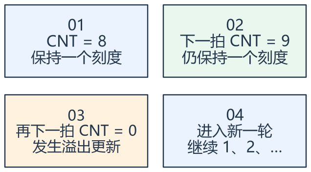

看图方法：先读每张卡片的关键词，再用下文核对它们之间的关系。

ARR = 9 时，0～9 的每个数值都占一个刻度，共 10 个刻度。到达 9 只是进入这一轮的最后一格，下一拍回到 0 才是周期边界。

普通连续计数不会因为数到 ARR 就停止。是否只运行一次，要另外看单脉冲模式等控制。

### 补图三：更新事件与中断之间隔着控制开关

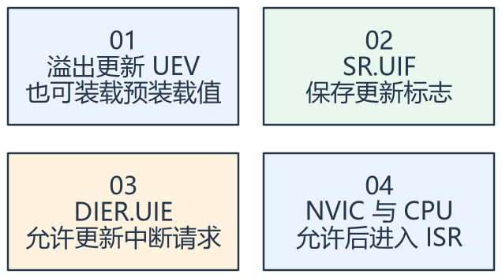

看图方法：先读每张卡片的关键词，再用下文核对它们之间的关系。

本图对应允许正常更新的常规配置。UEV 在定时器硬件内部发生，中断则是 CPU 的处理通路；不开 UIE 不妨碍 CNT 继续计数与输出 PWM。

ISR 处理时间晚于事件时间是可能的。软件中断次数不能直接代替示波器上的周期测量，也不能把一个标志位当作无限累积事件计数器。

### 补图四：输出比较的三个决定因素

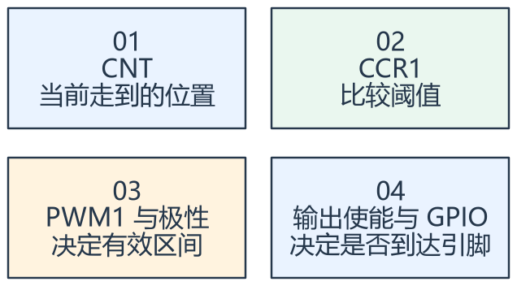

看图方法：先读每张卡片的关键词，再用下文核对它们之间的关系。

CCR 只给比较阈值，最终输出还受模式、极性、通道使能、GPIO 复用等条件影响。PWM1、向上、有效高时才可直接写成 CNT < CCR 输出高。

达到 CCR 后 CNT 继续走，到 ARR 周期边界再回零。因此调 CCR 可以改变脉宽，而不必改变周期。

### 补图五：预装载把新旧两套参数分开

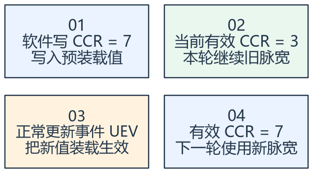

看图方法：先读每张卡片的关键词，再用下文核对它们之间的关系。

图中假设 OCxPE 已开启、更新未被禁止，也没有中途手动强制更新。软件写入值和硬件当前比较值可以暂时不同。

参数在周期边界切换能避免本轮中途突然移动比较点。PSC 本来就有缓冲，ARR 与输出 CCR 的预装载分别受 ARPE 和 OCxPE 控制。

### 波形、布局与数值图解

#### 缩小示例：PSC = 3，每四个输入时钟 CNT 才加一

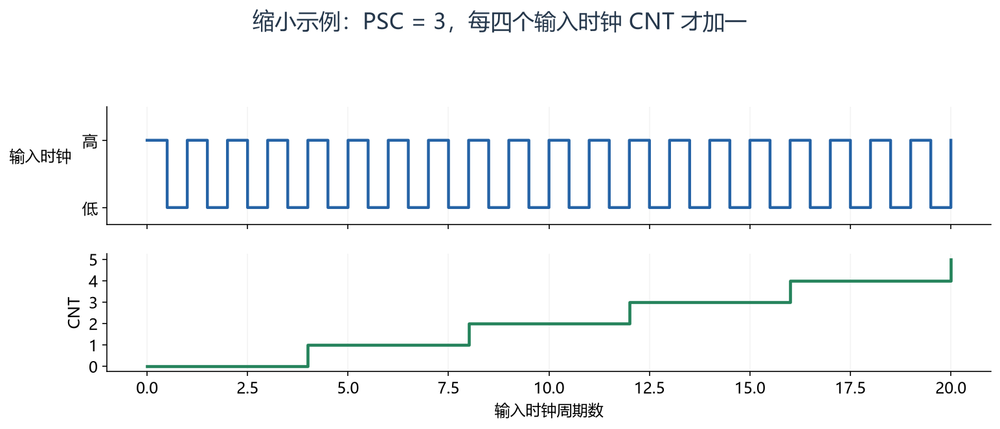

先数上方四个完整时钟周期，再看下方 CNT 增加一步。真实 72 MHz 分频 72 时，PSC 应为 71，得到 1 MHz，也就是每步 1
μs；仍需 ARR = 999999 才能直接组成一秒，但它超出普通 16 位定时器范围，通常改用 PSC = 7199、ARR = 9999。

#### ARR = 9：0～9 共十格，每一格都保持一个节拍

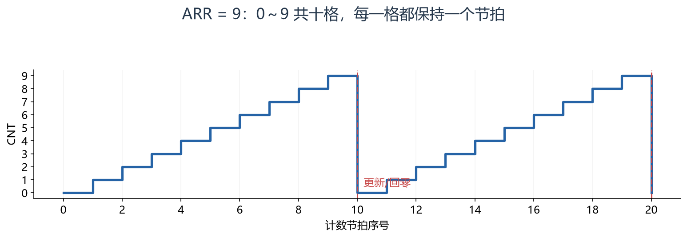

横向看台阶宽度：CNT = 9 也占一整格，下一拍回 0。周期是 (ARR + 1) / fCNT，不是 ARR / fCNT。

#### PWM1、向上计数、有效高：CNT < CCR 时输出高

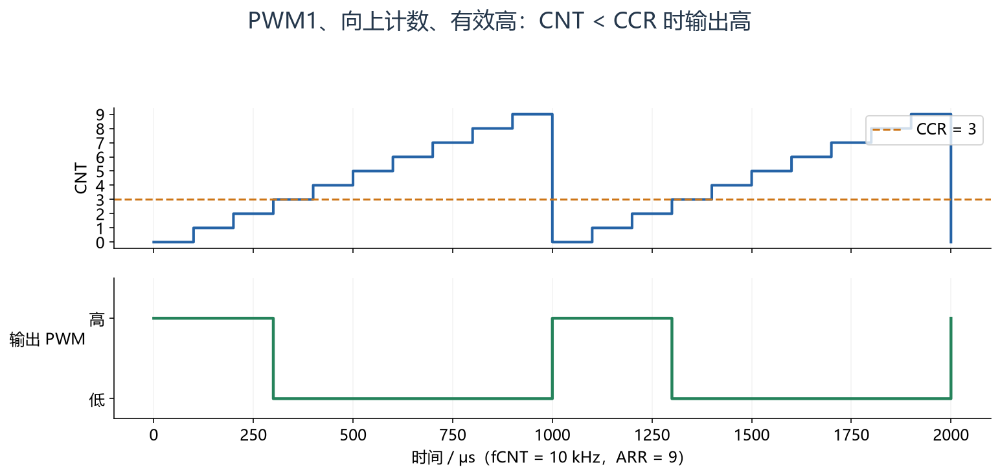

两幅图共享横轴：0、1、2 三格输出高，CNT 到 3 时转低，走到周期边界才重新变高。CCR 不是让 CNT 清零的命令。此图周期 1 ms、高电平
0.3 ms，占空比 30%。

#### 只改 CCR，比较 0%、30%、50%、70%、100% 占空比

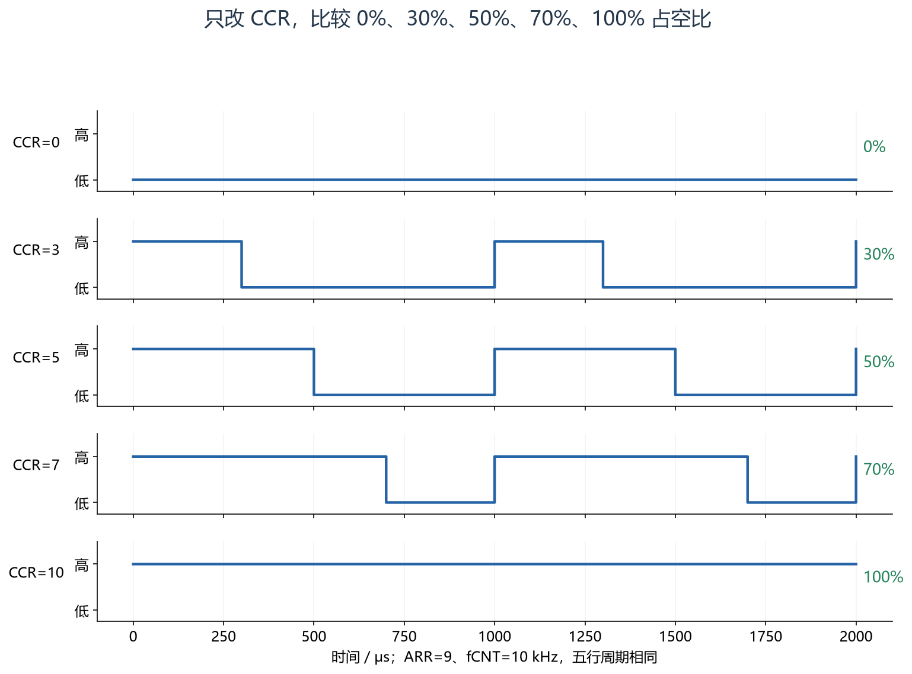

纵向比较高电平宽度，再横向比较周期边界。100% 需要 CCR = ARR + 1 且该值能被 CCR 表示；当 ARR
已是寄存器最大值时不能直接写入最大值加一。

#### 开启 CCR 预装载：写入时刻与比较值生效时刻分开

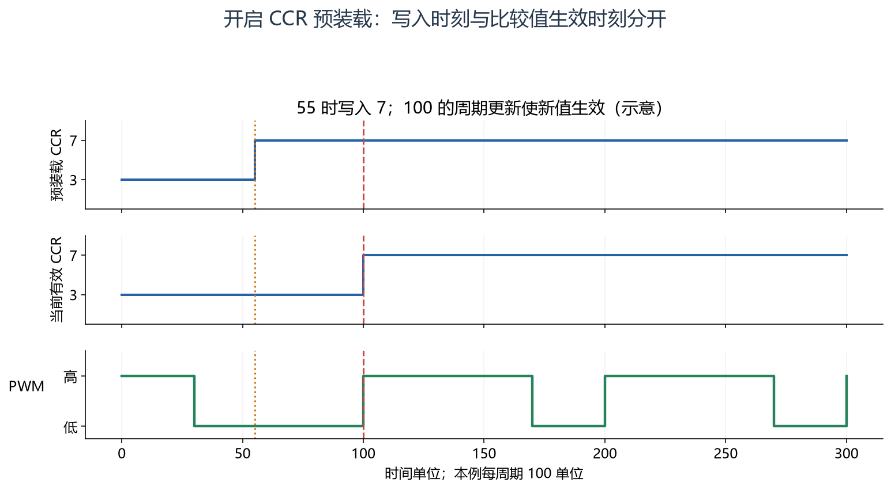

先看上两行：55 时只改变预装载值，100 时有效值才切换。下方 PWM 当前周期仍保持旧脉宽，下一周期使用新脉宽。前提是启用
OCxPE、正常更新，且没有中途强制 UG。

#### 从定时器内部到引脚，每个开关控制不同环节

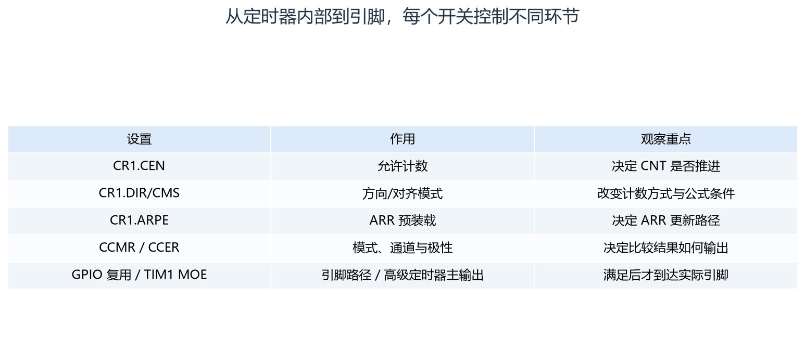

CR1 是运行设置的总入口之一，不能替代通道和引脚配置。检查 PWM 无输出时，依次确认时钟、CEN、模式、CCxE、复用 GPIO，以及高级定时器
MOE/刹车条件。

#### 相同 72 MHz 输入，改变不同参数产生不同结果

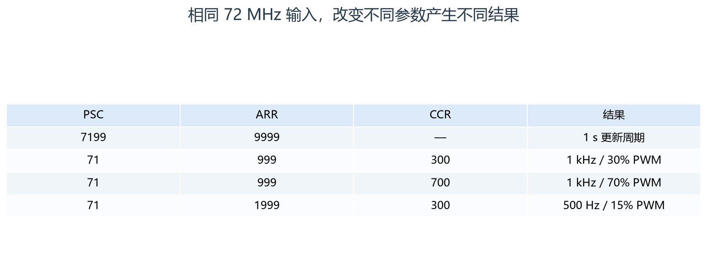

逐行用 fCNT=fTIM/(PSC+1)、fPWM=fCNT/(ARR+1)、D=CCR/(ARR+1) 复算。公式限常见向上计数、边沿对齐
PWM1、有效高等条件；变更 ARR 却不同比例调整 CCR，会同时改变占空比。

### 回到课件原图

下面图片截取自同目录原 PDF；页码为 PDF 阅读器中的物理页序号。
先读重绘解释，再用原图核对硬件框图或课件细节。

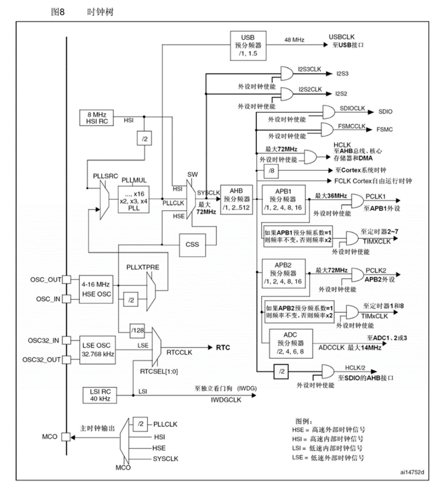

课件 P4（原图局部）：从 HCLK → APB 分频 → 定时器时钟观察是否有二倍关系。

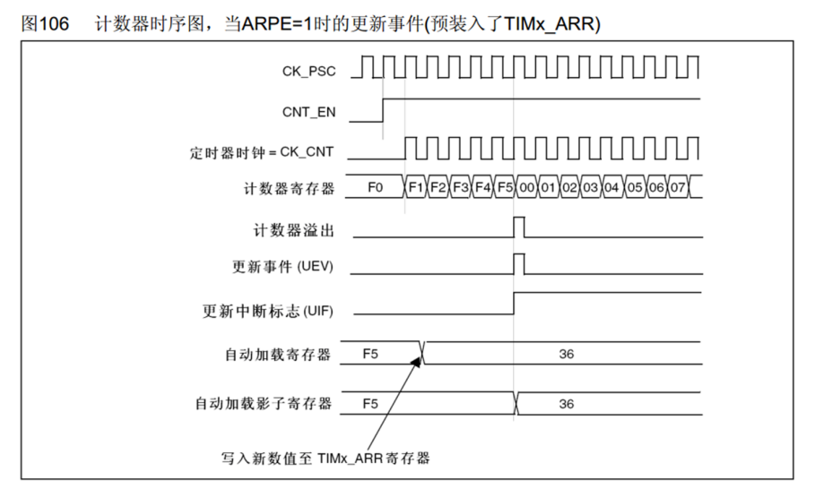

课件 P6（原图局部）：先看写入时刻，再看更新边界，区分预装载值与有效值。

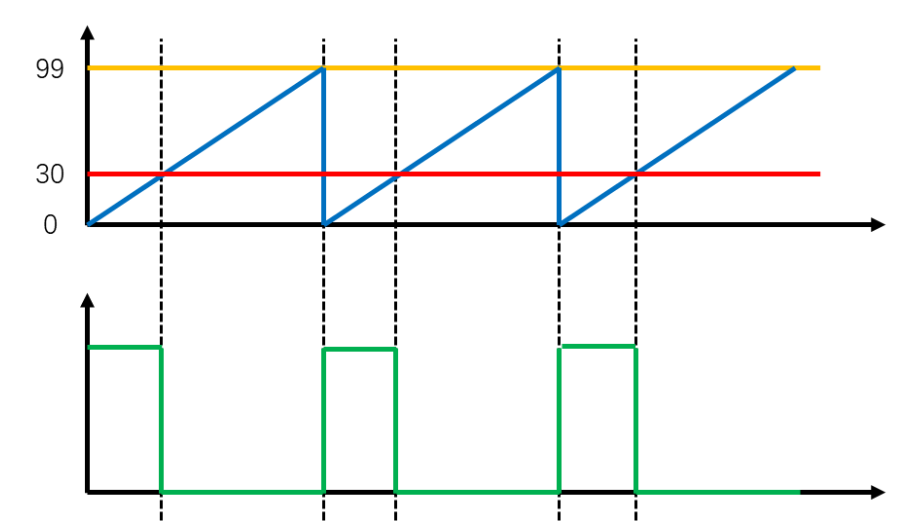

课件 P12（原图局部）：课件中 CNT 与 CCR 交点对应 PWM 翻转，注意模式和极性条件。

### 图源与后续修改

[可编辑概念图](course-note-assets/06/concepts.drawio)；
[本课图源目录](course-note-assets/06)。
概念图同时提供 JSON、SVG 与 PNG，专项图提供 SVG 与 PNG。
SVG 可放大查看；JSON 可用 diagramry 重绘。课件原图保持原貌，
不把截图中的文字改写成未经证实的新协议。

[专项图重绘脚本](course-note-assets/_source/redraw.py) ·
[图源使用说明](course-note-assets/_source/图源说明.md)


## 继续学习与资料对照

[跨外设工程专题](<01_跨外设工程专题与阅读索引.md>) · [资料来源与适用范围](<02_图文笔记资料来源与适用范围.md>)

深入部分包含官方机制对照和教学推导；模块命令、电气接线与固件差异按资料页的边界处理。

[深入配图源目录](course-note-assets/deep/06) · [深入图重绘脚本](course-note-assets/_source/deeper_diagrams.py)
