# 2-1-4-4_STM32基础 - 定时器输入捕获：图文笔记

[直接阅读深入学习](#deep-study) · [跨外设工程专题](<01_跨外设工程专题与阅读索引.md>)


输入捕获把边沿发生时的 CNT 锁存进 CCR。频率和脉宽来自时间间隔，编码器接口则利用两路相位判断方向和计数。

[返回学习导航](<00_单片机基础图文笔记导航.md>) · [打开原课件](<2-1-4-4_STM32基础 - 定时器输入捕获.pdf>)

## 阅读范围

原课件共 16 页；阅读定位：P1–4 输入捕获、测频/PWMI；P5–7 实验；P8–15 编码器接口；P16 小结。
图中卡片用于拆分概念，编号是阅读顺序；卡片之间不自动表示时间或因果。
重绘时序与数值例子会在图旁写出前提，不代表开发板实测。

## 一、边沿发生时，给 CNT 拍照

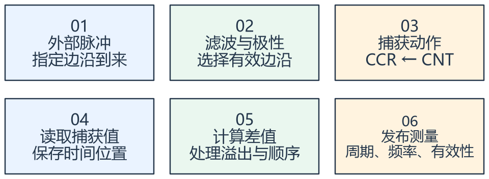

看图方法：先读每张卡片的关键词，再用下文核对它们之间的关系。

输出比较是软件预先给 CCR 一个标准；输入捕获则是硬件在事件时刻把 CNT 存入 CCR。同一个寄存器，工作模式不同，数据的来源和含义就不同。

普通捕获不会自动清 CNT。课件配合从模式 Reset 才实现捕获后复位时基；理解时必须把两个动作分开。

CCR 会被下一次捕获覆盖。软件要及时读取或使用适合的 DMA/缓冲方案，并检查过捕获、溢出和长时间无边沿。

## 二、测周法与测频法观察的窗口不同

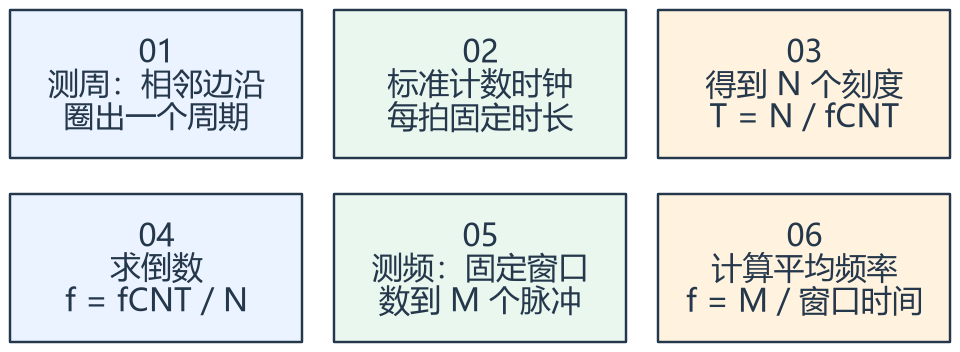

看图方法：先读每张卡片的关键词，再用下文核对它们之间的关系。

测周法在两个边沿之间数标准时钟，测频法在固定时间里数输入脉冲。两者量化误差的来源不同，不是算法名称换了一下而已。

假设 fCNT = 1 MHz，两次上升沿捕获值为 200、650，期间未溢出，则间隔是 450 μs，频率约 2222.22
Hz。不能把捕获差值机械加 1。

若已知相邻边沿间最多一次回绕，差值可按 ARR + 1 做模差；若可能多次回绕，只看两个 CCR 无法确定真实时间，需扩展计数或设置测量超时。

## 三、PWMI 用两个捕获值记录周期与高电平

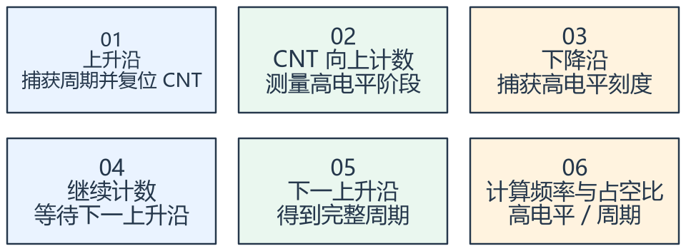

看图方法：先读每张卡片的关键词，再用下文核对它们之间的关系。

课件的 PWMI 用两个通道观察同一输入：一路捕获周期，另一路捕获高电平宽度。两路的直连/交叉映射和边沿必须配套设置。

假设周期捕获 1000，高电平捕获 300，fCNT = 1 MHz，则周期 1 ms、频率 1 kHz、占空比
30%。初始第一帧可能没有完整前一周期，应建立有效性条件。

编码器接口是另一种使用方式：A、B 两路相位不同，边沿次序决定方向，计数变化反映位移。倍率、每圈脉冲、机械传动比不一致时，不能直接把 CNT 当作转速。

## 专项图解

### PWMI 示例：下降沿记录高电平，上升沿界定周期

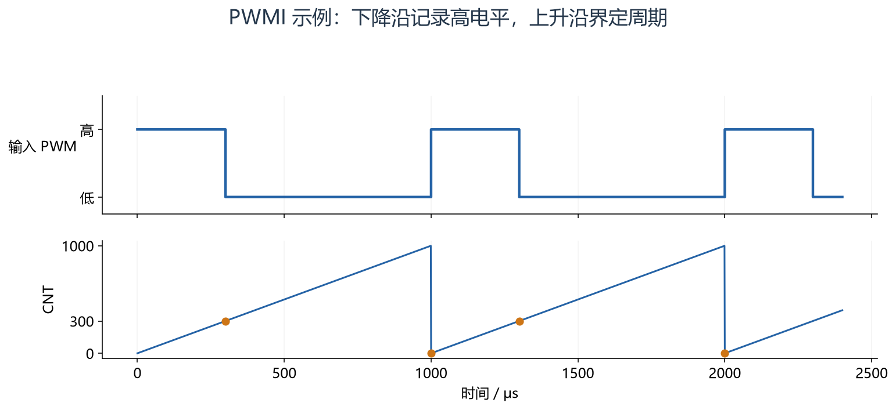

假设计数频率 1 MHz，周期 1000 μs、高电平 300 μs。复位从模式使 CNT
在上升沿复位；用于周期的捕获保存复位前的值。图中回零后的点不代表周期捕获等于零。

### 编码器：两路相位次序帮助判断运动方向

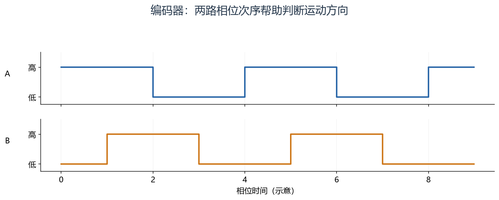

先看 A 的边沿，再看当时 B 的状态。反转时领先/滞后关系改变；实际正方向由接线和软件约定决定。不能只凭这张图就确定机械正转。

## 对照课件原图

下面图片截取自同目录原 PDF；页码为 PDF 阅读器中的物理页序号。
先读重绘解释，再用原图核对硬件框图或课件细节。

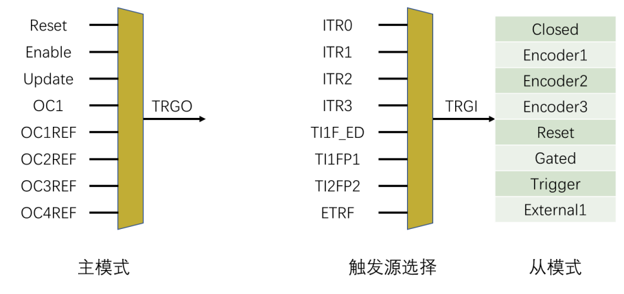

课件 P2（原图局部）：主模式输出触发、触发选择和从模式行为是三项关联配置。

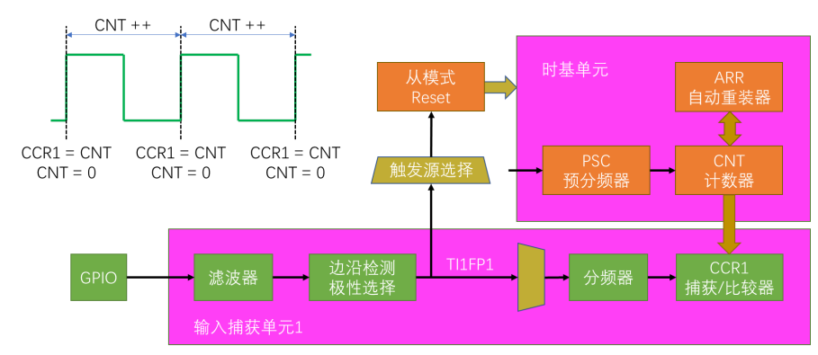

课件 P3（原图局部）：沿输入边沿看两条路径：一条锁存 CCR，一条触发从模式复位。

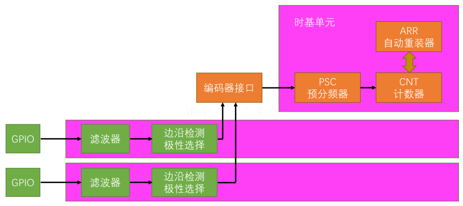

课件 P9（原图局部）：A/B 两路进入编码器逻辑，再决定 CNT 增减。

## 关键概念速查

| 名称 | 应该记住什么 |
|---|---|
| CNT | 时基或编码器当前计数 |
| CCR | 锁存的边沿时间值 |
| SMCR | 触发选择、从模式或编码器行为 |

## 具体例子

编码器有效计数为每圈 400，100 ms 内有符号差值为 20，则转速为 20 / 400 / 0.1 × 60 = 30 rpm。400
必须已包含当前解码倍率。

## 实验时如何验证

- 给定已知周期和脉宽的输入，比较捕获值与仪器读数。
- 测试边沿停止、极低频、溢出及第一帧无效条件。
- 转动编码器核对实际正方向、每圈计数和解码倍率。

## 常见误区

- 输入滤波会改变可响应的脉冲条件，不是越强越好。
- 一条输入波形使用两个捕获通道，不等于测了两根独立信号。
- 没有边沿时应超时置无效，不能永久保留上次频率当作当前值。

## 自测：先想答案，再展开

<details>
<summary>CNT 自动清零是谁做的？</summary>

只有配置了相应复位从模式等机制才会发生。

</details>

<details>
<summary>两个捕获值能知道多次溢出吗？</summary>

不能，必须增加溢出信息或限制测量范围。

</details>

<a id="deep-study"></a>

## 深入学习：测量窗口、回绕、量化误差和捕获过载


本节目录：

- [1. CCR 锁存不等于软件读得及时](#deep-1)
- [2. 模差公式必须附带观测范围](#deep-2)
- [3. 测周和测频各适合什么区间](#deep-3)
- [4. 计数频率提高会牺牲直接测量范围](#deep-4)
- [5. PWMI 两个值还需要同一周期的配对](#deep-5)
- [6. 滤波、过捕获与 DMA](#deep-6)
- [7. 编码器的“每圈多少计数”怎样推导](#deep-7)
- [8. 完整测量接口与诊断练习](#deep-8)

<a id="deep-1"></a>

### 1. CCR 锁存不等于软件读得及时

外部边沿经输入选择、数字滤波、极性和捕获预分频后，满足条件才将 CNT 锁存进 CCR，并形成相应状态。
这比 ISR 中再读 CNT 更接近边沿发生时刻，因为软件响应可能被其他中断推迟。
但输入滤波本身可能引入延迟，且同步到内部时钟也存在量化，不能把捕获值视为无限精确的物理时间。

CCMR 中的 CCxS 决定通道连接到输入还是输出及其映射，ICxF 管滤波，ICxPSC 管每几个有效事件捕获一次。
这里的捕获预分频与时基 PSC 不同：前者减少捕获事件数量，后者改变 CNT 计数节拍。

普通模式捕获不会自动清 CNT；若要每个周期从零计时，需另用从模式复位等机制。
把“锁存”和“复位”看成两条受控路径，才能解释 PWMI 为什么要配映射与触发。

<a id="deep-2"></a>

### 2. 模差公式必须附带观测范围

令 M=ARR+1，已知间隔小于一个完整计数模周期时：

```text
ΔN = (capture_new − capture_old + M) mod M
Δt = ΔN / fCNT
```

例如 ARR=999、捕获值 900→100，若已知实际间隔小于 1000 tick，则 ΔN=200。
如果期间可能有多个周期，真实间隔也可能是 1200、2200……，单靠两个值无法区分。
模差不是自动补全无限次溢出的算法。

若要扩展计数，用更新次数和捕获低位拼成时间戳，还必须解决“捕获与溢出几乎同时发生”的竞态。
读取顺序、UIF 与 CCR 的先后意义需按硬件与 ISR 逻辑设计；简单把任意时刻读到的高低部分拼起来，可能错一整个模周期。

<!-- extended:capture-wrap -->

#### 机制补图：900 → 回绕 → 100：差值要按计数模数计算

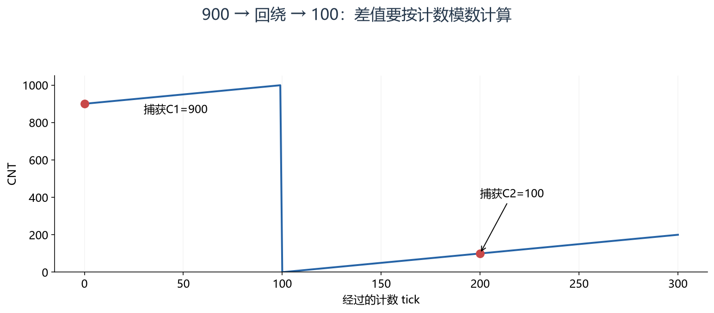

**读图方法与条件：** ARR=999，模数M=1000；Δ=(100−900+1000)%1000=200。只有已知两次捕获间隔小于一个模周期时，才能唯一解读为200 tick；多绕一圈同样得到这个余数。

[放大查看 SVG](course-note-assets/extended/07/capture-wrap.svg)

<!-- /extended -->

<a id="deep-3"></a>

### 3. 测周和测频各适合什么区间

测周在一个输入周期内数参考时钟：f≈fCNT/N，单个 tick 的误差比例约随 1/N 变化。
输入越高频，周期内 tick 越少，相对量化误差可能越大。
测频在固定门宽内数输入事件：f≈M/Tgate，一个事件的误差比例约随 1/M 变化，低频时事件太少便不利。

例：1 MHz 时基测 100 kHz，周期只有约 10 tick，一个 tick 就约 10%；测 1 kHz 则约 1000 tick，一个 tick 约 0.1%。
若改用 100 ms 门宽测 100 kHz，可计约 10000 个事件，一个事件约 0.01%，但结果延迟至少有门宽尺度。
这些只是量化尺度估计，未包含输入抖动和参考源误差。

需要宽动态范围时，可采用多周期测量、自适应门宽或区间切换。切换前后要统一输出时间戳与有效性，避免让控制算法把不同窗口的结果当作同一瞬时量。

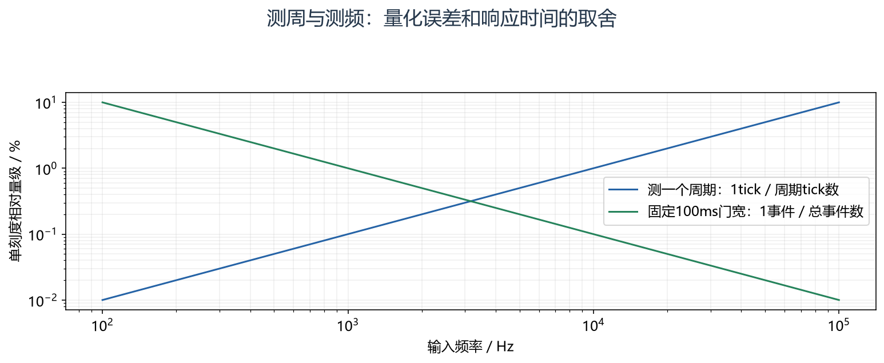

怎么看：两条曲线使用图中给定时基与门宽，仅比较一个计数量级的相对误差。实际测量还需考虑输入抖动、参考频率误差和滤波。

<a id="deep-4"></a>

### 4. 计数频率提高会牺牲直接测量范围

16 位计数器以 1 MHz 计数，回绕时间为 65536 μs≈65.536 ms；直接单周期测量低频时很快需要溢出扩展。
若降为 10 kHz，可覆盖约 6.5536 s，但每 tick 变成 100 μs，测窄脉冲的刻度会变粗。

频率、最小脉宽、最低转速、允许输出延迟共同决定时基。不能只为了“精度高”把 PSC 总设为零。
若测每转一脉冲且最低 10 rpm，周期达 6 s，应提前设计长周期和停止超时，而不是等出现 CCR 回绕后临时补丁。

<a id="deep-5"></a>

### 5. PWMI 两个值还需要同一周期的配对

常见 PWMI 把同一输入连接到两个捕获通道，一个边沿记录周期，另一个记录高电平时间，再配合复位从模式。
首次边沿之前不存在完整历史周期；周期通道和高电平通道也可能在软件读取过程中先后更新。

发布结果前至少确认周期非零、高电平不超过周期、两项来自匹配的一轮，并处理第一帧、边沿缺失和过捕获。
如果噪声多出一次边沿，仅检查“能算出百分比”不足以证明测量有效；还可结合合理频率和变化率判定。

<!-- extended:pwmi-pair -->

#### 机制补图：跨周期混读：两个正确寄存器值也能算出错误占空比

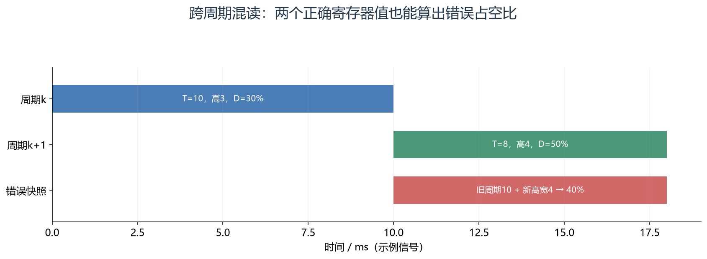

**读图方法与条件：** 40%不属于任一完整周期。实际PWMI复位模式的CCR更新顺序取决于边沿和通道，应在选定完成事件后组装一致快照，遇过捕获或超时则丢弃。

[放大查看 SVG](course-note-assets/extended/07/pwmi-pair.svg)

<!-- /extended -->

<a id="deep-6"></a>

### 6. 滤波、过捕获与 DMA

数字滤波通常要求按规定采样频率连续观察足够数量的稳定样本，拒绝短毛刺，同时降低可响应的最窄脉冲范围。
具体 ICxF 编码对应的采样分频与样本数按手册表选取，不是“填最大值最稳定”。

CCxOF 表示在前一次捕获状态尚未处理时又发生了捕获，CCR 可能已经被新值覆盖。
扩大软件数组不能恢复已经在硬件单寄存器处被覆盖的数据。可降低事件率、增加捕获预分频或采用匹配请求的 DMA，但仍要检查吞吐和缓冲覆盖。

没有新边沿时计数器可能仍在走，上次频率也仍留在变量中。因此对外数据应带最后有效边沿时间，超过约定时间即标记停止或无效。

<!-- extended:overcapture -->

#### 机制补图：CCR 是锁存位置，未读前又来边沿就可能丢测量

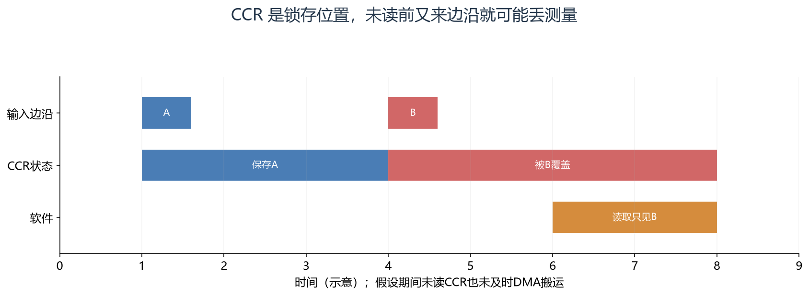

**读图方法与条件：** 第二次捕获可能置CCxOF，表示数据流已不完整。处理时应记录丢失、按手册清标志，并重新建立周期配对；不能继续把B当作紧邻上次的A。

[放大查看 SVG](course-note-assets/extended/07/overcapture.svg)

<!-- /extended -->

<a id="deep-7"></a>

### 7. 编码器的“每圈多少计数”怎样推导

正交编码器 A/B 相差约四分之一周期，边沿次序决定方向。若编码盘每圈提供 100 个 A 周期，采用适当四倍频解码可得到 400 count/rev。
还要乘机械传动比，统一到电机轴还是车轮轴；不同厂家 PPR/CPR 术语可能不同，应先查定义。

窗口法转速：rpm=Δcount/(count_per_rev×Δt)×60。
低速时短窗口可能大部分为零，偶尔跳一个较大值；拉长窗口可平滑，却增加响应延迟。高低速采用不同估计方法时仍要保持方向、时间和有效性一致。

<a id="deep-8"></a>

### 8. 完整测量接口与诊断练习

`cfg` 是时基、滤波、输入极性、每圈计数与超时；`ctx` 是前次捕获、溢出扩展与配对阶段；
`data` 是周期、频率、占空比/转速、时间戳和有效性；`ops` 是启动、停止、读取一致快照。

题：1 MHz 时基，连续 20 个周期共计 10003 tick，如何减少单周期量化影响？
解：平均周期约 500.15 μs，频率为 20×10^6/10003≈1999.40 Hz。
跨多周期求总间隔再计算可降低端点量化的相对影响，但更长观测窗口也平滑了真实频率变化。

题：波形仪器显示输入正常，程序偶发极小周期，优先查什么？
解：检查噪声/错误极性、多次回绕、溢出竞态、两周期值混读和 CCxOF；不能先用滤波把异常结果全部压平后宣布测量正确。

<!-- extended:measurement-validity -->

#### 机制补图：测量结果需要随时间失效，不能永远沿用上一次频率

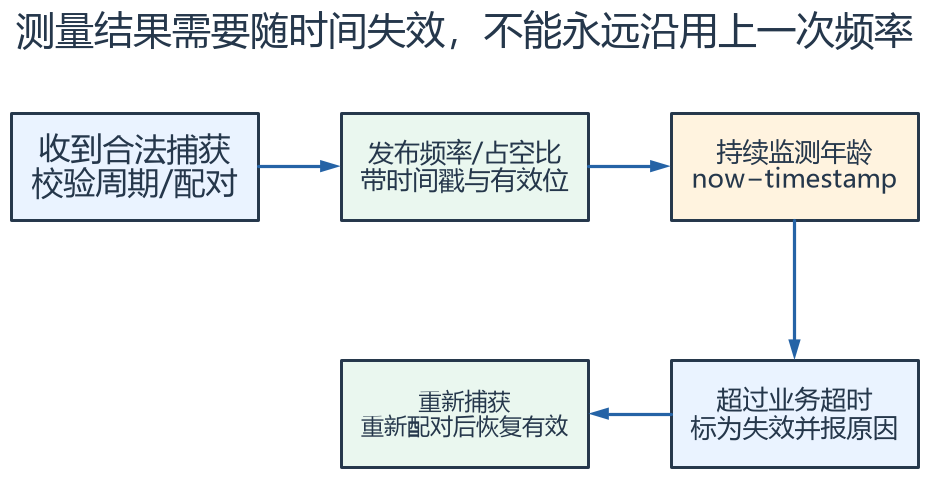

**读图方法与条件：** 超时阈值应覆盖最低允许输入频率及合理抖动。停波时，旧频率只是历史值；发布valid=false和超时原因比只把频率写0更能区分失效与真实零速。

[放大查看 SVG](course-note-assets/extended/07/measurement-validity.svg) · [可编辑结构图](course-note-assets/extended/07/extended.drawio)

<!-- /extended -->

## 资料与验证边界

入门部分依据同目录课件；深入部分补充官方资料与明确条件下的推导。课件中的产品宣传、历史软件版本、
简化图和典型性能不直接作为当前板卡、固件或全部同系列产品的保证。
本次只整理资料与图文，没有编译固件、下载或进行硬件实测。
实际接线、电平、寄存器差异和模块命令须核对所用器件资料。

## 图源与后续修改

[可编辑概念图](course-note-assets/07/concepts.drawio)；
[本课图源目录](course-note-assets/07)。
概念图同时提供 JSON、SVG 与 PNG，专项图提供 SVG 与 PNG。
SVG 可放大查看；JSON 可用 diagramry 重绘。课件原图保持原貌，
不把截图中的文字改写成未经证实的新协议。

[专项图重绘脚本](course-note-assets/_source/redraw.py) ·
[图源使用说明](course-note-assets/_source/图源说明.md)


## 继续学习与资料对照

[跨外设工程专题](<01_跨外设工程专题与阅读索引.md>) · [资料来源与适用范围](<02_图文笔记资料来源与适用范围.md>)

深入部分包含官方机制对照和教学推导；模块命令、电气接线与固件差异按资料页的边界处理。

[深入配图源目录](course-note-assets/deep/07) · [深入图重绘脚本](course-note-assets/_source/deeper_diagrams.py)
