# 2-2-1-1_STM32基础 - USART串口通信1-语音控制：图文笔记

[直接阅读深入学习](#deep-study) · [跨外设工程专题](<01_跨外设工程专题与阅读索引.md>)

串口硬件传送连续的字节流，协议负责把字节拼成消息。先掌握电平、位时间与字节格式，再学习接收状态机和语音命令。

[返回学习导航](<00_单片机基础图文笔记导航.md>) · [打开原课件](<2-2-1-1_STM32基础 - USART串口通信1-语音控制.pdf>)

## 阅读范围

原课件共 34 页；阅读定位：P2–10 USART、电平、帧与波特率；P11–14 收发实验；P15–30 数据包；P31–33 语音控制。
图中卡片用于拆分概念，编号是阅读顺序；卡片之间不自动表示时间或因果。
重绘时序与数值例子会在图旁写出前提，不代表开发板实测。

## 一、从程序中的字节到线上波形

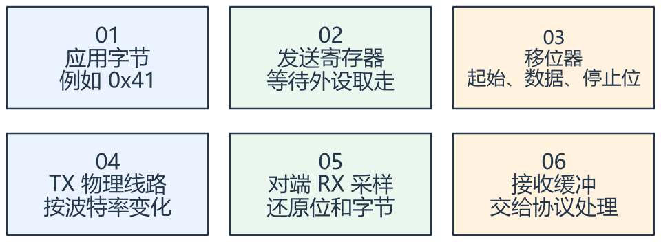

看图方法：先读每张卡片的关键词，再用下文核对它们之间的关系。

异步串口没有单独的共享时钟线，双方约定波特率与帧格式，再通过起始位建立每帧采样位置。TX 接对方 RX，并有合适的参考地和匹配的电平标准。

MCU 的 TTL/CMOS 串口电平不能直接当成 RS-232 正负电压。模块“5 V 供电”也不意味着串口引脚必然能承受 5 V。

发送寄存器可写入与整帧真正发送完毕是两个时刻，TXE 与 TC 的含义应区分。需要关闭驱动器或切换方向时，只看缓冲可写可能过早。

## 二、8N1 的一帧怎样数时间

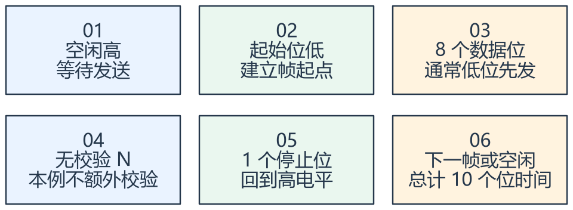

看图方法：先读每张卡片的关键词，再用下文核对它们之间的关系。

8N1 表示 8 个数据位、无校验、1 个停止位，加上起始位，通常一个字节占 10 个位时间。9600 bit/s 时，一帧约 10 / 9600 =
1.0417 ms，理论有效载荷约 960 字节/秒。

0x41 与字符 A 可以对应同一个字节；字符串 "41" 却是两个字符字节 0x34、0x31。串口工具中的 Hex
显示和文本显示只是同一数据的不同解释方式。

课件的 USART 还支持同步等其他功能。本节讨论常见异步 8N1，不能把此处位数直接套给带校验或 9 位字长模式。

## 三、接收字节流必须有组包状态机

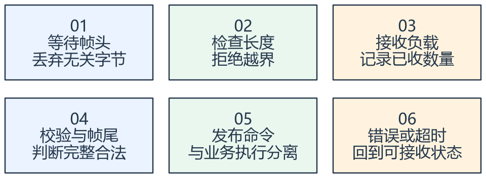

看图方法：先读每张卡片的关键词，再用下文核对它们之间的关系。

串口中断每次收到一个或少数字节，不等于每次得到一个完整应用消息。帧头、长度、校验和结束符是应用协议定义的边界，不是 USART 自动理解的业务内容。

接收必须防止长度越界、帧尾缺失、粘连、分段和超时。文本行协议可以按结束符组行，但也需限制最大长度；二进制负载可能包含任意字节，不能随便以某个字节当结束。

语音模块把识别结果转换为约定命令，MCU 仍需校验命令范围并映射成业务动作。课件 ASRPRO 的供电和串口电平应分开核对，命令字节以实际模块程序为准。

接收 ISR 宜保存字节和必要状态，显示、风扇控制等慢动作由业务层执行。完整帧最好通过一致快照或消息队列交接。

## 专项图解

### 0x41 的 8N1 波形：数据低位先发送

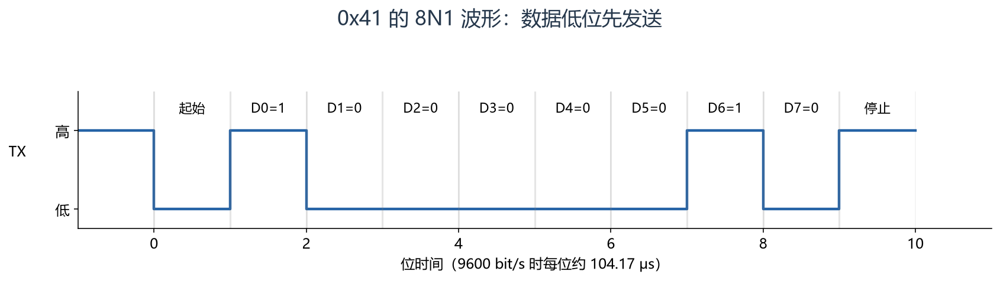

从起始位向右数：0，然后 D0～D7 为 1、0、0、0、0、0、1、0，最后停止位为 1。数据只占八位，线上一帧共十位。

### 字节、数值、字符和字符串的区别

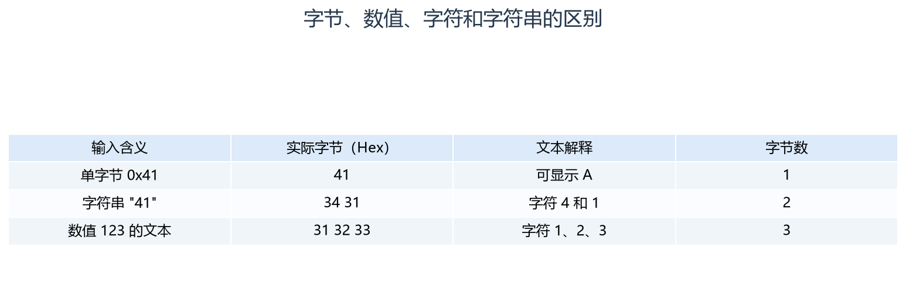

先看线上实际 Hex 字节，再看显示解释。同一个数值可以用二进制字段或文本编码传输，接收端必须遵守约定。

### 串口状态机：正常路径与错误恢复路径都要有

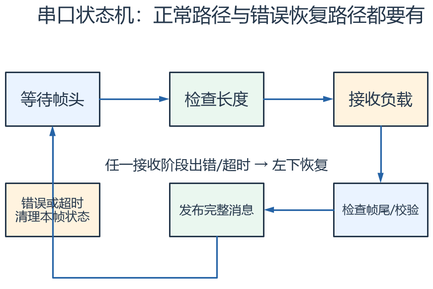

从左上顺时针看正常接收路径。错误与半帧超时都要回到可接收新帧的状态；图中的发布表示交给业务层，不表示 ISR 中直接执行慢业务。

## 对照课件原图

下面图片截取自同目录原 PDF；页码为 PDF 阅读器中的物理页序号。
先读重绘解释，再用原图核对硬件框图或课件细节。

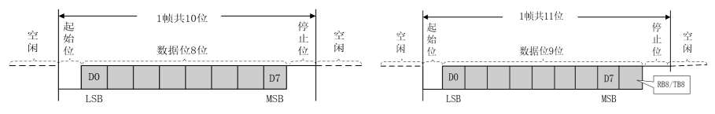

课件 P4（原图局部）：先数起始、数据、校验、停止位，再换算位时间。

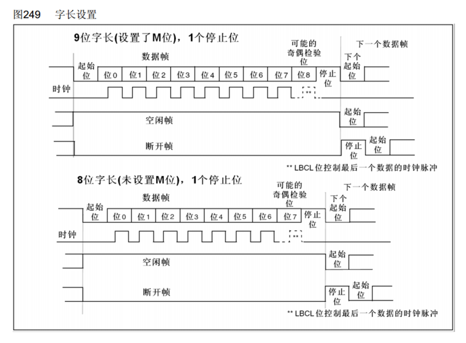

课件 P8（原图局部）：字长设置与校验位的占用关系需按外设说明阅读。

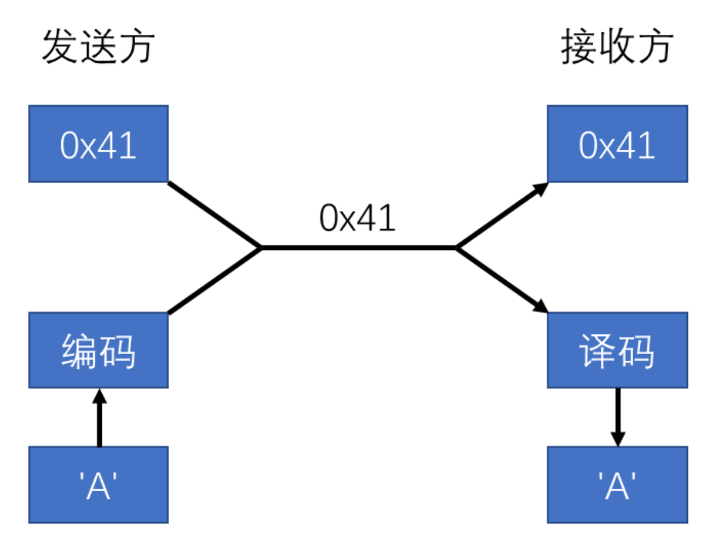

课件 P16（原图局部）：同一个 0x41 可以以数字或字符形式解释，线上字节本身未变化。

## 关键概念速查

| 名称 | 应该记住什么 |
|---|---|
| BRR / 波特率配置 | 位时间的来源，依赖外设时钟 |
| DR 与 RXNE | 接收数据和可读取状态，具体清除流程看型号 |
| 应用协议 | 帧头、长度、命令、校验、超时和应答 |

## 具体例子

收到字节 0x41，文本模式可能显示 A，Hex 模式显示 41。若发送字符串 "41"，线上是 34 31，而不是单字节 41。

## 实验时如何验证

- 用已知字节和固定帧测试波特率、格式及 Hex/文本差异。
- 分段发送、连发两帧、发送错误长度，检查组包恢复。
- 暂停半帧直到超时，再发完整帧，确认能够继续接收。

## 常见误区

- 波特率相同还不够，数据位、校验位和停止位也要一致。
- 校验和帧格式正确并不等于命令在当前状态允许执行。
- 接收超时后应恢复状态机，不能一直等待丢失的剩余字节。

## 自测：先想答案，再展开

9600、8N1 时传 100 字节至少多久？

仅连续位时间约 104.17 ms，还没计算间隔与软件延迟。

为什么一次接收回调不一定是一帧？

硬件或传输分段与应用消息边界不是同一件事。

## 深入学习：串口时钟、收发流水线、缓存预算和协议状态机

本节目录：

- [1. 波特率误差来自哪里](#deep-1)
- [2. DR、移位器、TXE 与 TC 是一条流水线](#deep-2)
- [3. 错误标志与清除序列要按器件处理](#deep-3)
- [4. 环形缓冲容量怎样计算](#deep-4)
- [5. DMA+空闲检测不等于自动识别消息边界](#deep-5)
- [6. 一个协议帧至少定义哪些东西](#deep-6)
- [7. 从“收到请求”到“动作完成”的三个时刻](#deep-7)
- [8. 延时预算与定位表](#deep-8)

### 1. 波特率误差来自哪里

USART 的 BRR 根据外设时钟及分频编码产生位时间。F103 常见 16 倍过采样配置中，可把实际波特率理解为 fPCLK/(16×USARTDIV)。
其中 USART1 与 USART2/3 所在总线不同，不能都用 72 MHz 计算。

双方时钟各有误差，累积偏差会使帧后半段采样偏离数据中心。允许误差取决于帧格式、接收实现和时钟条件，不能拿固定“±若干%”覆盖所有模式。
逻辑分析仪显示 115200 只能说明它按某种容差解码成功；要检查边界条件，仍需测实际位宽与波形质量。

9600/115200 表示符号/位传输速率的常见串口设置，不直接等于业务字节率。8N1 每字节十位，115200 时理想连续原始数据率约 11520 byte/s。

### 2. DR、移位器、TXE 与 TC 是一条流水线

软件将字节写入数据寄存器，之后硬件移入发送移位器并逐位发送。
TXE 表示发送数据寄存器可接收下一字节；TC 表示规定的整个发送过程已完成。
因此最后一个字节已经写入甚至 TXE=1 时，线上的停止位仍可能尚未结束。

RS-485 半双工切换 DE、关闭串口时钟、进入深度休眠等操作，要根据“最后一位是否离开线路”决定时机，不能只看缓冲可写。
DMA 完成也常只说明内存内容已经交给外设，不自动等于 TC。

接收方向中，移位器接到的字节进入接收数据寄存器并置 RXNE。软件取走不及时，下一字节到来可能形成 ORE。
ORE 是接收服务速度问题的证据，不能通过无条件清标志后继续打印旧缓存来假装没有丢数据。

<!-- extended:tx-completion -->

#### 机制补图：DMA完成、TXE与TC分别对应发送流水线的不同位置

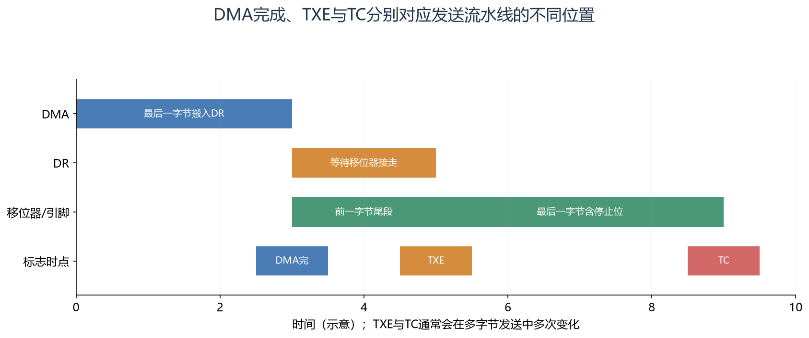

**读图方法与条件：** TXE表示DR空，TC表示最后一帧已发完且DR也空。DMA完成时，字节可能还在DR或移位器。RS-485释放DE等操作必须依据真正线路发送完成。

[放大查看 SVG](course-note-assets/extended/08/tx-completion.svg)

<!-- /extended -->

### 3. 错误标志与清除序列要按器件处理

噪声、帧错误、奇偶校验错误与溢出具有不同来源。F1 一些标志涉及先读 SR 再读 DR 等规定顺序，不能套 EXTI 的写一清零方法。
中断驱动应保存必要诊断计数，决定错误字节是否丢弃、当前应用帧是否废弃，以及何时重新同步。

ISR 中无边界读取、缓冲区越界和慢打印又会引入新的故障。串口接收 ISR 宜快速读状态/字节并交接，完整协议解析根据负载放到主循环或任务。

<!-- extended:rx-overrun -->

#### 机制补图：软件不及时取走接收数据，下一字节可能造成 ORE

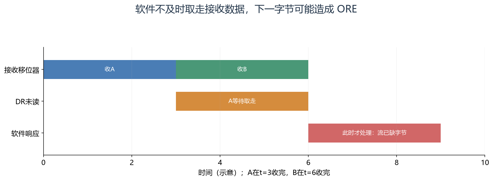

**读图方法与条件：** t=6 时DR仍未腾空，会出现过载接收错误。不能只清ORE后假装消息完整；要记录错误并重新同步协议。F1相关错误清除依手册规定读取SR再读DR。

[放大查看 SVG](course-note-assets/extended/08/rx-overrun.svg)

<!-- /extended -->

### 4. 环形缓冲容量怎样计算

环形缓冲一般由生产者写入、消费者读出，分别维护索引，必须明确空和满的判定方式。
采用“留一格区分满空”时，声明 256 个元素只有 255 个可用位置。不同实现也可额外保存计数或使用单调索引，不能混用判断公式。

115200、8N1 下，若消费者最长停顿 20 ms，期间可能新增约 230.4 字节。
至少应容纳 231 字节，再加已有积压、调度抖动与协议突发余量。一个可用容量 255 的缓存此时余量已不大。
缓存够大只处理有限停顿；长期消费速率小于输入速率时最终仍会满。

共享索引需要满足访问原子性与顺序要求。只加 volatile 不自动得到多生产者安全，也不自动建立跨平台内存可见性协议。
F103 的简单单生产者单消费者实现与多任务并发写队列，不能用同一个论证覆盖。

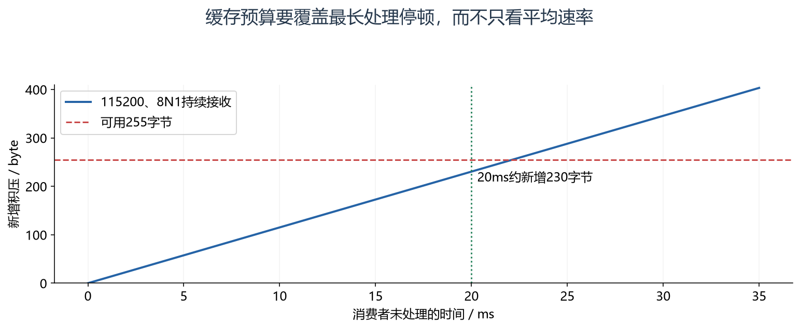

怎么看：按 115200、8N1 连续接收且消费者完全停顿计算，255 字节可用空间约 22.1 ms 填满。协议突发和既有积压还会缩短余量。

### 5. DMA+空闲检测不等于自动识别消息边界

接收 DMA 可以连续搬运；IDLE 可提示线路出现规定空闲，但应用一帧中也可能有停顿，连续两帧间也可能没有足够空闲。
因此 IDLE 更适合触发“看看目前来了多少数据”，应用仍按帧头、长度和校验确定消息。

循环 DMA 下可根据剩余计数推算写入位置，再处理两次位置之间新增的区段；跨尾部时需分两段读取。
快照时刻、DMA 恰好回绕和消费者追不上等边界必须明确。停止/重启 DMA 的方案还可能存在窗口丢字节，应按真实实现分析。

<!-- extended:idle-boundary -->

#### 机制补图：同一串口帧可以分两块，两帧也可能落在同一块

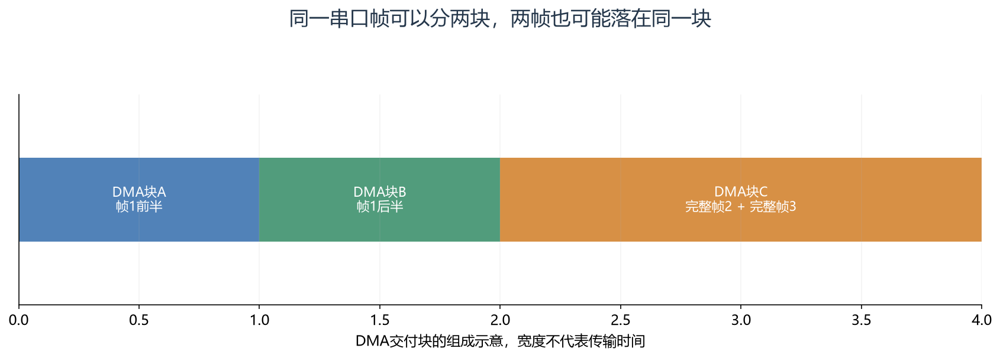

**读图方法与条件：** 方框表示软件收到的DMA数据块，不代表协议帧。IDLE反映串口线上一段空闲，解析器仍需依据长度、校验、帧头或转义规则持续消费字节。

[放大查看 SVG](course-note-assets/extended/08/idle-boundary.svg)

<!-- /extended -->

### 6. 一个协议帧至少定义哪些东西

帧头用于同步，长度限制资源使用，类型/命令定义语义，序号关联请求与应答，校验检测部分传输错误，超时帮助退出残帧。
多字节字段还必须规定大小端、单位、比例、有效范围及无效值。

假设一个教学协议采用“帧头+长度+命令+序号+负载+CRC”，应先算长度范围与最大帧总长，再分配缓冲。
接收端在接受长度后不能任其超过缓存；校验通过也不能跳过命令和状态合法性检查。
本例是协议设计说明，不是课件语音模块的真实帧格式。

帧头出现在负载中时，长度定界、转义和其他编码方案各有取舍。校验算法必须说明多项式、初值、反射、最终异或与字节顺序，只写“CRC16”不足以互通。

### 7. 从“收到请求”到“动作完成”的三个时刻

收到完整合法请求后，可以先返回接受状态；随后执行控制；执行完成再返回最终结果。
对于耗时语音动作或外设驱动，接受请求不等于动作完成。超时后重发还需考虑是否重复执行。

设置目标状态通常容易做到幂等，增加一次计数或扣一次余额则需要事务编号和重复识别。
语音识别模块可能重复上报同一识别结果，MCU 需要按业务定义处理，不能一律把重复字节认作通信干扰。

<!-- extended:request-ack-done -->

#### 机制补图：接收请求、接受请求、动作完成应有不同语义

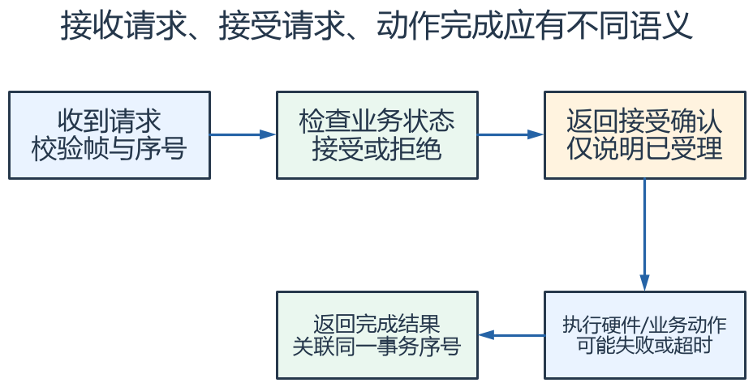

**读图方法与条件：** 发送方分别设置接收确认与完成超时。若模块手册只有一种应答，要按其实际语义处理，不能凭命名把“收到”解释成“已完成”。

[放大查看 SVG](course-note-assets/extended/08/request-ack-done.svg) · [可编辑结构图](course-note-assets/extended/08/extended.drawio)

<!-- /extended -->

### 8. 延时预算与定位表

32 字节 8N1 在 115200 下，仅发送位时间约 32×10/115200=2.778 ms。
完整响应还要加排队、远端处理、应答位时间与调度等待，应用超时必须覆盖这些量并留明确余量。

| 现象 | 优先区分 |
|---|---|
| 所有字节都乱码 | 电平、地、时钟、波特率、帧格式与反相 |
| 偶尔缺字节 | ORE、DMA窗口、缓存满、屏蔽/消费停顿 |
| 字节正确但命令错误 | 文本/Hex、组包、长度、字节序与状态约束 |
| 长时间后组包失步 | 残帧超时、错误恢复、长度越界与流量突发 |

证明范围按“线上字节→硬件接收→软件缓存→协议帧→业务动作”逐级记录；某一级正确不能替代后一层验证。

## 资料与验证边界

入门部分依据同目录课件；深入部分补充官方资料与明确条件下的推导。课件中的产品宣传、历史软件版本、
简化图和典型性能不直接作为当前板卡、固件或全部同系列产品的保证。
本次只整理资料与图文，没有编译固件、下载或进行硬件实测。
实际接线、电平、寄存器差异和模块命令须核对所用器件资料。

## 图源与后续修改

[可编辑概念图](course-note-assets/08/concepts.drawio)；
[本课图源目录](course-note-assets/08)。
概念图同时提供 JSON、SVG 与 PNG，专项图提供 SVG 与 PNG。
SVG 可放大查看；JSON 可用 diagramry 重绘。课件原图保持原貌，
不把截图中的文字改写成未经证实的新协议。

[专项图重绘脚本](course-note-assets/_source/redraw.py) ·
[图源使用说明](course-note-assets/_source/图源说明.md)

## 继续学习与资料对照

[跨外设工程专题](<01_跨外设工程专题与阅读索引.md>) · [资料来源与适用范围](<02_图文笔记资料来源与适用范围.md>)

深入部分包含官方机制对照和教学推导；模块命令、电气接线与固件差异按资料页的边界处理。

[深入配图源目录](course-note-assets/deep/08) · [深入图重绘脚本](course-note-assets/_source/deeper_diagrams.py)
