# 2-2-1-2_STM32基础 - USART串口通信2-射频识别技术RFID：图文笔记

[直接阅读深入学习](#deep-study) · [跨外设工程专题](<01_跨外设工程专题与阅读索引.md>)

RFID 系统分成 MCU 到读卡模块的接口，以及模块到卡片的射频协议。S50 的关键是扇区、块、权限和钱包操作顺序。

[返回学习导航](<00_单片机基础图文笔记导航.md>) · [打开原课件](<2-2-1-2_STM32基础 - USART串口通信2-射频识别技术RFID.pdf>)

## 阅读范围

原课件共 7 页；阅读定位：P1–3 RFID 与卡状态；P4–6 S50 存储结构、密钥与钱包；P7 综合实验。
图中卡片用于拆分概念，编号是阅读顺序；卡片之间不自动表示时间或因果。
重绘时序与数值例子会在图旁写出前提，不代表开发板实测。

## 一、两段通信链不要混为一谈

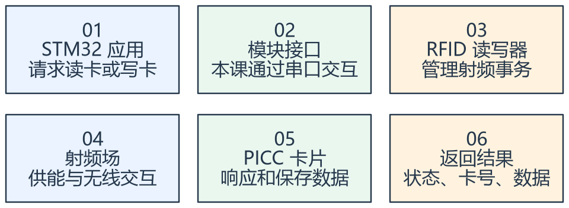

看图方法：先读每张卡片的关键词，再用下文核对它们之间的关系。

MCU 与模块之间的串口协议并不等于卡片空口协议。模块可能把寻卡、认证等封装为命令，但应用仍需理解成功、失败、卡离场与超时。

RFID 是较广的技术类别，NFC 与其中部分标准和应用相关，不能把所有 RFID 都当作同一种频率、距离和安全能力。课件讨论的 S50 属于特定卡型。

卡片 UID 用于识别，不应单独当作充分身份认证。卡型与 UID 长度随产品而异，不能把课件例子的 4 字节 UID 当作所有非接触卡的固定规则。

## 二、S50 的存储先分扇区，再分块

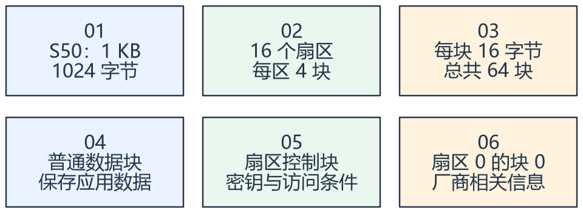

看图方法：先读每张卡片的关键词，再用下文核对它们之间的关系。

对课件 S50，16 × 4 × 16 = 1024 字节。每个扇区最后一块是扇区控制块，包含密钥和访问条件，不能当成普通用户数据区任意写。

全局块号可按 sector × 4 + block_in_sector 理解，例如扇区 2 的第 1 个块（区内编号 0）对应块号
8。写前先检查块号与用途。

容量不等于全部可随意存应用数据。控制块和厂商块需要特殊对待，权限配置错误可能让后续访问失败。不同卡型的组织不能照抄 S50。

## 三、钱包操作是一段带状态的事务

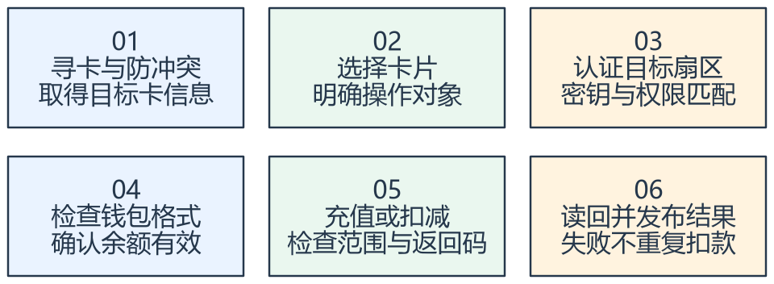

看图方法：先读每张卡片的关键词，再用下文核对它们之间的关系。

课件的公交卡实验包括初始化、读取、充值、消费和查询。钱包块需要采用正确的值块格式，不能任意写 4 字节后就假定标准增减命令一定可用。

每一步都可能失败：多卡、认证失败、卡离场、通信超时、余额不足或范围溢出。发送成功与卡片已经完成修改是不同证据。

如果扣款后应答丢失，盲目重发可能再次扣款。学习时就应区分“确认未执行”与“执行结果未知”，通过读回或受控事务设计解决。

课件中“ID 卡就是纯线圈”“IC 卡完全不会受损”等说法不宜作为器件结构或可靠性结论。区分身份标识、芯片存储与射频接口更有帮助。

## 专项图解

### S50：16 个扇区 × 4 块 × 16 字节

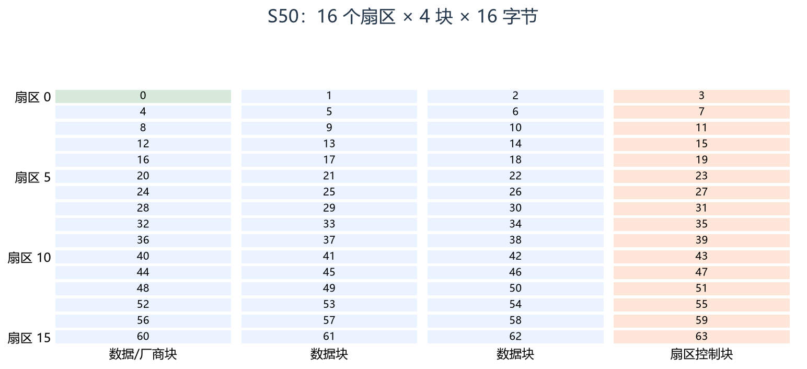

格子里的数字是全局块号，右列是每个扇区的控制块；绿色块 0 是厂商相关块。按颜色先排除特殊用途块，再规划业务数据。

### 扣款超时：必须区分“未执行”和“结果未知”

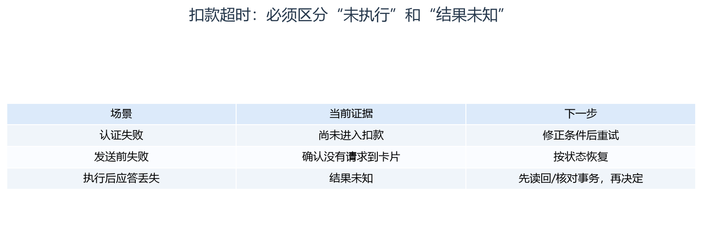

同样是“没有成功应答”，处理可能不同。不要把结果未知统一转换成未执行，盲目重发可能重复扣减。

## 对照课件原图

下面图片截取自同目录原 PDF；页码为 PDF 阅读器中的物理页序号。
先读重绘解释，再用原图核对硬件框图或课件细节。

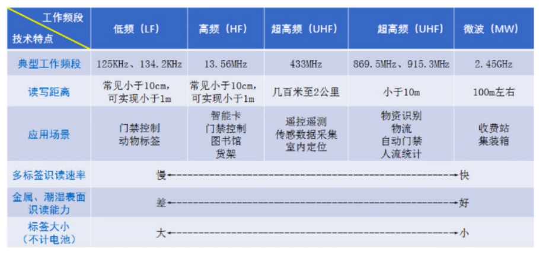

课件 P2（原图局部）：这张表比较不同射频频段的应用，距离并非任何场景的固定保证。

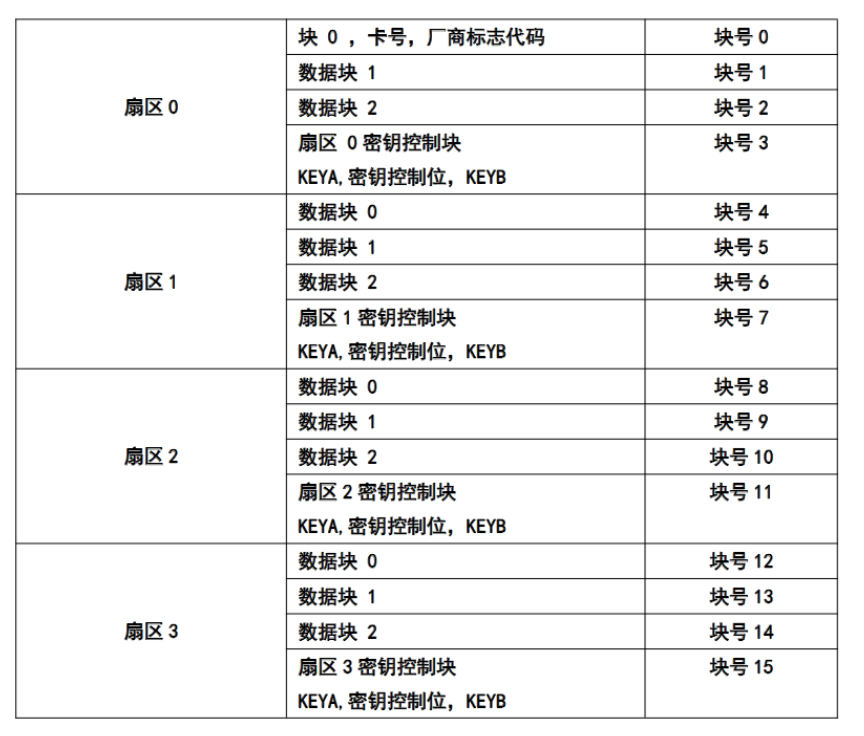

课件 P6（原图局部）：从全局块号看每四块中的最后一块为什么是控制块。

## 关键概念速查

| 名称 | 应该记住什么 |
|---|---|
| UID | 卡片标识，不能单独替代认证 |
| 扇区/块 | 存储组织和访问对象 |
| 控制块 | 密钥和访问条件，写入需特别受控 |

## 具体例子

一张 S50 卡选择扇区 2 保存业务数据：先计算区内数据块的全局块号，再认证、读写、核对结果；不能因为同扇区只有 4 块，就把第 4
块也全部写成余额数据。

## 实验时如何验证

- 先读卡型和 UID，再核对扇区、块号及权限。
- 只在明确允许的数据块进行学习实验，操作后读回核对。
- 模拟卡离场和应答丢失，检查是否误重复扣款。

## 常见误区

- 课件没有完整规定当前读卡模块的 UART 帧，不能根据业务名称编造命令。
- S50 与 S70 的容量和扇区组织不能混用。
- 卡片类型、认证成功、业务成功是不同层次的状态。

## 自测：先想答案，再展开

S50 为什么不是所有 1024 字节都适合普通数据？

存在扇区控制块与厂商相关块。

收到超时后可以直接再次扣款吗？

不可以先假定未执行，应先解决执行结果不确定的问题。

## 深入学习：RFID 的协议分层、访问权限和事务一致性

本节目录：

- [1. 卡片通信不是一条 UART 的延长线](#deep-1)
- [2. 存储容量与真正可用数据空间](#deep-2)
- [3. Key A、Key B 与访问条件要成套理解](#deep-3)
- [4. 值块为什么不是随便写一个整数](#deep-4)
- [5. 掉电和超时造成的是“结果未知”](#deep-5)
- [6. 卡离场与多卡是状态机输入](#deep-6)
- [7. 例：消费 250 分的验证顺序](#deep-7)
- [8. 自测与故障定位](#deep-8)

### 1. 卡片通信不是一条 UART 的延长线

主控到读写模块是本地接口，读写模块到卡片是射频/卡协议；两段各自有帧、错误和超时。
主控发出一条读卡命令后，模块可能继续完成寻卡、防冲突、选择、认证和读块，再返回结果。
串口发送完成不能证明射频选择完成，更不能证明卡片数据已经修改。

寻卡发现候选，防冲突帮助在多卡中识别，选择明确接下来交互对象，认证建立目标访问条件。
把 UID 显示出来只证明读到了标识，不等于已获得扇区读写权限或卡片具有足够安全性。

### 2. 存储容量与真正可用数据空间

对课件 S50 / Classic 1K 组织，16 个扇区，每区四个 16 字节块。
每区最后一块为控制块，扇区0块0为厂商相关块，因此常规数据区可按 16×3−1=47 块理解，共 752 字节。
这是结构上的数据块总量，实际还需扣除应用元数据、权限限制、版本与冗余记录。

全局块号=扇区号×4+区内块号，例如扇区3区内块2为14；区内块3则是控制块15。
权限检查应在计算块号后再次确认用途，防止“范围在0～63内”却把控制块当作普通存储。

<!-- extended:s50-space -->

#### 机制补图：S50：物理1024 B与常规业务数据空间不同

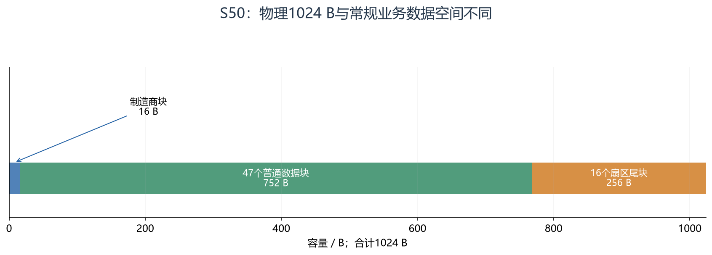

**读图方法与条件：** 横轴按字节比例，最左制造商块很窄。扇区尾块含密钥和访问条件，不能当普通数据随便覆盖；47块只是常规结构容量，实际可写性由卡型和权限决定。

[放大查看 SVG](course-note-assets/extended/09/s50-space.svg)

<!-- /extended -->

### 3. Key A、Key B 与访问条件要成套理解

控制块包含密钥和访问条件等字段，访问条件又使用规定的冗余编码。
某次认证成功只说明当前密钥与访问路径成立，读写许可还受对应块的访问条件限制。
更改密钥和访问条件时，编码错误可能造成后续无法正常访问。

学习时先使用可恢复的测试卡和明确允许的数据块，不把全零或默认密钥自动当成当前系统配置。
旧式卡片技术的认证能力也不能推广成现代安全凭证的充分保证；UID 单独白名单尤其不等于强身份认证。

### 4. 值块为什么不是随便写一个整数

经典值块通过值、取反值、重复值及地址相关冗余表达一致性。标准增值/减值等操作依赖这种结构和访问条件。
因此把余额的四字节整数写到普通块开头，并不自动得到可以使用标准钱包命令的值块。

大小端、数值范围、单位和负数是否允许应由应用明确，例如用“分”保存金额，避免浮点显示与存储规则不一致。
读到冗余不匹配时应报告无效记录，不能只取第一份数值继续扣款。
具体读写与转移命令由所用卡和模块协议决定，本笔记不补造 UART 命令字节。

<!-- extended:value-block -->

#### 机制补图：Classic 值块的16字节含数值冗余和地址冗余

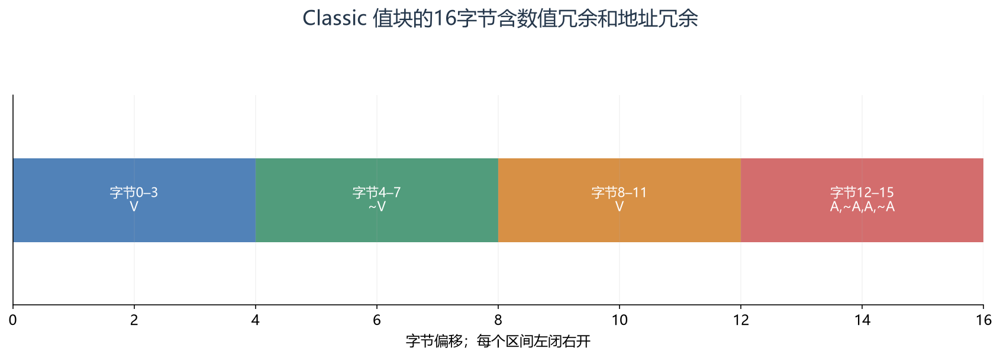

**读图方法与条件：** V是32位值，通常低字节在前；~表示逐位取反。后四字节是地址及其冗余。这是Classic兼容值块的格式说明，不保证特定模块暴露了相应操作命令，冗余一致性也不能替代业务权限与交易校验。

[放大查看 SVG](course-note-assets/extended/09/value-block.svg)

<!-- /extended -->

### 5. 掉电和超时造成的是“结果未知”

一次扣款可拆成：验证请求→核对卡与余额→准备修改→发送修改→等待结果→读回核对→向上层发布。
在发送前确认失败，可以认定本次尚未执行；在卡片可能已写完之后丢失应答，则不能这样认定。

如果同一请求序号重试，系统应尽可能识别是重复请求，并查询或核对此前结果。
仅靠串口 ACK、CRC 或无线链路重传，都无法单独提供业务“恰好执行一次”的保证。
卡内日志、主机事务记录与对账策略需配合设计，且不能假定普通多块写天然原子。

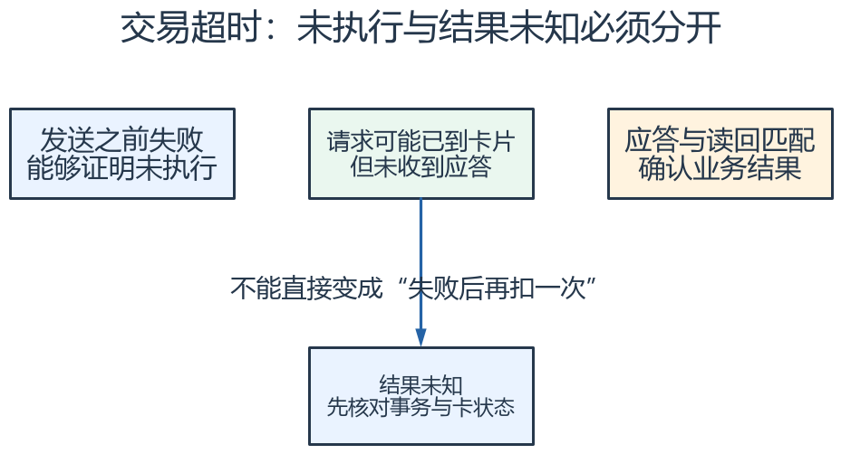

怎么看：区分“没执行”和“执行了但应答没到”。重试前先按交易身份核对结果，不能把通信超时直接解释为未扣款。

### 6. 卡离场与多卡是状态机输入

卡片可能在认证后离场、操作中移动、重新进入场区，或场中出现多卡。
应用必须区分无卡、发现卡、已选择、已认证、操作中、成功/失败/结果未知等状态，并规定每步超时。
“把函数从头再调一遍”可能选到另一张卡，后续操作必须核对仍是同一目标事务。

`cfg` 包含允许卡型、块布局、超时与权限策略；密钥应由合适的受控存储与接口管理。
`ctx` 保存当前卡选择和事务阶段；`data` 发布经过核对的标识、余额与结果；`ops` 提供查询或业务请求，而不让任意上层直接写控制块。

<!-- extended:card-presence -->

#### 机制补图：卡离场会打断一次交易，重新进场应重新建会话

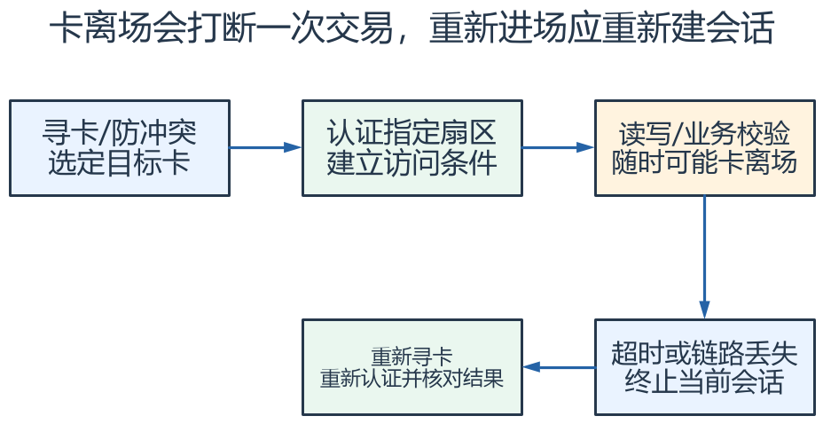

**读图方法与条件：** 中途离场不意味着写入一定未发生。若在提交后丢应答，重新进场后应结合交易号与读回结果判断，不能自动重复扣款。图不规定模块具体命令。

[放大查看 SVG](course-note-assets/extended/09/card-presence.svg) · [可编辑结构图](course-note-assets/extended/09/extended.drawio)

<!-- /extended -->

### 7. 例：消费 250 分的验证顺序

先确认卡片和应用记录有效，再检查余额不少于250分与结果不会越界；执行受支持的修改过程；核对返回与读回结果；记录该请求序号已完成。
若初始余额1000分，正常结果750分；若修改后应答丢失，则读到750分也需要结合事务身份判断，避免把其他并发操作误归为本次完成。

这说明“读回值符合预期”是重要证据，但复杂多端访问场景下不一定单独充分。
学习实验应明确是否只有一个读卡器和一个未并发修改的钱包，以限定结论适用范围。

<!-- extended:transaction-id -->

#### 机制补图：消费250分：交易号把重试与重复扣款区分开

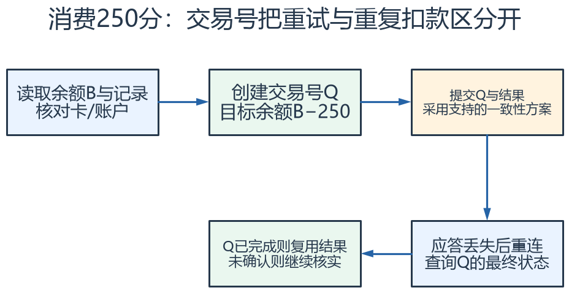

**读图方法与条件：** 这是业务设计模型，不能把“余额+交易号”写在不同块就当成原子事务。实际需要可恢复日志、模块支持或服务器账本；超时只表示结果未知。

[放大查看 SVG](course-note-assets/extended/09/transaction-id.svg) · [可编辑结构图](course-note-assets/extended/09/extended.drawio)

<!-- /extended -->

### 8. 自测与故障定位

| 现象 | 优先确认 |
|---|---|
| UID 可读，数据块读不了 | 是否完成目标扇区认证、访问条件是否允许 |
| 一些块正常另一些异常 | 全局块号、控制块/厂商块、扇区密钥区别 |
| 余额偶发重复扣减 | 超时重试是否识别结果未知和重复事务 |
| 写后暂时正常，下次认证失败 | 是否误写控制块或访问条件/密钥 |

思考：为什么“帧校验通过”无法证明消费安全？因为它只针对通信错误的一部分，未证明身份、权限、数据格式、余额范围和事务唯一性。

## 资料与验证边界

入门部分依据同目录课件；深入部分补充官方资料与明确条件下的推导。课件中的产品宣传、历史软件版本、
简化图和典型性能不直接作为当前板卡、固件或全部同系列产品的保证。
本次只整理资料与图文，没有编译固件、下载或进行硬件实测。
实际接线、电平、寄存器差异和模块命令须核对所用器件资料。

## 图源与后续修改

[可编辑概念图](course-note-assets/09/concepts.drawio)；
[本课图源目录](course-note-assets/09)。
概念图同时提供 JSON、SVG 与 PNG，专项图提供 SVG 与 PNG。
SVG 可放大查看；JSON 可用 diagramry 重绘。课件原图保持原貌，
不把截图中的文字改写成未经证实的新协议。

[专项图重绘脚本](course-note-assets/_source/redraw.py) ·
[图源使用说明](course-note-assets/_source/图源说明.md)

## 继续学习与资料对照

[跨外设工程专题](<01_跨外设工程专题与阅读索引.md>) · [资料来源与适用范围](<02_图文笔记资料来源与适用范围.md>)

深入部分包含官方机制对照和教学推导；模块命令、电气接线与固件差异按资料页的边界处理。

[深入配图源目录](course-note-assets/deep/09) · [深入图重绘脚本](course-note-assets/_source/deeper_diagrams.py)
