# 2-2-1-3_STM32基础 - USART串口通信3-蓝牙通讯：图文笔记

[直接阅读深入学习](#deep-study) · [跨外设工程专题](<01_跨外设工程专题与阅读索引.md>)

蓝牙模块在 MCU 串口和无线网络之间转发数据。先区分配置命令、无线寻址和业务消息，再理解透传、广播与 Mesh。

[返回学习导航](<00_单片机基础图文笔记导航.md>) · [打开原课件](<2-2-1-3_STM32基础 - USART串口通信3-蓝牙通讯.pdf>)

## 阅读范围

原课件共 11 页；阅读定位：P1–4 蓝牙概念与组网；P5 JDY-25M；P6–9 参数、帧和 AT 命令；P10 实验。
图中卡片用于拆分概念，编号是阅读顺序；卡片之间不自动表示时间或因果。
重绘时序与数值例子会在图旁写出前提，不代表开发板实测。

## 一、串口这一段与无线这一段分别检查

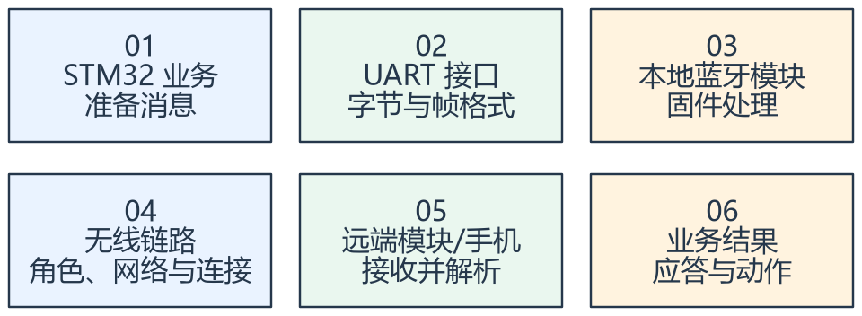

看图方法：先读每张卡片的关键词，再用下文核对它们之间的关系。

所谓透传，是模块替应用完成部分无线细节，让 MCU 通过串口发送数据。透传不代表任何长度、任意速率的数据都不会丢失，也不自动提供业务成功确认。

排查时先在本地核对 UART 波特率、数据格式、电平和供电，再核对无线角色、组网参数、连接和远端接收。UART 收到了模块的响应，只能证明这一段发生过交互。

课件的 JDY-25M 提供多种工作模式，具体功能依赖型号和固件。经典蓝牙、BLE 与 Mesh
不是同一个拓扑或传输模型，不能用“最多八台、固定十米”概括全部蓝牙设备。

## 二、网络号与节点地址解决不同问题

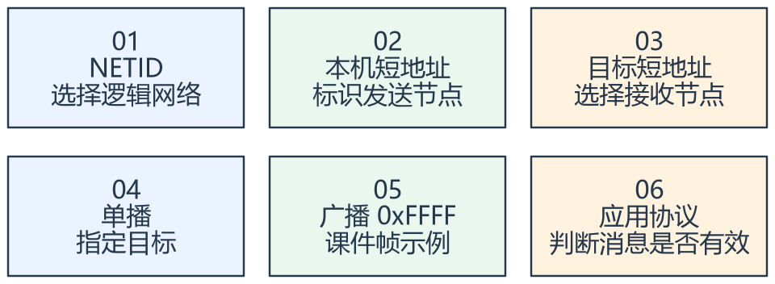

看图方法：先读每张卡片的关键词，再用下文核对它们之间的关系。

网络号像群组范围，节点地址像组内的收件人。两个节点配置相同网络号，不代表业务就一定能够通信，还要检查模式、无线条件及固件规定。

课件使用 AT+NETID1122 与 AT+MADDR0004 / 0005 等示例。它们是特定模块的命令，不是蓝牙标准对所有芯片规定的通用 AT 接口。

广播可以发给多个节点，但“发送了广播”不能证明每个节点均收到。应用若关心可靠执行，需要明确编号、应答、超时和重复消息处理。

## 三、从课件帧读出字段，不凭显示猜字节

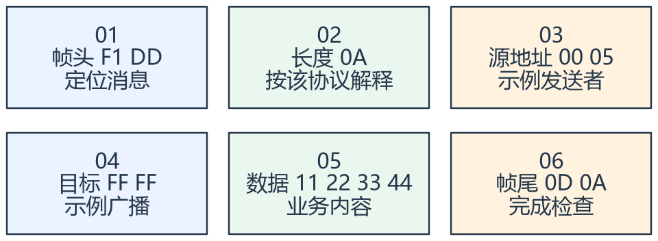

看图方法：先读每张卡片的关键词，再用下文核对它们之间的关系。

课件示例为 F1 DD 0A 00 05 FF FF 11 22 33 44 0D 0A。按照该示例，0A 对应长度字段之后的十个字节，不能直接当成
DATA 长度。

配置阶段示例使用 9600 波特率、命令带回车换行；是否需要切换工作模式、复位和等待生效，应按这块模块的手册与当前固件确认。

接收时先检验帧头和长度边界，再接收负载、核对地址与帧尾。业务执行与组包分离；遇到长度错误、缓冲溢出或接收超时，恢复接收状态。

## 专项图解

### 课件广播帧：长度字段的计算范围需要读清楚

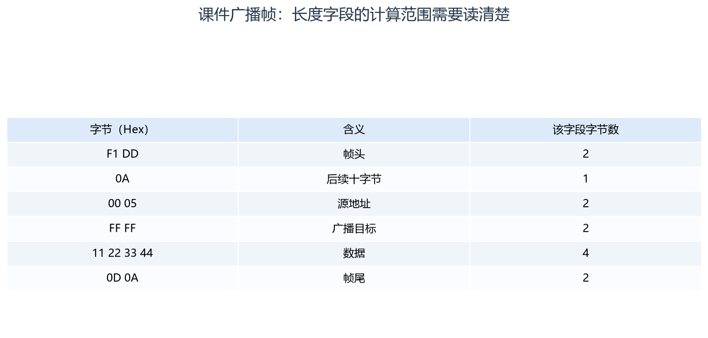

长度 0A 之后共有 2+2+4+2=10 字节，整帧共十三字节。这是课件模块协议示例，不是所有蓝牙的公共帧格式。

### 相同业务消息经过三个不同层次

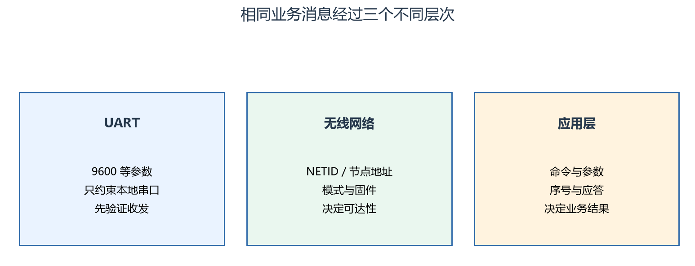

三层都正确才有机会完成一次业务。模块串口回 OK，不能替代远端业务应答。

### 单播与广播：收件范围不同，业务确认仍要设计

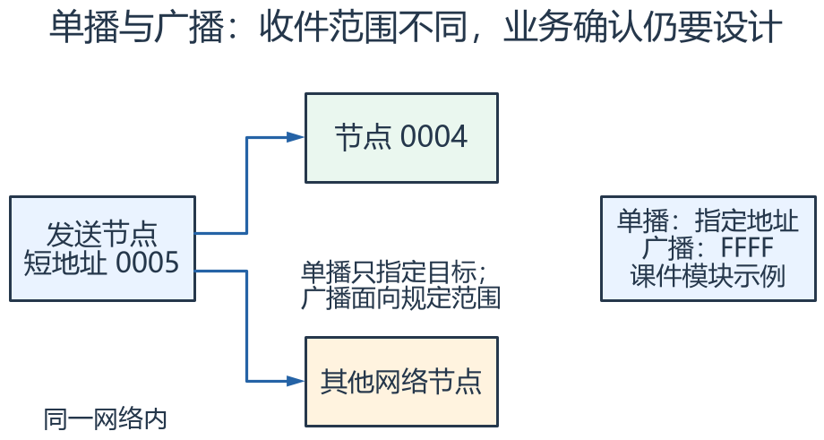

两路箭头用于比较收件范围：单播选择特定目标，广播可能面向多个节点。图不表示所有节点都已收到；无线可达性、睡眠和协议处理仍会影响结果。

## 对照课件原图

下面图片截取自同目录原 PDF；页码为 PDF 阅读器中的物理页序号。
先读重绘解释，再用原图核对硬件框图或课件细节。

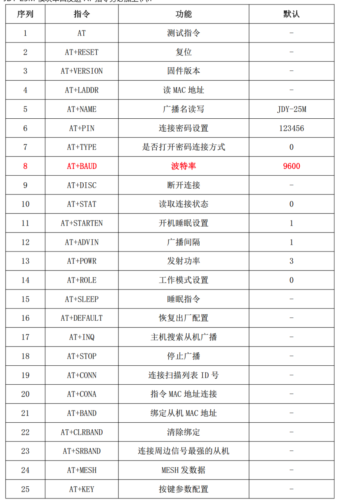

课件 P9（原图局部）：AT 命令表属于该模块，先确认当前工作模式再使用。

## 关键概念速查

| 名称 | 应该记住什么 |
|---|---|
| UART 参数 | 决定 MCU 与本地模块如何交换字节 |
| 网络/节点参数 | 决定无线组网与消息目的地 |
| 业务应答 | 确认请求是否被接受或执行 |

## 具体例子

源节点 0005 向 FFFF 发广播，负载为四个字节 11 22 33 44。接收方仍需核对命令和范围，不能把四个数据字节自动解释成 ASCII 字符串。

## 实验时如何验证

- 确认模块型号与固件、UART 参数和当前 AT/业务模式。
- 先单播验证，再按课件帧测试广播和长度解析。
- 断开远端，检查超时、重连以及重复消息的处理。

## 常见误区

- 课件的蓝牙版本表不能作为所有产品的速率、范围和功耗保证。
- AT 返回 OK 与远端已执行业务动作不是同一个状态。
- 模块供电电压与 UART 输入容限应分别确认。

## 自测：先想答案，再展开

网络号和目标地址有什么区别？

前者确定网络范围，后者选择其中的目标节点。

0A 一定代表十个数据字节吗？

不一定，长度计算范围由协议定义。

## 深入学习：蓝牙链路、应用分包、吞吐和可靠执行

本节目录：

- [1. 蓝牙不是一个固定的“无线串口”协议](#deep-1)
- [2. 广播、连接与 Mesh 的语义不同](#deep-2)
- [3. UART 帧与无线负载如何分包](#deep-3)
- [4. 吞吐由整条链最慢的一段限制](#deep-4)
- [5. AT 模式与业务模式要有明确切换状态](#deep-5)
- [6. 链路确认不能替代业务应答](#deep-6)
- [7. 安全性与无线验证分层](#deep-7)
- [8. 分层排查练习](#deep-8)

### 1. 蓝牙不是一个固定的“无线串口”协议

经典蓝牙常见 BR/EDR 与 SPP 使用方式；BLE 常通过 GAP 描述发现、连接与角色，通过 GATT 服务/特征组织应用数据。
某个“蓝牙串口”模块可能把这些细节封装为 UART 透传，也可能提供厂商 Mesh 或标准相关能力。
必须根据型号与固件确认底层模式，不能把名字里都带蓝牙的两个模块直接视为可互通。

BLE 的 central/peripheral 是连接角色，GATT client/server 是数据访问角色，两者不能简单一一等同。
手机 App 是否能与模块通信，还取决于服务、特征、写入/通知能力与权限，而不是只看手机能否搜索到设备名称。

<!-- extended:ble-layers -->

#### 机制补图：BLE 的连接角色与 GATT 数据角色处在不同层

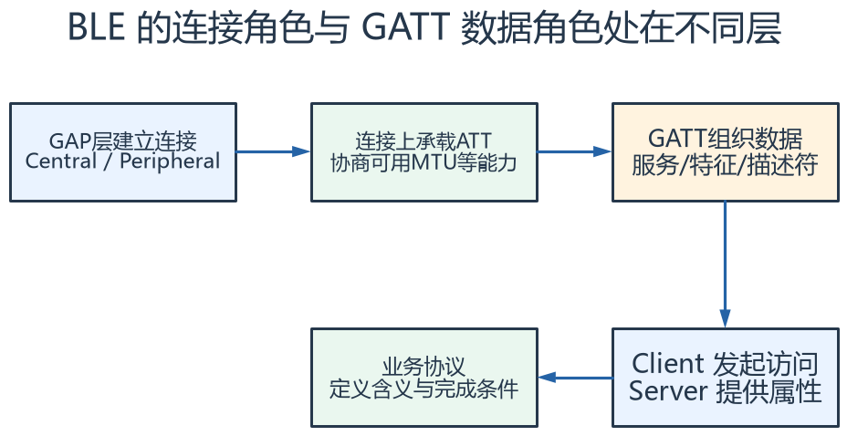

**读图方法与条件：** 角色应逐层判断：Central/Peripheral不能直接等同于Client/Server。一个连接中的设备可按实现承担GATT双向角色；BR/EDR的SPP又是另一套能力。

[放大查看 SVG](course-note-assets/extended/10/ble-layers.svg) · [可编辑结构图](course-note-assets/extended/10/extended.drawio)

<!-- /extended -->

### 2. 广播、连接与 Mesh 的语义不同

广播可用于让周围设备发现信息，不等于已经建立双向可靠连接。连接建立后可以协商通信参数，但也可能因距离、干扰或休眠策略失去连接。
Mesh 还要考虑配网、地址、转发和安全材料等自己的机制。课件 NETID/MADDR 的命令与短地址属于该模块接口，不能直接替代所有标准 Mesh 的术语与字段。

设备名称可能相同，也可修改，不能单独作为稳定身份。
业务应明确目标设备标识、网络加入状态、是否已授权以及连接生命周期，避免自动重连后控制到错误设备。

### 3. UART 帧与无线负载如何分包

MCU 连续写入 200 字节，不保证无线端一次提供 200 字节给应用。模块可能按 MTU、缓存和固件策略分割或合并。
接收方要按长度和协议解析字节流/数据块，不以“收到一次回调”作为一条业务消息的永久边界。

BLE ATT 在常见默认 MTU=23 条件下，普通特征值有效载荷常为20字节；更大的 MTU、数据长度扩展和连接策略可能改变这个数。
不能把20字节当作所有蓝牙包的统一上限，也不能假设模块固件必然启用了更大负载。

若应用跨包发送长消息，至少需要总长度、分段序号、组包超时与最大缓存边界；若模块已提供这些能力，应先理解其接口，避免再叠一层相冲突的分包协议。

<!-- extended:fragment-200 -->

#### 机制补图：200字节业务载荷，在每片20字节时要分成10片

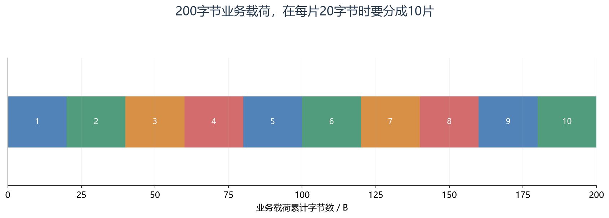

**读图方法与条件：** 假设ATT_MTU=23、一次通知的值最大20 B，且尚未扣业务分片头。若每片还需要序号和校验，200 B就会超过10片。分片要有事务号、片序、总长和重组超时；MTU变大也不能省掉业务边界。

[放大查看 SVG](course-note-assets/extended/10/fragment-200.svg)

<!-- /extended -->

### 4. 吞吐由整条链最慢的一段限制

UART 9600、8N1 的原始负载上限约960字节/秒。即使无线物理层更快，MCU 到模块这一段仍限制持续输入能力。
512字节仅串口连续发送就约需533 ms，尚未计算命令头、排队、无线调度与应答。

BLE 连接间隔、每次连接事件能发多少数据、重传、应用处理和手机系统调度共同影响吞吐与延迟。
缩短连接间隔可能改善响应，却增加唤醒频率与功耗；实际能力取决于双方协议栈与协商结果。
低功耗、低时延与高吞吐通常需要按业务取舍，不能同时用宣传最大值直接计算系统指标。

<!-- extended:uart-bottleneck -->

#### 机制补图：无线再快，9600波特UART发512字节也至少约533 ms

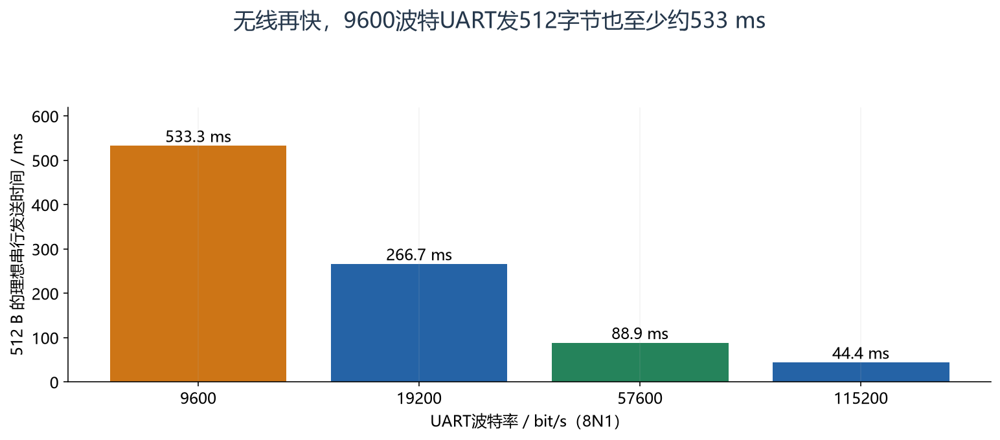

**读图方法与条件：** 8N1每字节10 bit，t=512×10/baud。不含AT封装、缓存等待、无线连接间隔、重传和对端处理；这是串行线发送下限，不是端到端实测。

[放大查看 SVG](course-note-assets/extended/10/uart-bottleneck.svg)

<!-- /extended -->

### 5. AT 模式与业务模式要有明确切换状态

配置命令可能要求特定模式、换行结束、等待响应和复位生效。
如果发送 AT 的时刻模块正处于透明传输，文本可能作为业务负载发到远端；反之业务字节可能被配置解析器误处理。

建议把启动识别、读取配置、必要修改、确认生效、进入业务、异常重连分成状态。
默认9600是本课模块示例，不能省略首次识别与参数确认。响应 OK 只能证明模块接受了本地命令，仍需确认无线端状态与应用结果。

<!-- extended:at-state -->

#### 机制补图：AT配置与业务传输需要受控切换

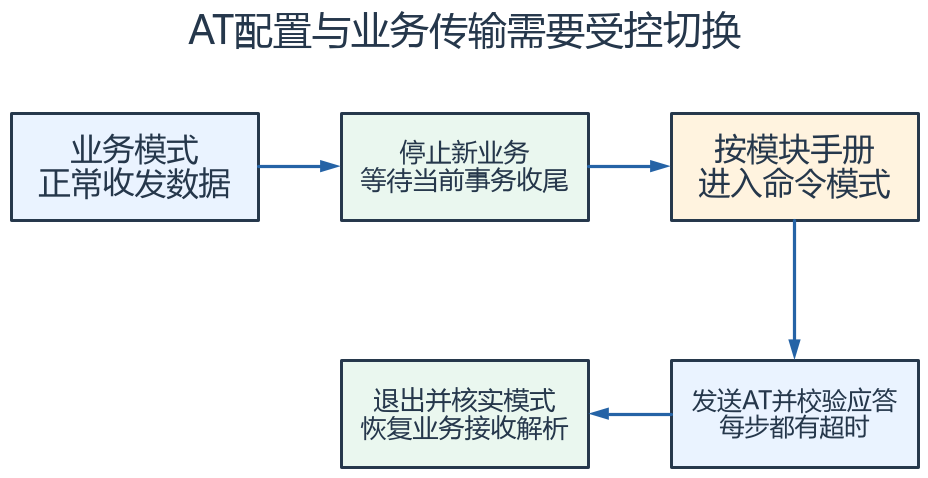

**读图方法与条件：** 不同模块的引脚、电平、进入时机、波特率规则并不统一。此图只规定软件状态边界；失败时记录当前模式并按手册恢复，避免把AT应答当业务帧或把业务数据当配置命令。

[放大查看 SVG](course-note-assets/extended/10/at-state.svg) · [可编辑结构图](course-note-assets/extended/10/extended.drawio)

<!-- /extended -->

### 6. 链路确认不能替代业务应答

链路层重传解决部分传输丢失，不保证远端业务处理成功。应用收到数据后可能因状态、权限或参数范围拒绝执行，也可能执行成功后应答丢失。
请求序号、结果码、超时与重复处理应构成完整闭环。

“设置亮度50%”可以按目标状态设计成幂等；“增加一档”重复执行就改变结果，需要序号或状态核对。
断开重连后旧缓存是否重发、序号是否从零开始、远端是否保留历史，都会影响重复识别。

### 7. 安全性与无线验证分层

配对、绑定、链路加密和应用授权分别解决不同问题，具体模式还取决于硬件输入输出能力与协议版本。
知道设备名、MAC 或短地址不等于得到控制授权；自己添加简单校验和也不构成加密或防重放。
真正涉及敏感控制时，应从可验证的威胁模型和模块安全能力设计，不能仅凭“蓝牙已配对”下结论。

验证至少记录模块型号/固件、UART参数、无线模式、连接参数、消息长度、距离/遮挡和成功率。
近距离桌面测试通过，只能证明这些条件下的行为；手机后台运行、共存干扰、低电压和重连需要独立覆盖。

### 8. 分层排查练习

| 现象 | 优先查看 |
|---|---|
| 找不到设备 | 供电、广播模式、扫描能力、频段/协议匹配 |
| 能找到却连不上 | 角色、已有连接、权限、安全与固件状态 |
| 能连接却无业务数据 | UART、服务/特征、通知订阅、地址和模式 |
| 大包偶发不完整 | 分包、缓存、流控、组包长度和超时 |
| 重连后动作重复 | 旧缓冲、请求序号和幂等规则 |

在 UART 与无线应用端分别留带时间戳的收发记录，才能分清字节在哪一层已经到达。

## 资料与验证边界

入门部分依据同目录课件；深入部分补充官方资料与明确条件下的推导。课件中的产品宣传、历史软件版本、
简化图和典型性能不直接作为当前板卡、固件或全部同系列产品的保证。
本次只整理资料与图文，没有编译固件、下载或进行硬件实测。
实际接线、电平、寄存器差异和模块命令须核对所用器件资料。

## 图源与后续修改

[可编辑概念图](course-note-assets/10/concepts.drawio)；
[本课图源目录](course-note-assets/10)。
概念图同时提供 JSON、SVG 与 PNG，专项图提供 SVG 与 PNG。
SVG 可放大查看；JSON 可用 diagramry 重绘。课件原图保持原貌，
不把截图中的文字改写成未经证实的新协议。

[专项图重绘脚本](course-note-assets/_source/redraw.py) ·
[图源使用说明](course-note-assets/_source/图源说明.md)

## 继续学习与资料对照

[跨外设工程专题](<01_跨外设工程专题与阅读索引.md>) · [资料来源与适用范围](<02_图文笔记资料来源与适用范围.md>)

深入部分包含官方机制对照和教学推导；模块命令、电气接线与固件差异按资料页的边界处理。
