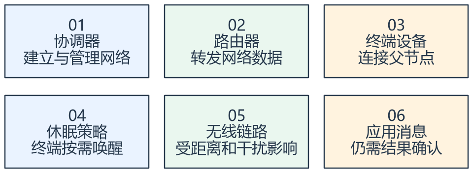
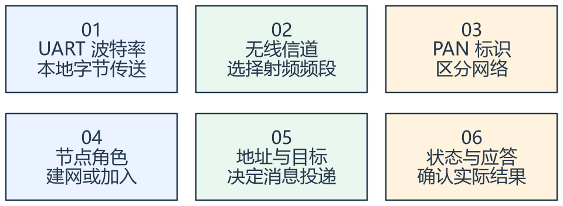
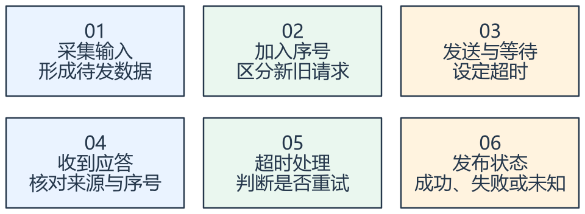
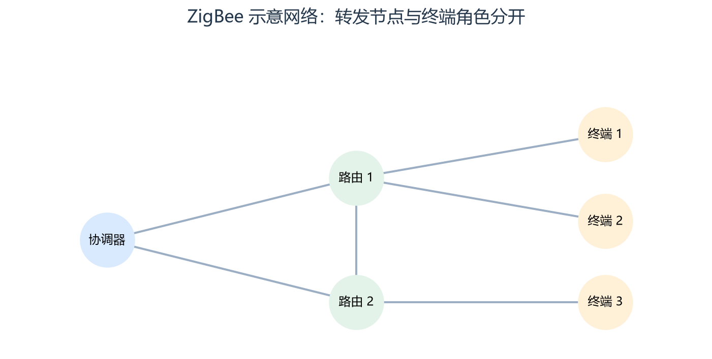
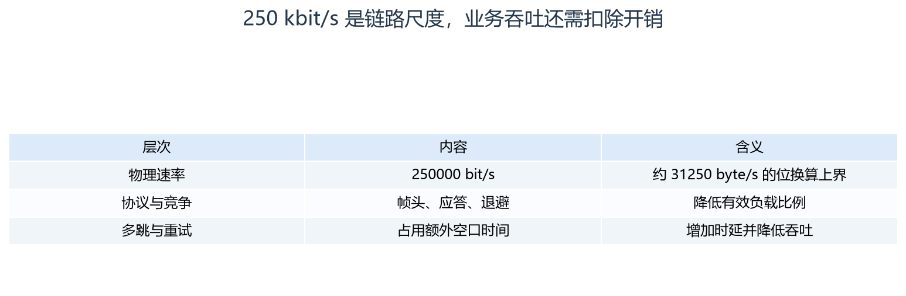
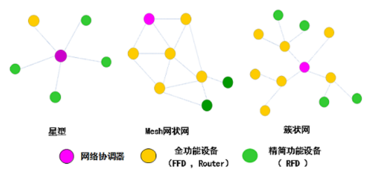
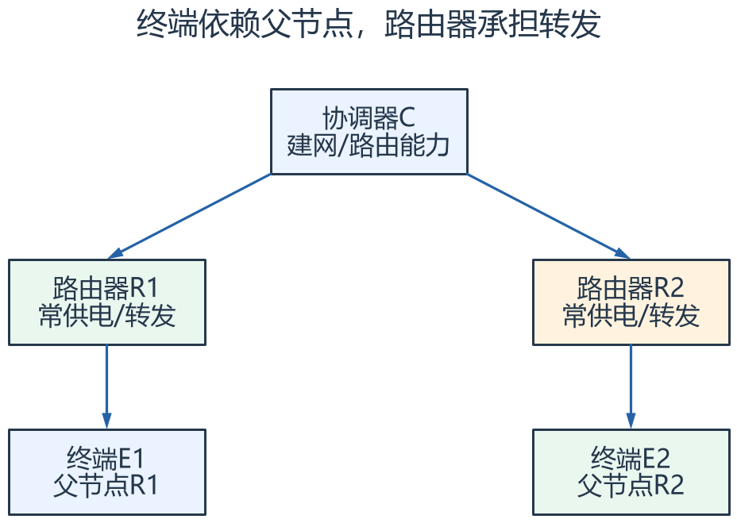
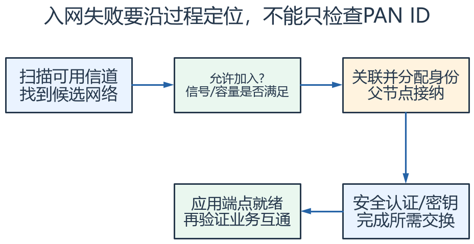
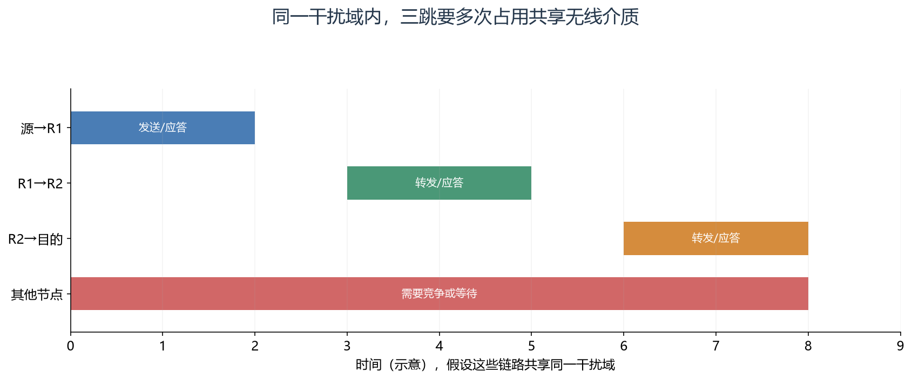
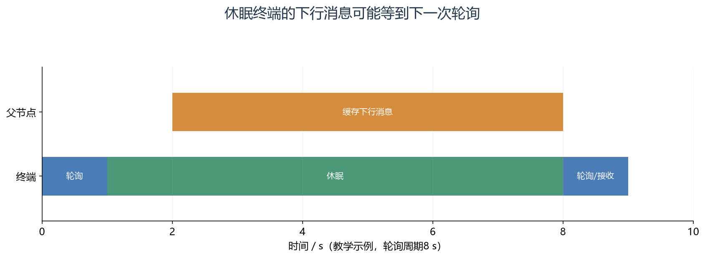

# 2-2-1-4_STM32基础 - USART串口通信4-ZigBee：图文笔记

[直接阅读深入学习](#deep-study) · [跨外设工程专题](<01_跨外设工程专题与阅读索引.md>)

ZigBee 的重点是节点角色、网络拓扑和低功耗通信。串口参数决定本地接口，PAN、信道和地址决定无线网络。

[返回学习导航](<00_单片机基础图文笔记导航.md>) · [打开原课件](<2-2-1-4_STM32基础 - USART串口通信4-ZigBee.pdf>)

## 阅读范围

原课件共 9 页；阅读定位：P1–4 技术特点与拓扑；P5–7 DL-20 模块；P8 配置与实验；P9 小结。
图中卡片用于拆分概念，编号是阅读顺序；卡片之间不自动表示时间或因果。
重绘时序与数值例子会在图旁写出前提，不代表开发板实测。

## 一、三种角色的责任不同

看图方法：先读每张卡片的关键词，再用下文核对它们之间的关系。

协调器负责建网；路由器参与转发；终端设备通常依附父节点，可采用低功耗休眠。不是每个节点都可以随时睡眠而仍承担相同的中继责任。

星型便于理解直接连接，树型体现父子层级，Mesh 允许更灵活的多跳路径。但实际路由和容量取决于协议栈、资源、配置和无线环境。

ZigBee 基于 IEEE 802.15.4。常见 2.4 GHz 物理层速率是 250 kbit/s，不能写成 250
KB/s；应用吞吐还要扣除协议开销、竞争和重传。

## 二、组网参数与串口参数分层核对

看图方法：先读每张卡片的关键词，再用下文核对它们之间的关系。

STM32 到 DL-20 的 UART 配置正确，只说明本地接口条件满足；无线侧还需信道、PAN、角色和目标地址等参数协调。

先确认模块能响应配置，再检查网络形成与入网状态，然后测试单次消息和返回结果。一次性同时改动所有参数会让问题难以定位。

课件部分命令在截图中，未完整定义所有命令字节。本笔记不补造配置协议；实验应对照原图和所用 DL-20 固件手册。

## 三、可靠性需要把超时与重复消息算进去

看图方法：先读每张卡片的关键词，再用下文核对它们之间的关系。

无线连接是可变化的：干扰、休眠、路由变化或断电都可能让消息延迟或丢失。把发送函数返回成功直接当成对端业务完成，会遗漏关键状态。

对于开灯这类幂等命令，重复设置目标状态较容易处理；对于扣款、计数增加这类动作，需要重复请求识别，避免重试造成二次执行。

课件中的距离、最大节点数和时延是条件化指标，不构成任意网络的保证。验证时记录节点角色、拓扑、距离、障碍物、负载和重试统计。

## 专项图解

### ZigBee 示意网络：转发节点与终端角色分开

左侧协调器建立网络，中间路由器提供转发，右侧终端通过父节点接入。连接线仅示意可用关联/链路，不代表每条应用消息都沿固定路线传递。

### 250 kbit/s 是链路尺度，业务吞吐还需扣除开销

第一行只是单位换算，不是应用吞吐保证。多节点和无线干扰会进一步改变实际表现。

## 对照课件原图

下面图片截取自同目录原 PDF；页码为 PDF 阅读器中的物理页序号。
先读重绘解释，再用原图核对硬件框图或课件细节。

课件 P4（原图局部）：比较星型、树型和网状，先找直接连接与转发路径。

## 关键概念速查

| 名称 | 应该记住什么 |
|---|---|
| 协调器/路由器/终端 | 建网、转发、终端业务分工 |
| PAN/信道 | 无线网络与频段配置 |
| 波特率/帧格式 | MCU 到模块的本地接口配置 |

## 具体例子

一个协调器接上位机、两个路由器扩展覆盖、多个终端采集温度。终端休眠可节能，但父节点和接收缓存策略必须配合，不能只在 MCU 内调用延时。

## 实验时如何验证

- 记录角色、PAN、信道、地址及实际拓扑。
- 从近距离单跳开始，再加入路由与低功耗终端。
- 统计丢包、重试和时延，记录干扰及休眠条件。

## 常见误区

- 250 kbit/s 不等于每秒传送 250 千字节业务数据。
- Mesh 不保证任何位置都一定有可用路径。
- 休眠终端与持续承担转发任务的路由器不能混同。

## 自测：先想答案，再展开

串口能收发为什么还无法无线通信？

无线网络、角色和地址等条件可能未满足。

重发同一条命令可能发生什么？

对端可能重复执行，需要序号或幂等设计。

## 深入学习：ZigBee 的分层、组网、休眠与网络容量

本节目录：

- [1. IEEE 802.15.4 与 ZigBee 处在不同层](#deep-1)
- [2. 协调器、路由器、终端与父节点](#deep-2)
- [3. 入网不只是“参数相同就成功”](#deep-3)
- [4. 多跳延迟与容量不能按节点数简单相乘](#deep-4)
- [5. 休眠终端怎样仍能接收下行](#deep-5)
- [6. 应用端点、集群与厂商透传的边界](#deep-6)
- [7. 安全材料、重试与业务重复](#deep-7)
- [8. 一个可验证的网络实验](#deep-8)

### 1. IEEE 802.15.4 与 ZigBee 处在不同层

IEEE 802.15.4 提供相应物理/MAC基础，ZigBee 在其上组织网络、寻址、应用与安全相关机制。
采用相同无线芯片或频段，并不表示使用了相同网络协议；厂商私有透传方案也可能采用相同物理层。
主控看到的 UART AT 命令只是模块封装接口。

课件常见2.4 GHz物理速率为250 kbit/s，属于调制与链路尺度。
应用消息还要包含协议头、校验、竞争等待、应答与可能的重传，实际有效吞吐显著依赖场景。

### 2. 协调器、路由器、终端与父节点

协调器建立网络并承担特定网络职责，路由器可帮助多跳转发，终端设备通常通过父节点交互。
一个路由器退出可能影响其后终端和转发路径，不能只检查这个路由器自己是否能再次串口响应。

PAN标识、无线信道、节点短地址和更稳定的扩展标识承担不同职责。
短地址在重新入网等过程中可能变化，因此业务数据库若用短地址作为永久设备身份，可能出现错误关联。
具体模块向应用暴露哪些标识，应按当前固件协议确认。

<!-- extended:zigbee-topology -->

#### 机制补图：终端依赖父节点，路由器承担转发

**读图方法与条件：** 连线表示一组示例父子关系，省略反向数据与其他邻接链路。终端通常不转发其他节点的包；网络角色不能仅凭模块外观判断。

[放大查看 SVG](course-note-assets/extended/11/zigbee-topology.svg) · [可编辑结构图](course-note-assets/extended/11/extended.drawio)

<!-- /extended -->

### 3. 入网不只是“参数相同就成功”

网络形成、允许加入、扫描发现、身份/安全条件、地址分配与父节点选择都会影响结果。
终端串口返回参数配置成功，不表示已入网；已入网也不表示应用端点和数据格式已经匹配。

可将状态分成未配置、寻网、加入中、已联网、业务就绪、失联和重新加入。
每步有自己的超时和退避策略，避免失败后高速不停重试，占满串口、射频和CPU。

<!-- extended:join-chain -->

#### 机制补图：入网失败要沿过程定位，不能只检查PAN ID

**读图方法与条件：** 每个关口都可能拒绝或超时；具体入网流程随协议版本与安全配置变化。关联成功不能直接当成业务成功，短地址也不能替代长期设备身份。

[放大查看 SVG](course-note-assets/extended/11/join-chain.svg) · [可编辑结构图](course-note-assets/extended/11/extended.drawio)

<!-- /extended -->

### 4. 多跳延迟与容量不能按节点数简单相乘

一条消息经过多跳，通常需要多次占用共享无线介质，沿路还可能竞争、重传和排队。
邻近节点能互相干扰，隐蔽节点又可能无法直接感知对方发送，所以网络实际容量不等于单链路吞吐乘节点总数。

例：50个终端每秒各发40字节，纯负载为2000 byte/s=16 kbit/s，明显低于250 kbit/s。
但如果多数走三跳，再加应答、协议头、同时突发和干扰，延迟和丢包仍可能明显；上述16 kbit/s只给负载下界，不能证明网络一定够用。

较好的策略包括分散采样上报相位、批量合并、只上报变化、限制重试和给关键消息留带宽。
这些策略需要按消息年龄和业务重要性取舍，不能为节省流量无限缓存过期控制指令。

<!-- extended:multihop-airtime -->

#### 机制补图：同一干扰域内，三跳要多次占用共享无线介质

**读图方法与条件：** 一份业务数据占用多次空口时间，容量不能按路由器数量相乘。空间复用、退避、重传和不同链路质量会进一步改变吞吐与尾延迟。

[放大查看 SVG](course-note-assets/extended/11/multihop-airtime.svg)

<!-- /extended -->

### 5. 休眠终端怎样仍能接收下行

休眠降低终端无线活动，但父节点是否缓存下行、缓存多久、终端何时轮询/唤醒，都限制命令到达时间。
终端每10秒才醒一次，通常不能同时承诺任意时刻100 ms内收到下行控制。

路由器若需要持续承担转发，不能照抄休眠终端策略。
电池寿命计算还要把传感器、MCU、启动和重试能量纳入，不能只使用无线芯片最小休眠电流。

<!-- extended:sleep-poll -->

#### 机制补图：休眠终端的下行消息可能等到下一次轮询

**读图方法与条件：** 消息在t=2到达，终端在t=8才取走，等待约6 s。父节点缓存容量、超时和子节点老化都有限，不能保证任意长休眠仍能收到。

[放大查看 SVG](course-note-assets/extended/11/sleep-poll.svg)

<!-- /extended -->

### 6. 应用端点、集群与厂商透传的边界

标准化应用可通过端点、集群和属性/命令组织语义；厂商透传则可能只把字节送给目标模块。
无线连通不意味着两个应用能互懂温度单位、命令编号或数据布局。
如果课件模块只暴露透传接口，本地应用仍需定义自己的帧和版本。

因此网络地址与业务对象要分开。例如“目标节点1234”回答消息送哪里，“查询温度属性”回答送到后做什么。
不应让业务层通过修改任意AT文本直接操纵网络内部状态，而应由网络服务提供受控的连接与发送接口。

### 7. 安全材料、重试与业务重复

加入许可、网络密钥与应用授权的管理决定谁能参与和请求什么动作，默认参数相同并不等于安全。
模块的实际密钥管理能力应从手册和固件接口确认，不在笔记中猜测命令或写入默认密钥。

不同层都可能重传，因此业务接收方需要明确序号和重复规则。
写入目标状态、执行一次不可重复动作、发布周期遥测应采用不同可靠性策略；对遥测而言，过期数据有时比丢一帧更不适合控制使用。

### 8. 一个可验证的网络实验

先验证两节点近距离单跳，再增加路由，最后加入休眠与干扰条件。每一步记录消息序号、发送/接收时间、重试、失联与恢复。
为了测单向时延，端点时钟需要同步或使用已知方法；否则可先测往返时间，不把两个未同步时间戳直接相减。

| 问题 | 需要的证据 |
|---|---|
| 能否加入网络 | 模块网络状态与父节点/协调器记录 |
| 数据有没有丢 | 连续应用序号与接收统计 |
| 路由是否恢复 | 中继断电前后可达性与恢复时间 |
| 休眠后能否控制 | 轮询周期、父节点缓存与下行结果 |

题：为什么“支持大量节点”的规格不证明当前部署可稳定秒级上报？节点容量、空口负载、拓扑、重试和应用时延是不同维度，必须分别验证。

## 资料与验证边界

入门部分依据同目录课件；深入部分补充官方资料与明确条件下的推导。课件中的产品宣传、历史软件版本、
简化图和典型性能不直接作为当前板卡、固件或全部同系列产品的保证。
本次只整理资料与图文，没有编译固件、下载或进行硬件实测。
实际接线、电平、寄存器差异和模块命令须核对所用器件资料。

## 图源与后续修改

[可编辑概念图](course-note-assets/11/concepts.drawio)；
[本课图源目录](course-note-assets/11)。
概念图同时提供 JSON、SVG 与 PNG，专项图提供 SVG 与 PNG。
SVG 可放大查看；JSON 可用 diagramry 重绘。课件原图保持原貌，
不把截图中的文字改写成未经证实的新协议。

[专项图重绘脚本](course-note-assets/_source/redraw.py) ·
[图源使用说明](course-note-assets/_source/图源说明.md)

## 继续学习与资料对照

[跨外设工程专题](<01_跨外设工程专题与阅读索引.md>) · [资料来源与适用范围](<02_图文笔记资料来源与适用范围.md>)

深入部分包含官方机制对照和教学推导；模块命令、电气接线与固件差异按资料页的边界处理。
