# 2-3-1_STM32基础 - I2C通信-MPU6050：图文笔记

[直接阅读深入学习](#deep-study) · [跨外设工程专题](<01_跨外设工程专题与阅读索引.md>)

I2C 用两根开漏信号线传输有地址的数据。MPU6050 则在寄存器中提供加速度、温度和角速度原始数据。

[返回学习导航](<00_单片机基础图文笔记导航.md>) · [打开原课件](<2-3-1_STM32基础 - I2C通信-MPU6050 .pdf>)

## 阅读范围

原课件共 24 页；阅读定位：P1–5 接线、起停、应答与数据帧；P6–10 软件/硬件 I2C；P11–23 MPU6050 与实验。
图中卡片用于拆分概念，编号是阅读顺序；卡片之间不自动表示时间或因果。
重绘时序与数值例子会在图旁写出前提，不代表开发板实测。

## 一、开漏加上拉为什么能共享总线

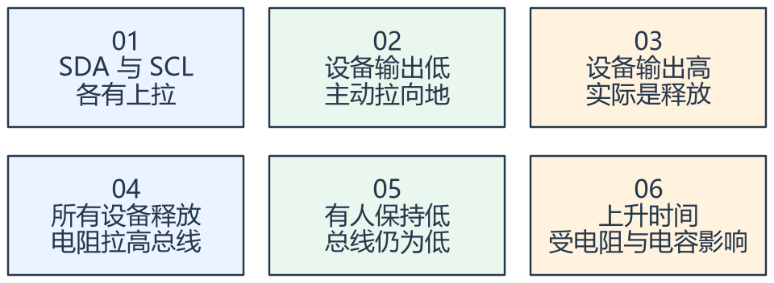

看图方法：先读每张卡片的关键词，再用下文核对它们之间的关系。

I2C 的高电平由上拉形成。设备写高时释放引脚，其他设备仍可把总线拉低。不能用推挽输出强行拉高来代替开漏总线。

SCL 高电平期间 SDA 从高变低是 START，从低变高是 STOP；普通数据在 SCL 高期间保持稳定。读时序先找起停边界，再按时钟划分数据。

“同步通信”表示有时钟配合，并不等于软件实现不受中断影响。GPIO 模拟时序可能被中断延长；是否可接受还要看总线时序和从机超时条件。

## 二、地址、方向与第九拍 ACK

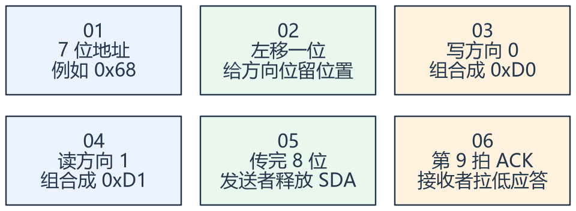

看图方法：先读每张卡片的关键词，再用下文核对它们之间的关系。

MPU6050 常见 7 位地址为 0x68 或 0x69，取决于 AD0。0xD0/0xD1 是地址为 0x68 时与 R/W
位组合后的总线字节，不是另外两个独立设备。

每传完一个字节，接收者在第九拍回应 ACK 或 NACK。读最后一个字节时，主机通常发 NACK，告诉从机不再继续读取，再发 STOP。

库函数参数可能要求 7 位地址，也可能要求已经左移的地址，应查看接口契约。把同一个地址重复左移，或漏移一位，都可能造成 NACK。

## 三、指定寄存器读与原始量换算

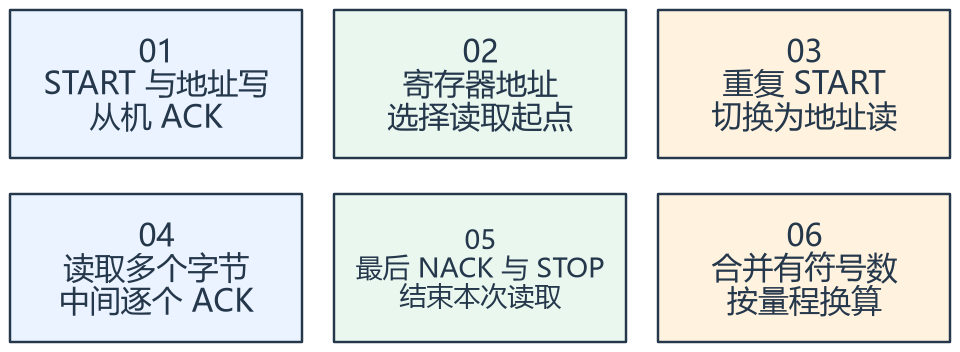

看图方法：先读每张卡片的关键词，再用下文核对它们之间的关系。

寄存器读取通常先用写方向告诉器件“从哪个寄存器开始”，随后重复起始，以读方向取回数据。这不等于先修改传感器的测量值。

MPU6050 连续读取的 14 字节常包括三轴加速度、温度和三轴角速度。高低字节先正确合并为 16 位有符号值，再根据配置量程的灵敏度缩放。

在 ±2 g 配置下，灵敏度为 16384 LSB/g，原始值 16384 约为 1
g；若改变量程，除数也要改变。陀螺输出是角速度，变成角度需要积分并处理偏置与误差。

等待 ACK、总线空闲和硬件事件都要有超时。NACK、总线被拉低和样本过期应反馈为错误或无效数据，不能把未读出的缓冲内容继续当作本次测量。

## 专项图解

### I2C：起始条件、地址八位、第九拍应答、停止条件

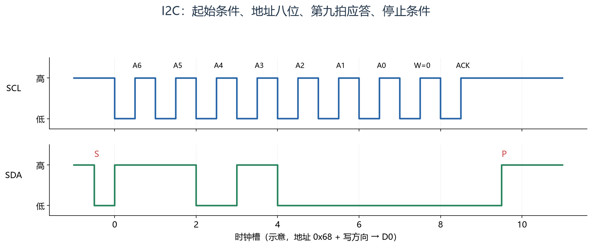

SDA 在 SCL 高时下降构成 S；中间八个时钟传送 11010000，最后一位为写方向；第九拍由接收方拉低 ACK。P 是 SCL 高时 SDA
上升，真实边沿需满足建立保持时间。

### 读寄存器：两次地址阶段，中间用重复起始连接

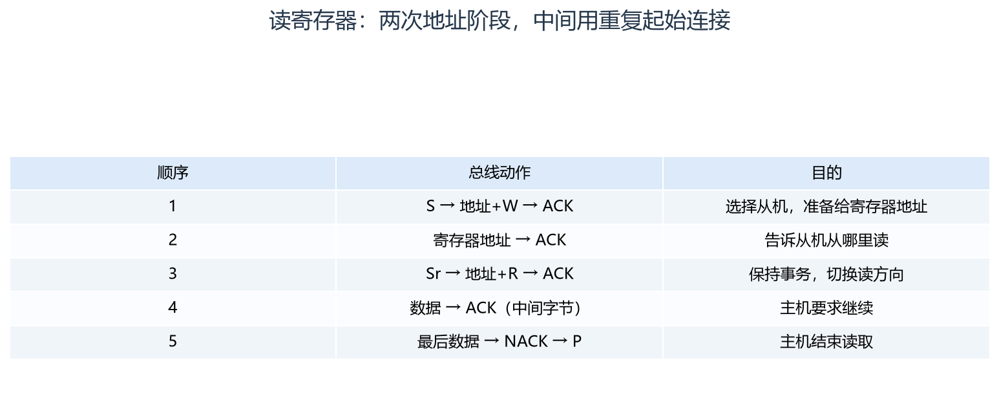

S 为 START，Sr 为 repeated START，P 为 STOP。读数据时主机是接收方，因此 ACK/NACK
由主机控制；每处等待都要能超时退出。

### I2C 的线与关系：任意一方拉低，总线就是低

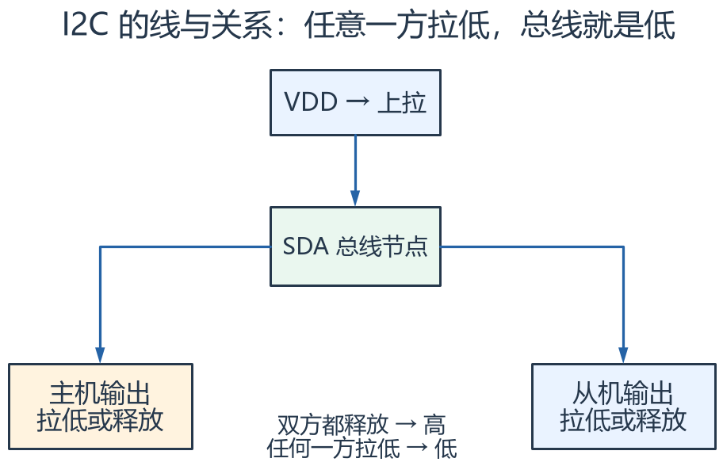

把节点看成共享的一根线。主机发完八位后释放 SDA，从机才可以在第九拍用拉低表示 ACK；不能用推挽强拉高与对方低电平对抗。

## 对照课件原图

下面图片截取自同目录原 PDF；页码为 PDF 阅读器中的物理页序号。
先读重绘解释，再用原图核对硬件框图或课件细节。

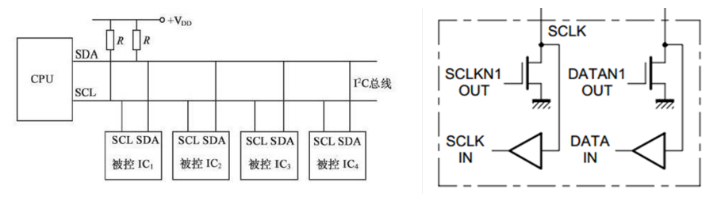

课件 P2（原图局部）：沿两根总线找上拉、主机和从机，理解释放与拉低。

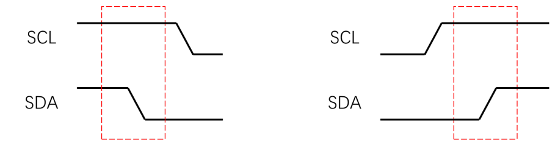

课件 P3（原图局部）：先找 SCL 高期间 SDA 的起停变化，再看数据稳定区。

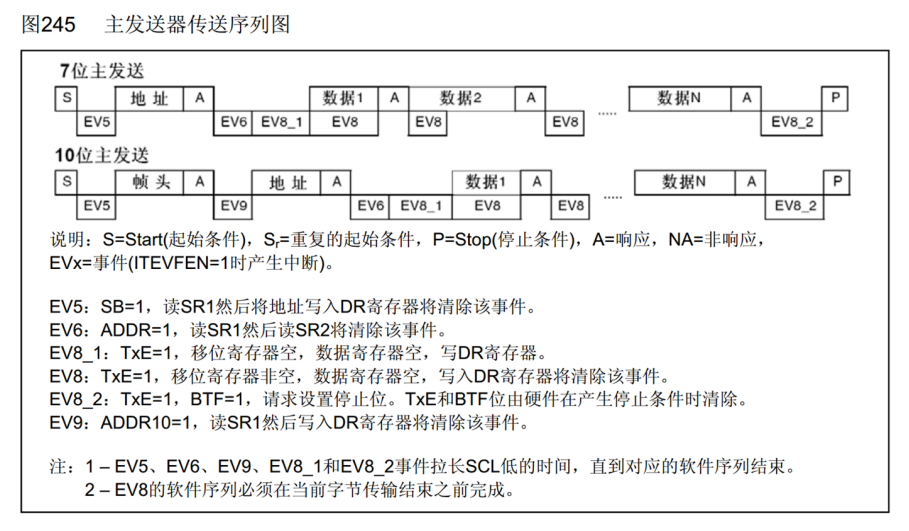

课件 P10（原图局部）：事件序列只是硬件外设实现的步骤，每一处等待都需考虑超时。

## 关键概念速查

| 名称 | 应该记住什么 |
|---|---|
| START/STOP | 总线事务起止条件 |
| ACK/NACK | 逐字节应答与结束读取 |
| 量程/灵敏度 | 原始码值到物理量的换算依据 |

## 具体例子

收到高字节 FF、低字节 00：合并位模式为 0xFF00，解释成有符号 16 位是 -256。若当作无符号 65280，计算出的方向和幅值都会错误。

## 实验时如何验证

- 示波器核对上拉、起停、地址、ACK 和重复起始。
- 先读标识，再读三轴，确认量程、字节顺序与符号。
- 断开传感器或保持总线低，检查超时与错误恢复。

## 常见误区

- SDA/SCL 必须有合适上拉，内部弱上拉不一定满足速率与电容条件。
- WHO_AM_I 能读到不代表三轴量程、输出速率和数据有效性都已配置正确。
- 加速度不经处理直接二次积分，误差通常会迅速累积。

## 自测：先想答案，再展开

为什么地址 0x68 在波形里变成 D0？

七位地址左移并添加写方向位。

最后一个读取字节为什么发 NACK？

主机用它表示不再读取后续字节。

## 深入学习：I2C 电气时序、F1 硬件状态和传感器数据处理

本节目录：

- [1. 上拉电阻存在上限与下限](#deep-1)
- [2. 时钟同步与 clock stretching](#deep-2)
- [3. F1 I2C 外设为何不能只等待同一个“完成位”](#deep-3)
- [4. NACK、总线错误、仲裁丢失与忙超时分别处理](#deep-4)
- [5. MPU6050 的配置是一条数据含义链](#deep-5)
- [6. 一次多字节读取为何优于逐轴散读](#deep-6)
- [7. 从原始量到姿态还差哪些步骤](#deep-7)
- [8. 前后端分层与错误传播](#deep-8)
- [9. 练习：看到 −1 g 先检查什么](#deep-9)

### 1. 上拉电阻存在上限与下限

开漏总线的上升沿由上拉电阻与总电容共同决定，30%～70%上升时间近似tr=0.8473RpCb。
电阻太大则上升慢；太小则低电平时器件需要灌入过大电流。
下限可按Rp,min≈(VDD−VOL,max)/IOL估计，再结合器件与总线规范选择。

以3.3 V、允许VOL=0.4 V、灌电流3 mA作为教学条件，下限约967 Ω。
若总电容100 pF且要求tr≤300 ns，上限约3.54 kΩ，4.7 kΩ就不能仅凭“常用”认定满足该条件。
实际Cb包含器件、走线、连接器和测量探头，最终需观察真实波形。

<!-- extended:rp-window -->

#### 机制补图：电容变大时，上拉电阻的可选窗口逐渐收窄

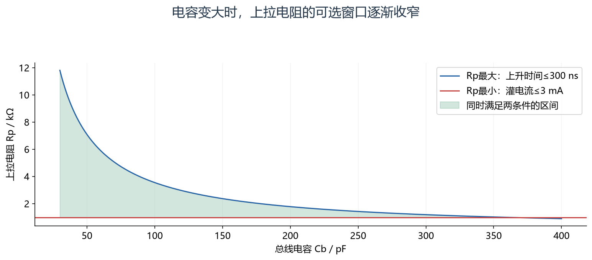

**读图方法与条件：** 假设VDD=3.3 V、VOL(max)=0.4 V、IOL=3 mA、tr(max)=300 ns。Rp(min)约0.967 kΩ，Cb=100 pF时Rp(max)约3.54 kΩ。这些是计算条件，不是对所有板卡的固定推荐；还需核对器件及走线。

[放大查看 SVG](course-note-assets/extended/12/rp-window.svg)

<!-- /extended -->

### 2. 时钟同步与 clock stretching

在开漏SCL上，主机释放高电平后仍要考虑总线实际是否已高；从机可能保持低电平延长处理时间，这就是时钟拉伸。
软件I2C若只延时后假定SCL高，可能在实际低电平时继续推进，导致事务错误。
是否允许拉伸、最长多久，应结合从机规格与系统超时设计。

多主场景中，还存在仲裁：设备发送1实际是释放，如果同时看到总线为0，可能意味着其他主机发送0而自己失去仲裁。
单主的简单GPIO驱动不应被描述为天然具备完整多主协议。

<!-- extended:clock-stretch -->

#### 机制补图：主机释放 SCL 后，实际线仍可能被从机拉低

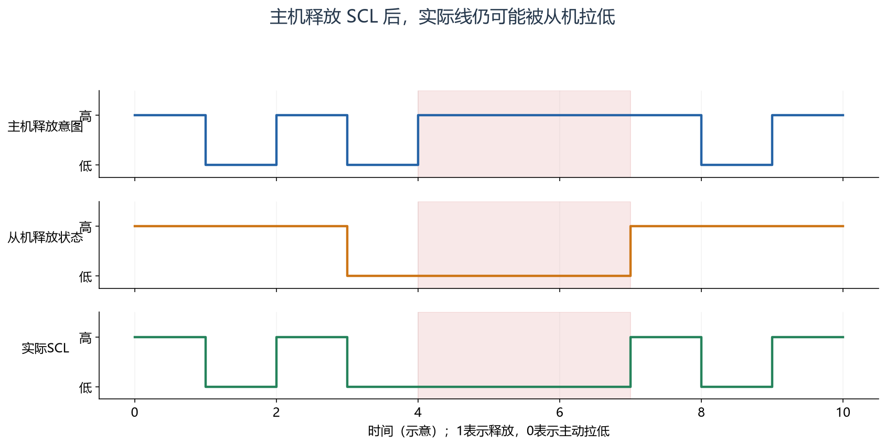

**读图方法与条件：** 实际SCL是开漏参与者共同作用的结果。红段主机已经释放，但从机尚未释放；支持拉伸的主机应观察实际线电平并有超时。图不表示所有器件都支持拉伸，也省略RC上升沿。

[放大查看 SVG](course-note-assets/extended/12/clock-stretch.svg)

<!-- /extended -->

### 3. F1 I2C 外设为何不能只等待同一个“完成位”

CR1配置启动、停止、ACK等行为；CR2还包含外设时钟相关配置；CCR/TRISE参与SCL与上升时间设置；SR1/SR2反映不同阶段。
硬件主机流程需要区分START已发送、地址阶段完成、发送缓存可写、字节传输完成、接收数据可读等状态。

某些状态通过规定读写序列清除，例如读取SR1后读取SR2涉及ADDR清除。
F1的1字节、2字节与多字节接收，对ACK、POS、STOP和清ADDR时机的要求不同，不能只在统一for循环最后改ACK就认为所有长度成立。
应依据RM0008与相应应用说明，使用经过验证的驱动路径，笔记中的总线逻辑不能替代这些芯片时序细节。

### 4. NACK、总线错误、仲裁丢失与忙超时分别处理

地址NACK可能是地址错、从机没供电、忙或模式不对；数据NACK可能来自命令/长度不被接受。
BUSY一直为1又可能是线被拉低、事务未结束或外设状态异常。把所有情况都返回一个“失败”会使上层无法决定重试还是恢复硬件。

等待使用单调时间与明确超时，失败后恢复本事务与总线状态，发布错误原因和计数。
在单主、线路没有硬件短路且从机允许的条件下，可评估通过受控时钟脉冲与STOP恢复被中断事务；
不能在未知多主总线上随意强行切GPIO输出脉冲，也不能指望这种办法修复持续物理短路。

### 5. MPU6050 的配置是一条数据含义链

上电识别→解除睡眠/选择时钟→配置采样分频与数字滤波→设置加速度/陀螺量程→配置数据读取与必要中断。
每一个配置都会影响数据解释：同样原始数16384，在±2 g与±4 g下对应不同物理量。

常见寄存器包括PWR_MGMT_1、SMPLRT_DIV、CONFIG、GYRO_CONFIG、ACCEL_CONFIG、ACCEL_XOUT_H和WHO_AM_I。
寄存器名帮助定位职责，但具体位值、复位等待和输出速率关系应按手头器件版本核对，不能只读成功标识就跳过配置。

### 6. 一次多字节读取为何优于逐轴散读

14字节突发读取可一次取得三轴加速度、温度和三轴角速度，减少地址和寄存器选择开销，也有利于获得相关的一组数据。
逐个字节、逐个轴分开读，可能跨越传感器内部更新时刻，形成不同样本的组合。
最终一致性仍需遵循器件的数据锁存/FIFO规则，不能把“使用同一for循环”当作传感器同步采样证明。

仅算14个数据字节就需要14×9=126个SCL周期，400 kHz约315 μs；指定寄存器的完整读还包含两次地址阶段、寄存器地址及起停开销。
理想1 kHz读样本仅数据部分已占约31.5%总线时间。加多个传感器后，要重新计算总线预算。

<!-- extended:burst-budget -->

#### 机制补图：14字节连续读：数据位之外还有地址和应答时钟

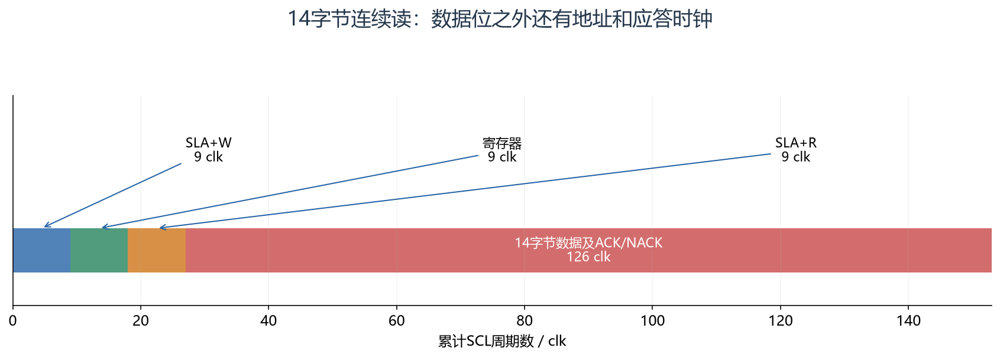

**读图方法与条件：** 典型“写寄存器地址+重复起始+读14字节”约153个SCL周期。400 kHz理想耗时382.5 μs，100 kHz为1.53 ms，还要加起停建立、拉伸、软件空隙等；末字节由主机NACK结束。

[放大查看 SVG](course-note-assets/extended/12/burst-budget.svg)

<!-- /extended -->

### 7. 从原始量到姿态还差哪些步骤

高低字节合并后按有符号16位解释，再除以量程对应灵敏度。
静止时加速度计测到的包括重力方向，不是“放着不动三轴都必须为零”；陀螺应接近零角速度，但存在偏置和噪声。

陀螺积分角度满足θ[k]=θ[k−1]+ω[k]Δt。偏置b会造成约b×t的累计漂移，Δt也必须用真实采样时间而非随便填一个常数。
加速度可帮助估计静态倾角，却受运动加速度影响；六轴本身不提供独立绝对航向基准。

互补滤波可把短时陀螺积分与长期重力倾角结合，例如θ=α(θprev+ωΔt)+(1−α)θacc。
α应和采样周期、目标带宽及模型条件关联；复杂滤波不能补回错误字节序、量程或时间戳。

<!-- extended:gyro-drift -->

#### 机制补图：微小陀螺偏置持续积分，会变成明显角度漂移

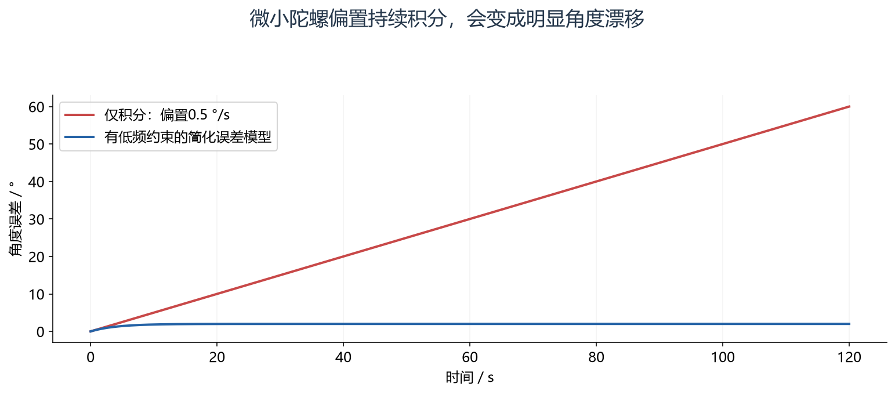

**读图方法与条件：** 红线按误差=b×t计算，120 s为60°。蓝线只是有界对照模型，不是某个滤波器实测。重力可约束部分倾角，但线加速度会干扰，单靠加速度计无法给偏航提供绝对航向参考。

[放大查看 SVG](course-note-assets/extended/12/gyro-drift.svg)

<!-- /extended -->

### 8. 前后端分层与错误传播

I2C驱动负责事务与错误，MPU设备层负责寄存器配置与原始量，采集/估计服务负责标定、时间和姿态，业务层使用有质量标识的结果。
不应在最底层ACK等待函数里加入“车身倾倒判定”。

传感器断开应使样本过期或无效，不能继续把最后一个角度作为当前可信姿态。
恢复后还需要考虑首帧、偏置重新估计及滤波器状态，避免旧状态与新传感器数据突然拼接。

### 9. 练习：看到 −1 g 先检查什么

在±2 g条件下，原始0xC000解释为−16384，约为−1 g；若当无符号则得到49152，方向和幅值都错。
先验证字节顺序、符号与量程，再验证坐标轴方向、安装姿态和偏置，最后分析实际运动。
不要先通过取绝对值掩盖负号，因为方向信息可能正是业务需要的事实。

## 资料与验证边界

入门部分依据同目录课件；深入部分补充官方资料与明确条件下的推导。课件中的产品宣传、历史软件版本、
简化图和典型性能不直接作为当前板卡、固件或全部同系列产品的保证。
本次只整理资料与图文，没有编译固件、下载或进行硬件实测。
实际接线、电平、寄存器差异和模块命令须核对所用器件资料。

## 图源与后续修改

[可编辑概念图](course-note-assets/12/concepts.drawio)；
[本课图源目录](course-note-assets/12)。
概念图同时提供 JSON、SVG 与 PNG，专项图提供 SVG 与 PNG。
SVG 可放大查看；JSON 可用 diagramry 重绘。课件原图保持原貌，
不把截图中的文字改写成未经证实的新协议。

[专项图重绘脚本](course-note-assets/_source/redraw.py) ·
[图源使用说明](course-note-assets/_source/图源说明.md)

## 继续学习与资料对照

[跨外设工程专题](<01_跨外设工程专题与阅读索引.md>) · [资料来源与适用范围](<02_图文笔记资料来源与适用范围.md>)

深入部分包含官方机制对照和教学推导；模块命令、电气接线与固件差异按资料页的边界处理。
