# 2-4-1_STM32基础 - SPI通信-W25Q64：图文笔记

[直接阅读深入学习](#deep-study) · [跨外设工程专题](<01_跨外设工程专题与阅读索引.md>)

SPI 由主机提供时钟并用片选选择从机。W25Q64 则通过命令、地址、数据和忙状态完成 Flash 读写。

[返回学习导航](<00_单片机基础图文笔记导航.md>) · [打开原课件](<2-4-1_STM32基础 - SPI通信-W25Q64.pdf>)

## 阅读范围

原课件共 27 页；阅读定位：P1–6 SPI 接线、四模式与硬件；P7–13 W25Q64 组织和命令；P14–25 软件/硬件实验。
图中卡片用于拆分概念，编号是阅读顺序；卡片之间不自动表示时间或因果。
重绘时序与数值例子会在图旁写出前提，不代表开发板实测。

## 一、四根线与四种模式各自解决什么

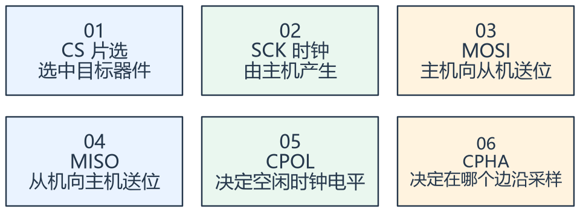

看图方法：先读每张卡片的关键词，再用下文核对它们之间的关系。

SPI 每推进一位时钟，发送和接收都在发生。想读从机数据，主机仍要发送 dummy 字节来产生时钟；发送了 dummy 不代表把它当成新的独立命令。

CPOL 决定时钟空闲高低，CPHA 决定第一个还是第二个边沿采样。四种模式必须与从机手册一致，不能只凭“上升沿读”就确定全部配置。

SPI 没有统一规定七位从机地址或逐字节 ACK。多个从机通常分别用 CS 选择，并应确认未选中从机的 MISO 能正确释放。

## 二、容量、页和扇区是三个尺度

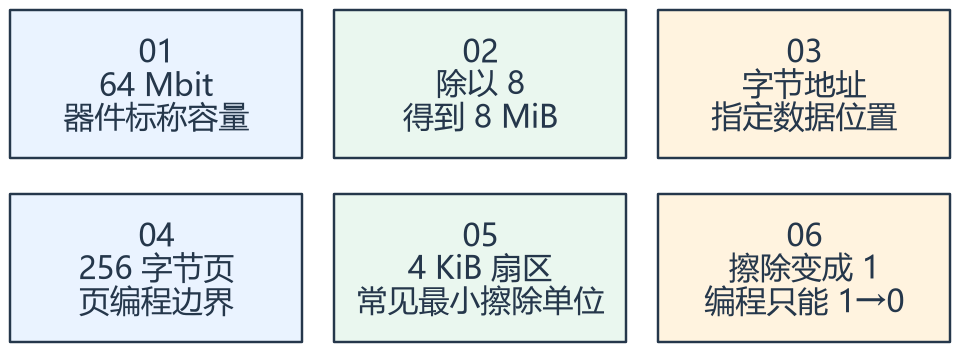

看图方法：先读每张卡片的关键词，再用下文核对它们之间的关系。

对课件 W25Q64，64 Mbit = 8 MiB = 8388608 字节。Mbit 与 MByte 相差八倍，地址范围和缓存规划不能混用。

页编程通常最多 256 字节，并受页边界限制。跨过一页末尾不能假定器件自动顺序进入下一页；软件应按剩余页空间拆分。

擦除会把整个目标扇区恢复为 0xFF，影响的不只是准备改动的几个字节。修改少量数据时要先规划同扇区其他数据的保留与掉电恢复。

## 三、写入是一段需要等待的事务

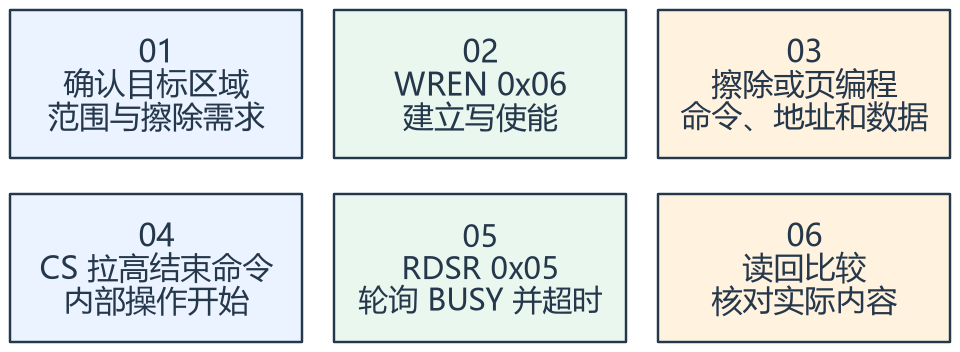

看图方法：先读每张卡片的关键词，再用下文核对它们之间的关系。

常用命令包括写使能 06、读状态 05、页编程 02、普通读取 03、4 KiB 扇区擦除 20。具体时序、地址宽度和允许模式仍按完整型号手册确认。

一次需要修改存储的命令前要满足写使能条件；写使能在操作后可能自动清除，不能只在系统上电时执行一次。轮询状态时检查 BUSY，必要时结合 WEL
和错误信息定位问题。

读状态是发送 05 后继续提供时钟接收状态，后续发送的 dummy 字节不是必须再发一个“01 命令”。课件把相关 SPI 实验写成 I2C
的位置应按上下文识别为笔误。

所有等待设置上限，失败保留明确状态。读回一致证明本次读写内容匹配，掉电原子性和擦写寿命需要另外设计与验证。

## 专项图解

### SPI 模式 0 示例：CS 为低期间发送命令 0x03

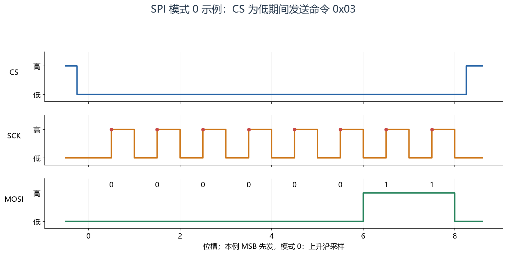

先看 CS 选择事务，再看红点标出的上升采样沿，最后读 MOSI 的 00000011。此图只画命令阶段，读取 W25Q64
还要继续地址和数据时钟，不能发完 03 就结束 CS。

### 起始地址 0x00F0，写入 40 字节应拆两页

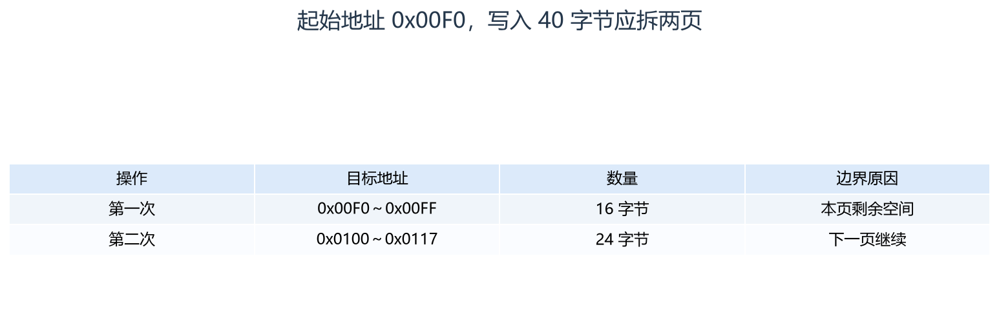

先算 256 - (地址 % 256)，得到本页还能写多少。每次页编程都需满足写使能，并等待完成；范围内需要擦除时，应先保护同扇区其他数据。

## 对照课件原图

下面图片截取自同目录原 PDF；页码为 PDF 阅读器中的物理页序号。
先读重绘解释，再用原图核对硬件框图或课件细节。

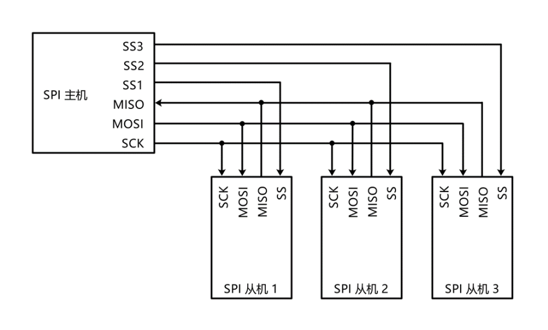

课件 P2（原图局部）：先看每个从机独立 CS，再看共享时钟与数据线。

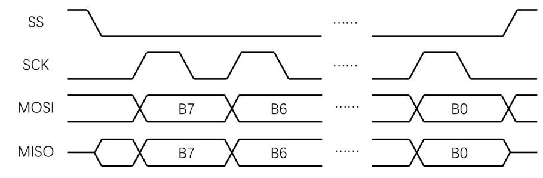

课件 P4（原图局部）：对照 CPOL 和 CPHA 找采样边沿与数据变化边沿。

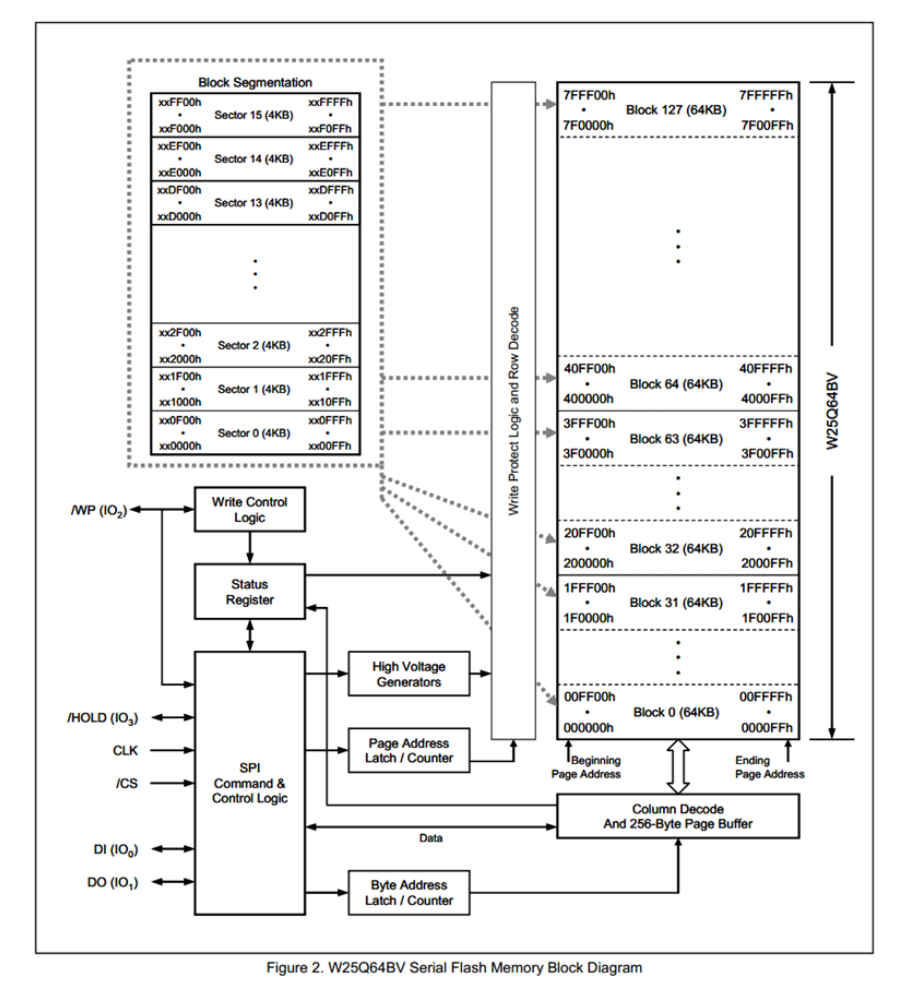

课件 P8（原图局部）：按字节、页和扇区理解地址组织，避免把读写单位混用。

## 关键概念速查

| 名称 | 应该记住什么 |
|---|---|
| CS/CPOL/CPHA | 事务边界与采样规则 |
| 页编程/扇区擦除 | 写入边界与擦除边界 |
| BUSY/WEL | 正在内部操作与写使能状态 |

## 具体例子

从地址 0x00F0 写 40 字节：本页只剩 16 字节，先写 16，再从 0x0100 写 24；两次页编程分别完成写使能、命令、等待和结果检查。

## 实验时如何验证

- 核对 CS、电平、CPOL/CPHA，先读器件 ID。
- 在专门测试区域执行擦除、跨页拆分写入与读回。
- 验证忙等待超时、边界地址以及同扇区数据保护。

## 常见误区

- 写 FF 不能把已经变成 0 的位恢复为 1。
- CS 一直保持低不一定允许无限连续执行多个命令。
- MCU 发送完成不表示 Flash 内部编程已经完成。

## 自测：先想答案，再展开

8 MiB 与 64 Mbit 矛盾吗？

不矛盾，一个字节等于八位。

为什么 40 字节可能需要两次页编程？

起始地址靠近页尾，不能直接越过页边界。

## 深入学习：SPI 时序裕量、NOR Flash 写入约束与可靠存储

本节目录：

- [1. CPOL/CPHA 先描述边沿，再描述数据](#deep-1)
- [2. 同时收发与 dummy 字节](#deep-2)
- [3. 一个读命令怎样占用总线](#deep-3)
- [4. 64 Mbit、8 MiB 与地址边界](#deep-4)
- [5. NOR 的 1→0 约束怎样影响改写](#deep-5)
- [6. WEL、BUSY 与保护位的因果链](#deep-6)
- [7. 掉电安全记录：先设计提交顺序](#deep-7)
- [8. 寿命、磨损与日志布局](#deep-8)
- [9. 共享 SPI 总线与 RTOS](#deep-9)
- [10. 边界测试清单与推导题](#deep-10)

### 1. CPOL/CPHA 先描述边沿，再描述数据

CPOL=0表示空闲低，第一个边沿上升；CPOL=1表示空闲高，第一个边沿下降。
CPHA=0在第一个有效边沿采样，CPHA=1在第二个有效边沿采样，另一边沿用于更新数据。
所以只说“上升沿采样”无法同时说明空闲电平与首位准备时机。

主从需要共同满足数据建立/保持、时钟高低宽度与片选前后间隔。
提高频率后偶发错误，可能来自采样边沿与传播延迟、布线反射和电平质量，不一定是软件分包出了问题。
同一个SCK设置对一块短线板可用，不能证明换成长排线仍满足时序。

<!-- extended:spi-four-modes -->

#### 机制补图：先看空闲电平，再按第一个或第二个边沿确定采样

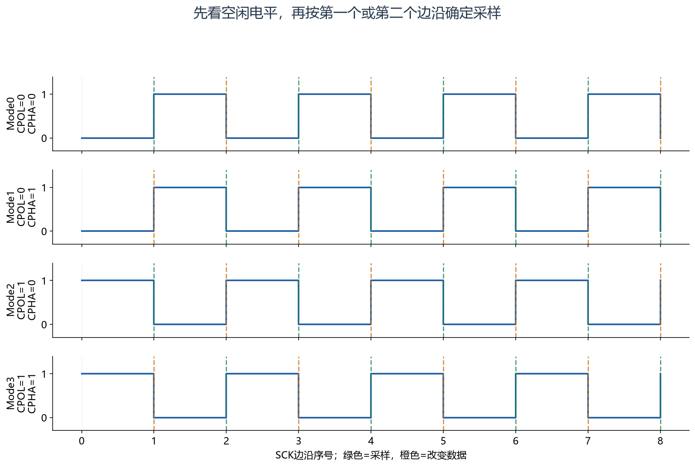

**读图方法与条件：** CPHA=0在第一个有效边沿采样，首位须在该边沿之前准备好；CPHA=1在第二个边沿采样。图只画SCK与采样/改变标记，真实数据还须满足从设备的建立、保持及CS时序要求。

[放大查看 SVG](course-note-assets/extended/13/spi-four-modes.svg)

<!-- /extended -->

### 2. 同时收发与 dummy 字节

发送每个时钟位时也在接收。读器件数据时主机必须继续产生时钟，常通过写dummy字节做到。
写dummy的具体值是否无关，要看命令阶段和从机规则，不能脱离事务假定任何值都通用。

F1的TXE表示发送缓存可写，不等于最后一个时钟已发完；结束CS前还要按手册处理BUSY等完成条件。
忽略接收端还可能积累接收数据/溢出状态，应按具体驱动模式维护，即使应用只关心发送。
DMA发送完成也不能直接替代整个SPI事务完成。

### 3. 一个读命令怎样占用总线

课件普通读取可理解为CS拉低→03→地址→继续提供时钟接收数据→CS拉高。
地址宽度、快速读取的dummy周期和允许时钟都由具体器件/命令定义，不能把03与快速读时序混在一起。

以三字节地址、256字节数据、8 MHz为教学条件，总共260字节时钟，位时间约260×8/8 MHz=260 μs。
这没有包括软件、片选间隔和总线竞争，只是线上的理想时间。
小块读取时命令地址开销比例较大，批量读取可提高效率，但不能因此忽略最大延迟要求。

<!-- extended:read-duplex -->

#### 机制补图：03h读命令期间，主机发送dummy才能持续提供读时钟

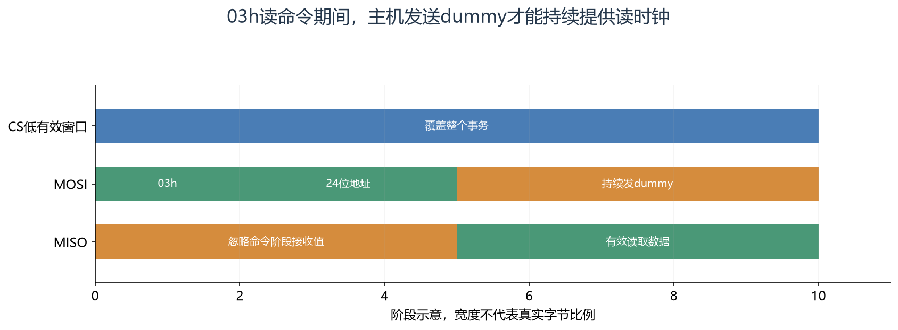

**读图方法与条件：** 针对课件常见24位地址的03h普通读取，命令后3个地址字节，随后读数据。dummy指主机为产生时钟而发送的占位字节，不是03h要求的额外dummy周期；不同快速读命令的规则需另查手册。

[放大查看 SVG](course-note-assets/extended/13/read-duplex.svg)

<!-- /extended -->

### 4. 64 Mbit、8 MiB 与地址边界

W25Q64这类64 Mbit器件容量为8×1024×1024字节，字节地址通常覆盖0x000000～0x7FFFFF。
这不等于它支持任意输入的三字节地址，也不表示器件型号、状态/保护位在所有后缀版本中完全相同。

页是编程组织尺度，扇区/块是擦除尺度。读取可连续跨页，不意味着页编程也允许同样跨页。
操作前既检查总容量，也检查页内空间、擦除区间与保护状态，防止“长度没越界但错误擦了邻居数据”。

### 5. NOR 的 1→0 约束怎样影响改写

擦除使位恢复为1，编程只能把允许的位变为0。想把旧值F0改成E0只需进一步清位，但想改回FF需要擦除。
即便逻辑上只修改一个字节，擦除也可能波及整个4 KiB扇区。

若同扇区还有其他数据，常见思路是读出/准备完整有效内容、擦除目标区域、分多页重写并校验。
该过程在断电时存在中间态；仅在SRAM保存备份无法抵抗整机断电，不能称为掉电安全。

另外，允许的重复页编程次数、最大编程/擦除时间和寿命依赖具体器件，应查完整型号资料，不能只凭“NOR只能清零”推导任意次数重复编程都可靠。

### 6. WEL、BUSY 与保护位的因果链

写使能令器件进入允许修改的状态；真正的擦除/编程命令还受地址、保护位和电源条件限制。
命令结束后器件进入内部忙状态，待BUSY清除才可能开始后续受限制操作。WEL也可能随操作完成清零，不能只上电执行一次WREN。

忙等待设置上限并区分未接受命令、操作超时与读回不符。
读回正确是重要证据，但CRC比对只是发现一类不一致，并不自动使数据拥有原子提交、版本或鉴别能力。

### 7. 掉电安全记录：先设计提交顺序

一个记录可包含magic、格式版本、序号、长度、负载、CRC与提交标记。
思路是先把新记录写到未占用位置并验证，最后按器件允许的编程规则写提交标记；上电只接受提交完成且结构/CRC合法的记录。
旧有效记录在新记录成功前保留。

擦除回收使用独立区域轮换，不能先擦掉唯一旧副本，再希望掉电后还能恢复。
多字节写入、跨页写入和扇区擦除都不能默认视为原子；提交标记方案也要满足该器件的重复编程、对齐和掉电规范。

### 8. 寿命、磨损与日志布局

寿命要用具体型号保证值与实际擦除频率计算。若仅作假设，某扇区保证E次擦除、每天擦D次，则理论计数尺度为E/D天，仍不等于系统可靠寿命保证。
温度、保存时间、电压和掉电过程还会影响实际使用条件。

频繁保存计数可以先聚合、按变化阈值保存、使用追加日志、分区轮换和磨损管理。
代价是上电扫描时间、RAM索引和掉电可能丢失的最近更新范围。应明确接受丢几次更新，而不是既要求零损失又无限推迟写入。

### 9. 共享 SPI 总线与 RTOS

不同设备可能要求不同CPOL/CPHA、速率与CS时序。互斥范围应覆盖从选择配置、拉低CS到事务结束，而不是只保护单个字节发送函数。
Flash内部忙期间是否可以释放总线、访问另一个器件，要看片选和器件工作规则，而不是让任务一直持总线锁空转数毫秒。

存储服务可串行化请求，维护忙状态、队列、超时与回调/结果。上层请求“保存一条配置记录”，底层隐藏WREN和页拆分细节。
不能多个模块同时擦同一个扇区，即使每次SPI字节传输都加了锁。

<!-- extended:spi-lock -->

#### 机制补图：共享总线的锁需要覆盖配置、CS与整段收发

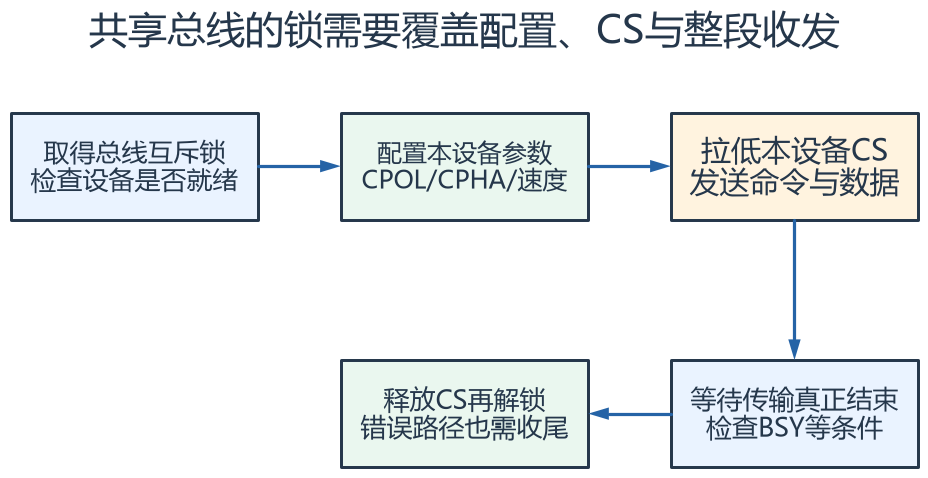

**读图方法与条件：** 只锁发送函数的一次调用，仍可能在“命令→地址→数据”之间被别的任务改模式。SPI总线锁和Flash内部BUSY是两层：芯片忙时可否释放总线给其他设备，应由设备级状态与驱动约束共同决定。

[放大查看 SVG](course-note-assets/extended/13/spi-lock.svg) · [可编辑结构图](course-note-assets/extended/13/extended.drawio)

<!-- /extended -->

### 10. 边界测试清单与推导题

测试至少覆盖页尾、扇区尾、容量尾、未擦除改写、保护状态、忙超时和掉电恢复；写后核对不仅看第一个字节，也检查未应改变的邻接区域。
电气问题用CS/SCK/MOSI/MISO时序与电平验证，存储一致性问题用带序号记录与恢复结果验证。

题：地址0x01F8写20字节如何拆页？
解：256−0xF8=8，先写8字节至0x01FF，再从0x0200写12字节；是否需先擦除由旧位值与区域规划决定。
每次页编程独立满足写使能与完成检查，总SPI时钟时间不等于器件内部写入总时间。

<!-- extended:page-split -->

#### 机制补图：256 B页：从页内偏移248写20 B，应拆成8 B与12 B

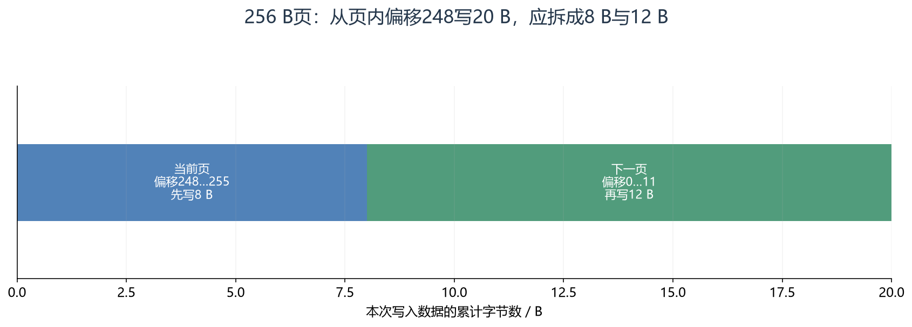

**读图方法与条件：** 第一段结束后等待BUSY清除、检查结果，再按器件要求WREN启动下一段。不能假定跨页Page Program会自动进入下一页；常见器件会在页内回绕。

[放大查看 SVG](course-note-assets/extended/13/page-split.svg)

<!-- /extended -->

## 资料与验证边界

入门部分依据同目录课件；深入部分补充官方资料与明确条件下的推导。课件中的产品宣传、历史软件版本、
简化图和典型性能不直接作为当前板卡、固件或全部同系列产品的保证。
本次只整理资料与图文，没有编译固件、下载或进行硬件实测。
实际接线、电平、寄存器差异和模块命令须核对所用器件资料。

## 图源与后续修改

[可编辑概念图](course-note-assets/13/concepts.drawio)；
[本课图源目录](course-note-assets/13)。
概念图同时提供 JSON、SVG 与 PNG，专项图提供 SVG 与 PNG。
SVG 可放大查看；JSON 可用 diagramry 重绘。课件原图保持原貌，
不把截图中的文字改写成未经证实的新协议。

[专项图重绘脚本](course-note-assets/_source/redraw.py) ·
[图源使用说明](course-note-assets/_source/图源说明.md)

## 继续学习与资料对照

[跨外设工程专题](<01_跨外设工程专题与阅读索引.md>) · [资料来源与适用范围](<02_图文笔记资料来源与适用范围.md>)

深入部分包含官方机制对照和教学推导；模块命令、电气接线与固件差异按资料页的边界处理。
