# 2-4-2_STM32基础 - FLASH编程_BKP备份寄存器：图文笔记

[直接阅读深入学习](#deep-study) · [跨外设工程专题](<01_跨外设工程专题与阅读索引.md>)

内部 Flash 保存掉电数据，但擦除会影响整页；BKP 依靠备份电源保留少量寄存器，两者的保存机制不同。

[返回学习导航](<00_单片机基础图文笔记导航.md>) · [打开原课件](<2-4-2_STM32基础 - FLASH编程_BKP备份寄存器.pdf>)

## 阅读范围

原课件共 11 页；阅读定位：P1–6 Flash 布局、擦写与实验；P7–10 BKP、后备域与实验；P11 小结。
图中卡片用于拆分概念，编号是阅读顺序；卡片之间不自动表示时间或因果。
重绘时序与数值例子会在图旁写出前提，不代表开发板实测。

## 一、先画存储布局，再写参数

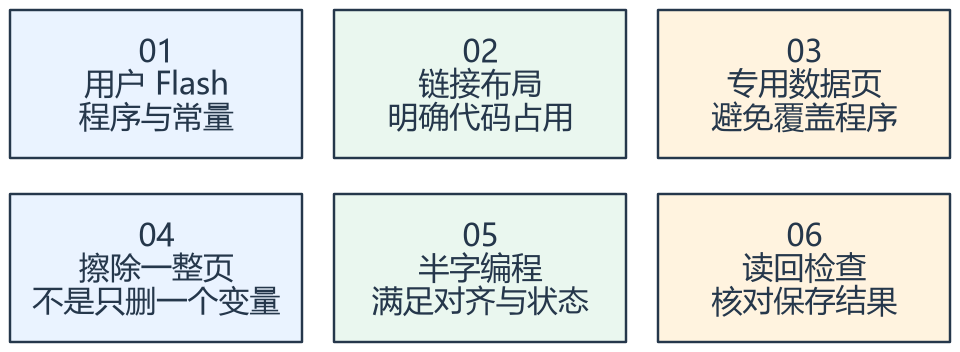

看图方法：先读每张卡片的关键词，再用下文核对它们之间的关系。

STM32F103C8T6 标称 Flash 为 64 KiB，对应 0x08000000 至 0x0800FFFF。课件中示意的 128 KiB
布局不能直接作为 C8 的可用空间保证。

该中容量器件通常按 1 KiB 页擦除。参数区必须在链接与布局中明确保留，不能凭感觉选一个“看起来靠后”的地址，否则固件增大后就可能覆盖程序。

Flash 普通读取可通过地址访问，但普通指针赋值不能替代合法编程流程。擦写时需注意等待、对齐、允许的写入粒度与供电条件。

## 二、解锁到重新上锁是一段受控操作

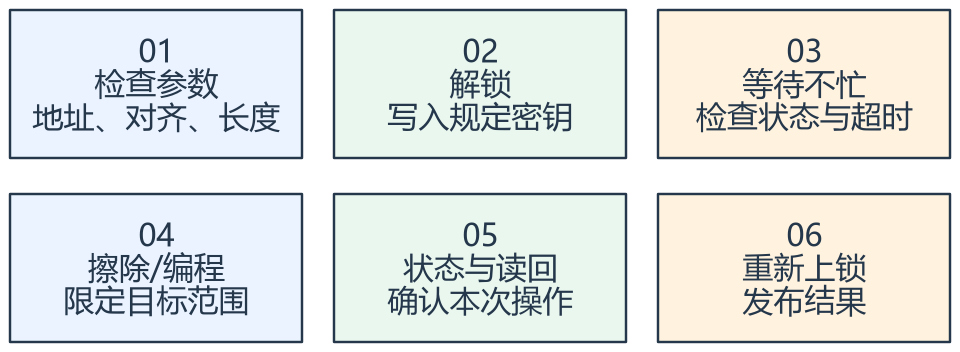

看图方法：先读每张卡片的关键词，再用下文核对它们之间的关系。

课件展示的解锁密钥为 0x45670123 与 0xCDEF89AB。它们用于控制寄存器的操作许可，不是应用数据的加密密钥。

每个等待都要设置超时，操作后读取错误状态并读回数据。即使流程正确，掉电中断仍可能使记录不完整；版本、长度、CRC 和提交标记可帮助辨认有效记录。

频繁更新的计数不宜每次都擦同一页。应评估更新频率、擦写寿命和轮换方案。选项字节和读保护会影响后续维护，不应作为普通参数区随意试写。

## 三、BKP 保存依赖备份域供电

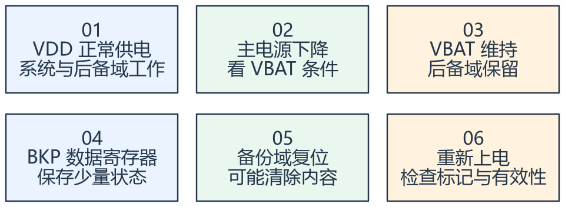

看图方法：先读每张卡片的关键词，再用下文核对它们之间的关系。

对课件 F103C8，BKP 为十个 16 位数据寄存器，总共 20 字节；不要把它当作任意容量的独立 EEPROM。

BKP 依赖 VDD 或 VBAT 等备份域供电条件。主电源关闭而 VBAT
有效时可以保留；所有供电都消失后不能无条件保证数据。备份域复位和配置的侵入检测等也可能清除内容。

访问通常需要打开相应外设时钟并解除备份域写保护。上电时先检查初始化标记和字段有效性，不能因为“寄存器地址仍存在”就认为内容可靠。

## 专项图解

### C8 的 64 KiB Flash：地址计算与布局保留分开

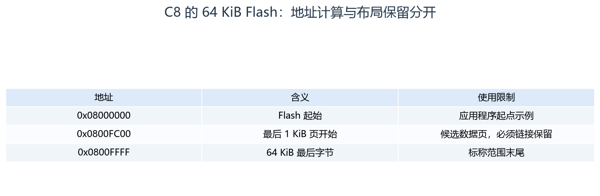

这些是标称容量的地址计算。是否可以把末页拿来存参数，必须核对实际链接布局，图不构成已为当前工程保留空间的证据。

### Flash 位变化：擦除与编程的方向不同

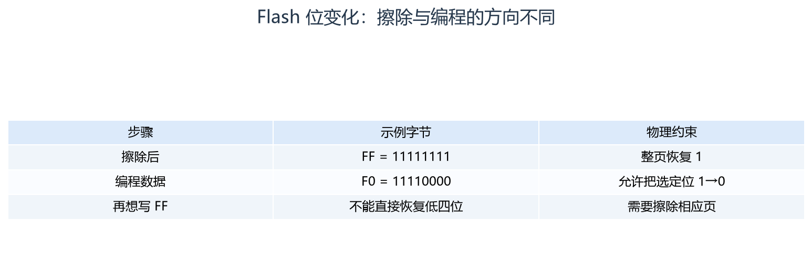

从上向下看一次变化。一个变量要恢复成更大的数值，并不一定能直接再次编程；需按位判断并考虑整页其他数据。

### 独立参数页必须从链接布局中保留出来

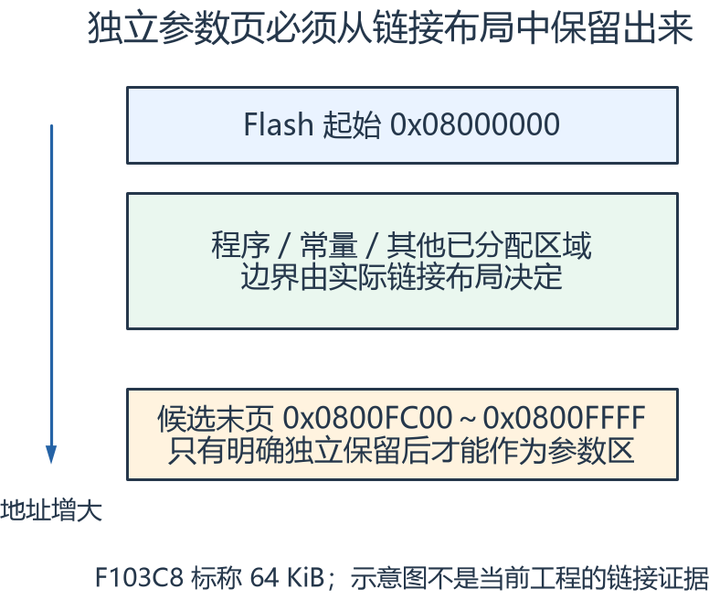

自上向下读地址。数据区需要链接器和程序共同约定，不能仅凭这张地址示意就执行擦除。参数更新影响整页，需保护同页内容与掉电恢复。

## 对照课件原图

下面图片截取自同目录原 PDF；页码为 PDF 阅读器中的物理页序号。
先读重绘解释，再用原图核对硬件框图或课件细节。

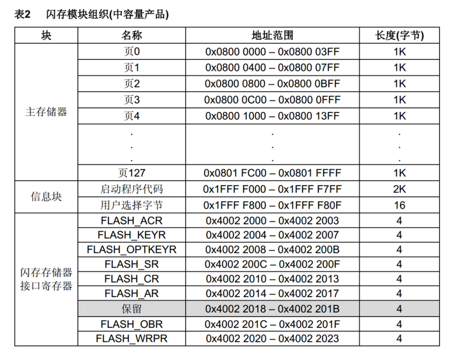

课件 P2（原图局部）：对照器件容量阅读，图里的容量示例不能直接套到所有型号。

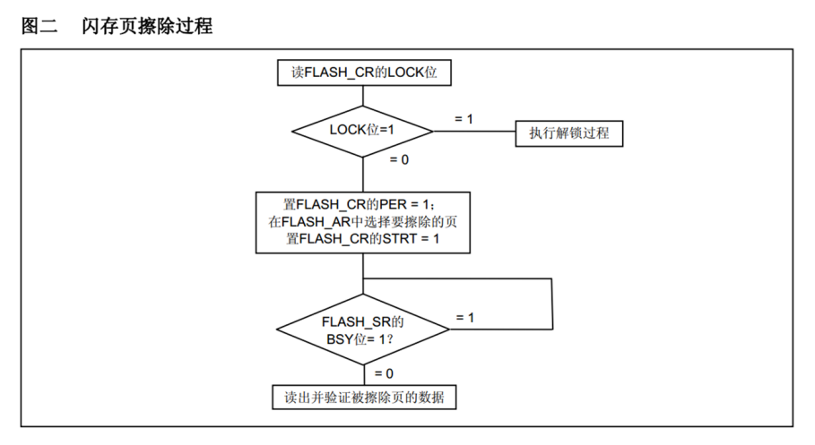

课件 P4（原图局部）：看整页擦除对同页其他内容的影响。

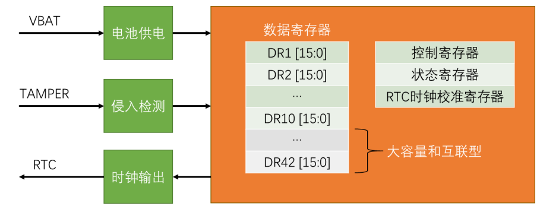

课件 P8（原图局部）：沿 VDD/VBAT 和后备域看保持与清除条件。

## 关键概念速查

| 名称 | 应该记住什么 |
|---|---|
| 内部 Flash | 掉电保存，受页擦除与寿命约束 |
| BKP | 少量备份域寄存器，依赖供电 |
| 链接保留区 | 防止代码与参数区重叠 |

## 具体例子

若规划最后 1 KiB 为参数页，其候选范围为
0x0800FC00–0x0800FFFF；这只是地址计算示例，必须先由实际链接文件和固件尺寸证实该页已被独立保留。

## 实验时如何验证

- 查看实际链接布局，证明数据页与代码独立。
- 用专用数据页验证擦写、读回、掉电重启和无效记录处理。
- 分别测试主电源关闭且 VBAT 有效、备份域复位两种保持条件。

## 常见误区

- 课件的 128 KiB 图不等于 F103C8 标称容量变大。
- 停止 SWD 调试不等于建立完整的数据安全机制。
- 掉电保存和带电备份是两种不同的能力。

## 自测：先想答案，再展开

擦除一个参数会影响其他数据吗？

可能会，擦除单位是整页。

BKP 没有 VBAT 还能断主电保留吗？

不能据此保证，需满足后备域供电条件。

## 深入学习：内部 Flash 的执行限制、记录恢复与后备域

本节目录：

- [1. 数据页边界必须由链接器共同保证](#deep-1)
- [2. 解锁、擦除、编程与状态检查](#deep-2)
- [3. 为什么 Flash 操作可能影响中断与实时性](#deep-3)
- [4. 两页轮换的恢复逻辑](#deep-4)
- [5. CRC、版本、默认值各解决什么问题](#deep-5)
- [6. 磨损预算与保存策略](#deep-6)
- [7. BKP 与普通 SRAM、Flash 的边界](#deep-7)
- [8. 保护配置与升级是独立课题](#deep-8)
- [9. 练习：怎么证明掉电恢复方案成立](#deep-9)

### 1. 数据页边界必须由链接器共同保证

F103C8标称64 KiB，中容量Flash页通常为1 KiB。候选末页0x0800FC00～0x0800FFFF能否用作参数区，取决于实际链接布局是否保留。
代码尚小、当前没碰到该页，不等于以后版本也不会使用。只在C里定义一个参数地址常量，不能阻止链接器把程序放进去。

应该从链接区域中扣除保留空间，或使用受控段/区域，并用map文件验证。
固件更新策略还要说明是否擦除该页、数据格式如何迁移、出错时如何恢复默认。存储区是应用与升级流程共同维护的接口。

<!-- extended:link-reserve -->

#### 机制补图：F103C8示例：参数页必须同时从代码链接区中扣除

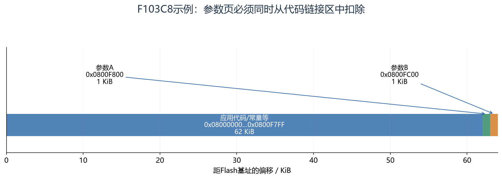

**读图方法与条件：** 示例以64 KiB主Flash和1 KiB页为前提，末两页做参数存储。最右两页很窄是实际比例；写存储宏还不够，链接布局也必须排除它们。这只是规划示例，没有修改用户工程的链接配置。

[放大查看 SVG](course-note-assets/extended/14/link-reserve.svg)

<!-- /extended -->

### 2. 解锁、擦除、编程与状态检查

F1 Flash控制器的KEYR用于解锁，SR反映忙和相关错误，CR选择擦除/编程等操作，AR提供相应目标地址。
常规编程粒度是规定的半字，地址与数据必须满足要求，不能把普通32位赋值就当作完整编程驱动。

操作前验证范围与对齐，等待不忙，按手册设置操作并触发，等待完成后检查错误与读回，再清理控制状态并重新上锁。
发现保护/编程错误时不能无限重试，尤其不能为“修复参数”扩大擦除到未知程序区域。

### 3. 为什么 Flash 操作可能影响中断与实时性

在本课常见单bank器件上，Flash忙期间，对Flash的取指或读取可能等待。
即便擦写函数本身搬到SRAM，如果它还调用Flash中的函数、读取Flash中的常量或异常入口仍依赖受影响区域，实时性仍可能受阻。

因此要预算最坏擦除/编程时间，并分析中断、看门狗、通信缓存和控制周期能否承受。
“用了RTOS，所以Flash写入不会影响其他任务”不成立，调度器不能绕过硬件取指限制。
是否采用RAM执行、在空闲窗口保存或把存储迁移到独立外设，应按实际系统约束设计。

<!-- extended:flash-stall -->

#### 机制补图：单Bank Flash忙期间，代码取指等待可能扩大中断延迟

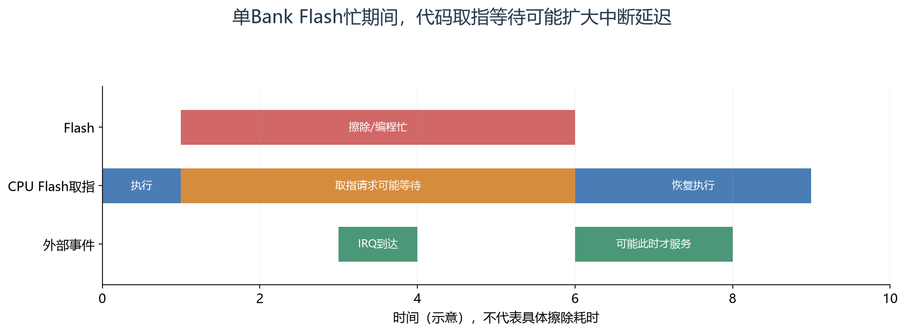

**读图方法与条件：** 仅把入口函数放RAM不一定解决问题：调用链、常量、向量表或ISR仍可能访问忙Flash。应核对手册的访问限制，并实际评估最坏中断延迟。

[放大查看 SVG](course-note-assets/extended/14/flash-stall.svg)

<!-- /extended -->

### 4. 两页轮换的恢复逻辑

一种教学布局是A、B两页交替保留有效记录。新数据写入另一个可用位置，完成结构与CRC验证后写提交信息；旧页在新页可恢复之前保持有效。
上电扫描所有候选，检查magic、版本、长度、CRC和提交状态，再根据明确的序号比较规则选最新有效记录。

断电点可能落在擦页中、写负载中、写CRC中或提交时。设计需要说明每一个点重启后会选择哪个副本。
序号回绕、两页都有效、两页都无效和格式升级也要有确定行为；不能简单比较无符号大小后永远认为数值最大者最新。

记录可恢复性与“最近一次保存一定完成”不同。若掉电发生在新记录未提交前，合理结果通常是恢复旧有效记录，并明确允许丢失最近一次更新。

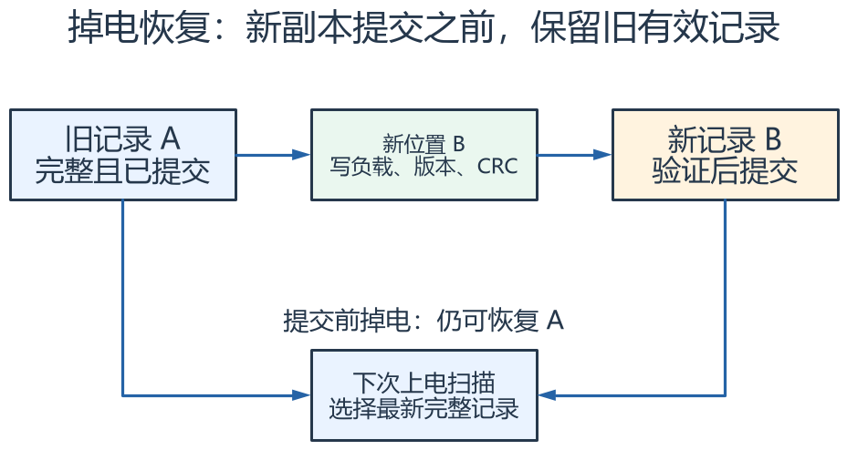

怎么看：沿流程检查每个掉电点：新记录确认有效前保留旧记录；启动恢复只接受满足结构、CRC 与提交条件的记录。

### 5. CRC、版本、默认值各解决什么问题

CRC帮助识别部分数据损坏，magic帮助识别记录类型，长度约束防止越界解析，版本用于选择解释格式。
这些字段没有任何一个单独证明数据来自可信主体，也没有自动提供加密或防回滚。

没有有效记录时应使用经过校验的默认配置并上报恢复原因，而不是把擦除后的FF字段直接用作超时、数组长度或CAN ID。
加载后的参数还要做范围和组合检查，例如最小阈值不得大于最大阈值。

### 6. 磨损预算与保存策略

每次参数变更就擦同一页，会使写入频率直接消耗该页寿命。
先区分必须立即持久化的安全配置、可批量保存的统计值和可重算缓存，再选择追加记录、轮换页或外部存储。
寿命推算中的擦写保证次数必须来自具体型号手册，不能以互联网常见数字替代。

读写接口应返回参数错误、保护、忙超时、校验失败等可区分结果。
后台保存失败不应让业务默默认为数据已经持久化；RAM中的新配置和Flash已提交版本可能暂时不同。

<!-- extended:wear-budget -->

#### 机制补图：寿命预算首先看擦除频率，而不是只看写入字节数

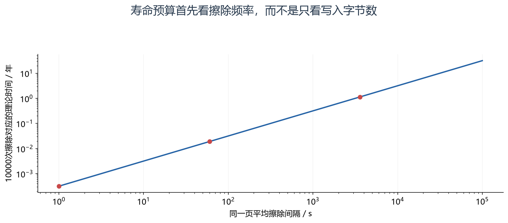

**读图方法与条件：** 仅假设单页10000次擦除作为计算预算，不作为无条件寿命保证。每秒擦除约2.78小时用完预算；每分钟约6.94天；每小时约1.14年。合并保存、追加日志、跨页轮换可改变平均磨损，还需考虑温度和数据保持条件。

[放大查看 SVG](course-note-assets/extended/14/wear-budget.svg)

<!-- /extended -->

### 7. BKP 与普通 SRAM、Flash 的边界

F103C8的十个16位BKP数据寄存器共20字节，适合初始化标记、少量恢复状态和时间相关信息。
它依赖后备域供电，不是无需电源的Flash，也不是保留所有RAM的待机模式。
访问需满足相应时钟与DBP写许可；备份域复位或配置的侵入检测会改变保留条件。

标记写对不代表其他字段一定完整。若多寄存器保存一个结构，可用版本/校验及提交顺序避免半更新被当作有效。
VBAT正常且RTC连续走时，也不自动证明应用存入BKP的全部字段有正确生命周期。

### 8. 保护配置与升级是独立课题

读保护、写保护和选项字节会影响调试、擦写与升级路径，操作前必须确认当前保护状态、恢复方式和可能的整片擦除影响。
本笔记解释职责，不给未知板卡直接提供选项字节修改步骤。
关闭调试引脚、隐藏地址或加一个magic值不能单独代替数据安全设计。

### 9. 练习：怎么证明掉电恢复方案成立

先列出每个可中断步骤，明确预期重启结果，再在专用测试区域和受控设备上覆盖这些断电点。
检查不仅是“程序还能启动”，还包括选择了哪一版记录、未完成记录是否被拒绝、旧记录是否保留、默认恢复是否可识别。

| 证据 | 可以得出的结论 |
|---|---|
| map显示独立数据页 | 当前构建中存储区未与代码重叠 |
| 一次写后读回一致 | 该次写入内容与预期一致 |
| 多个断电点恢复正确 | 已覆盖步骤下的恢复逻辑成立 |
| 仅源码中有CRC字段 | 还不能证明CRC使用、提交和恢复均正确 |

<!-- extended:power-loss -->

#### 机制补图：两页提交：新页未确认有效前，始终保留旧页

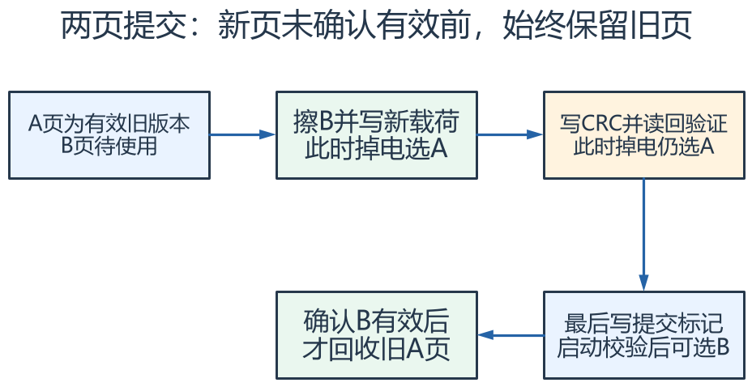

**读图方法与条件：** 启动扫描必须同时校验提交标记、版本、长度和CRC等条件。提交标记写入中途掉电时，只有完整有效的新记录才可获选；序号比较要定义回绕规则，测试应覆盖每一步及标记半写入状态。

[放大查看 SVG](course-note-assets/extended/14/power-loss.svg) · [可编辑结构图](course-note-assets/extended/14/extended.drawio)

<!-- /extended -->

## 资料与验证边界

入门部分依据同目录课件；深入部分补充官方资料与明确条件下的推导。课件中的产品宣传、历史软件版本、
简化图和典型性能不直接作为当前板卡、固件或全部同系列产品的保证。
本次只整理资料与图文，没有编译固件、下载或进行硬件实测。
实际接线、电平、寄存器差异和模块命令须核对所用器件资料。

## 图源与后续修改

[可编辑概念图](course-note-assets/14/concepts.drawio)；
[本课图源目录](course-note-assets/14)。
概念图同时提供 JSON、SVG 与 PNG，专项图提供 SVG 与 PNG。
SVG 可放大查看；JSON 可用 diagramry 重绘。课件原图保持原貌，
不把截图中的文字改写成未经证实的新协议。

[专项图重绘脚本](course-note-assets/_source/redraw.py) ·
[图源使用说明](course-note-assets/_source/图源说明.md)

## 继续学习与资料对照

[跨外设工程专题](<01_跨外设工程专题与阅读索引.md>) · [资料来源与适用范围](<02_图文笔记资料来源与适用范围.md>)

深入部分包含官方机制对照和教学推导；模块命令、电气接线与固件差异按资料页的边界处理。

[深入配图源目录](course-note-assets/deep/14) · [深入图重绘脚本](course-note-assets/_source/deeper_diagrams.py)
