# 2-4-3_STM32基础 - RTC实时时钟：图文笔记

[直接阅读深入学习](#deep-study) · [跨外设工程专题](<01_跨外设工程专题与阅读索引.md>)

STM32F1 的 RTC 主要是低速时钟驱动的秒计数器，软件把秒数转换成日历。备份电源、时钟源和初始化策略共同决定走时能否连续。

[返回学习导航](<00_单片机基础图文笔记导航.md>) · [打开原课件](<2-4-3_STM32基础 - RTC实时时钟.pdf>)

## 阅读范围

原课件共 11 页；阅读定位：P1–4 时间戳与时间转换；P5–8 RTC、时钟与后备电源；P9–10 实验；P11 小结。
图中卡片用于拆分概念，编号是阅读顺序；卡片之间不自动表示时间或因果。
重绘时序与数值例子会在图旁写出前提，不代表开发板实测。

## 一、从 32768 Hz 到每秒加一

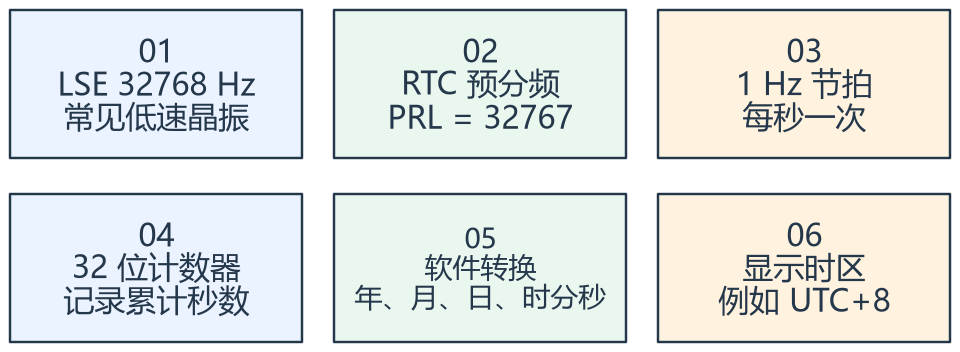

看图方法：先读每张卡片的关键词，再用下文核对它们之间的关系。

STM32F1 的 RTC 与新系列带日历寄存器的 RTC 不同。这里先保存秒计数，再由软件进行日期、闰年和显示转换。

当输入为 32768 Hz，分频系数为 PRL + 1 = 32768，得到 1 Hz。晶振偏差会累积为走时误差，设置了正确分频不等于时间永远准确。

Unix 时间戳通常表达自 1970-01-01 00:00:00 UTC 起的秒数。UTC+8 是显示解释，不应在同一份 UTC 计数里反复叠加八小时。

## 二、备份供电与时钟源一起决定保持能力

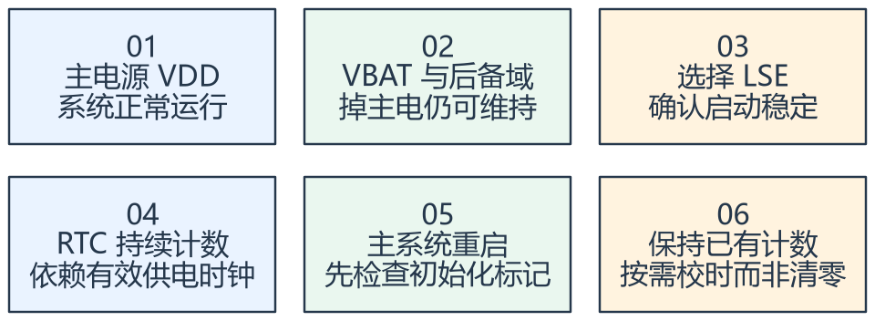

看图方法：先读每张卡片的关键词，再用下文核对它们之间的关系。

VBAT 使后备域在主电源关闭时仍可能工作，但还必须有适合的 RTC 时钟。不能把 LSE、LSI、HSE 的备份运行能力一概而论。

启动代码每次都重新设置时间，会造成系统一复位就“回到出厂日期”。应先判断 RTC 是否已经初始化且数据有效，再决定首次配置或仅同步读取。

备份域复位会破坏已有配置或计数。为了切换时钟而重置后备域时，要明确对现有时间的影响。

## 三、读写计数器与转换日历需要分别验证

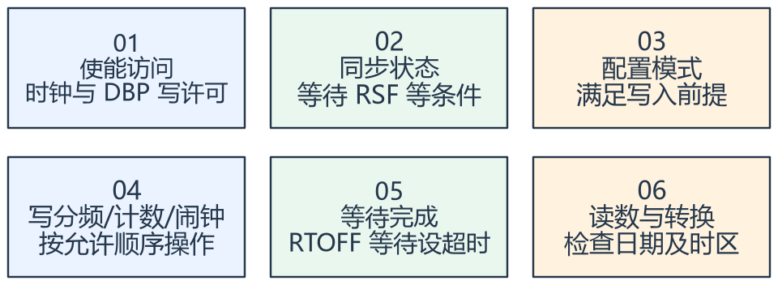

看图方法：先读每张卡片的关键词，再用下文核对它们之间的关系。

F1 访问 RTC 需要遵循同步与配置等待，不能只写一个计数寄存器就假定已经生效。跨多个寄存器读取计数还要采用驱动建议的一致读法。

gmtime 通常把时间戳转换为 UTC 日历；localtime 与 mktime 涉及本地时区语义，嵌入式 C 库支持情况也可能不同。课件把
gmtime 的 UTC 表现直接视为错误不严谨。

校验应覆盖跨秒、跨日、月底、闰年、断主电保留和重新上电。闹钟事件与 CPU 唤醒还需要对应中断/事件与低功耗配置。

## 专项图解

### RTC 的三层表示：时钟、秒数、日历

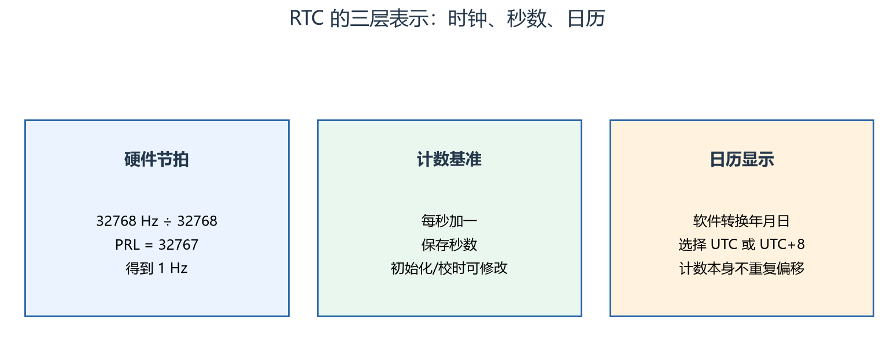

先由硬件得到秒，再由软件解释成日历。改变显示时区与校准硬件计数是两项不同操作。

### 一个时刻可以有两种日历显示

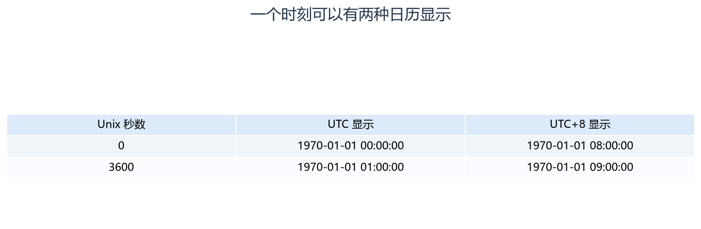

每一行描述同一个时间点，第二、三列只是不同显示时区。先约定存储的是 UTC 秒数，再统一处理显示与输入转换。

### RTC 保持：后备域电源与 LSE 时钟缺一不可

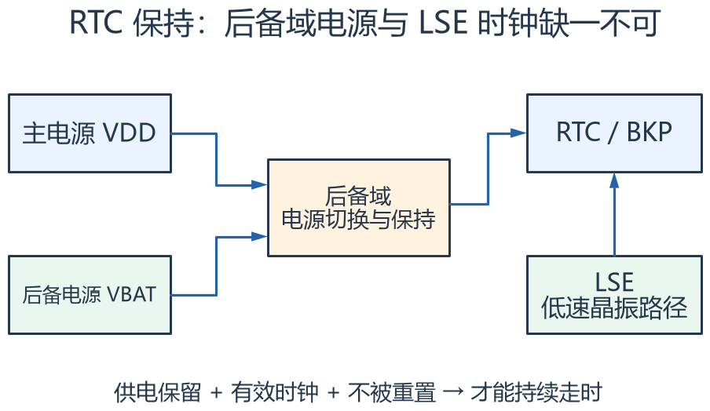

左边看供电来源，右边看 RTC 还需要时钟。图表示功能依赖而非完整电路；备份域复位或无条件重新设置计数仍会破坏连续走时。

## 对照课件原图

下面图片截取自同目录原 PDF；页码为 PDF 阅读器中的物理页序号。
先读重绘解释，再用原图核对硬件框图或课件细节。

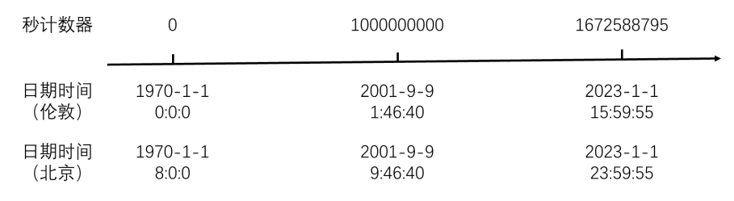

课件 P2（原图局部）：把时间戳当作时间点，日历是它的显示解释。

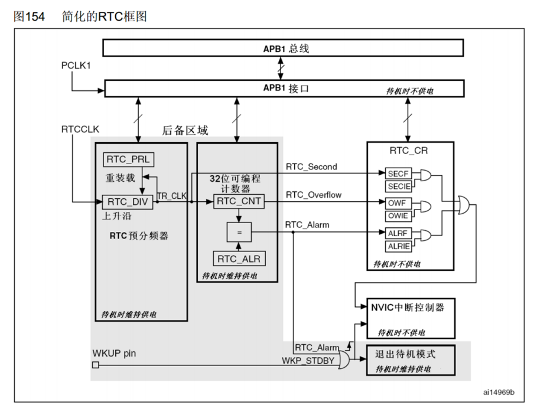

课件 P5（原图局部）：沿时钟选择、预分频和计数器追踪秒的来源。

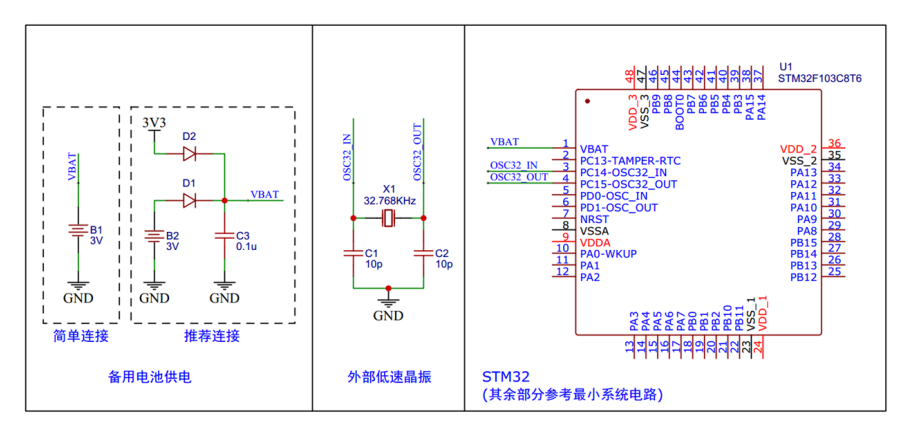

课件 P6（原图局部）：检查后备电源路径，不能仅凭软件初始化认为掉电后一定走时。

## 关键概念速查

| 名称 | 应该记住什么 |
|---|---|
| PRL | 分频参数，输出频率依赖输入时钟 |
| RTC 秒计数 | 硬件保存的时间基准数值 |
| 时间戳/时区 | 统一时间点与显示方式分工 |

## 具体例子

时间戳 0 以 UTC 显示为 1970-01-01 00:00:00；按 UTC+8 显示为同日 08:00:00。它们描述同一时刻，不是两个不同的
RTC 初值。

## 实验时如何验证

- 核对 LSE、VBAT、分频和首次初始化条件。
- 验证跨日、月底、闰年与 UTC/本地显示转换。
- 关闭主电源后恢复，核对实际走时并测量长期误差。

## 常见误区

- RTC 不等于操作系统调度 Tick。
- 每次启动重新初始化备份域会破坏走时连续性。
- 有电池也需核对 LSE 电路、启动、负载与实测误差。

## 自测：先想答案，再展开

32768 Hz 为什么写 32767？

分频系数是寄存器值加一。

UTC+8 是否每秒都要给计数加八小时？

不需要，时区只参与显示与转换。

## 深入学习：走时误差、时区语义、一致读取与校时策略

本节目录：

- [1. F1 RTC 的秒从哪里来](#deep-1)
- [2. ppm 怎样换成每天误差](#deep-2)
- [3. 原始计数、Unix 时间与 C 的 time_t](#deep-3)
- [4. gmtime、localtime、mktime 如何配对](#deep-4)
- [5. 高低寄存器读取要防跨界](#deep-5)
- [6. 只在首次初始化时设置时间](#deep-6)
- [7. 校时可能让墙上时间向后跳](#deep-7)
- [8. 闹钟、中断与低功耗唤醒是三层](#deep-8)
- [9. 测试矩阵与计算题](#deep-9)

### 1. F1 RTC 的秒从哪里来

RTC输入时钟经20位预分频得到计数节拍，32位计数器累计节拍；常见LSE=32768 Hz、PRL=32767得到1 Hz。
这种秒计数RTC与新系列直接提供年月日时分秒的日历RTC不同。软件日历转换承担了月份、闰年与显示规则。

后备域选择的时钟与供电决定主电源关闭后是否持续走时。不能只配置VBAT，就假设任何来源的RTC时钟均能在同样条件下运行。
初始化还要等待所选时钟稳定，超时应反馈故障或受控降级，而不是无期限等待晶振启动。

### 2. ppm 怎样换成每天误差

相对频率误差20 ppm表示每秒约偏20 μs，累计一天约86400×20×10^−6=1.728 s。
一周约12.096 s。这是固定误差示例，真实晶振还受温度、负载电容、老化和板级寄生影响。

仅观察十几秒没有明显跳变，无法证明长期准确。应使用可靠参考并测足够时间，记录温度与供电条件。
F1提供的硬件校准能力与调整方向/步进有具体约束，不能把任意ppm直接写成某个寄存器整数而不核对编码。

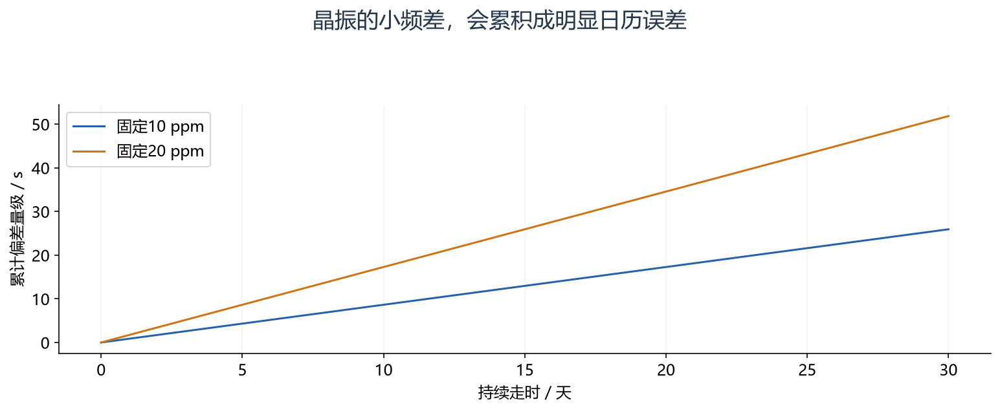

怎么看：图示固定频率偏差、没有校时的理想模型。20 ppm 每天约 1.728 s，30 天约 51.84 s；实际温度漂移可使曲线发生变化。

### 3. 原始计数、Unix 时间与 C 的 time_t

RTC硬件只保存计数值，是否把0定义为1970年、产品上线时刻或其他纪元，是软件约定。
若采用Unix秒，应统一UTC语义，显示时再进行时区转换。把当前本地日历直接当UTC存入会造成固定偏移。

32位无符号秒计数的总跨度约136年；C库若使用32位有符号time_t，其可表示范围又不同，常见2038年边界来自软件类型而不是RTC突然停止。
系统要同时检查硬件计数范围、转换库类型和通信字段宽度，不应只测当前年份。

### 4. gmtime、localtime、mktime 如何配对

gmtime把时间戳解释为UTC日历，localtime按库的本地时区规则解释，mktime通常把本地日历转成时间戳。
嵌入式库的时区配置与支持程度需要实测/查文档，不能把桌面环境行为自动套进裸机库。

如果自己固定加八小时，又让localtime按UTC+8再转换，就可能叠加两次时差。
夏令时、历史规则或跨地区产品更不能只用一个常数处理所有日期；只面向固定UTC+8的教学示例应明确这个范围。

<!-- extended:timezone -->

#### 机制补图：UTC存储只做一次时区转换，避免重复加8小时

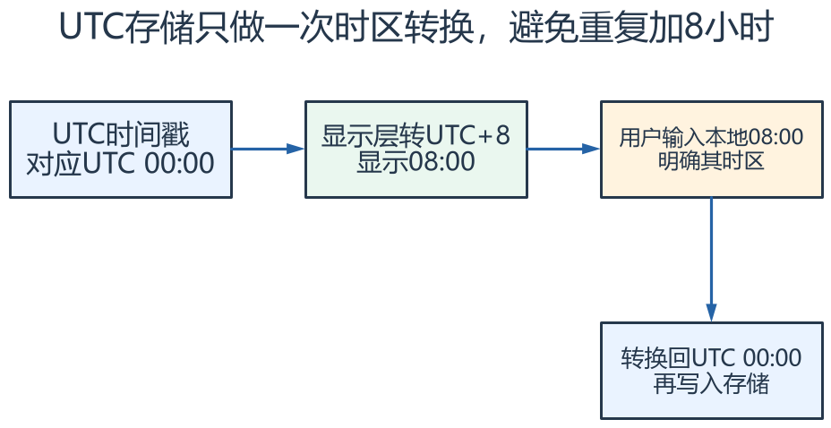

**读图方法与条件：** 这是同一时刻的表示转换。若先把时间戳加8小时，再交给已配置UTC+8的localtime，就会显示16:00。time_t宽度、时区库配置和夏令时规则需要明确。

[放大查看 SVG](course-note-assets/extended/15/timezone.svg) · [可编辑结构图](course-note-assets/extended/15/extended.drawio)

<!-- /extended -->

### 5. 高低寄存器读取要防跨界

F1的RTC计数由相关高低部分提供。若读高位后计数恰好跨低16位回绕，再读低位，就可能拼成不属于同一时刻的数。
应采用芯片驱动建议的一致读取顺序，必要时比较高位前后是否变化，变化则重新读取。

APB访问还涉及同步状态，例如RSF；配置写入涉及等待RTOFF、进入/退出配置模式等要求。
因此“两个寄存器各读一次”与“读到一致时间点”不是同一件事，暂停调试时看起来稳定也不足以验证边界。

<!-- extended:rtc-torn-read -->

#### 机制补图：分开读高低半字时，可能拼出从未存在的时间

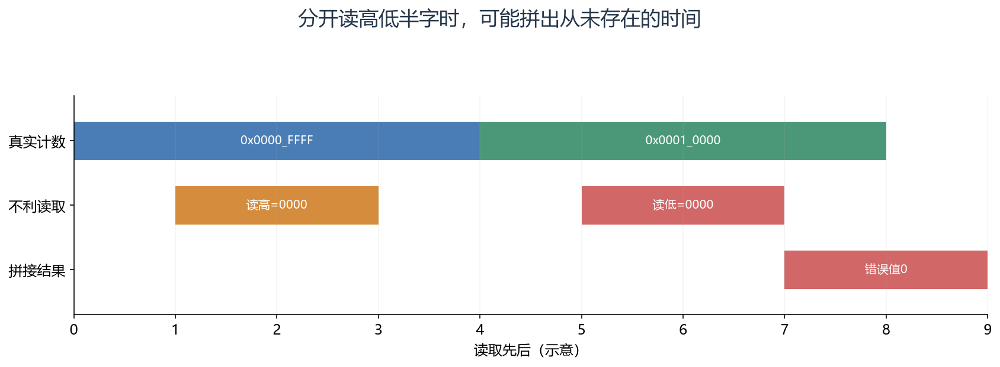

**读图方法与条件：** 高低交界时旧高位+新低位造成错误。常用一致读法是高1→低→高2，若高1≠高2就重读；还需按F1 RTC规定处理APB同步。

[放大查看 SVG](course-note-assets/extended/15/rtc-torn-read.svg)

<!-- /extended -->

### 6. 只在首次初始化时设置时间

启动时先检查后备域标记、时钟配置和数据有效性，再决定是首次配置、维持已有时间还是执行明确授权的校时。
无条件复位备份域会清掉需要保留的状态；仅凭magic存在也不够，还要确认版本与计数合理性。

产品应区分“时间已设置”“硬件正在走时”“当前绝对时间可信”三个状态。
电池曾耗尽后再次上电，RTC也可能能正常每秒加一，但绝对日期已经不可信，应等待用户或网络校时。

<!-- extended:rtc-trust -->

#### 机制补图：启动时先判断时间可信度，再决定是否初始化

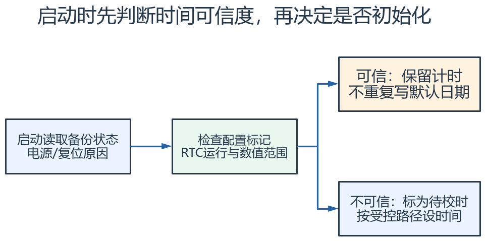

**读图方法与条件：** 右上和右下是两种判断结果；校时成功后记录来源与可信状态。标记存在不代表晶振始终正常，业务可结合掉电原因、时间范围和外部校时验证。

[放大查看 SVG](course-note-assets/extended/15/rtc-trust.svg) · [可编辑结构图](course-note-assets/extended/15/extended.drawio)

<!-- /extended -->

### 7. 校时可能让墙上时间向后跳

用户或网络校时会改变绝对时间。若用RTC日历时间计算通信超时，向后校时可能让超时迟迟不到，向前校时可能让大量等待立即过期。
超时和周期调度宜采用单调时间基准；RTC负责绝对时间显示、日志标记与相关日程。

需要日志顺序可同时保存单调序号/运行时间与UTC时间，明确校时前后的可信度。
小偏差渐进调整与直接跳变各有取舍；采用何种策略取决于业务允许的时间连续性，而不是固定只有一种“准确”做法。

<!-- extended:wall-monotonic -->

#### 机制补图：日志时间可以校准，超时计时应避免随之倒退

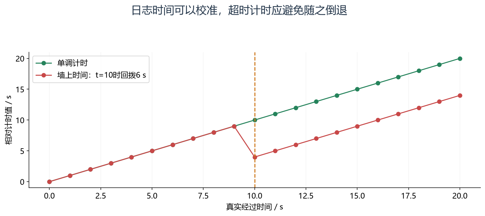

**读图方法与条件：** 图用相对秒数省略日期。墙上时间回拨后可能重复，若用它计算通信超时，等待会被延长。单调计时还要正确处理计数回绕和低功耗期间的补偿。

[放大查看 SVG](course-note-assets/extended/15/wall-monotonic.svg)

<!-- /extended -->

### 8. 闹钟、中断与低功耗唤醒是三层

设置闹钟比较值只完成RTC内部条件，后续请求/事件通路、相关屏蔽和目标低功耗模式的允许唤醒源还要配置。
唤醒后也可能需要恢复系统时钟与外设，才能完成业务动作。

如果计数值已经超过目标、目标恰好落在配置过程中、旧闹钟标志未清，行为与“写一个未来时间就等着”不同。
要定义重设闹钟、取消闹钟与遗漏日程的策略，尤其跨复位时应先判定过去事件是否补执行。

### 9. 测试矩阵与计算题

除了每秒走一次，还应覆盖：分钟/日/月切换、闰年2月29日、时区往返转换、计数低位回绕、主电断开、备份域复位和向前/向后校时。
每项记录原始秒数与日历显示，分清错误发生在计数、转换还是界面。

题：晶振快10 ppm，30天大约快多少？
解：30×86400×10×10^−6=25.92 s，仅用于固定偏差估计。
题：把本地08:00存为UTC08:00，再按UTC+8显示会怎样？
解：显示为16:00，问题在时间语义，而非硬件分频。

## 资料与验证边界

入门部分依据同目录课件；深入部分补充官方资料与明确条件下的推导。课件中的产品宣传、历史软件版本、
简化图和典型性能不直接作为当前板卡、固件或全部同系列产品的保证。
本次只整理资料与图文，没有编译固件、下载或进行硬件实测。
实际接线、电平、寄存器差异和模块命令须核对所用器件资料。

## 图源与后续修改

[可编辑概念图](course-note-assets/15/concepts.drawio)；
[本课图源目录](course-note-assets/15)。
概念图同时提供 JSON、SVG 与 PNG，专项图提供 SVG 与 PNG。
SVG 可放大查看；JSON 可用 diagramry 重绘。课件原图保持原貌，
不把截图中的文字改写成未经证实的新协议。

[专项图重绘脚本](course-note-assets/_source/redraw.py) ·
[图源使用说明](course-note-assets/_source/图源说明.md)

## 继续学习与资料对照

[跨外设工程专题](<01_跨外设工程专题与阅读索引.md>) · [资料来源与适用范围](<02_图文笔记资料来源与适用范围.md>)

深入部分包含官方机制对照和教学推导；模块命令、电气接线与固件差异按资料页的边界处理。

[深入配图源目录](course-note-assets/deep/15) · [深入图重绘脚本](course-note-assets/_source/deeper_diagrams.py)
