# 2-4-4_STM32基础 - 电源管理：图文笔记

[直接阅读深入学习](#deep-study) · [跨外设工程专题](<01_跨外设工程专题与阅读索引.md>)


低功耗要先决定停掉哪些时钟和电源，再决定靠什么唤醒，以及唤醒后保留了哪些状态。板级耗电也要一起测。

[返回学习导航](<00_单片机基础图文笔记导航.md>) · [打开原课件](<2-4-4_STM32基础 - 电源管理.pdf>)

## 阅读范围

原课件共 8 页；阅读定位：P1–3 供电与电压监测；P4 时钟降频；P5–7 Sleep、Stop、Standby；P8 小结。
图中卡片用于拆分概念，编号是阅读顺序；卡片之间不自动表示时间或因果。
重绘时序与数值例子会在图旁写出前提，不代表开发板实测。

## 一、电源域、频率与板级电流分开看

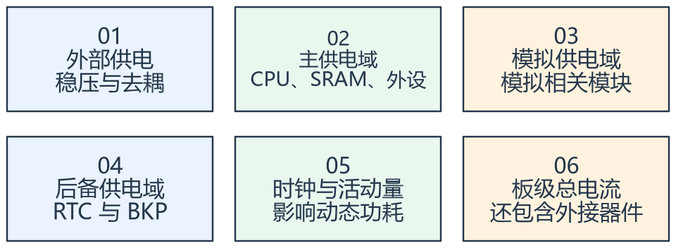

看图方法：先读每张卡片的关键词，再用下文核对它们之间的关系。

降低 CPU 频率可减少部分动态功耗，但不能保证整块开发板的电流按比例降低。LED、稳压器静态电流、外接模块和调试器都可能占明显比例。

先确定要测 MCU 电流还是整板电流，再明确测点与供电路径。调试连接可能改变低功耗行为和电流，应记录测试条件。

PVD 用来检测供电越过阈值，提供预警事件。它不是储能器件；若没有足够供电余量与时间，不能保证来得及进行任意 Flash 写入。

## 二、三种模式用保留状态来记

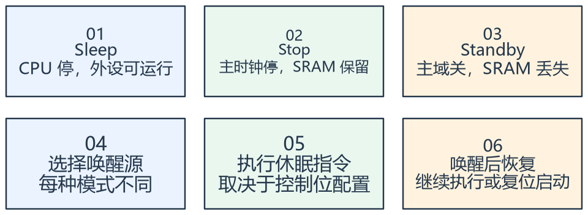

看图方法：先读每张卡片的关键词，再用下文核对它们之间的关系。

Sleep 通常停止 CPU，外设可继续工作，具体还受时钟门控配置影响。Stop 停止主要高速时钟，SRAM 和寄存器可保留，但外设工作能力要逐项确认。

F1 从 Stop 唤醒后通常先由 HSI 作为系统时钟，需要按配置恢复 HSE/PLL 与系统频率，不能直接认为所有波特率和定时周期仍与睡前相同。

Standby 关闭主要供电域，SRAM 丢失，唤醒通常走复位启动路径；RTC/BKP 等是否保留依赖后备域条件。模式越深，恢复路径越需要设计。

## 三、进入和退出都需要顺序

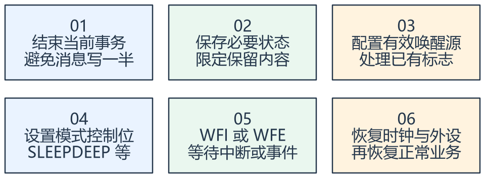

看图方法：先读每张卡片的关键词，再用下文核对它们之间的关系。

WFI/WFE 是等待指令，实际进入哪种模式取决于内核与 PWR 控制位。不能看到 WFI 就直接判断程序进入了 Standby。

进入前检查串口是否真正发送完成、Flash 是否忙、唤醒标志是否已处理；否则可能丢消息、立即醒来，或睡下后无法按预期唤醒。

退出后先恢复必要时钟和接口，再让业务处理新消息。对 Standby 应通过复位原因与备份标记识别启动场景，对丢失的 SRAM 状态重新初始化。

## 专项图解

### F103 低功耗：先比较保留内容与恢复路径

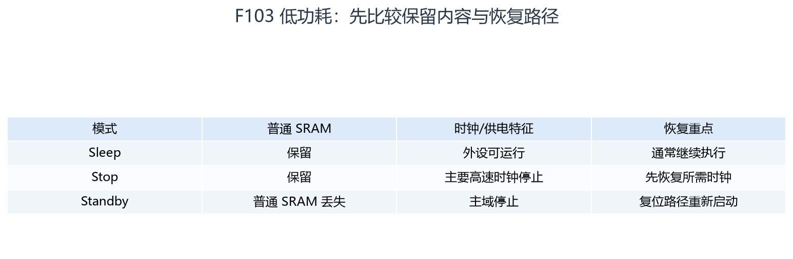

按列比较模式，不能只记功耗大小。RTC/BKP 是否继续取决于后备域供电和时钟；外设能否唤醒还需查对应模式的允许来源。

### 睡前与醒后各有必须完成的工作

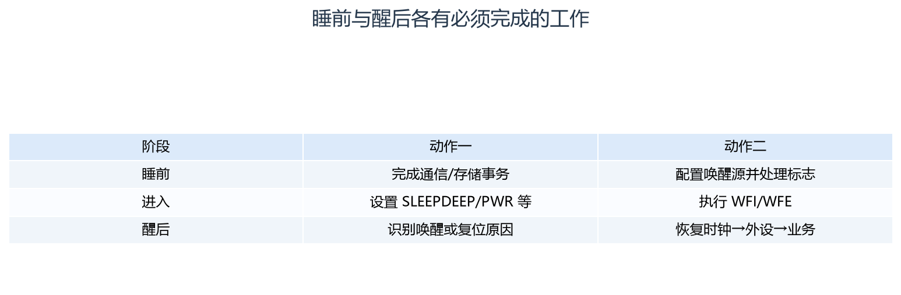

从上向下看执行过程。WFI/WFE 是等待指令，模式取决于控制位；Stop 唤醒和 Standby 重启的恢复流程不同。

### Stop 唤醒后：时钟恢复先于依赖它的业务

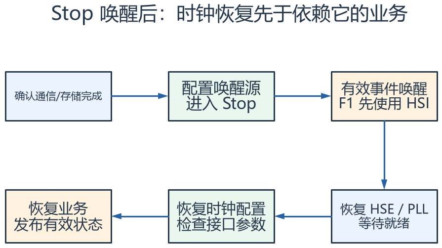

从左上沿箭头读一整次睡眠过程。唤醒后恢复哪些时钟由应用决定；等待就绪也必须有超时与降级处理，不能无期限停在恢复流程。

## 对照课件原图

下面图片截取自同目录原 PDF；页码为 PDF 阅读器中的物理页序号。
先读重绘解释，再用原图核对硬件框图或课件细节。

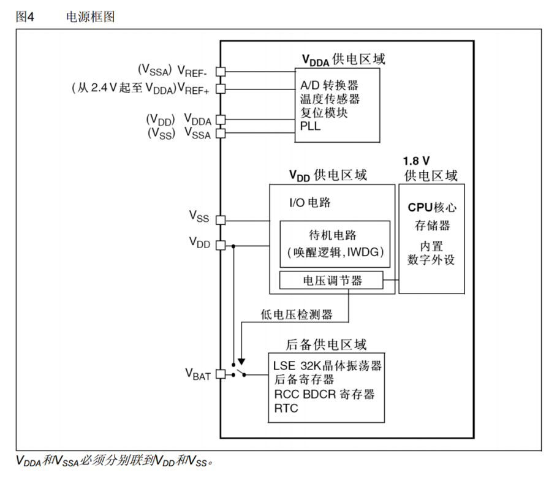

课件 P2（原图局部）：沿不同供电域区分正常供电与后备保持。

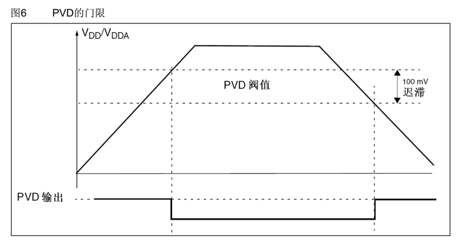

课件 P3（原图局部）：阈值曲线表示检测行为，剩余可用时间还依赖实际供电下降过程。

## 关键概念速查

| 名称 | 应该记住什么 |
|---|---|
| Sleep | 浅睡眠，恢复较简单 |
| Stop | 保留 SRAM，需关注时钟恢复 |
| Standby | 深度断主域，按复位路径重新建立现场 |

## 具体例子

串口需要 72 MHz 配置下的时钟关系：从 Stop 醒来若系统暂用
HSI，而软件仍按旧时钟假设使用波特率或延时，通信与时间都可能异常。先恢复时钟再恢复业务。

## 实验时如何验证

- 先确认可用唤醒源，再逐个模式验证恢复路径。
- 对照睡前醒后的时钟、波特率、变量与复位原因。
- 记录测点、LED、外设、调试连接和供电条件，实测整板电流。

## 常见误区

- 休眠后不亮 LED，不等于 MCU 电流已达到手册最低值。
- 任意中断都能唤醒所有模式的说法不成立。
- PVD 中断发生不保证任意存储事务都有时间完成。

## 自测：先想答案，再展开

<details>
<summary>Standby 后普通变量还在吗？</summary>

普通 SRAM 内容不能按保留处理。

</details>

<details>
<summary>Stop 唤醒第一件事为什么常是恢复时钟？</summary>

主时钟状态发生变化，后续外设和时间参数依赖它。

</details>

<a id="deep-study"></a>

## 深入学习：用能量、恢复时间和状态保留选择低功耗模式


本节目录：

- [1. 不只比较最低休眠电流，要比较一个业务周期的能量](#deep-1)
- [2. 计算一个电池采样节点的平均电流](#deep-2)
- [3. Sleep、Stop、Standby 对软件现场的影响](#deep-3)
- [4. 睡眠入口存在“检查完无任务，事件恰好到来”的竞态](#deep-4)
- [5. 唤醒源需要一条完整可观察的通路](#deep-5)
- [6. 恢复也要有超时与降级](#deep-6)
- [7. PVD 预警不等于任意掉电写都来得及](#deep-7)
- [8. RTOS Tick 与低功耗时间补偿](#deep-8)
- [9. 测量为何容易被开发环境干扰](#deep-9)
- [10. 故障分析练习](#deep-10)

<a id="deep-1"></a>

### 1. 不只比较最低休眠电流，要比较一个业务周期的能量

周期能耗可以拆为工作、进入休眠、休眠与唤醒恢复。平均电流近似等于各阶段电流乘持续时间之和除以总周期。
更深模式虽然休眠电流低，进入/恢复开销可能更大，短暂空闲时不一定划算。

若浅睡电流为I1、深睡为I2，深睡额外恢复能量为E，则理想节能分界时间约为E/[V×(I1−I2)]。
这是固定电压与简化电流模型，实际还要纳入外部器件启动、时钟稳定和数据重建时间。

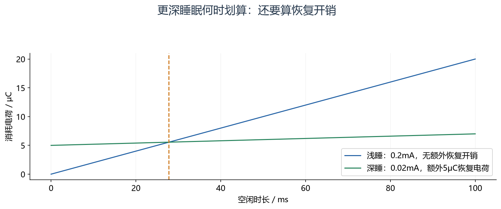

怎么看：比较同一空闲窗口的电荷消耗，并把恢复成本计入。图示参数下约 27.8 ms 才达到收支平衡，不是本开发板的测量值。

<a id="deep-2"></a>

### 2. 计算一个电池采样节点的平均电流

假设每秒工作10 ms，工作电流20 mA，剩余990 ms休眠电流20 μA，则平均约：

```text
Iavg = 20 mA × 0.01 + 0.020 mA × 0.99 ≈ 0.2198 mA
```

若整板稳压器、LED和传感器额外持续消耗1 mA，这个外围开销反而明显高于MCU循环平均值。
所以先测供电域，再优化占比最大的部分，比只把CPU再降一点频更有意义。
电池标称容量除以平均电流只是粗估，还需考虑转换效率、温度、自放电和截止电压。

<!-- extended:current-area -->

#### 机制补图：平均电流看曲线下面积：短时大电流也可能占主导

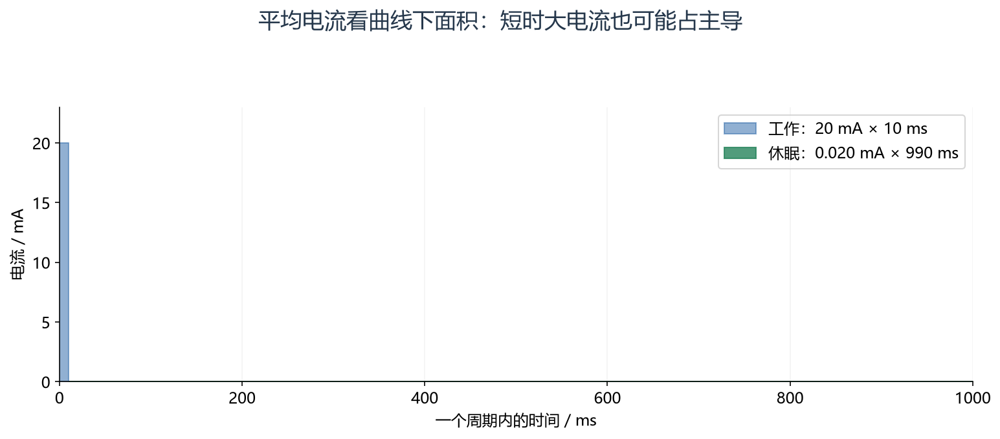

**读图方法与条件：** 平均电流=(20×10+0.020×990)/1000=0.2198 mA。图是理想两状态模型，工作只占1%时间却贡献大部分电荷；实际还要计入唤醒、无线发送、稳压器和板级静态电流。

[放大查看 SVG](course-note-assets/extended/16/current-area.svg)

<!-- /extended -->

<a id="deep-3"></a>

### 3. Sleep、Stop、Standby 对软件现场的影响

Sleep一般保留CPU/外设运行配置，CPU等中断/事件；Stop保留SRAM但主要高速时钟停止；Standby关闭主域并按复位路径恢复。
模式名不是完整规格，具体外设、时钟和允许唤醒源应逐项看F103手册。

Stop醒后若先使用HSI，原先依赖PLL的波特率、定时节拍和软件延时假设可能暂不成立。
Standby后则不能直接使用旧SRAM中的任务句柄或队列，以为程序从原位置继续；应重新初始化并借助合法保留状态识别原因。

<a id="deep-4"></a>

### 4. 睡眠入口存在“检查完无任务，事件恰好到来”的竞态

程序先判断没有工作，再执行等待指令，如果事件恰好落在二者之间，可能导致立即醒来、延迟处理或错过由软件维护的睡眠条件。
可靠设计要结合中断屏蔽、内核等待指令语义、pending状态与RTOS提供的休眠机制建立不可丢事件的交接。

不能随意照抄“关中断→WFI→开中断”而不理解该内核的唤醒条件和屏蔽恢复顺序。
有RTOS时应优先分析其tickless/Idle移植流程，避免业务任务绕过调度器直接停止系统时钟。

<!-- extended:sleep-race -->

#### 机制补图：检查完无任务之后，进入睡眠之前仍有事件窗口

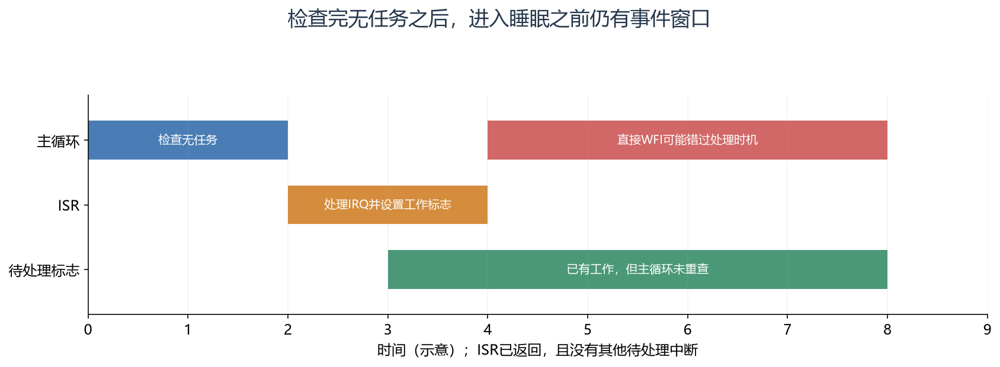

**读图方法与条件：** 事件不一定丢失，可能是软件已经置标志却又入睡，直到下次唤醒才处理。应使用已验证的原子检查/睡眠序列或RTOS低功耗入口，不能盲目关中断后WFI。

[放大查看 SVG](course-note-assets/extended/16/sleep-race.svg)

<!-- /extended -->

<a id="deep-5"></a>

### 5. 唤醒源需要一条完整可观察的通路

以外部输入或RTC为例，物理条件→外设检测→事件/中断屏蔽→内核/PWR允许条件→退出低功耗→恢复时钟→执行业务。
某个引脚能在Run状态触发IRQ，不等于它能从Standby唤醒。

旧标志未清可能造成睡下即醒；唤醒边沿在设置前已经发生可能使程序等不到下一次事件。
因此睡前处理标志必须服务于明确策略：保留应处理的事件，清理已经消费的历史状态，再原子地交接进入条件。

<a id="deep-6"></a>

### 6. 恢复也要有超时与降级

唤醒后按需要开启HSE/PLL、等待稳定、配置Flash等待周期与总线分频、切换系统时钟，再恢复依赖它们的外设。
等待失败不能无限挂起，也不能继续把软件SystemCoreClock变量当作已经真实切换的证据。

可根据需求保留HSI运行、限制功能并上报时钟故障，或进入受控恢复路径。具体降级需由产品需求决定，教学笔记不能替未知项目指定最终安全状态。
串口发送、ADC采样和定时输出应在相关时钟确认后再恢复，防止首帧或首周期异常。

<!-- extended:wake-fallback -->

#### 机制补图：唤醒恢复时钟，也必须给失败分支一个出口

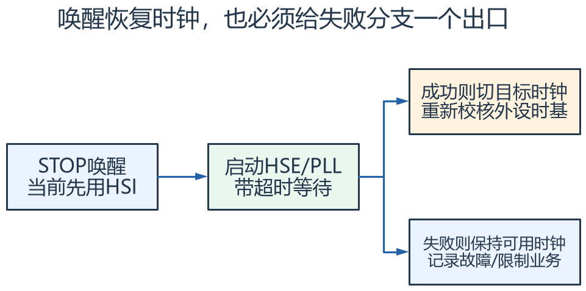

**读图方法与条件：** 右上与右下分别代表成功和失败结果，之后发布恢复状态。降级时USART、PWM、SysTick等配置必须匹配实际时钟；无法满足时序的业务应拒绝启动或进入项目定义的安全状态。

[放大查看 SVG](course-note-assets/extended/16/wake-fallback.svg) · [可编辑结构图](course-note-assets/extended/16/extended.drawio)

<!-- /extended -->

<a id="deep-7"></a>

### 7. PVD 预警不等于任意掉电写都来得及

PVD检测供电阈值，只提供事件；能否完成保存取决于剩余电压、下降速度、系统电流和存储最坏操作时间。
理想电容可释放能量约E=0.5C(Vstart²−Vend²)，电容容量也有公差与ESR，实际还可能有其他负载共同消耗。

如果Flash正在擦除且所需时间超过可用窗口，临时收到PVD中断不能自动补救。
更可靠的思路是平时保持可恢复记录、减少最后必须保存的数据，再用受控储能与试验验证，而不是把完整事务全部押在最后瞬间。

<!-- extended:pvd-energy -->

#### 机制补图：掉电后是否来得及保存，需要比较能量与执行时间

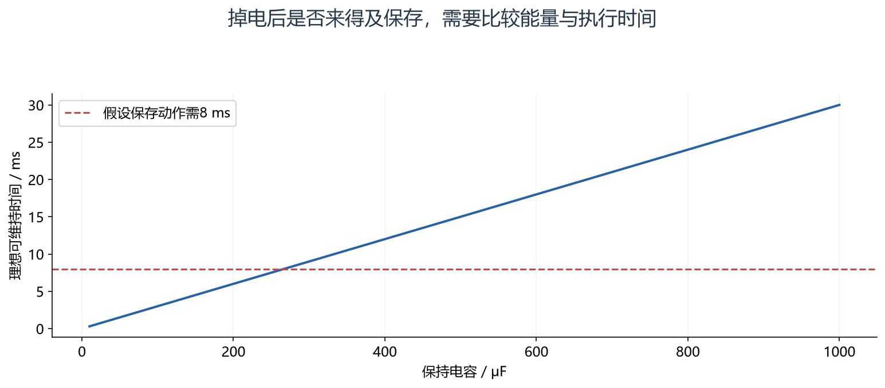

**读图方法与条件：** 用E=½C(V高²−V低²)，假设3.3→2.7 V、负载功率60 mW，100 μF理想约3 ms，1000 μF约30 ms。忽略ESR、泄漏和电源转换损耗，仅作能量估算；PVD门限、最低编程电压和最坏擦写耗时还需逐项满足。

[放大查看 SVG](course-note-assets/extended/16/pvd-energy.svg)

<!-- /extended -->

<a id="deep-8"></a>

### 8. RTOS Tick 与低功耗时间补偿

普通每毫秒SysTick会频繁唤醒CPU。tickless可在预计空闲期间减少Tick中断，再按低功耗计时源补偿已过时间。
它并不自动让所有驱动具备Stop兼容性，也不自动恢复PLL或维持所有软件定时器的精确墙上时刻。

需要检查低功耗时钟是否继续运行、最大休眠长度、早醒补偿、Tick量化、任务超时和外设活动约束。
如果业务任务持有资源或外设正忙，电源管理服务可能需要拒绝深睡，而不是只因Idle得到CPU就断时钟。

<a id="deep-9"></a>

### 9. 测量为何容易被开发环境干扰

调试器可能保持某些时钟或通过接口反向供电，串口转接器、模块信号线、LED和稳压器也可能形成额外路径。
万用表平均读数可能看不见短时唤醒尖峰，应根据目标使用电流波形或积分测量。

测试记录至少写模式、供电电压、测点、外设状态、调试连接、唤醒周期和测量带宽。
只写“测得几μA”没有条件，无法与手册典型值公平比较，也无法复现。

<a id="deep-10"></a>

### 10. 故障分析练习

| 现象 | 检查方向 |
|---|---|
| 一执行休眠就立即回来 | 历史挂起、唤醒源持续有效、进入条件竞态 |
| 唤醒后串口乱码 | 实际系统时钟、PCLK和BRR是否匹配 |
| Standby后变量丢失 | 这是主域断电的预期，需重新初始化 |
| 低功耗电流远大于手册 | 整板负载、调试/回灌、时钟与引脚状态 |

能否休眠、睡多久、靠谁唤醒、恢复到何种可信状态，应由一个明确的电源管理接口协调，而不是每个业务模块各自调用WFI。

## 资料与验证边界

入门部分依据同目录课件；深入部分补充官方资料与明确条件下的推导。课件中的产品宣传、历史软件版本、
简化图和典型性能不直接作为当前板卡、固件或全部同系列产品的保证。
本次只整理资料与图文，没有编译固件、下载或进行硬件实测。
实际接线、电平、寄存器差异和模块命令须核对所用器件资料。

## 图源与后续修改

[可编辑概念图](course-note-assets/16/concepts.drawio)；
[本课图源目录](course-note-assets/16)。
概念图同时提供 JSON、SVG 与 PNG，专项图提供 SVG 与 PNG。
SVG 可放大查看；JSON 可用 diagramry 重绘。课件原图保持原貌，
不把截图中的文字改写成未经证实的新协议。

[专项图重绘脚本](course-note-assets/_source/redraw.py) ·
[图源使用说明](course-note-assets/_source/图源说明.md)


## 继续学习与资料对照

[跨外设工程专题](<01_跨外设工程专题与阅读索引.md>) · [资料来源与适用范围](<02_图文笔记资料来源与适用范围.md>)

深入部分包含官方机制对照和教学推导；模块命令、电气接线与固件差异按资料页的边界处理。

[深入配图源目录](course-note-assets/deep/16) · [深入图重绘脚本](course-note-assets/_source/deeper_diagrams.py)
