# 2-5-1-STM32基础 - FreeRTOS：图文笔记

[直接阅读深入学习](#deep-study) · [跨外设工程专题](<01_跨外设工程专题与阅读索引.md>)


FreeRTOS 在单核上调度多个任务，让阻塞等待与优先级协作管理 CPU。重点是任务状态、数据交接、ISR 边界和资源生命周期。

[返回学习导航](<00_单片机基础图文笔记导航.md>) · [打开原课件](<2-5-1-STM32基础 - FreeRTOS.pdf>)

## 阅读范围

原课件共 52 页；阅读定位：P1–9 概念、调度与状态；P10–16 移植；P17–27 任务；P28–30 ISR 与临界区；P31–47
通信同步；P48–51 内存。
图中卡片用于拆分概念，编号是阅读顺序；卡片之间不自动表示时间或因果。
重绘时序与数值例子会在图旁写出前提，不代表开发板实测。

## 一、单核任务轮流占用 CPU

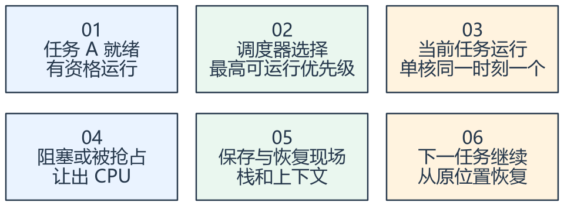

看图方法：先读每张卡片的关键词，再用下文核对它们之间的关系。

单核上的并发体现为交错执行，并不是多个任务同时执行指令。较高优先级任务就绪后是否立即抢占，取决于抢占配置与临界区等条件。

FreeRTOS 通常是任务优先级数值越大越高；Cortex-M 的 NVIC 优先级编码则通常数值越小越高。两者属于不同调度层，不能用同一个方向去理解。

每个任务保存自己的栈与上下文，任务函数通常是循环结构，不能随意 return。Idle
在无其他可运行任务时执行，动态删除的清理等功能可能依赖它获得运行机会。

## 二、延时是进入阻塞，不是占住 CPU 空转

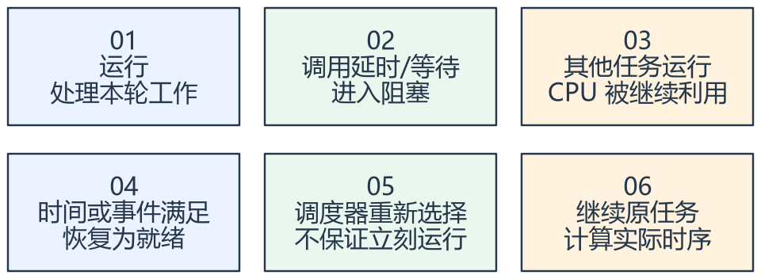

看图方法：先读每张卡片的关键词，再用下文核对它们之间的关系。

vTaskDelay 让任务阻塞一段 Tick，不是在任务里忙等。到期表示可以再次竞争运行，不保证绝对准点执行；更高优先级任务或中断仍可能延迟它。

周期任务用 vTaskDelayUntil 等基于上次计划时刻推进，较能避免“工作耗时 + 相对延时”的累计漂移。Tick
计数与毫秒转换应使用适配宏并注意粒度。

阻塞、挂起与删除是不同状态。suspend/resume 不适合当可靠的事件累计机制：事件到来时任务若尚未挂起，一次 resume
可能无法留下供后续消费的记录。

## 三、创建任务时同时预算栈与堆

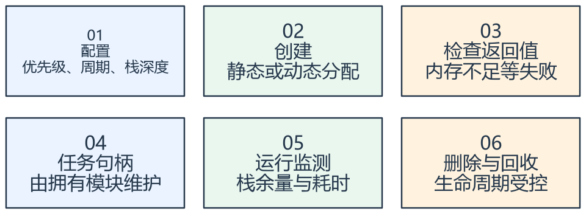

看图方法：先读每张卡片的关键词，再用下文核对它们之间的关系。

xTaskCreate 的栈深度一般以 StackType_t 元素为单位，而不是字节。在 32 位 Cortex-M 常见实现中，256 个元素对应约
1024 字节，但要以当前 port 定义为准。

动态创建消耗 FreeRTOS 管理的堆，静态创建由应用提供任务控制块和栈。创建返回失败时不能继续把未建立的句柄当作有效对象。

heap_1 不释放；heap_2 支持释放但不合并相邻空闲块；heap_3 使用库 malloc/free；heap_4 合并相邻空闲块；heap_5
支持多个内存区域。具体支持与限制以实际 FreeRTOS 版本为准。

可把周期、优先级和栈预算看作 cfg，任务句柄和执行阶段看作 ctx，采集快照或队列消息看作 data，创建、请求、快照获取等 API 看作 ops。

## 四、队列传递数据，信号量表示同步

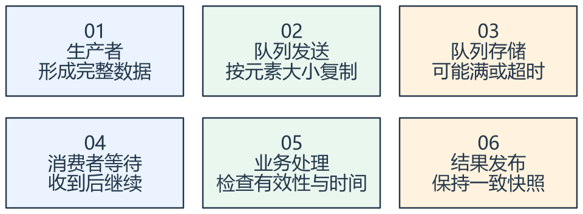

看图方法：先读每张卡片的关键词，再用下文核对它们之间的关系。

队列按创建时的 item size 复制一项数据。发送结构体时复制结构体内容；发送指针时只复制地址，不会自动延长所指对象生命周期。

不能把函数即将返回的局部变量地址放入队列，再指望接收方稍后安全使用。指针消息需要明确缓冲池、所有权和释放责任。

二值信号量适合同步，计数信号量适合累计有限数量的资源/事件。队列满、等待超时和消费者速度不足要有策略，不能静默丢失关键数据。

## 五、互斥锁、事件组与通知如何选择

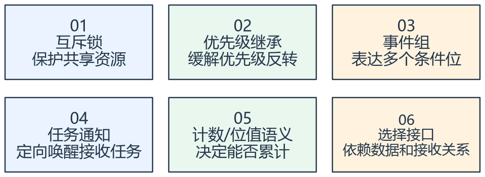

看图方法：先读每张卡片的关键词，再用下文核对它们之间的关系。

互斥锁带资源拥有关系，并支持优先级继承，适合保护共享设备或数据。二值信号量通常没有互斥锁的优先级继承语义，不能机械替换。

事件组表示条件位。例如网络已连接和传感器已就绪可作为两个条件；同一位反复 set 并不会自动累计成多次事件。

任务通知适合直接通知已知接收任务，可表达计数、位或数值等模式，但其语义要选择明确。需要多接收者或传递复杂负载时，应重新评估接口。

临界区宜短，不能在里面做长耗时计算或阻塞等待。互斥锁只能在适合的任务上下文使用，不能放进 ISR。

## 六、中断与软件定时器各有执行上下文

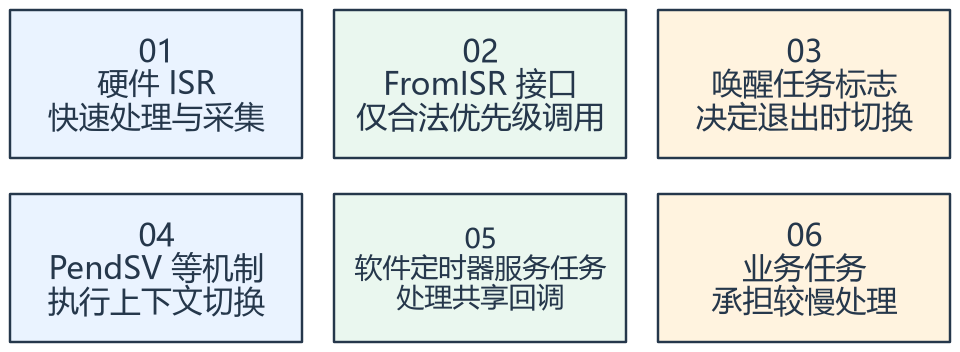

看图方法：先读每张卡片的关键词，再用下文核对它们之间的关系。

ISR 中使用专门的 FromISR API，并满足当前 port 的中断优先级限制。不能在中断里调用可能阻塞的普通队列或信号量等待函数。

中断通知更高优先级任务就绪后，可按 port 约定请求切换。真正切换现场通常由 PendSV 等底层机制处理；不要把业务 ISR 自己写成调度器。

软件定时器回调运行在定时器服务任务中，多个回调共享这个执行上下文。长时间阻塞一个回调会拖延其他定时器和命令，宜把实际工作交给业务任务。

调试验证关注最坏执行时间、栈余量、队列积压、超时与恢复。能创建任务和串口打印，不足以证明实时性目标已经满足。

## 专项图解

### 单核调度：同一时刻只有一项占用 CPU

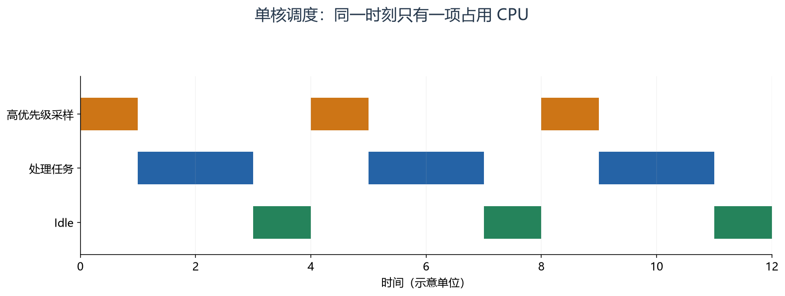

沿横轴看采样任务周期性就绪并运行，随后阻塞，处理任务得到 CPU；都不就绪时才运行 Idle。每行空白代表未运行，不足以单独判断它处于阻塞还是就绪。

### 相对延时会累积工作耗时，周期等待按计划推进

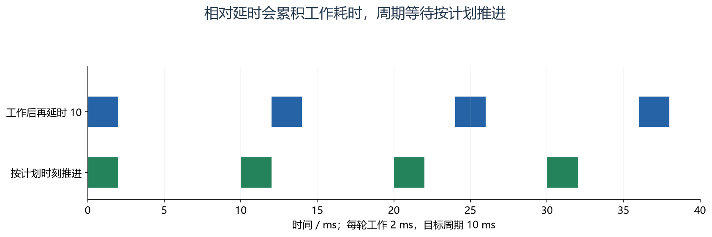

上行每轮工作 2 ms 后再等待 10 ms，起点是 0、12、24、36；下行以 10 ms 计划间隔推进，起点是
0、10、20、30。图未考虑抢占和超期，实际仍需处理任务错过计划的情况。

### 队列按元素复制：数据值和地址的生命周期不同

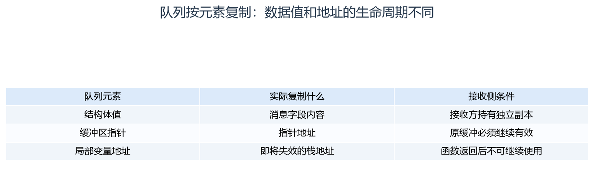

先确认 item size 与发送对象。指针队列需要约定分配、拥有、释放和复用时刻；排队成功不会自动使原对象延长寿命。

### 根据数据关系选择同步机制

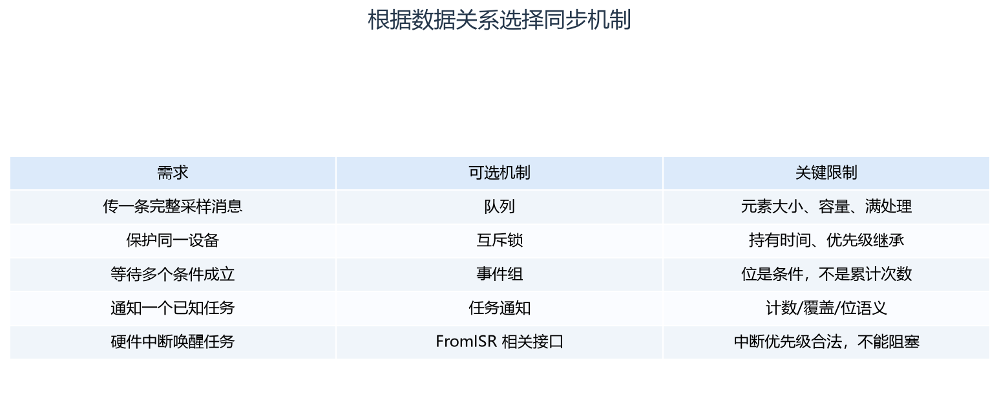

按“需求 → 机制 → 检查点”阅读。没有一种 API 同时替代所有通信、同步、保护和数据所有权责任。

### 任务状态：就绪只是获得运行资格

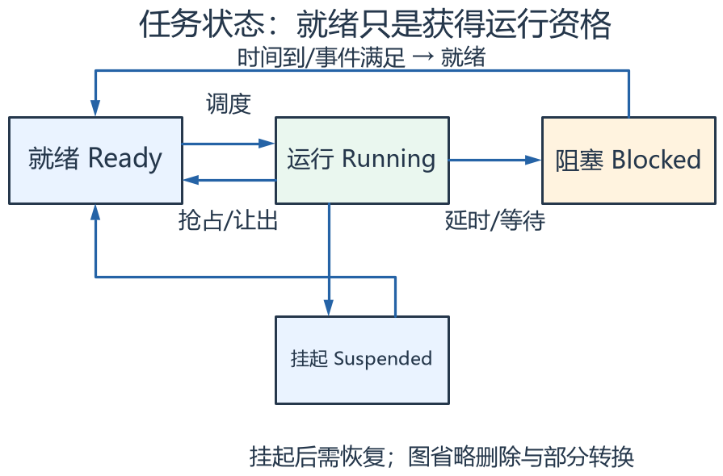

先看上排：运行任务等待资源或延时后阻塞，条件满足回到就绪，再由调度器决定何时运行。挂起是另一种受控状态，resume 不能代替可靠事件计数。

### 优先级继承：让持锁者尽早完成并释放资源

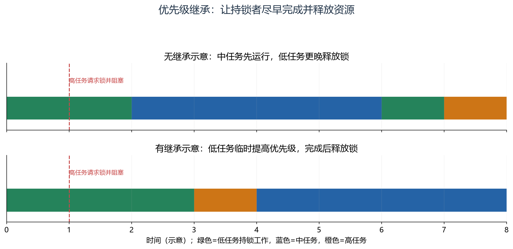

高任务在时刻 1
需要低任务持有的锁。无继承时，中任务可进一步推迟低任务；互斥锁继承高优先级后，低任务较早完成释放。图为简化单锁示例，继承不能消除持锁过久或所有死锁问题。

## 对照课件原图

下面图片截取自同目录原 PDF；页码为 PDF 阅读器中的物理页序号。
先读重绘解释，再用原图核对硬件框图或课件细节。

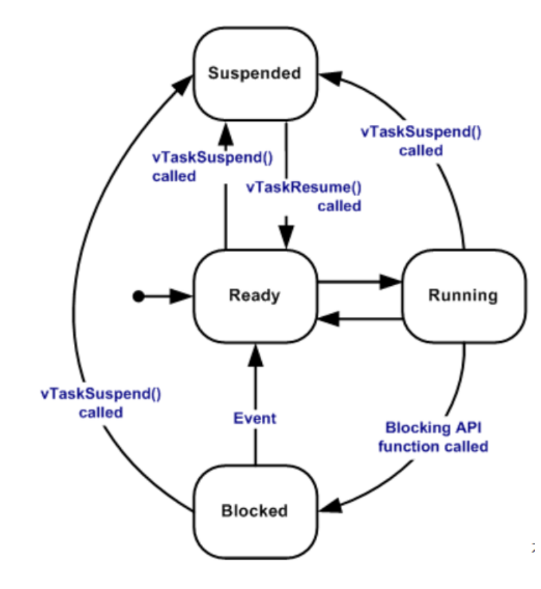

课件 P7（原图局部）：沿状态转换观察哪个动作使任务重新具有运行资格。

## 关键概念速查

| 名称 | 应该记住什么 |
|---|---|
| 任务/ISR | 调度执行实体与硬件事件上下文 |
| 队列/通知/信号量 | 传递数据或唤醒同步 |
| 互斥锁/临界区 | 不同边界下保护共享资源 |
| 软件定时器 | 由服务任务执行的定时回调 |

## 具体例子

采样任务每 10 ms 形成带时间戳和有效性的结构体，发送到队列；控制任务阻塞等队列，收到后处理并发布结果。ISR
仅记录硬件事件并通知采样任务，显示任务用较低优先级更新界面。

## 实验时如何验证

- 核对任务周期、优先级、栈和 FreeRTOSConfig.h。
- 检查创建返回值、栈余量、队列满、超时和缓冲所有权。
- 用时间戳或跟踪测量抢占、周期偏差与最坏执行时间。
- 分别检查 ISR 与定时器回调上下文，验证合法 API 与不阻塞要求。

## 常见误区

- 提高优先级不能解决任务内部无限忙等造成的全部问题。
- 队列复制指针不等于复制指针指向的数据。
- 任务解阻塞不等于已经得到 CPU。
- 软件定时器回调不能作为任意长任务执行入口。
- 中断优先级限制必须查实际 FreeRTOSConfig.h 与 port，不能猜通用数值。

## 自测：先想答案，再展开

<details>
<summary>256 的任务栈深度一定是 256 字节吗？</summary>

不是，通常是 256 个 StackType_t 元素。

</details>

<details>
<summary>事件组同一位设置十次会保存十次吗？</summary>

不会，它表达位条件，不是天然的事件计数队列。

</details>

<details>
<summary>为什么 ISR 不能等待互斥锁？</summary>

ISR 不属于可被普通任务阻塞和持锁的任务上下文。

</details>

<a id="deep-study"></a>

## 深入学习：从“会创建任务”到可分析的并发系统


本节目录：

- [1. 调度器到底在选择什么](#deep-1)
- [2. Cortex-M3 的切换现场在哪里](#deep-2)
- [3. 栈深度、堆容量与静态分配](#deep-3)
- [4. Tick 是离散计时，不是无限精确的毫秒](#deep-4)
- [5. 截止时间要看最坏响应，而不只看平均利用率](#deep-5)
- [6. 队列复制与指针所有权](#deep-6)
- [7. 二值信号量、计数信号量、互斥锁与通知](#deep-7)
- [8. 优先级反转与死锁是不同问题](#deep-8)
- [9. FromISR 与中断优先级编码](#deep-9)
- [10. 临界区、挂起调度器和互斥锁的边界](#deep-10)
- [11. 软件定时器与事件组不保存所有历史](#deep-11)
- [12. heap_1～heap_5 选择不只是“哪个能free”](#deep-12)
- [13. 设计一条完整采集控制链](#deep-13)
- [14. 假设约束下的设计练习](#deep-14)
- [15. 调试需要哪些可复现证据](#deep-15)

<a id="deep-1"></a>

### 1. 调度器到底在选择什么

任务至少包括入口、参数、栈、控制块、优先级与状态。调度器从可运行任务中按策略选择执行者，不负责替应用自动决定采样、协议和控制的依赖。
抢占配置决定更高优先级任务就绪后能否抢占；时间片配置影响同优先级任务的轮转条件，不能笼统说“每个任务固定分一毫秒”。

高优先级任务若永不阻塞且持续就绪，低优先级任务可能一直得不到CPU。
taskYIELD通常只让其他有资格的任务参与选择，不保证让低优先级任务运行；让出与阻塞是两件事。

<a id="deep-2"></a>

### 2. Cortex-M3 的切换现场在哪里

常见移植中，任务运行使用PSP，异常处理使用MSP。异常机制保存基本帧，port代码再保存/恢复必要寄存器和任务栈指针。
SysTick等提供节拍，PendSV通常承担延后的上下文切换，SVC用于启动等内核路径，具体以实际port为准。

因此每个任务栈要容纳本任务调用链与相关异常入栈，MSP也要容纳中断处理与嵌套。
只监测某个任务的栈余量不能证明主中断栈安全；调用层次、局部大数组与printf都可能改变峰值。

<!-- extended:psp-msp -->

#### 机制补图：任务切换：硬件异常帧与软件保存寄存器分两段

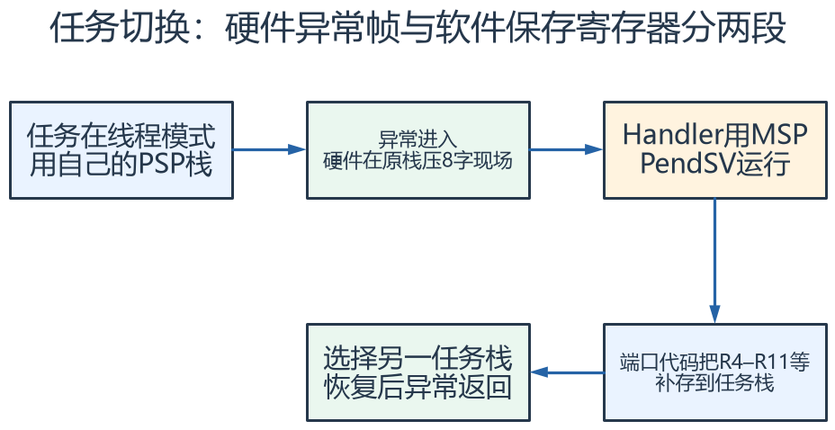

**读图方法与条件：** 以典型Cortex-M3 FreeRTOS端口为机制示意。硬件帧为R0–R3、R12、LR、PC、xPSR，可能另有对齐；端口保存内容应以实际源码为准。MSP用于异常处理，不是所有任务共用一个PSP栈。

[放大查看 SVG](course-note-assets/extended/17/psp-msp.svg) · [可编辑结构图](course-note-assets/extended/17/extended.drawio)

<!-- /extended -->

<a id="deep-3"></a>

### 3. 栈深度、堆容量与静态分配

xTaskCreate的栈深度通常按StackType_t元素计，创建还消耗任务控制块等内存；配置堆大小不等于全部SRAM都给任务栈。
静态创建把内存来源交给应用，仍需保证对象生命周期、对齐与容量。
创建结果必须检查，不能在失败后继续使用未成功创建的句柄。

栈高水位反映测得路径下的最小剩余模式区域，不能证明未运行路径也安全，也不能排除任意越界写。
检测机制、填充值、优化、库函数与版本影响具体监测行为；最坏路径压力测试仍重要。

<a id="deep-4"></a>

### 4. Tick 是离散计时，不是无限精确的毫秒

configTICK_RATE_HZ决定Tick粒度。时间转Tick会发生取整，小于一个Tick的请求可能在某种转换后成为0。
vTaskDelay从调用时刻相对等待，实际阻塞时间受调用相位影响；解阻塞后还需参与调度。

vTaskDelayUntil/xTaskDelayUntil这类接口按计划唤醒点推进，减少工作耗时累计漂移；若任务长期超期，则需要明确跳过、追赶或报错策略，不能只换一个API就解决负载过高。
测量微秒级脉宽通常应使用硬件定时器，而不是把Tick频率无止境提高。

<!-- extended:tick-phase -->

#### 机制补图：同样延时5个Tick，真实等待会随调用相位变化

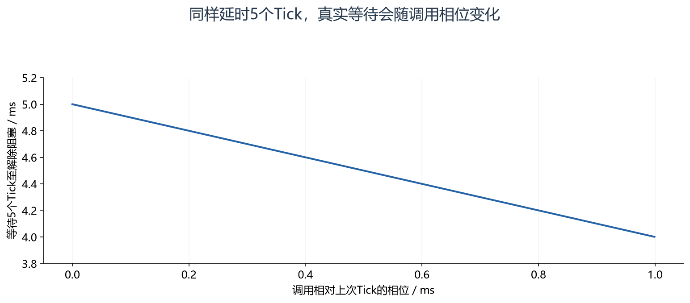

**读图方法与条件：** 假设Tick=1 ms，无挂起调度等额外因素，等待时间大致落在4到5 ms。这只是解除阻塞时刻，变为Ready后何时运行还取决于调度和更高优先级工作。pdMS_TO_TICKS的取整还会进一步影响短延时。

[放大查看 SVG](course-note-assets/extended/17/tick-phase.svg)

<!-- /extended -->

<a id="deep-5"></a>

### 5. 截止时间要看最坏响应，而不只看平均利用率

对简单固定优先级、可抢占且满足分析假设的周期任务，可用响应时间迭代：

```text
Ri = Ci + Bi + Σ ceil(Ri / Tj) × Cj
```

Ci是本任务最坏执行时间，Bi是受共享资源等影响的阻塞，上式求和覆盖更高优先级任务j。
迭代到稳定且Ri不大于截止时间，才在相应假设内说明可满足；中断、抖动、非周期事件和非抢占区还需纳入模型。

例：高任务C=1 ms、T=5 ms，低任务C=2 ms、无额外阻塞。
低任务响应估计从2开始，得到2+ceil(2/5)×1=3 ms，再算仍3 ms。
若低任务截止时间为2.5 ms，它就不能因为总利用率看起来不高而被判定满足。

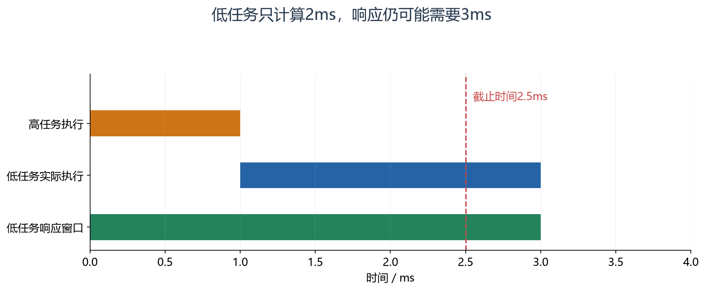

怎么看：低优先级任务自身只执行 2 ms，但等待高任务后响应达到 3 ms，超过图示 2.5 ms 截止时间。执行时间不包含全部等待时间。

<a id="deep-6"></a>

### 6. 队列复制与指针所有权

队列按元素大小复制，不解析字段。发送结构体可获得内容副本，结构体内若还有指针，指向对象仍没有被深拷贝。
发送指针时必须定义分配者、当前拥有者、释放者、失败后回收和是否允许复用。

局部数组地址、DMA正在覆盖的缓冲地址、提前释放的堆地址进入队列，均可能形成生命周期错误。
队列满时若选择丢弃，应区分丢最新、覆盖旧快照或报告关键消息丢失；不能所有业务都采取同一种策略。

按平均生产速度计算容量不够。若每10 ms产生一项，消费者最长阻塞100 ms，至少考虑这期间约10项加既有积压和突发余量。
长期生产高于消费速率，容量再大也只推迟溢出。

<!-- extended:queue-pointer -->

#### 机制补图：队列复制指针值，不会延长局部数组的生命周期

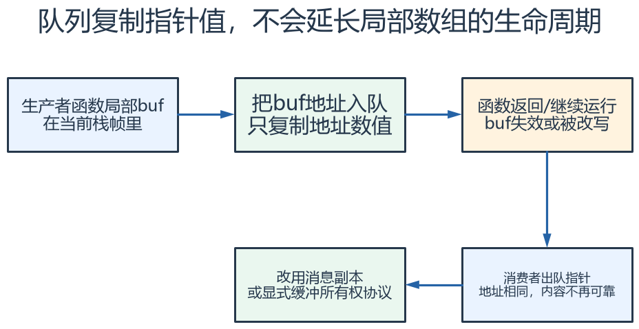

**读图方法与条件：** 即便入队成功也不保证指向内容安全。若队列项本身是结构体，结构体中的指针仍是浅拷贝；缓冲池应明确归还时机、超时和失败回收路径。

[放大查看 SVG](course-note-assets/extended/17/queue-pointer.svg) · [可编辑结构图](course-note-assets/extended/17/extended.drawio)

<!-- /extended -->

<a id="deep-7"></a>

### 7. 二值信号量、计数信号量、互斥锁与通知

二值信号量可表示一次可消费同步状态，多个事件可能合并；计数信号量保留有限计数；队列保存具体内容。
任务通知可高效定向到接收任务，但计数、位设置与覆盖语义不同，必须按业务选择；通知数组等能力还与版本配置有关。

互斥锁管理有拥有者的共享资源，并支持优先级继承。继承减少某类优先级反转，不会自动防死锁，也不能使长时间持锁没有影响。
递归互斥锁要求配套API与对称释放，不能用来掩盖不清晰的调用层次。

<a id="deep-8"></a>

### 8. 优先级反转与死锁是不同问题

低任务持锁，高任务等待，中任务却抢占低任务，造成高任务间接受中任务影响，这是典型优先级反转。
继承让持锁低任务临时提高优先级，有助于尽快释放资源，但持锁代码本身仍需有界。

两个任务分别持有A、B再等待对方锁，则可能形成死锁。可用统一锁顺序、减少嵌套、受控超时与重新设计所有权来避免。
超时不是自动回滚：已执行的外设动作和已修改的数据需要明确恢复策略。
不要在持有共享串口锁时阻塞等待一个也需要该锁才能产生的应答。

<!-- extended:abba-deadlock -->

#### 机制补图：ABBA死锁：两个任务各持有一个锁，再等待对方

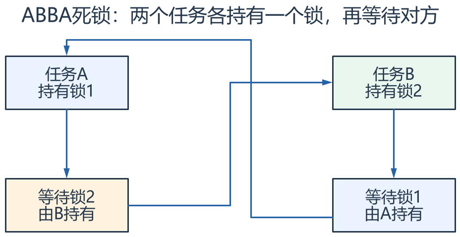

**读图方法与条件：** 沿依赖箭头形成等待环。提高任务优先级或启用优先级继承不会解除环；应统一加锁顺序、减少嵌套或设计有回滚的超时策略。

[放大查看 SVG](course-note-assets/extended/17/abba-deadlock.svg) · [可编辑结构图](course-note-assets/extended/17/extended.drawio)

<!-- /extended -->

<a id="deep-9"></a>

### 9. FromISR 与中断优先级编码

ISR不可像任务一样阻塞，应使用明确支持的FromISR接口，并满足该Cortex-M port的中断优先级约束。
NVIC数值小通常更紧急，FreeRTOS任务优先级数值大通常更高，这两套方向不要混用。

例如芯片实现4位，逻辑优先级5直接写到硬件高位编码会涉及左移4位；CMSIS接口与configMAX_SYSCALL_INTERRUPT_PRIORITY可能使用不同表示。
必须按实际工程区分逻辑值、已移位值和分组，不能把十进制5直接放到所有配置位置。

最紧急的一些ISR可不受内核临界区屏蔽，但相应不能调用内核API。
唤醒更高优先级任务后按port要求提出退出中断时切换请求；只调用通知而忽略必要切换，可能增加响应延迟。

<!-- extended:nvic-encoding -->

#### 机制补图：F103四位优先级：逻辑值5写入硬件高四位0x50

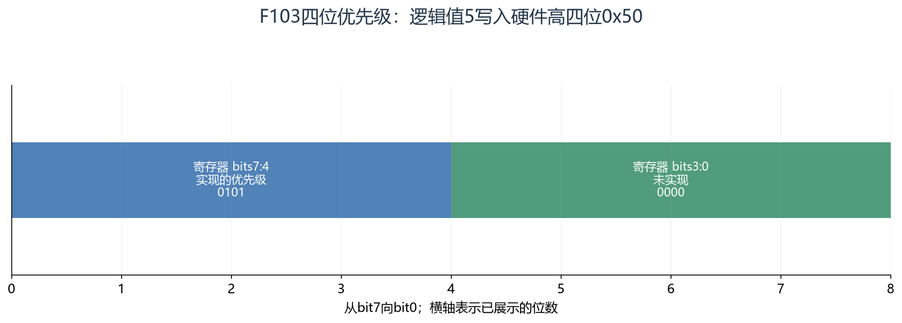

**读图方法与条件：** 假设__NVIC_PRIO_BITS=4，CMSIS NVIC_SetPriority传逻辑值5，硬件字节是5<<4=0x50。逻辑数字越小紧迫性越高。FreeRTOS屏蔽阈值宏有逻辑值与已左移值两类，不能互相直接替换。

[放大查看 SVG](course-note-assets/extended/17/nvic-encoding.svg)

<!-- /extended -->

<a id="deep-10"></a>

### 10. 临界区、挂起调度器和互斥锁的边界

临界区通过port相关机制保护短访问，不适合长等待；挂起调度器主要限制任务切换，不自动阻止ISR修改共享对象。
互斥锁能阻塞任务等待资源，却不适用于ISR。

当ISR是写者、任务是读者时，单给任务加互斥锁没有保护ISR路径。
跨字段快照可以使用短临界区复制、版本检查或双缓冲，且仍需处理对象寿命与更新速率。
volatile只处理编译器访问问题，不构成这些同步机制的替代品。

<a id="deep-11"></a>

### 11. 软件定时器与事件组不保存所有历史

软件定时器回调由定时器服务任务执行，多个回调共享执行环境；长回调或阻塞会拖延其他定时器与命令。
启动/停止等操作可能通过命令队列交接，API返回与最终处理时刻要区分，并检查队列满等失败情况。

事件组表达位条件，可等待任意位或全部位，还涉及返回后是否清位。同一位设置10次不天然保留10个事件。
多个消费者等待同一组条件时也要理解具体唤醒/清除语义，不能把它当作给每个接收者独立积累的消息队列。

<!-- extended:timer-service -->

#### 机制补图：一个软件定时器回调耗时过长，会拖住同一服务任务的后续工作

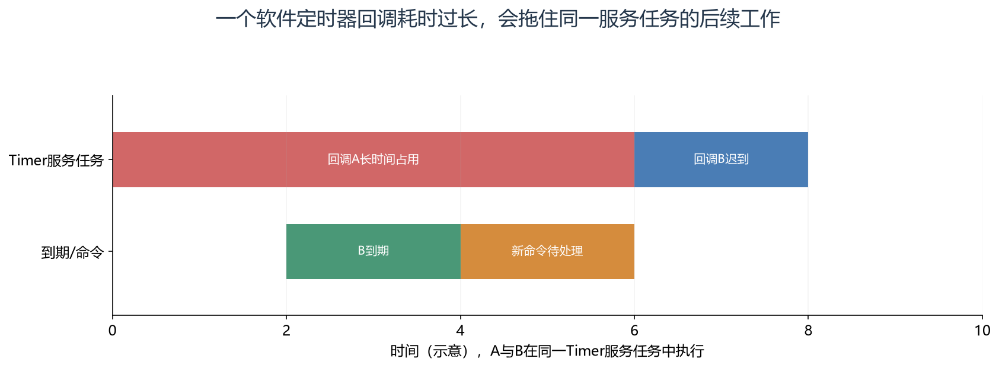

**读图方法与条件：** 回调A不会自动获得独立线程。长计算或阻塞会延迟其他回调和定时器命令处理；回调宜做短操作并通知业务任务，命令队列容量与失败返回也要检查。

[放大查看 SVG](course-note-assets/extended/17/timer-service.svg)

<!-- /extended -->

<a id="deep-12"></a>

### 12. heap_1～heap_5 选择不只是“哪个能free”

heap_1只分配不释放；heap_2可释放但不合并邻接空闲块；heap_3封装库malloc/free；heap_4合并空闲块；heap_5支持多个区域。
具体实现随版本确认，分配耗时、碎片、区域可访问性与错误处理都影响实时性。

启动时固定创建大部分对象有助于稳定资源需求，但不自动证明每个任务栈足够。
运行中动态分配要有失败策略与生命周期规则，不能在任意ISR里调用普通分配函数。
带DMA或特殊RAM的平台还要检查该区域是否能被目标外设访问。

<a id="deep-13"></a>

### 13. 设计一条完整采集控制链

硬件定时触发ADC→DMA完成块→ISR快速记录并通知→采集任务验证/换算→队列或一致快照→控制任务→驱动请求→输出反馈。
每段明确周期、优先级、输入输出、最大处理时间和阻塞行为。显示与日志通常不应反过来卡住关键控制链。

`cfg` 保存任务预算、阈值和队列容量；`ctx` 由模块维护句柄与内部阶段；`data` 发布带时间与质量的业务快照；`ops` 提供受控请求和获取接口。
外部模块不能为了方便直接修改别人的队列索引或状态机步骤。

<a id="deep-14"></a>

### 14. 假设约束下的设计练习

要求采样10 ms一次、控制拿到数据后2 ms内完成，显示100 ms刷新，日志允许延迟。
先预算采样与控制最坏耗时，再评估IRQ负载、锁阻塞与消息交接，之后确定优先级；不能仅按“看起来重要”随意填数字。

为采样/控制设置合理超时和旧数据策略；显示使用最新一致快照，日志通过有界队列异步处理。
若日志来不及，按定义丢弃非关键记录并计数，而不是让控制任务长期等待串口打印。

<a id="deep-15"></a>

### 15. 调试需要哪些可复现证据

| 目标 | 观察内容 |
|---|---|
| 栈安全 | 各任务高水位、MSP预算、最坏路径与异常现场 |
| 周期与截止时间 | 计划/实际启动、执行结束、中断与锁等待 |
| 通信无静默丢失 | 队列峰值、满计数、序号、过期与恢复 |
| 资源无死锁 | 锁顺序、持有时长、超时与资源拥有者 |
| 定时器服务正常 | 命令队列、回调执行时间与延迟 |

本节属于机制与分析方法，未检查某个具体FreeRTOS工程的配置和port，因此不把其中示例优先级、栈大小或计算结果写成当前产品已经验证的参数。

## 资料与验证边界

入门部分依据同目录课件；深入部分补充官方资料与明确条件下的推导。课件中的产品宣传、历史软件版本、
简化图和典型性能不直接作为当前板卡、固件或全部同系列产品的保证。
本次只整理资料与图文，没有编译固件、下载或进行硬件实测。
实际接线、电平、寄存器差异和模块命令须核对所用器件资料。

## 图源与后续修改

[可编辑概念图](course-note-assets/17/concepts.drawio)；
[本课图源目录](course-note-assets/17)。
概念图同时提供 JSON、SVG 与 PNG，专项图提供 SVG 与 PNG。
SVG 可放大查看；JSON 可用 diagramry 重绘。课件原图保持原貌，
不把截图中的文字改写成未经证实的新协议。

[专项图重绘脚本](course-note-assets/_source/redraw.py) ·
[图源使用说明](course-note-assets/_source/图源说明.md)


## 继续学习与资料对照

[跨外设工程专题](<01_跨外设工程专题与阅读索引.md>) · [资料来源与适用范围](<02_图文笔记资料来源与适用范围.md>)

深入部分包含官方机制对照和教学推导；模块命令、电气接线与固件差异按资料页的边界处理。

[深入配图源目录](course-note-assets/deep/17) · [深入图重绘脚本](course-note-assets/_source/deeper_diagrams.py)
