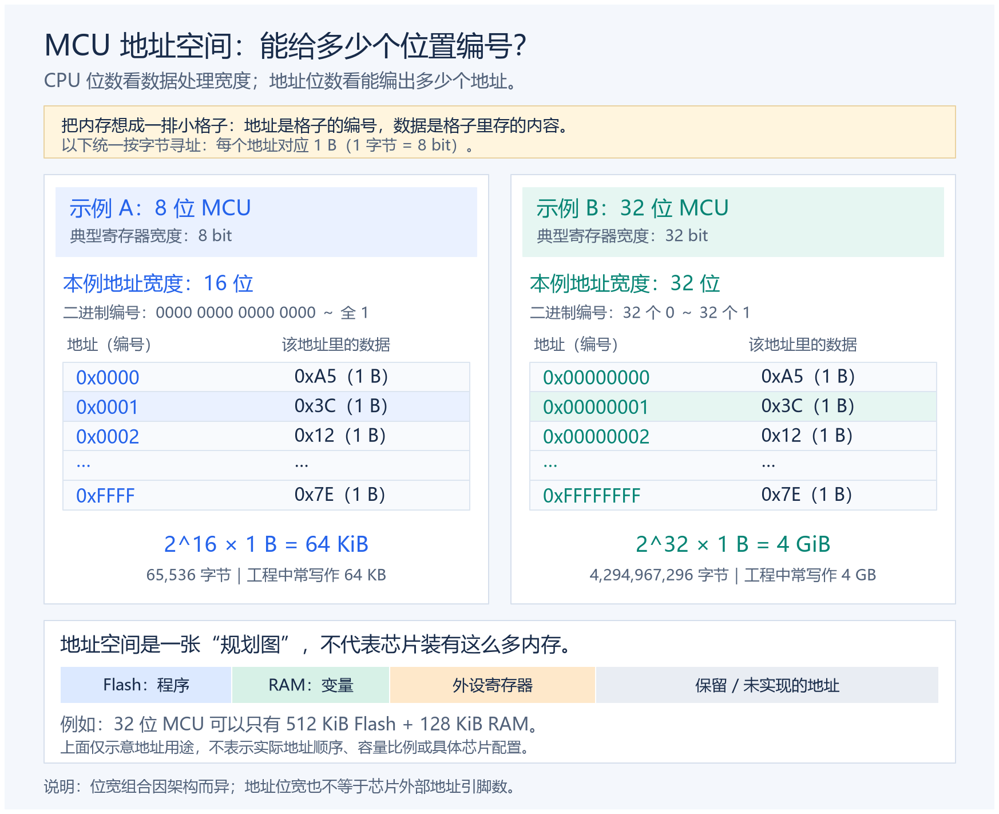

## 地址映射

### 引言
MCU的地址映射是系统设计当中的核心观念，它决定了mcu如何的去访问和管理资源。通过内存映射，处理器可以将物理设备的地址空间映射到自己的逻辑地址空间中

### 计算机架构总览
计算机分为两个架构，这两个架构是当前最主流的组成架构
当学习计算机组成原理的时候，肯定是学习了“冯洛伊曼架构”
后面介绍一下"哈佛架构"
- 冯洛伊曼架构：：指令和数据共享同一个存储空间和总线，结构简单但可能存在访问瓶颈
- 哈佛架构：指令和数据分别使用独立的存储空间和总线，可以并行访问，提高了系统性能

现代MCU通常采用修改版的哈佛架构，在保持独立总线的同时，允许在某些情况下跨越指令和数据内存边界。

### MCU中常见的内存类型

FALSH：存储程序代码，不可修改，通常为只读内存
SRAM： 静态随机存取存储器，用于存储运行时数据，速度快但容量小

#### 内存映射的基本概念

MCU的地址空间是处理器可以直接寻址的所有内存位置的集合。不同的MCU架构有不同的地址位宽，例如：

8位MCU：通常有16位地址线，可寻址64KB空间
32位MCU：通常有32位地址线，可寻址4GB空间
