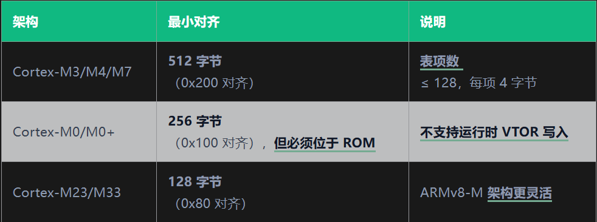

## 中断向量表
中断向量表是中断处理程序存放的起始地址，中断处理程序存放在ROM中，中断处理程序调用时，中断向量表存放的ROM地址会作为参数传递给中断处理程序。中断处理程序调用时，中断向量表存放的ROM地址会作为参数传递给中断处理程序。中断处理程序调用时，中断向量表存放的ROM地址会作为参数传递给中断处理程序。中断处理程序调用时，中断向量表存放的ROM地址会作为参数传递给中断处理程序。中断处理程序调用时，


### 中断向量表结构
Cotex-M的向量表固定在地址空间的其实位置：0x0000 0000 ，每个表项占4字节，存对应的异常或者中断处理程序的地址，对应的前16个表项是对应的系统异常，从16项开始(0x40)是中断处理程序

``` cpp
// 向量表定义（典型 startup_stm32f407xx.s 中的结构）
__attribute__((section(".isr_vector")))
void (* const g_pfnVectors[])(void) = {
    // 系统异常（前 16 项）
    (void*)&_estack,            // 0x0000: 主堆栈指针（MSP）初始值
    Reset_Handler,              // 0x0004: 复位入口
    NMI_Handler,                // 0x0008: NMI 中断
    HardFault_Handler,          // 0x000C: HardFault
    MemManage_Handler,          // 0x0010: MemManage Fault (M3/M4/M7)
    BusFault_Handler,           // 0x0014: Bus Fault
    UsageFault_Handler,         // 0x0018: Usage Fault
    // ... 省略第7~15项（SVCall、DebugMon、PendSV、SysTick等）

    // 外设中断（从第16项开始）
    WWDG_IRQHandler,            // 0x0040: 窗口看门狗
    PVD_IRQHandler,             // 0x0044: 电源电压检测
    TAMP_STAMP_IRQHandler,      // 0x0048: 入侵/时间戳
    // ... 后续按芯片外设排列
};
```
注意：这个estack是指向ram的栈顶的，作为栈的初始位置，因此虽然中断向量表的第一项是放在函数指针里面的。但不是实际的函数地址，而是MSP的初始值，即栈顶地址。
MSP的作用：
- 保存一些函数调用过程中的临时变量，返回地址和临时数据等
- 进入中断和异常时，cpu自动把现场压入msp当中
- 执行中断处理函数的时候使用MSP

### VTOR
vtor table register(向量表寄存器)，作用是指定中断向量的位置
>"发生中断的时候，去哪个地址查找中断函数入口"
默认情况下，CPU 通常从 0x00000000 查向量表：
``` text
0x00000000  初始 MSP
0x00000004  Reset_Handler
0x00000008  NMI_Handler
0x0000000C  HardFault_Handler
```
如果把 `SCB->VTOR = = 0x08010000U;`
那么以后查表的地址变为0x08010000U
``` cpp
0x08010000  初始 MSP
0x08010004  Reset_Handler
0x08010008  NMI_Handler
...

vtor位于系统控制块（SCB）中，地址0xE000ED08,位宽32位

``` cpp
VTOR (0xE000ED08)
位段：
[31:7]   TBLOFF — 向量表基地址（对齐到 128 字节，M0/M0+ 特殊）
[6:0]    保留
```

``` cpp
// 标准 CMSIS 定义
#define SCB_VTOR_ADDR        0xE000ED08UL
#define SCB_VTOR             ((volatile uint32_t *)SCB_VTOR_ADDR)

// 读取当前向量表地址
uint32_t vtor_value = SCB->VTOR;
printf("当前向量表地址: 0x%08X\n", vtor_value);
```
> 对齐要求



### 实战使用
在bootloader中设置中断向量表，更改为app的运行地址

``` cpp
// bootloader 跳转到 APP 的核心代码
#define APP_BASE_ADDRESS     0x08010000UL
#define APP_VTOR_OFFSET      ((uint32_t)APP_BASE_ADDRESS)

typedef void (*app_entry_t)(void);

void jump_to_app(void)
{
    uint32_t msp_value;
    app_entry_t reset_handler;

    // 步骤 1：验证 APP 固件完整性（CRC/SHA 校验）
    if (!verify_app_firmware(APP_BASE_ADDRESS)) {
        return;  // 校验失败，留在 bootloader
    }

    // 步骤 2：设置 VTOR 指向 APP 的向量表
    // ⚠️ 必须在使能任何中断之前设置！
    SCB->VTOR = APP_VTOR_OFFSET;
    __DSB();  // 确保写入完成
    __ISB();  // 刷新指令流水线

    // 步骤 3：从 APP 向量表加载 MSP 和 PC
    msp_value = *(volatile uint32_t*)APP_BASE_ADDRESS;
    reset_handler = (app_entry_t)(*(volatile uint32_t*)(APP_BASE_ADDRESS + 4));

    // 步骤 4：切换到 APP 的堆栈并跳转
    __set_MSP(msp_value);
    reset_handler();

    // 不会返回
}
```
注意事项：
1. 必须先设 VTOR，再加载 MSP 和跳转。如果跳转后才设 VTOR，跳转过程中发生的中断仍然使用 bootloader 的向量表。
2. 跳转前关闭所有 bootloader 中使能的中断。否则 APP 未初始化外设时触发中断 → 找不到 ISR → HardFault。
3. APP 的链接脚本必须指定正确的 VECT_TAB_OFFSET。

``` cpp
// 跳转前关闭中断的标准操作
void deinit_bootloader_peripherals(void)
{
    // 关闭全局中断
    __disable_irq();

    // 关闭 SysTick（bootloader 可能用了它延时）
    SysTick->CTRL = 0;

    // 复位所有外设时钟（可选）
    RCC->AHB1RSTR = 0xFFFFFFFF;
    RCC->AHB1RSTR = 0x00000000;

    // 清理所有待处理的中断
    NVIC->ICPR[0] = 0xFFFFFFFF;
    NVIC->ICPR[1] = 0xFFFFFFFF;
    // ... 按芯片 NVIC 行数扩展

    __DSB();
    __ISB();
}
```
常见的bug，用户在 bootloader 中开启了某个外设中断（比如定时器、UART），然后跳转到 APP。APP 的 VTOR 写晚了，结果中断一来，CPU 直接从 bootloader 的向量表里找 ISR——但 bootloader 的 ISR 已经不复用了，实际执行的是个空循环或者异常行为。

``` cpp
// ❌ 错误做法：中断使能后才设 VTOR
void jump_to_app_bad(void)
{
    // ... UART 中断已经在 bootloader 中使能了

    uint32_t msp = *(volatile uint32_t*)APP_BASE_ADDRESS;
    app_entry_t entry = (app_entry_t)(*(volatile uint32_t*)(APP_BASE_ADDRESS + 4));

    // UART 中断触发 → 走的还是 bootloader 向量表！
    __set_MSP(msp);
    entry();

    // ❌ VTOR 在跳转之后才设置——永远走不到这行
    SCB->VTOR = APP_VTOR_OFFSET;  
}
```
正确顺序： 禁止全局中断 → 关闭所有外设中断 → 设置 VTOR → 设置 MSP → 跳转 → APP 的入口代码自行重新使能需要的中断。


### 异常向量表搬移：RamFunc 模式
某些场景下，我们需要在运行时修改中断处理函数，比如动态注册 ISR。但向量表通常放在 Flash 中（只读），这时需要将向量表搬移到 RAM，然后让 VTOR 指向 RAM 地址。
``` cpp
// 在 RAM 中建立可写的向量表
#define VECTOR_TABLE_COUNT   128  // 具体数目由芯片决定
__attribute__((section(".ram_vector")))
uint32_t ram_vector_table[VECTOR_TABLE_COUNT];

void vtor_init_with_ram(void)
{
    // 步骤 1：复制 Flash 中的向量表到 RAM
    uint32_t flash_vtor = SCB->VTOR;
    uint32_t *src = (uint32_t *)flash_vtor;

    for (int i = 0; i < VECTOR_TABLE_COUNT; i++) {
        ram_vector_table[i] = src[i];
    }

    __DMB();  // 确保 RAM 写完成

    // 步骤 2：VTOR 指向 RAM 区域
    // ⚠️ RAM 地址也需满足对齐要求
    SCB->VTOR = (uint32_t)ram_vector_table;
    __DSB();
    __ISB();
}

// 运行时注册 ISR（仅对 RAM 向量表生效）
void vector_table_set_isr(int irqn, void (*handler)(void))
{
    int index = irqn + 16;  // IRQn 转向量表偏移
    ram_vector_table[index] = (uint32_t)handler;
    __DMB();  // 确保写完成
}
```

注意：搬移到 RAM 后，芯片从 Flash 执行代码，但中断来时从 RAM 找 ISR 地址。RAM 的访问速度快于 Flash（特别是带缓存的情况），但需考虑 RAM 空间开销（128 × 4 = 512 字节）。


### 总结
VTOR 是 Cortex-M 中断管理的核心寄存器，理解其结构、对齐要求和重定位原理，是编写 bootloader、实现固件升级、构建安全隔离系统的必备技能。记住三件事：对齐要检查、设 VTOR 要趁早、跳转前清中断，就能绕开绝大多数 VTOR 相关的坑。